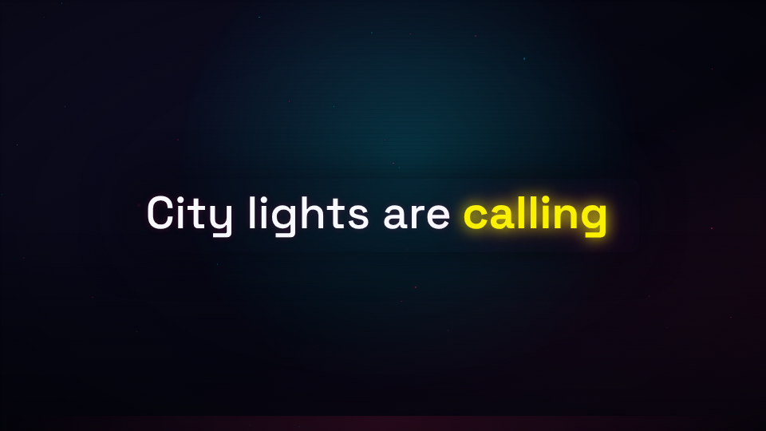

# coreslopper

An open-source, Claude Code-native workflow for making music videos and episodes of a series: from an idea and a song (or a script) to a validated storyboard and a finished Remotion render.

> **Status: work in progress.** The pipeline is being tested end to end. Stages, schemas, and provider integrations may still change. Treat it as an experiment, not a production tool.



Agent skills do the creative work (brief, treatment, storyboard, prompts). Tested scripts do the mechanical work (audio analysis, validation, budget checks, caching, rendering). Each shot can be motion graphics, an AI clip, real footage, or a mix. The pipeline runs on its own and stops only for budget, missing credentials, or a validation failure it cannot fix.

## Requirements

- Node.js 22+, Python 3.12+, [uv](https://docs.astral.sh/uv/), `ffmpeg`, and [Claude Code](https://claude.com/claude-code). `init` checks them and offers to install the missing ones.
- For AI visuals: a [fal.ai](https://fal.ai) key or a [Higgsfield](https://higgsfield.ai) credential. Without one, the mock provider renders placeholders. Video clips can also render locally in [ComfyUI](comfyui/README.md).
- A finished song: the mix, ideally its vocal stem, and the lyrics. coreslopper does not generate music.
- Optional: an NVIDIA GPU for faster lyric alignment. CPU works.

## 1. Create a workspace

A workspace is one folder that holds the workflow and all your video projects. Create it once:

```bash
npx coreslopper@latest init my-videos
cd my-videos
```

The wizard checks your tools, asks for provider keys (stored in `.env`, gitignored), and creates a first project. Every later command runs inside this folder. See [docs/onboarding.md](docs/onboarding.md) for all flags.

## 2. New project

coreslopper always starts from a finished song. Bring the mix, ideally its vocal stem, and the lyrics.

**Install the lyric aligner once per workspace** (WhisperX and Demucs, a large download):

```bash
(cd scripts/audio-analysis && uv sync --extra asr --extra stems)
```

**Start Claude Code and create the project:**

```bash
claude
```

```text
/new-video
```

Or start on the board: `npm run cli -- board`, **+ New** → Music video takes the project data, the lyrics with proposed section tags, the song and stem as uploads, and your references (mood boards, storyboards, concepts, footage, links); `/new-video <slug>` then starts with the brief ([docs/board.md](docs/board.md#new-projects)).

The `new-video` skill walks you through setup:

1. It asks for the title, artist, slug, budget (USD, mandatory), visual provider (`mock`, `fal`, or `higgsfield`), the sung language, and the song's rights, then creates the project.
2. It asks you to paste the lyrics and adds section tags (`[Verse 1]`, `[Chorus]`, …) for you to confirm.
3. It tells you where to put the audio:
   - the mix at `projects/<slug>/audio/song.wav`,
   - the vocal stem at `projects/<slug>/audio/stems/vocals.wav`.

   WAV goes straight in; `song.mp3`, `vocals.flac`, and other formats with the same name are converted. Export both from the same session so they line up. The stem is optional, but it makes the lyric timing much more accurate. When you confirm, it runs `npm run cli -- import-song` to check the files and record them in `song.json`.
4. It grills you about the video and writes `brief.md` and `treatment.md` with you.

Higgsfield has no lip-sync yet. For lip-sync shots, add a `FAL_KEY` to `.env` and set `lipsync: fal` in `projects/<slug>/project.yaml` ([details](docs/providers.md)).

**Run the pipeline.** At the end, `new-video` offers to start it, or run it yourself:

```text
/video-next <slug>
```

It analyzes the song, builds the style and character bibles, writes and validates the storyboard, generates the assets, and renders `projects/<slug>/renders/` without further questions. If you stop halfway through setup, `/new-video <slug>` resumes where you left off.

Every character the pipeline builds lands in the workspace's character library. In your next video or series, pick it on the board (**Characters**, or the wizard's library step) or let the agent run `npm run cli -- character use <slug> <id>`: its sheet and references are copied into the project and the character bible builds on them instead of starting over ([docs/board.md](docs/board.md#characters)).

## 3. Review and fix

Watch the result in the board's **Review** tab (`npm run cli -- board`): step frame by frame along a timeline of sections and shots, write notes on a frame or a range, and send them to the agent with one click. `/video-next <slug>` then works through them, re-renders the preview, and answers every note on the board ([docs/board.md](docs/board.md#review)).

## 4. Release

The last stage, `qa-export`, builds the release package in `projects/<slug>/renders/release/`: every format, three thumbnails, three Shorts with covers, the song as WAV, the streaming cover, the Spotify Canvas, lyrics, and the texts for each platform (YouTube, Shorts, TikTok, Instagram, Spotify and the distributor, X, LinkedIn when the song suits it, and your microsite). It also plans a **release calendar** for the project: when what goes online where.

**Open the board** to publish from its release view:

```bash
npm run cli -- board                          # http://127.0.0.1:4848
```

Its production view shows every project and series in the workspace while they are made: stages, budget, the generation queue, the art director's reviews, renders, and the command to type next in Claude Code. `docker compose up -d` runs the board in a container on any system, with the watchdog that posts approved releases and reports stalled stages and finished renders ([docs/board.md](docs/board.md)).


- One tab per platform: which file goes where (with previews), every text with a copy button and a counter against the platform's limit, the settings to check (AI label, related video, cover), and where each post links to.
- Tick off what you posted and paste its live URL. The YouTube URL then fills the link in the X and LinkedIn texts and the microsite data. Your progress is saved in `projects/<slug>/review/release-status.json`.
- The calendar view shows the dates of all your projects; **Calendar as .ics** imports them into your calendar app.

**Release with one click.** **Approve release** on the board hands the release to the autopilot: every post a platform API allows goes out at its calendar time without you logging in. That covers the Instagram Reels, the feed post and the announcement story, X with media and the link, LinkedIn, the YouTube uploads a day ahead, TikTok drafts, the Spotify link in the description, and your microsite. The board shows what is still yours: switching the YouTube video public until Google audited your API project, a Premiere, the release-day story, the distributor and Spotify for Artists. Set it up once:

```bash
npm run cli -- publish-auth youtube        # and tiktok, x, linkedin, instagram: each optional
npm run cli -- release-timer install       # runs release-run every 5 minutes
```

Your computer has to be on at the posting times; a post it missed waits for you on the board. Setup per platform, costs (X bills per post), and limits: [docs/publishing.md](docs/publishing.md#release-autopilot).

**Set your release rules once** in `config/release-schedule.yaml` (copy [templates/channel/release-schedule.yaml](templates/channel/release-schedule.yaml)): release weekday and times, your time zone, lead times for the distributor and the Spotify pitch, the Short slots, posting times, and holidays. Every new project takes the next free slots, so two songs never share a Friday or a Short slot. Set `release.release_date` in `project.yaml` to fix a project's date; until then the calendar's date is a proposal.

**Projects from before the calendar**, or songs that are already out: run `/release-backfill <slug>` in Claude Code. It asks what is published, writes the missing texts, plans the open slots, and marks the past as done.

Uploading stays yours: the board tells you what to post, and `publish` can upload to YouTube and TikTok as private videos or drafts ([docs/publishing.md](docs/publishing.md)). What each platform accepts and why: [docs/release-platforms.md](docs/release-platforms.md).

## Series and episodes

Besides music videos, coreslopper makes episodes of a series from a script instead of a song. A **series** is a folder in `projects/` like every video, beside its episodes, with its canon: bible, style, characters, sets, reference images and voices, and an episode plan. Each **episode** is its own project that reads this canon and builds its audio from `script.yaml`: generated or recorded takes per line, ambience per scene, and English subtitles.

A workspace from before series moved into `projects/` runs `npm run cli -- migrate-layout` once ([docs/onboarding.md](docs/onboarding.md#updating-a-workspace)).

**Create the series once:**

```text
/new-series
```

The `new-series` skill asks for the title, slug, series budget (USD, mandatory), master format, and providers, then grills you into the bible, characters, sets, and episode plan. It generates the character and set references and the reference voices through the series budget. The series budget covers the canon and every episode's budget.

**Create each episode:**

```text
/new-episode
```

The `new-episode` skill asks for the series, episode number, slug, and episode budget, creates the project (formats, providers, and brand come from the series), and grills you into `script.yaml`. Characters and sets come from the canon; if the story needs a new one, add it to the series first.

**Run the pipeline** as for a music video:

```text
/video-next <slug>
/series-status <series>
```

`/video-next` generates the takes, mixes the episode track, then storyboards, generates, and renders. To use your own recordings, put them at `projects/<slug>/audio/lines/<line-id>.wav` and run `npm run cli -- import-takes <slug>` before the `voice-track` stage. Review and fix pass work as above. Details and the manual commands: [docs/pipeline.md](docs/pipeline.md#episodes).

## Everyday commands

Run these inside the workspace.

| Command | What it does |
|---|---|
| `npm run cli -- status <project>` | Stages, spend, and the next step. |
| `npm run cli -- validate <project>` | Check timing, storyboard, style, and characters. |
| `npm run cli -- render <project> --format 16x9` | Render a format (`16x9`, `9x16`, `1x1`). |
| `npm run cli -- board` | The workspace's page: production status of every project and series, and the release view with files, texts, settings, and the calendar of all projects. |
| `npm run cli -- calendar <project>` | Plan or show a project's release calendar (`--replan`, `--done-until <date>`). |
| `npm run cli -- release-run --plan` | What the release autopilot posts when, and what needs you. |
| `npm run cli -- release-timer install` | Run the release autopilot every 5 minutes. |
| `npm run cli -- estimate --role image.keyframe --units 8 --project projects/<project>` | Check a cost against the budget. |
| `npm run cli -- doctor` | Check tools, fonts, Remotion, and keys. |
| `/video-next <project>` | Run all open stages in Claude Code. |
| `/video-next <project> --stage storyboard` | Rerun one stage. |
| `/video-status <project>` | Read-only status in Claude Code. |
| `/series-status <series>` | Canon, episodes, stages, and spend of a series. |

The pipeline is resumable: run `/video-next` again after a stop, and it continues where it left off. Generated assets are cached, so a rerun does not pay twice.

## Update the workspace

New releases bring new skills and fixes. Commit first, then update from inside the workspace:

```bash
git add -A && git commit -m "chore: before coreslopper update"
npx coreslopper@latest update
```

Your projects, `.env`, and your own edits to workflow files are kept. If a file you changed also changed upstream, the new version is saved next to it as `<file>.coreslopper-new`. Workspaces created with 0.1.0 need `update --force` once. Details: [docs/onboarding.md](docs/onboarding.md#updating-a-workspace).

## Learn more

| Topic | Document |
|---|---|
| Setup flags, credentials, updating, troubleshooting | [docs/onboarding.md](docs/onboarding.md) |
| What each stage does, and running one by hand | [docs/pipeline.md](docs/pipeline.md) |
| Series and episodes: stages, takes, re-timing | [docs/pipeline.md#episodes](docs/pipeline.md#episodes), [ADR 0016](docs/adr/0016-episode-projects.md) |
| fal.ai, Higgsfield, budgets, and model roles | [docs/providers.md](docs/providers.md) |
| Release board, calendar, and what each platform accepts | [docs/release-platforms.md](docs/release-platforms.md), [ADR 0028](docs/adr/0028-release-board-and-calendar.md) |
| The release autopilot: one approval, then the calendar posts by API | [docs/publishing.md](docs/publishing.md#release-autopilot), [ADR 0029](docs/adr/0029-release-autopilot.md) |
| Uploading to YouTube and TikTok | [docs/publishing.md](docs/publishing.md) |
| Local video clips with ComfyUI | [comfyui/README.md](comfyui/README.md) |
| Optional MCP servers | [docs/mcp.md](docs/mcp.md) |
| How it works inside | [docs/architecture.md](docs/architecture.md), [docs/adr/](docs/adr/) |
| Terms used everywhere | [docs/glossary.md](docs/glossary.md) |
| Why it is built this way | [docs/adr/](docs/adr/) |

## License

The workflow is [MIT](LICENSE). **Remotion, the renderer, is source-available, not open source:** it is free for individuals, non-profits, and companies with up to 3 employees; larger for-profit companies need a Remotion license. Make sure you hold the rights to the song before you publish a video. See [docs/THIRD_PARTY.md](docs/THIRD_PARTY.md).

## Contributing and security

To work on coreslopper itself, clone the repository and follow [CONTRIBUTING.md](CONTRIBUTING.md); it includes the demo project, which needs no API keys. Report vulnerabilities privately as described in [SECURITY.md](SECURITY.md).
