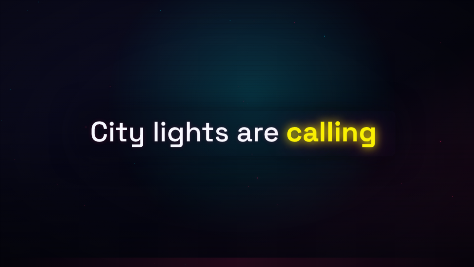

# coreslopper

An open-source, Claude Code-native workflow for making music videos: from a brief, through lyrics and a song, to a validated storyboard and a finished Remotion render.

> **Status: work in progress.** This workflow is currently being tested end to end. The pipeline, schemas, skills, and provider integrations may still change, and it is not yet clear that every stage works as documented. Treat it as an experiment, not a production-ready tool.



The demo is a 12-second, motion-only project. It runs without API keys and is the first vertical slice of the pipeline.

## Why this exists

Most AI music-video workflows are either a pile of prompts or a pile of scripts. coreslopper separates them:

- **Creative work** (brief, treatment, lyrics, storyboard, prompts) is done by focused agent skills.
- **Mechanical work** (audio analysis, schema validation, caching, budget checks, rendering, export) is done by tested TypeScript and Python.
- **Every shot chooses its source**: motion graphics, an AI clip, real footage, or a mix. The decision lives in the storyboard, not in the project setup.
- **The pipeline is autonomous by default.** It stops only for budget, missing credentials, or an unrecoverable validation failure. Quality is established before the run through grilling and enforced during the run by automated critics.
- **It is resumable and thrifty.** `state.json` tracks every stage; generated assets are cached by a hash of model, prompt, seed, references, and params.

Read [the plan](docs/PLAN.md) for the full rationale, [the ADRs](docs/adr/) for the decisions, and [the glossary](docs/glossary.md) for the language.

## Features

- **Brief → treatment → lyrics → song → timing → style → storyboard → assets → render → QA.**
- **Storyboard coverage validation.** Shots use symbolic anchors (`section`, `line`, `word`, `beat`, `downbeat`) and must cover the song with no gaps or overlaps.
- **Local-first audio analysis.** Demucs for stems, WhisperX for word alignment, librosa for BPM/beats/downbeats/onsets/energy. The lyrics are authoritative; only timestamps come from ASR.
- **Provider-agnostic generation.** `generateImage`, `editImage`, `imageToVideo`, and `lipSync` behind a narrow adapter. fal.ai and Higgsfield are the real adapters; a deterministic mock adapter powers tests and no-account runs.
- **Cost guard.** Mandatory per-project budget, batch cap, pre-batch estimate, manifest, and cache. Unknown pricing is a hard error.
- **Character consistency.** Reference images are required for recurring characters; frame chaining is available per storyboard transition.
- **Remotion renderer.** Frame-driven motion graphics, typography, 3D via `@remotion/three`, and a reusable effect library.
- **Claude Code layer.** `/new-video`, `/video-next`, `/video-status`, fresh-context stage runners, art-director and QA critics, and schema-validating hooks.
- **Open-source safe.** MIT for the workflow, no secrets, no copyrighted media, a license-safe demo, and explicit third-party notices.

## Requirements

- Node.js 22 or newer.
- Python 3.12 or newer and [uv](https://docs.astral.sh/uv/).
- `ffmpeg` and `ffprobe` on `PATH` for footage import and loudness normalization. The motion-only demo does not need them. On Linux x64 without a package manager, run `./scripts/install-ffmpeg.sh`; the media commands check `.tools/ffmpeg` automatically.
- Optional: a CUDA GPU for WhisperX/Demucs. CPU works but is slower.
- Optional: a Suno account for song generation, a `FAL_KEY` for fal.ai image/video generation, and a Higgsfield API credential for Higgsfield image/video generation.

## Install with npx

Create a self-contained workspace without cloning the repository:

```bash
npx coreslopper@latest init my-video
```

The onboarding wizard:

- checks Node 22+, npm, git, uv, Python 3.12, ffmpeg, and Claude Code;
- offers to install uv, Python 3.12, ffmpeg, and Claude Code;
- asks how the song is made (Suno or import) and how visuals are generated (mock, fal.ai, or Higgsfield);
- validates optional `FAL_KEY` and Higgsfield credentials and writes them to `.env` (gitignored);
- configures the Suno MCP server in `.mcp.json`;
- creates the first project and runs `npm install` plus `uv sync`.

Fully non-interactive:

```bash
npx coreslopper@latest init my-video --yes --song suno --visual higgsfield --budget 50
```

Set `FAL_KEY` or `HIGGSFIELD_API_KEY` in the environment (or pass `--fal-key` / `--higgsfield-key`) when you choose a real provider. Prefer environment variables; a key passed on the command line can end up in your shell history. Use `--image-provider` and `--video-provider` when the two should differ, for example Higgsfield for keyframes and fal.ai for video.

Then open Claude Code in the workspace:

```bash
cd my-video
claude
```

Run `/mcp` once to authenticate Suno, then `/video-next my-video`. The generated workspace contains the full workflow runtime, so every `npm run cli -- ...` command in this README works inside it. Running `npx coreslopper` without arguments inside a workspace prints the available commands. To move a workspace to a newer release, run `npx coreslopper@latest update` inside it; local edits are kept. See [docs/onboarding.md](docs/onboarding.md) for all flags, updating, and troubleshooting.

## Quickstarts

### 1. Existing Suno.ai song with lyrics and a vocal stem

Use this when the song is already finished. The pipeline imports the audio, uses your lyrics as the authoritative text, and takes word timings from the vocal stem.

```bash
# 1. Create a workspace and project. `import` means "use my song".
#    Use --visual fal instead, or mix providers, if you prefer fal.ai.
export HIGGSFIELD_API_KEY="key_id:key_secret"   # or add it to .env after init
npx coreslopper@latest init neon-rain --yes --song import --visual higgsfield --budget 50
cd neon-rain
```

Mix the providers in `projects/neon-rain/project.yaml` when needed. Lip-sync currently uses the fal adapter, so also set `FAL_KEY` when `video` or `lipsync` is `fal`:

```yaml
providers:
  image: higgsfield
  video: fal
  lipsync: fal
  song: import
```

```bash
# 2. Put the finished song and the vocal stem into the project.
mkdir -p projects/neon-rain/audio/stems
cp ~/Downloads/neon-rain.wav projects/neon-rain/audio/song.wav
cp ~/Downloads/neon-rain-vocals.wav projects/neon-rain/audio/stems/vocals.wav

# If the download is MP3, M4A, or another format, normalize it to WAV instead:
# npm run cli -- normalize-audio projects/neon-rain --input ~/Downloads/neon-rain.mp3
```

```bash
# 3. Write the lyrics with section tags. Keep the words exactly as sung.
#    The analyzer takes text and order from this file; WhisperX supplies timings.
$EDITOR projects/neon-rain/lyrics.txt
```

```text
[Verse 1]
Line one
Line two

[Chorus]
Line three
Line four
```

```bash
# 4. Record where the song came from and whether the stem is present.
$EDITOR projects/neon-rain/song.json
```

```json
{
  "source": "suno",
  "title": "Neon Rain",
  "artist": "your Suno artist",
  "path": "audio/song.wav",
  "duration": 198,
  "bpm": 118,
  "language": "en",
  "hasVocals": true,
  "stems": true,
  "license": "Suno output; check your plan and local law",
  "notes": "Imported from Suno with a vocal stem."
}
```

```bash
# 5. Mark the lyrics and song stages as already supplied, and write the idea
#    into the brief so the treatment has an anchor.
$EDITOR projects/neon-rain/brief.md
npm run cli -- stage-done projects/neon-rain brief --outputs brief.md
npm run cli -- stage-skip projects/neon-rain lyrics --reason "Imported lyrics"
npm run cli -- stage-skip projects/neon-rain song --reason "Imported Suno song and vocal stem"

# 6. Run the remaining stages in Claude Code.
claude
# /video-next neon-rain
```

The `audio-analysis` stage uses `audio/stems/vocals.wav` when it exists. If you want to run the analysis by hand first:

```bash
cd scripts/audio-analysis
uv sync --extra asr --extra stems
uv run python analyze.py --project ../../projects/neon-rain \
  --vocals ../../projects/neon-rain/audio/stems/vocals.wav --device auto
# use --device cuda on an NVIDIA machine
cd ../..
npm run cli -- stage-done projects/neon-rain audio-analysis --outputs timing.json,timing.report.md
npm run cli -- validate projects/neon-rain
```

### 2. No song yet

Use this when the pipeline should write the lyrics, generate the song with Suno, analyze it, and build the video.

```bash
# 1. Create the workspace with Suno and a visual provider.
export HIGGSFIELD_API_KEY="key_id:key_secret"   # or add it to .env after init
npx coreslopper@latest init my-video --yes --song suno --visual higgsfield --budget 50
cd my-video
```

Use `--visual fal` and `FAL_KEY` for fal.ai. For a mixed setup, start a fresh workspace:

```bash
npx coreslopper@latest init another-video \
  --yes --song suno \
  --image-provider higgsfield \
  --video-provider fal \
  --budget 50
```

```bash
# 2. Write the one-paragraph idea into the brief, then mark the stage done.
#    Without this, the autonomous brief stage drafts it from the project title.
$EDITOR projects/my-video/brief.md
npm run cli -- stage-done projects/my-video brief --outputs brief.md

# 3. Open Claude Code, authenticate Suno once, and run the pipeline.
claude
# /mcp
# /video-next my-video
```

The pipeline writes the treatment and lyrics, generates two Suno variants by default, scores them, analyzes the selected song, builds the style and character bibles, writes and validates the storyboard, produces the assets, and renders the preview and masters. It stops only for budget, missing credentials, or an unrecoverable validation failure.

Resume or inspect at any time:

```bash
npm run cli -- status my-video
npm run cli -- estimate --role image.keyframe --units 8 --project projects/my-video
```

In Claude Code, resume one stage with `/video-next my-video --stage storyboard`.

## Work in this repository

```bash
git clone https://github.com/hemi1986/coreslopper.git
cd coreslopper
./scripts/setup.sh        # or: npm install && (cd scripts/audio-analysis && uv sync --group dev)

# Generate the license-safe demo audio and validate the project
npm run demo:audio
npm run cli -- validate projects/demo

# Contact sheet and 16:9 render
npm run cli -- contact-sheet projects/demo
npm run cli -- render projects/demo --format 16x9
```

The render is written to `projects/demo/renders/16x9.mp4`.

Or run the full demo (audio, validation, contact sheet, all three formats, and QA):

```bash
npm run demo
```

Check your environment at any time:

```bash
npm run cli -- doctor
```

## Create a project

```bash
npm run cli -- new my-video --budget 50 --visual higgsfield
# or mix providers:
npm run cli -- new my-video --budget 50 --image-provider higgsfield --video-provider fal
```

Budget is mandatory. The command creates `projects/my-video/` from `templates/project/` and initializes `state.json`. In an npx workspace, `npx coreslopper new my-video --budget 50` does the same. Then open Claude Code in the workspace and run:

```text
/video-next my-video
```

Add `--stage <stage>` to run one stage, or `--dry-run` to inspect the next stage and budget.

## Pipeline

| # | Stage | What happens | Output |
|---|---|---|---|
| 1 | `brief` | Grill the idea; write topic, source, audience, length, formats, style, constraints. | `brief.md` |
| 2 | `treatment` | Core idea, visual world, dramaturgy, shot mix. | `treatment.md` |
| 3 | `lyrics` | Original lyrics with section tags plus a Suno style prompt. | `lyrics.txt`, `suno-style.txt` |
| 4 | `song` | Suno MCP (two variants, scored) or import. Stems when available. | `song.json`, `audio/song.wav` |
| 5 | `audio-analysis` | Demucs + WhisperX + librosa; section table with confidence flags. | `timing.json`, `timing.report.md` |
| 6 | `style-character` | Palette, typography, look, motion rules, character sheets. | `style.yaml`, `characters.yaml` |
| 7 | `storyboard` | Anchored shots, coverage validation, contact sheet. | `storyboard.yaml`, `storyboard.md` |
| 8 | `assets` | Motion components, AI keyframes/clips, footage proxies. | `assets/`, `manifest.jsonl` |
| 9 | `assembly` | Remotion timeline, preview, master, derivatives. | `renders/` |
| 10 | `qa-export` | Sync, readability, determinism, budget reconciliation, all formats. | `review/report.md`, renders |

No creative approval gate blocks the run. A stage stops only on budget, missing credentials, or an unrecoverable validation failure.

## Audio analysis

```bash
cd scripts/audio-analysis
uv sync                 # core: librosa, numpy, soundfile, jsonschema
uv sync --extra asr --extra stems   # WhisperX + Demucs
uv run python analyze.py --project ../../projects/my-video --device cuda
```

The script writes `timing.json` and `timing.report.md`. It never writes `timing.overrides.json`; that file is yours and always wins at load time.

For a fixture or a motion-only demo, `--skip-asr` distributes lyric timings without speech recognition. Real lyric videos should use WhisperX.

## AI generation

The provider interface is intentionally small:

```ts
generateImage(input): Promise<ImageResult>;
editImage(input): Promise<ImageResult>;
imageToVideo(input): Promise<VideoResult>;
lipSync(input): Promise<VideoResult>;
```

fal.ai implements all four operations; Higgsfield implements image and video generation but not lip-sync. The mock adapter returns deterministic SVG placeholders. Model IDs, provider-specific slugs, defaults, and prices live in [`config/models.yaml`](config/models.yaml), not in code. A change of model is a configuration change.

Choose providers per project in `project.yaml`:

```yaml
providers:
  image: higgsfield
  video: fal
  lipsync: fal   # optional; defaults to providers.video
  song: import
```

`image` covers `generateImage` and `editImage`. `video` covers `imageToVideo`. `lipsync` is optional so a project can use Higgsfield for stills and motion while keeping fal.ai for lip-sync. `song` is `suno`, `import`, or `mock`.

A generation batch is a JSON array:

```json
[
  {
    "operation": "editImage",
    "role": "image.keyframe",
    "prompt": "Nova stands in neon rain, cinematic close-up",
    "references": ["characters/nova/sheet.png"],
    "seed": 1234
  },
  {
    "operation": "imageToVideo",
    "role": "video.image_to_video.quality",
    "prompt": "slow push in, rain streaks, neon reflections",
    "references": ["assets/keyframes/shot-004.png"],
    "durationSeconds": 5,
    "seed": 1234
  }
]
```

Estimate and run:

```bash
npm run cli -- estimate --role image.keyframe --units 8 --project projects/my-video
npm run cli -- generate projects/my-video --batch assets/batches/scene-01.json
```

The estimate resolves the role for the project's selected provider. Add `--provider higgsfield` (or `fal`) to compare providers without changing the project.

Every call is cached by a SHA-256 hash of the canonical request and recorded in `assets/manifest.jsonl` with provider, model, prompt, seed, references, cost, and cache status. A cache hit costs nothing.

### Credentials

```bash
# fal.ai
FAL_KEY=...

# Higgsfield: either the complete credential from open.higgsfield.ai ...
HIGGSFIELD_API_KEY=key_id:key_secret

# ... or the split values. HF_API_KEY, HF_KEY, and HF_CREDENTIALS are also accepted.
HF_API_KEY_ID=...
HF_API_KEY_SECRET=...
```

Higgsfield submissions are asynchronous: the adapter uploads local references through the presigned-upload endpoint, polls the request, and downloads the result before it is cached. Its model schemas are strict, so provider-specific params stay in `config/models.yaml`. Three adapter-only options are stripped before the request is sent: `send_seed: true` for models that accept a seed, `send_negative_prompt: true` for models that accept a negative prompt, and `reference_field: <field>` when an edit model uses a name other than `image_urls` (for example `image_reference_url`).

Higgsfield does not implement lip-sync in this workflow yet. Set `providers.lipsync: fal` when a storyboard uses lip-sync shots.

Without a key, use the mock provider:

```yaml
providers:
  image: mock
  video: mock
  lipsync: mock
  song: import
```

### Provider-specific model roles

A role has a base provider and optional alternatives:

```yaml
roles:
  image.keyframe:
    provider: fal
    model: fal-ai/flux-2-pro
    pricing: { unit: image, usd: 0.05 }
    alternatives:
      higgsfield:
        model: higgsfield-ai/soul/v2/standard
        params: { resolution: 1080p, aspect_ratio: 16:9 }
        pricing: { unit: image, usd: 0.006 }
```

A project can also override a role explicitly with `models.image.keyframe.model`, `.params`, and `.pricing` in `project.yaml`. The estimator refuses to run a paid batch when the selected provider has no model or price.

## Claude Code layer

- **`/new-video`** creates a project from the template. Budget is required.
- **`/video-next`** runs all open stages, one fresh `stage-runner` subagent per stage. It stops only on hard stops.
- **`/video-status`** is read-only.
- **`art-director`** judges stills, keyframes, character sheets, and clip frames against the style bible.
- **`qa-checker`** runs schema, asset, sync, readability, determinism, and budget checks.
- **Hooks** validate `storyboard.yaml`, `timing.json`, `timing.overrides.json`, `project.yaml`, `state.json`, `style.yaml`, and `characters.yaml` after edits.
- **MCP** includes the official Suno server at `https://api.suno.com/mcp`. fal.ai and Higgsfield are used through the adapter, not MCP.

See [CLAUDE.md](CLAUDE.md) for the Claude Code specifics.

## Repository layout

```text
.claude/          skills, commands, agents, hooks, settings
config/           model roles and defaults
docs/             plan, glossary, architecture, pipeline, ADRs, third-party notices
packages/
  core/           Zod schemas, state, timing, hash, cost, project loader
  providers/      fal.ai + Higgsfield + mock, cache, manifest
  cli/            validate, status, new, render, contact-sheet, stage commands
  remotion/       MusicVideo composition, motion components, effects, 3D
schema/           generated JSON Schema
scripts/          audio analysis (Python/uv), fixtures
templates/project project template
brand/example/    neutral synthwave/cyberpunk kit, OFL fonts
projects/         video projects; media is gitignored
```

## State, caching, and budget

- `project.yaml` requires `budget_usd`. `batch_cap_usd` defaults to 30 % of the remaining budget.
- `state.json` records every stage, attempts, outputs, errors, and spend.
- `timing.overrides.json` is user-owned and never overwritten.
- Generated assets live in `.cache/generations/<hash>/` and are recorded in `assets/manifest.jsonl`.
- `timing.effective.json` is generated by validation; it is derived and gitignored.

## Formats

- Master: 16:9, 1920×1080, 30 fps, H.264.
- Derivatives: 9:16 1080×1920 and 1:1 1080×1080 by default; 4:5 optional.
- 4K/60 is not a default. Add it as a project-specific format when needed.

Derivatives are separate compositions with safe-area-aware layouts, not naive crops.

## Open source and licensing

- The workflow is **MIT** licensed. See [LICENSE](LICENSE).
- **Remotion is source-available, not OSI open source.** It is free for individuals, organizations with up to 3 employees, and non-profits; larger for-profit organizations need a Remotion license. See [docs/THIRD_PARTY.md](docs/THIRD_PARTY.md).
- The vendored Matt Pocock skills are MIT, pinned and attributed.
- The example brand uses OFL fonts (Orbitron, Space Grotesk, JetBrains Mono) and an original mark.
- The demo audio is generated by a script. No Suno/fal.ai/Higgsfield output or copyrighted music is committed.

**Do not commit** API keys, `.env`, generated audio/video, or copyrighted media. The repository is open source; keep it license-safe.

## Documentation

- [docs/PLAN.md](docs/PLAN.md) — agreed architecture and delivery plan.
- [docs/onboarding.md](docs/onboarding.md) — npx setup, flags, and troubleshooting.
- [docs/architecture.md](docs/architecture.md) — data flow, state, cache, providers, rendering.
- [docs/pipeline.md](docs/pipeline.md) — stage-by-stage runbook.
- [docs/glossary.md](docs/glossary.md) — ubiquitous language.
- [docs/adr/](docs/adr/) — architecture decision records.
- [docs/THIRD_PARTY.md](docs/THIRD_PARTY.md) — licenses and attribution.
- [docs/mcp.md](docs/mcp.md) — Suno MCP, optional fal.ai exploration, and provider adapter notes.

## Contributing

Read [CONTRIBUTING.md](CONTRIBUTING.md), run `npm test`, `npm run typecheck`, and `npm run python:test`, and keep the demo green. For a new skill, use the vendored `writing-for-agents` guidance and keep frontmatter to `name`, `description`, and `license`.

## Security

Report vulnerabilities privately as described in [SECURITY.md](SECURITY.md). Never include a real API key in an issue, a screenshot, or a log.
