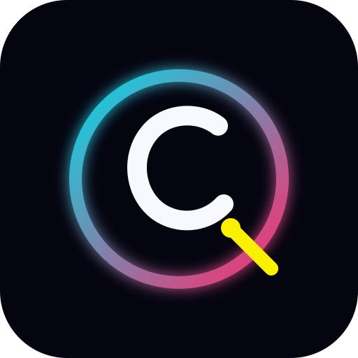

# Neon Rain — Example Brand Kit

A neutral synthwave/cyberpunk kit used by the motion-only demo. It is intentionally generic: projects should create their own brand kit or override these tokens.

## Palette

| Token | Hex | Use |
|---|---|---|
| `background` | `#050510` | Base canvas |
| `surface` | `#0d0d24` | Cards, plates, secondary surfaces |
| `primary` | `#ff2a6d` | Neon pink; main accent and glow |
| `secondary` | `#05d9e8` | Cyan; grid, particles, technical accents |
| `accent` | `#f9f002` | Acid yellow; highlights and warnings |
| `text` | `#f8f8ff` | Primary text |
| `muted` | `#8b8ba7` | Secondary text and metadata |

## Typography

- **Display:** Orbitron 800, tight tracking, uppercase. Use for titles and big statements.
- **Body:** Space Grotesk 500. Use for lyric lines and longer text.
- **Mono:** JetBrains Mono 400. Use for technical labels, timecodes, shot IDs.

All three fonts are SIL OFL 1.1. License files are in `fonts/`.

## Motion

- Easing: `easeOut`.
- Grain: 0.08, applied globally.
- Beat reactions: scale and glow, never a hard cut on every beat.
- Downbeats: larger structural moves, not more noise.

## Do

- Keep the background near-black so neon reads.
- Use one dominant accent per shot; let the others support.
- Check text contrast at 9:16 and 1:1, not only 16:9.
- Use the grid and particles as texture, not as the subject.

## Don't

- Put pink text on a pink glow with no dark plate.
- Use the accent yellow for long body copy.
- Add a new font per shot.
- Use a recognizable trademark or copyrighted character in the logo or references.

## Tokens

Machine-readable values are in `tokens.json`. The demo's `style.yaml` mirrors the palette and typography.
