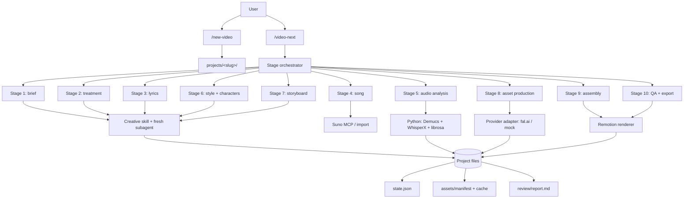

# Music Video Workflow — Implementation Plan

| | |
|---|---|
| **Status** | Approved — implementation in progress |
| **Date** | 2026-11-08 |
| **License** | MIT (repository code and documentation) |
| **Primary runtime** | Claude Code |
| **Development runtime** | OpenCode |
| **Working title** | `coreslopper` (rename before public release is fine) |

## 1. Vision

A reusable, open-source workflow that takes a music video from a rough idea to a finished render. Creative work is done by an agent through focused skills; mechanical work is done by tested TypeScript and Python scripts. The same repository holds the workflow and any number of video projects, so every project gets the latest skills, schemas, renderers, and quality checks without copying code.

The pipeline runs autonomously by default. Quality is established **before** the run through a grilling interview, and enforced **during** the run by schema validation, automated art-direction and QA critics, deterministic rendering, cache checks, and a hard budget guard. There are no creative approval gates. The pipeline stops only when it cannot safely continue: budget exceeded, credentials missing, or an unrecoverable validation failure after bounded retries.

## 2. Goals and non-goals

### Goals

- Produce music videos from a brief, lyrics, and a song with a repeatable pipeline.
- Support motion graphics, AI-generated images and clips, real footage, and mixed shots in one timeline.
- Make every stage resumable, deterministic where it matters, and cheap to re-run.
- Keep creative decisions in skills/prompts and mechanical decisions in code.
- Work in Claude Code without adaptation; keep the core usable from OpenCode and plain scripts.
- Be safe to publish as an MIT-licensed open-source repository: no secrets, no copyrighted media, clear third-party notices.
- Keep context windows bounded by running each stage in a fresh context.

### Non-goals (for the first release)

- A hosted SaaS, web UI, or multi-user collaboration.
- Training or fine-tuning image/video models.
- A full non-linear editor. Remotion is the edit system; the storyboard is the edit decision list.
- Live performance capture, multicam editing, or advanced color grading.
- Automatic publishing to social platforms.
- Windows-native support in v1 (WSL is documented; macOS/Linux are primary).

## 3. Decisions from the grilling

| # | Decision | Choice |
|---|---|---|
| 1 | Project layout | Projects are folders under `projects/<slug>/` in this repo. An optional `export-project` command can extract one later. |
| 2 | Master format | 16:9, 1920×1080, 30 fps, H.264, high bitrate. |
| 3 | Derivative formats | 9:16 1080×1920 and 1:1 1080×1080 by default; 4:5 optional. 4K/60 only on request. |
| 4 | Typical song length | 2:30–4:00; the pipeline does not hard-code a maximum. |
| 5 | Shot mix | Mixed by default: motion graphics ~50–70 %, AI clips ~20–40 %, footage ~0–20 %. Per-shot decision in the storyboard. |
| 6 | First vertical slice | Motion-only, so the pipeline can run without generation spend. |
| 7 | Human gates | None for creative work. `review_mode: auto` is the default. |
| 8 | Hard stops | Budget exceeded, missing credentials, unrecoverable validation/QA failure after retries. |
| 9 | Context strategy | One fresh subagent/process per stage; files are the only interface; asset batches of ~5 shots. |
| 10 | Budget | `budget_usd` is mandatory at project creation; `batch_cap_usd` defaults to 30 % of the remaining budget. |
| 11 | Music source | Official Suno MCP (`https://api.suno.com/mcp`) or import of an existing file; stems when available. |
| 12 | Audio analysis | Local Demucs + WhisperX + librosa on the RTX 5070 Ti; CPU fallback. |
| 13 | Image/video provider | fal.ai behind a narrow adapter; `config/models.yaml` selects models and defaults. |
| 14 | Repository language | English for all repository artifacts (docs, skills, schema, lyrics, commit messages). |
| 15 | License | MIT for our code and docs. The project is non-commercial in positioning; MIT still allows commercial use by others. |
| 16 | Schema source of truth | Zod → generated JSON Schema + TypeScript types; Python validates with `jsonschema`. |
| 17 | Third-party skills | Vendor Matt Pocock skills with source, pinned commit, license, and a summary. |
| 18 | Media in git | Generated audio, clips, and renders are gitignored. Only text artifacts, small stills, and review sheets are committed. |

## 4. Architecture at a glance



**Control plane:** `state.json` records stage status, input hashes, output paths, retries, and spend. A stage is skipped when its inputs are unchanged and its outputs exist. Mechanical reruns are safe.

**Data plane:** All stage inputs and outputs are files in the project directory. The orchestrator passes paths and short summaries, never raw assets or full transcripts.

**Budget plane:** The estimator reads `config/models.yaml` and the project overrides, computes the worst-case cost of the next batch, and refuses to start if it would exceed `batch_cap_usd` or the remaining project budget.

## 5. Repository layout

```text
.
├── .claude/
│   ├── skills/
│   │   ├── video-brief/SKILL.md
│   │   ├── video-treatment/SKILL.md
│   │   ├── lyrics-writer/SKILL.md
│   │   ├── suno-song/SKILL.md
│   │   ├── audio-analysis/SKILL.md
│   │   ├── style-bible/SKILL.md
│   │   ├── character-bible/SKILL.md
│   │   ├── storyboard/SKILL.md
│   │   ├── remotion-motion/SKILL.md
│   │   ├── ai-clips/SKILL.md
│   │   ├── footage/SKILL.md
│   │   ├── assembly-render/SKILL.md
│   │   ├── video-qa/SKILL.md
│   │   ├── grill-me/                 # vendored, Matt Pocock
│   │   ├── grilling/                 # vendored, Matt Pocock
│   │   ├── writing-for-agents/       # vendored, successor to write-a-skill
│   │   └── domain-modeling/          # vendored, successor to ubiquitous-language
│   ├── commands/
│   │   ├── new-video.md
│   │   ├── video-next.md
│   │   └── video-status.md
│   ├── agents/
│   │   ├── art-director.md
│   │   ├── qa-checker.md
│   │   └── stage-runner.md
│   ├── hooks/
│   │   └── validate-artifacts.mjs
│   └── settings.json
├── .github/
│   ├── workflows/ci.yml
│   ├── ISSUE_TEMPLATE/
│   └── PULL_REQUEST_TEMPLATE.md
├── AGENTS.md
├── CLAUDE.md
├── README.md
├── LICENSE
├── CONTRIBUTING.md
├── CODE_OF_CONDUCT.md
├── SECURITY.md
├── .env.example
├── .gitignore
├── .mcp.json
├── package.json
├── tsconfig.json
├── config/
│   ├── models.yaml
│   └── defaults.yaml
├── docs/
│   ├── PLAN.md
│   ├── architecture.md
│   ├── pipeline.md
│   ├── glossary.md
│   ├── THIRD_PARTY.md
│   └── adr/
├── packages/
│   ├── core/            # schemas, state, config, hash, manifest, timing, cost
│   ├── providers/       # narrow generation interface, fal adapter, mock adapter
│   ├── remotion/        # compositions, components, hooks, effects
│   └── cli/             # validate, estimate, render, export, project management
├── scripts/
│   ├── audio-analysis/  # Python: uv project, Demucs, WhisperX, librosa
│   ├── setup.sh
│   └── fixtures/        # synthetic audio and deterministic test assets
├── schema/              # generated JSON Schema (checked in)
├── templates/project/   # files copied by /new-video
├── brand/example/       # neutral synthwave/cyberpunk example kit
├── projects/            # user projects (media gitignored)
└── examples/            # small, license-safe demo fixtures
```

Package manager: **npm workspaces** (already available; no extra global install). Python: **uv** with a per-script `pyproject.toml`. Node 22+; Python 3.12+; `ffmpeg` required; GPU optional.

## 6. Pipeline

No stage waits for a human. Each stage has an automated completion check. The pipeline stops only on the hard-stop conditions in section 3.

| # | Stage | Skill | Output | Automated check / stop condition |
|---|---|---|---|---|
| 1 | Brief | `video-brief` | `brief.md` | Schema and brief critic. Stop only if `budget_usd` or required formats are missing. |
| 2 | Treatment | `video-treatment` | `treatment.md` | Critic compares against the brief; up to 2 automatic revisions. |
| 3 | Lyrics | `lyrics-writer` | `lyrics.txt`, `suno-style.txt` | Section-tag validation; lyric critic; line/section map must be usable by audio analysis. |
| 4 | Song | `suno-song` | `audio/song.wav`, stems, `song.json` | Suno MCP or import. Two variants are generated and scored; the best is selected. Stop if no provider and no import. |
| 5 | Audio analysis | `audio-analysis` | `timing.json`, `timing.report.md` | Reject unreadable audio. Low-confidence sections are flagged but do not block. |
| 6 | Style & character bible | `style-bible`, `character-bible` | `style.yaml`, `characters.yaml`, reference images | Reference-image existence and image QA; character sheets must contain at least one usable reference per character. |
| 7 | Storyboard | `storyboard` | `storyboard.yaml`, `storyboard.md`, contact sheet, optional animatic | Schema, anchor resolution, full coverage, reference existence, shot critic; up to 3 automatic revisions. |
| 8 | Asset production | `remotion-motion`, `ai-clips`, `footage` | Motion components, keyframes, clips, footage proxies, `assets/manifest.jsonl` | Per-batch cost estimate and QA; cache hits reuse assets; failures retry with backoff. |
| 9 | Assembly | `assembly-render` | Remotion composition, `renders/preview-16x9.mp4` | Preview render; sync, legibility, and coverage checks. |
| 10 | QA & export | `video-qa` | `review/report.md`, all format renders | Still checks, sync check, readability, determinism, final report. |

### Stage behavior

- A stage is **idempotent**: rerunning it with the same inputs produces the same outputs or a cache hit.
- A stage writes outputs atomically (temporary file + rename) and records them in `state.json`.
- A failed stage records `attempts`, `last_error`, and a resumable checkpoint. The next run continues from the checkpoint.
- A stage never overwrites `timing.overrides.json`, `project.yaml`, or any user-authored file.
- The orchestrator does not embed raw images, audio, or full transcripts in its context. It reads `state.json`, `review/report.md`, and short stage summaries.
- `review_mode: auto` is the default. `review_mode: final` adds one blocking human review before export; it is for open-source users who want it, not the project default.

## 7. Data contracts

### 7.1 `project.yaml`

Created by `/new-video`. Required fields are validated before any stage runs.

```yaml
version: 1
slug: neon-rain
title: Neon Rain
created: 2026-11-08
workflow:
  version: 0.1.0
  commit: "<pinned>"
budget_usd: 50            # mandatory; no hidden default
batch_cap_usd: 15         # optional; default = 30% of remaining budget
review_mode: auto         # auto | final
formats:
  master: { aspect: "16:9", width: 1920, height: 1080, fps: 30 }
  derivatives:
    - { aspect: "9:16", width: 1080, height: 1920 }
    - { aspect: "1:1",  width: 1080, height: 1080 }
providers:
  image: fal
  video: fal
  song: suno
brand: example
models: {}                # per-project overrides for config/models.yaml
```

### 7.2 `state.json`

```json
{
  "version": 1,
  "project": "neon-rain",
  "workflowVersion": "0.1.0",
  "stage": "audio-analysis",
  "status": "pending",
  "stages": {
    "brief": {
      "status": "done",
      "inputHash": "sha256:...",
      "outputs": ["brief.md"],
      "attempts": 1,
      "finishedAt": "2026-11-08T12:00:00Z"
    }
  },
  "budget": { "totalUsd": 50, "spentUsd": 0, "reservedUsd": 0 },
  "artifacts": {},
  "errors": [],
  "updatedAt": "2026-11-08T12:00:00Z"
}
```

### 7.3 `timing.json` and `timing.overrides.json`

`timing.json` is generated and committed (it is small and needed for reproducibility). `timing.overrides.json` is user-owned, has precedence, and is never overwritten.

```json
{
  "version": 1,
  "audio": { "path": "audio/song.wav", "duration": 214.5, "sampleRate": 48000 },
  "bpm": 120.0,
  "beats": [0.0, 0.5, 1.0],
  "downbeats": [0.0, 2.0],
  "onsets": [0.12, 0.51],
  "energy": { "hop": 512, "fps": 86.13, "values": [0.1, 0.2] },
  "sections": [
    { "id": "intro", "label": "Intro", "start": 0.0, "end": 8.0, "confidence": 0.98, "sources": ["tag", "energy"] }
  ],
  "lines": [
    {
      "id": "l1",
      "section": "verse_1",
      "start": 8.0,
      "end": 12.0,
      "text": "Neon rain on the wire",
      "words": [
        { "text": "Neon", "start": 8.0, "end": 8.3 }
      ]
    }
  ],
  "meta": { "whisperModel": "large-v3", "demucsModel": "htdemucs_ft", "generatedAt": "..." }
}
```

The effective timing used by Remotion is `resolveTiming(base, overrides)`, written to `timing.effective.json` (derived, gitignored). Overrides may replace BPM, section boundaries, line times, and word times, but never the lyric text.

### 7.4 `storyboard.yaml`

Every shot has a stable ID, a section reference, symbolic start/end anchors, a source, a visual description, camera, on-screen text, highlight words, transition, style/character references, and prompts for AI shots.

```yaml
version: 1
timing: timing.effective.json
style: style.yaml
characters: characters.yaml
shots:
  - id: shot-001
    section: intro
    start: { type: section, id: intro, edge: start }
    end:   { type: section, id: intro, edge: end }
    source: motion              # motion | ai-clip | footage | mixed
    description: "A lone figure walks through rain-lit neon streets."
    camera: "slow dolly in"
    text: "NEON RAIN"
    highlights: ["NEON", "RAIN"]
    transition: { type: cut, duration: 0 }
    refs:
      style: [palette.neon, typography.display]
      characters: [nova]
    motion:
      component: "TitleCard"
      props: { subtitle: "a synthwave story" }
    prompts:
      keyframe: "..."
      video: "..."
    chaining:
      enabled: true
      from: shot-000
    # For `mixed`, list the layers instead of a single source:
    # layers:
    #   - { type: ai-clip, asset: "...", blend: "screen" }
    #   - { type: motion, component: "Scanlines", zIndex: 2 }
```

**Anchor types:** `section`, `line`, `word`, `beat`, `downbeat`, and an explicit `time` escape hatch. Section and line anchors carry an `edge` (`start` or `end`); word, beat, downbeat, and time anchors are points. The resolver maps them to seconds using effective timing. Validation rejects unresolved anchors, gaps, overlaps, and incomplete coverage.

**Coverage rule:** shots must be sorted, non-overlapping, start at 0, end at the song duration, and leave no gap larger than the configured tolerance (default 1 frame).

**Source rules:** `motion` requires a component or preset; `ai-clip` requires keyframe/video prompts; `footage` requires an asset path; `mixed` requires a `layers` array with at least two source layers. All style/character references must exist.

## 8. Audio analysis

Pipeline:

1. **Vocals:** use Suno stems when available; otherwise Demucs (`htdemucs_ft`) on the mixed song.
2. **Words:** WhisperX (faster-whisper + wav2vec2 alignment) on the vocal stem. The authoritative text comes from `lyrics.txt`; only timestamps come from alignment. Mismatches are corrected by fuzzy matching to the lyric lines.
3. **Rhythm:** librosa for BPM, beats, downbeats, onsets, and frame-level energy (default hop 512 at 48 kHz).
4. **Sections:** parse Suno section tags from `lyrics.txt`, align them with line timestamps, and refine boundaries with energy changes. Each section gets a confidence score and its evidence sources.
5. **Report:** write `timing.report.md` with a section table, flagged low-confidence boundaries, and unmatched lyric lines.
6. **Overrides:** merge `timing.overrides.json` after every load. The analysis script never writes that file.

The analysis is a Python `uv` project with pinned dependencies and a `--device auto|cuda|cpu` flag. GPU is used when available; CPU is the fallback. The script validates its output against the generated JSON Schema before writing.

## 9. AI generation

### 9.1 Provider interface

`packages/providers` exposes exactly three operations:

```ts
generateImage(input: ImageInput): Promise<ImageResult>;
editImage(input: EditImageInput): Promise<ImageResult>;
imageToVideo(input: VideoInput): Promise<VideoResult>;
```

`ImageInput` and `VideoInput` carry model, prompt, negative prompt, references, seed, dimensions/duration, and provider-specific params. Results carry local file paths, provider, model, seed, cost, and raw response metadata. The interface is intentionally too small to leak fal.ai-specific concepts.

### 9.2 Adapters

- **fal.ai** — first real adapter, using the fal SDK/REST. `FAL_KEY` comes from the environment.
- **mock** — deterministic placeholders (gradient stills, short generated clips) for tests, CI, and users without accounts.
- Future adapters are additive; the pipeline does not change.

### 9.3 Model configuration

`config/models.yaml` maps roles to model IDs and default parameters:

| Role | Candidate model (verify at implementation) | Notes |
|---|---|---|
| `image.character_sheet` | `google/nano-banana-2.1/edit` or `fal-ai/flux-2-pro/edit` | Multi-reference editing; output 2K–4K. |
| `image.keyframe` | `fal-ai/flux-2-pro` or `google/nano-banana-2.1` | Hero stills; aspect ratio per shot. |
| `image.edit` | `fal-ai/flux-2-pro/edit` or `google/nano-banana-2.1/edit` | Reference-preserving edits. |
| `video.image_to_video.quality` | `kling/v4/image-to-video` | 3–30 s, 720p/1080p, optional end frame for chaining. |
| `video.image_to_video.fast` | `kling/v4/flash/image-to-video` or `bytedance/seedance-2.0/fast/image-to-video` | Cheaper drafts and B-roll. |
| `video.image_to_video.premium` | `bytedance/seedance-2.5/us/image-to-video` or Veo 3.1 | Hero shots only. |
| `video.image_to_video.budget` | `alibaba/wan-3.0/image-to-video` or `fal-ai/wan/v2.7/image-to-video` | Lowest-cost motion. |

The exact fal.ai slugs and prices are verified during implementation and pinned in `config/models.yaml` with a `last_verified` date. Model changes are configuration changes, not code changes. Video is generated **without native audio** where the model supports it; the song is the only audio source.

`config/models.yaml` also stores per-unit prices and constraints (max duration, supported resolutions, reference limits). The estimator refuses to guess: an unknown price is a hard error.

### 9.4 Cache and manifest

- **Cache key:** SHA-256 of canonical JSON containing provider, operation, model ID, prompt, negative prompt, seed, dimensions/duration, and SHA-256 hashes of every reference file.
- **Cache location:** `.cache/generations/<hash>/`.
- **Manifest:** append-only `assets/manifest.jsonl`, one record per generation:

```json
{
  "id": "gen_01J...",
  "hash": "sha256:...",
  "operation": "imageToVideo",
  "provider": "fal",
  "model": "kling/v4/image-to-video",
  "prompt": "...",
  "seed": 123456,
  "references": [{ "path": "characters/nova/sheet.png", "sha256": "..." }],
  "params": { "duration": 5, "resolution": "1080p" },
  "costUsd": 0.84,
  "cached": false,
  "createdAt": "..."
}
```

- **Resume:** a batch writes a checkpoint before each item. Re-running skips completed items and cache hits.
- **Retries:** exponential backoff with jitter, per-request timeout, and a maximum attempt count. Fatal provider errors (auth, invalid model) are not retried.
- **Budget:** estimate the whole batch before starting, compare with `batch_cap_usd` and remaining budget, and abort before the first paid call if either would be exceeded.

### 9.5 Character consistency and frame chaining

- Character sheets are generated once per character and stored with at least one usable reference image.
- Every character shot passes the character's reference images to `editImage`/`imageToVideo`; text-only character prompts are rejected by validation.
- Frame chaining is opt-in per storyboard transition: extract the last frame of the previous clip, use it as the first frame of the next, and include the reference hash in the cache key.
- Generated clips are inspected at their first, middle, and last frame by the `art-director` critic; failures are retried with a corrected prompt, not accepted silently.

## 10. Remotion

- **Composition:** one `MusicVideo` composition per format (`16x9`, `9x16`, `1x1`), sharing the same timeline and shot data. `calculateMetadata` injects project config, effective timing, storyboard, and asset manifest.
- **Layers:** background → footage/AI video → motion graphics → typography → overlays → grain/postprocessing.
- **Timing:** every time value comes from effective timing or `useCurrentFrame()`. No hard-coded seconds in components.
- **Determinism rules:** no `useFrame` with clock/delta, no `Math.random`, no `Date.now`, no time-based CSS animations. Randomness uses `random(seed)`. Postprocessing parameters are pure functions of the frame.
- **3D:** `@remotion/three` + React Three Fiber. Animation is driven by frame-derived props; the render loop is not used as a clock.
- **Hooks:** `useBeat`, `useDownbeat`, `useOnset`, `useEnergy`, `useSection`, `useWordTiming`, `useShot`.
- **Components:** `WordPop`, `HighlightWord`, `KineticType`, `LyricLine`, `LowerThird`, `LogoLockup`, `SafeArea`, `ContactSheet`.
- **Effects:** `Glitch`, `RGBSplit`, `Scanlines`, `NeonGlow`, `TypeOn`, `ParticleField`, `Grain`, each themed through brand tokens.
- **Audio:** the song is normalized once to −14 LUFS integrated / −1 dBTP true peak, then used as the master track in every format. AI clips are muted.
- **Render:** `npx remotion render` per format through `packages/cli`. Master 16:9; derivatives use safe-area-aware layouts, not naive crops.
- **QA:** still checks at section boundaries and flagged words; sync check compares expected word times with rendered text; readability checks contrast, minimum font size, and safe areas; determinism check renders a short fixture twice and compares frame hashes.

## 11. Skills

| Skill | When it fires | Primary output |
|---|---|---|
| `video-brief` | Starting a new project or revising the brief | `brief.md` |
| `video-treatment` | Turning a brief into a visual concept | `treatment.md` |
| `lyrics-writer` | Writing or revising lyrics and the Suno style prompt | `lyrics.txt`, `suno-style.txt` |
| `suno-song` | Generating or importing the song and stems | `audio/song.wav`, stems, `song.json` |
| `audio-analysis` | After the song exists | `timing.json`, `timing.report.md` |
| `style-bible` | Defining palette, type, look, and references | `style.yaml`, style references |
| `character-bible` | Defining recurring characters | `characters.yaml`, character sheets |
| `storyboard` | Turning the treatment and timing into shots | `storyboard.yaml`, `storyboard.md`, contact sheet |
| `remotion-motion` | Building motion-graphics shots and effects | Remotion components/compositions |
| `ai-clips` | Generating keyframes and image-to-video clips | Keyframes, clips, manifest entries |
| `footage` | Importing real clips | Normalized proxies, trim metadata |
| `assembly-render` | Assembling the timeline and rendering previews | Remotion composition, previews |
| `video-qa` | Final checks and exports | `review/report.md`, format renders |

Every own skill uses minimal frontmatter:

```yaml
---
name: storyboard
description: Use when turning a treatment and timing into a validated shot list...
license: MIT
---
```

The description states the trigger branches, not a summary of the body. Skills use the glossary terms consistently and link to `docs/glossary.md`.

### Third-party skills

The requested `write-a-skill` and `ubiquitous-language` skills no longer exist under those names upstream. The current successors are vendored instead:

- `grill-me` + `grilling` — the interview workflow for briefs, treatments, and storyboards.
- `writing-for-agents` (successor to `write-a-skill`) — how to write skills, `AGENTS.md`, and `CLAUDE.md`. Includes `SKILL-MECHANICS.md`.
- `domain-modeling` (successor to `ubiquitous-language`) — build and sharpen the domain model, glossary, and ADRs. Includes `GLOSSARY-FORMAT.md` and `ADR-FORMAT.md`.

Source, pinned commit, license, and adaptations are recorded in `docs/THIRD_PARTY.md`. The glossary lives at `docs/glossary.md` (the vendored skill is adapted to that path).

## 12. Claude Code layer

### Commands

- **`/new-video`** — prompts for title, slug, budget, formats, brand kit, and song source; copies `templates/project/` to `projects/<slug>/`; writes `project.yaml` and initial `state.json`; validates the budget; prints the next command.
- **`/video-next`** — reads state and runs all pending stages. Each stage is dispatched to a fresh subagent/process. Stops only on hard stops. `--stage <name>` runs one stage; `--dry-run` prints the plan and cost estimate; `--mock` uses the mock provider.
- **`/video-status`** — prints stage table, budget, artifacts, flags, and the next action. It never mutates the project.

### Agents

- **`art-director`** — reads stills, character sheets, keyframes, and the style bible; scores palette, composition, character consistency, and text legibility; returns pass/fail plus concrete prompt or layout fixes. It does not silently accept a bad still.
- **`qa-checker`** — checks coverage, sync, readability, determinism, and manifest/cost consistency; writes `review/report.md`.
- **`stage-runner`** — generic isolated executor: reads one skill, one stage contract, and the project files; writes the stage outputs; returns a short summary. This is how `/video-next` keeps the main context small.

### Hooks

`.claude/settings.json` registers a `PostToolUse` hook for `Write|Edit`. The hook inspects the changed path and runs:

- `storyboard.yaml` → schema + anchor + coverage validation.
- `timing.json` / `timing.overrides.json` → schema + override merge validation.
- `project.yaml` / `state.json` → schema + budget validation.

A failure exits non-zero with a short, actionable message. Validators are also runnable directly (`npm run validate -- --file ...`) and in CI.

### MCP

`.mcp.json` includes:

- **Suno** — official HTTP MCP at `https://api.suno.com/mcp`; authentication via Claude Code's MCP login flow.
- **fal.ai** — optional, for exploratory use only; the pipeline uses the adapter, not MCP.

No secrets are committed. `.env.example` documents `FAL_KEY`, optional `OPENAI_API_KEY` (only if a user chooses API Whisper), and paths/flags. Suno uses OAuth, not an env key.

## 13. Projects and brand kits

`templates/project/` contains:

```text
project.yaml
brief.md
treatment.md
lyrics.txt
suno-style.txt
song.json
timing.json
timing.overrides.json
storyboard.yaml
storyboard.md
state.json
style.yaml
characters.yaml
brand/            # optional project-specific brand overrides
audio/            # gitignored
assets/           # gitignored
review/           # report, contact sheet, small stills
renders/          # gitignored
```

`brand/example/` is a neutral synthwave/cyberpunk kit:

- `brand.yaml` — palette, typography, motion tokens.
- `logo.svg` — original mark.
- `fonts/` — OFL-licensed fonts (Orbitron, Space Grotesk, JetBrains Mono) with license files.
- `styleguide.md` — how to apply the kit.
- `tokens.json` — machine-readable tokens for Remotion.

Project-specific brands live in the project, not in the workflow repo. The example kit exists to show the structure and to power the vertical slice.

**Export:** `npm run export-project -- <slug> --to <path>` copies the project, pins the workflow commit in `project.yaml`, and includes a minimal `README` describing how to install the workflow at that commit. It is additive and not required for v1.

## 14. Open source

- **License:** MIT for our code and docs. The project is positioned as non-commercial, but MIT permits commercial use by others; this is intentional and documented.
- **No secrets:** `.env.example` only; `.env` gitignored; CI uses mocks.
- **No copyrighted media:** generated Suno/fal.ai assets, audio, and renders are gitignored; examples use synthetic or CC0 material.
- **Third-party notices:** `docs/THIRD_PARTY.md` with source, pinned commit, license, summary, and adaptations for vendored skills; Remotion's source-available license; font licenses; provider terms.
- **Docs:** `README.md` (what/why/quickstart/requirements/costs/security/license), `AGENTS.md` (agent-facing project description), `CLAUDE.md` (`@AGENTS.md` plus Claude Code specifics), `docs/architecture.md`, `docs/pipeline.md`, `docs/glossary.md`, `docs/adr/`.
- **Community:** `CONTRIBUTING.md`, `CODE_OF_CONDUCT.md` (Contributor Covenant 2.1), `SECURITY.md`, issue/PR templates.
- **CI:** GitHub Actions on Ubuntu with Node 22/24, Python 3.12, `ffmpeg`; lint, typecheck, unit tests, schema validation, mock-provider integration, and a short deterministic render. GPU tests are opt-in and never required in CI.

## 15. Implementation phases

### Phase 1 — Skeleton and contracts

- Repository scaffolding, `package.json` workspaces, `tsconfig`, lint/format, test setup.
- `AGENTS.md`, `CLAUDE.md`, `README.md`, `LICENSE`, `CONTRIBUTING.md`, `SECURITY.md`, `.env.example`, `.gitignore`, `.mcp.json`.
- Finalize the draft `docs/glossary.md` and keep it aligned with schema and skill language.
- Zod schemas for `project.yaml`, `state.json`, `timing.json`, `storyboard.yaml`, `style.yaml`, `characters.yaml`; generated JSON Schema and TS types.
- State machine, hash/cache utilities, budget/cost math, timing resolver.
- `templates/project/`, `brand/example/`, `config/models.yaml`.
- Unit tests for schemas, anchors, coverage, cache keys, budget math, and state transitions.

**Acceptance:** `npm test` passes; schema generation is reproducible; a fixture project validates.

### Phase 2 — Vertical slice (motion only)

- 10–15 s fixture with synthetic audio and a precomputed timing file for CI; local 30–45 s demo with a real vocal track (CC0 or user-provided, never committed).
- Audio analysis Python project with Demucs/WhisperX/librosa and a mock/CPU test path.
- Brief → treatment → lyrics → song import → audio analysis → style bible → storyboard → one motion shot → 16:9 render.
- Remotion base composition, timing hooks, one typographic shot, preview render.
- `review/report.md` with coverage, sync, readability, and determinism results.
- `/new-video`, `/video-next`, `/video-status`, `stage-runner`, hooks, and the validation hook.

**Acceptance:** a fresh clone can run the mock vertical slice end-to-end; a local GPU run produces a real 30–45 s motion-only video; two renders of the fixture have identical frame hashes.

### Phase 3 — AI clips, footage, mixed shots

- fal.ai adapter, mock adapter, manifest, cache, cost estimator, retry/resume.
- Character bible with reference sheets; keyframe and image-to-video generation; frame chaining.
- Footage import, trimming, proxy normalization, and mixed-shot composition.
- `art-director` and `qa-checker` agents wired into the pipeline.
- Model matrix verified against the live fal.ai catalog and pinned.

**Acceptance:** a storyboard with motion, AI, footage, and mixed shots renders end-to-end; cache hits avoid duplicate spend; a deliberate budget overrun aborts before the first paid call.

### Phase 4 — Open-source polish

- README chapters per stage, architecture and pipeline docs; glossary updates and ADR review.
- CI, issue/PR templates, security policy, contribution guide.
- Example brand polish, demo renders with license-safe media, screenshots/contact sheets.
- Third-party notices, dependency license audit, final security pass.
- Optional `export-project` and `review_mode: final`.

**Acceptance:** a new contributor can install, run the mock demo, and understand the pipeline from the README; CI is green; no secrets or copyrighted media are present.

## 16. Testing and CI

| Layer | Tool | What it proves |
|---|---|---|
| TypeScript unit | Vitest | Schemas, anchors, coverage, cache keys, budget math, state transitions, manifest parsing |
| Python unit | pytest | Section parsing, lyric alignment mapping, overrides merge, energy features, schema validation |
| Provider contract | Vitest + mock | The three provider operations and error/retry behavior |
| Integration | Vitest + fixture | Brief → storyboard → one motion shot → 2 s render, no network |
| Determinism | Remotion + frame hashes | Two renders of the same fixture are identical |
| GPU (optional) | pytest marker | Demucs/WhisperX on CUDA; never required in CI |

CI runs on Ubuntu, installs `ffmpeg`, uses Node 22, Python 3.12, and `uv`, and never calls Suno or fal.ai. A short Remotion render validates the composition; the browser is downloaded by Remotion and cached.

## 17. Risks and mitigations

| Risk | Mitigation |
|---|---|
| No human gates allow creative drift | Upfront grilling, strong brief/treatment/storyboard critics, bounded revisions, final review report, optional `review_mode: final`, budget caps. |
| Context windows fill during long runs | One fresh subagent per stage; file-only contracts; batch asset generation; orchestrator reads summaries only. |
| AI character inconsistency | Reference images always required; character sheets; frame chaining; art-director still checks. |
| Cost overrun | Mandatory project budget; batch cap; pre-batch estimate; unknown price = hard error; cache; manifest. |
| Suno MCP instability or plan limits | Import is a first-class path; stems optional; provider errors are explicit. |
| Whisper alignment errors | Lyrics are authoritative; fuzzy matching; low-confidence flags; `timing.overrides.json`; report. |
| Remotion nondeterminism | Frame-driven rules; lint/review; frame-hash tests; no wall-clock/random. |
| Remotion license confusion | Documented as source-available, not OSI; users comply with the Remotion License. |
| Large media bloats git | `.gitignore` for audio/assets/renders; only text and small review images committed. |
| Provider/model churn | Narrow adapter; model IDs and prices in config; no provider concepts in pipeline code. |
| Open-source licensing mistakes | Pinned vendored skills with MIT notice; font licenses; generated dependency notice; no copyrighted demo media. |
| GPU stack incompatibility on RTX 5070 Ti | Pin PyTorch/CUDA-compatible versions; CPU fallback; document tested versions. |

## 18. Open questions before public release

- Final repository name and GitHub organization (working title `coreslopper`).
- Exact fal.ai model slugs and prices; verify and pin at implementation time.
- Suno MCP authentication details and whether stems are available on the user's plan.
- WhisperX/PyTorch CUDA build that works reliably on the RTX 5070 Ti (Blackwell).
- Whether 4K/60 or 4:5 should become first-class formats after v1.
- Whether `export-project` ships in v1 or v1.1.
- Windows-native support (WSL is the documented path for v1).

## 19. Approval

This plan is ready for review. Implementation starts only after explicit approval.

- [ ] Pipeline stages and no-gate autonomy are correct.
- [ ] Formats and shot mix are correct.
- [ ] Budget and licensing decisions are correct.
- [ ] Third-party skill substitutions (`writing-for-agents`, `domain-modeling`) are acceptable.
- [ ] Repository layout and phased delivery are acceptable.
