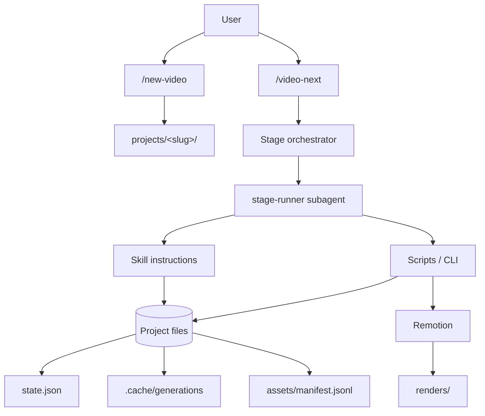

# Architecture

## Overview

coreslopper is a file-based pipeline. Every stage reads files from a project directory and writes files back. The orchestrator passes paths and short summaries, not raw assets. This keeps context windows bounded and makes every stage resumable.



## Control plane

`state.json` is the control plane:

- one entry per stage with `pending`, `running`, `done`, `failed`, or `skipped`;
- input hashes, output paths, attempts, timestamps, and the last error;
- project budget: total, spent, reserved;
- a global `stage` and `status`.

`/video-next` uses `npm run cli -- status` to find the next stage and `stage-start`, `stage-done`, `stage-fail`, and `stage-skip` to persist transitions. Done and skipped stages are not repeated; use `stage-reset` to re-run one after changing an input. Input hashes are recorded when the stage provides them.

## Data plane

The project directory is the only interface between stages:

```text
project.yaml        configuration and budget
brief.md
treatment.md
lyrics.txt
suno-style.txt
song.json
timing.json         generated timing
timing.overrides.json  user-owned corrections
timing.effective.json  resolved base + overrides (derived, gitignored)
style.yaml
characters.yaml
storyboard.yaml
storyboard.md
state.json
assets/manifest.jsonl
assets/references/  user-provided moodboards and reference images, gitignored
assets/footage/     normalized real footage, gitignored
audio/              song and stems, gitignored
characters/<id>/    character sheets and refs, gitignored
renders/            gitignored
review/             report, contact sheet, small stills
```

`timing.overrides.json` is never written by a script. The TypeScript loader merges it over `timing.json` on every load and writes `timing.effective.json` for the renderer.

## Stage isolation

Each stage runs in a fresh `stage-runner` subagent or process. The runner reads the skill and the stage inputs, writes the stage outputs, and returns a compact summary:

```text
STATUS: ok
STAGE: storyboard
OUTPUTS: storyboard.yaml,storyboard.md,review/contact-sheet.svg
WARNINGS: none
SPEND_USD: 0
NEXT: assets
```

The main orchestrator never reads raw images, audio, or full transcripts. It reads `state.json`, `project.yaml`, `review/report.md`, and the summary. Asset production is batched (default 5 shots) by the skill.

## Autonomy and hard stops

`review_mode: auto` is the default. There are no creative approval gates. A stage may stop the pipeline only when:

1. the next batch would exceed `batch_cap_usd` or the remaining project budget;
2. a real provider is configured and its credentials are missing;
3. validation or QA fails after the stage's bounded retries;
4. a script would overwrite a user-owned file (`timing.overrides.json`, `project.yaml`).

`review_mode: final` adds one optional human review before `qa-export`. It is for users who want a gate; it is not the default.

## Schemas

Zod is the source of truth in `packages/core/src/schema.ts`. `npm run schema` generates JSON Schema into `schema/` with `io: input`. Python validates `timing.json` against the generated schema. This gives one contract for TypeScript and Python without duplicating definitions.

The storyboard schema is stricter than YAML: it defines shot IDs, anchors, sources, transitions, refs, prompts, layers, and chaining. Semantic validation in `packages/core/src/timing.ts` checks:

- every anchor resolves;
- shots are ordered, start at 0, end at the song duration, and have no gaps or overlaps;
- every style/character reference exists;
- source-specific fields are present (`motion.component`, AI prompts, footage asset, mixed layers);
- text highlights are part of the text;
- frame chaining points backward.

## Timing resolution

`timing.json` contains BPM, beats, downbeats, onsets, energy, sections, lines, and words. `timing.overrides.json` can replace BPM, beat arrays, section boundaries, line times, and word times. The text itself never comes from overrides.

Anchors are symbolic:

```yaml
start: { type: section, id: chorus_1, edge: start }
end:   { type: line, id: l4, edge: end }
```

Section and line anchors carry an `edge` (`start` or `end`). Word, beat, and downbeat anchors are points. `time` exists as an escape hatch and is flagged in validation.

## Providers and cache

`packages/providers` exposes only:

```ts
generateImage(input)
editImage(input)
imageToVideo(input)
```

The first real adapter is fal.ai; the mock adapter returns deterministic SVG placeholders. Model IDs, params, and prices live in `config/models.yaml`. The `GenerationRunner`:

1. hashes the canonical request, including SHA-256 hashes of every reference file;
2. checks `.cache/generations/<hash>/result.json`;
3. on a hit, copies the cached files and records a zero-cost manifest entry;
4. on a miss, calls the provider, writes the cache, copies outputs to the project, and appends to `assets/manifest.jsonl`;
5. retries transient provider errors with backoff and timeouts;
6. records failures in the manifest.

A batch is estimated before the first paid call. Unknown pricing is a hard error. The budget and batch cap are enforced before generation, and spend is recorded in `state.json` after each successful call.

## Remotion

`packages/remotion` renders a single `MusicVideo` composition. The CLI resolves the project, builds a serializable `VideoProps` object, bundles the composition with the repository as `publicDir`, and calls `renderMedia` or `renderStill`.

The composition:

- maps each resolved shot to a `<Sequence>`;
- renders motion backdrops, media layers, mixed layers, and text overlays;
- uses `useCurrentFrame()` and `useVideoConfig()` for every animation;
- uses `random(seed)` for particles;
- uses `@remotion/three` for 3D;
- has no wall-clock, `Math.random`, `useFrame` clock, or time-based CSS animation.

Formats are separate compositions (`16x9`, `9x16`, `1x1`, `4x5`) with safe-area-aware layouts. The master is 16:9 1080p30; derivatives are not naive crops.

## Claude Code layer

- `.claude/skills/<name>/SKILL.md` — the stage skills.
- `.claude/commands/` — `/new-video`, `/video-next`, `/video-status`.
- `.claude/agents/` — `stage-runner`, `art-director`, `qa-checker`.
- `.claude/hooks/validate-artifacts.mjs` — validates project artifacts after `Write|Edit`.
- `.claude/settings.json` — registers the hook.
- `.mcp.json` — Suno MCP.

The core skills and scripts are tool-agnostic. The commands, agents, hooks, and MCP config are the Claude Code layer.

## Distribution and onboarding

The root package is publishable as `coreslopper`. `npm run build` produces two artifacts:

- `runtime/` — a snapshot of the tracked workflow, excluding generated media and local credentials;
- `dist/cli.js` — a bundled npx entry point with `init`, `doctor`, `new`, `status`, and `validate`.

`npx coreslopper init` copies `runtime/` into a private workspace, checks the local toolchain, optionally installs uv/Python/ffmpeg/Claude Code, writes `FAL_KEY` to `.env`, and configures the Suno MCP server in `.mcp.json`. The npx package deliberately does not depend on Remotion; the workspace's `npm install` provides rendering and audio-analysis dependencies. The workspace is a snapshot, not a clone, so updates use `init --force` rather than `git pull`. See [onboarding.md](onboarding.md) and [ADR 0010](adr/0010-npx-onboarding.md).

## Security and licensing

- No secrets in the repository. `.env.example` documents the variables; `.env` is gitignored.
- Generated media and copyrighted material are gitignored. The demo audio is synthetic.
- Vendored skills are MIT, pinned, and attributed in `docs/THIRD_PARTY.md`.
- Remotion is source-available; its license is separate from this repository's MIT license.
- CI runs without API keys and uses the mock provider.
