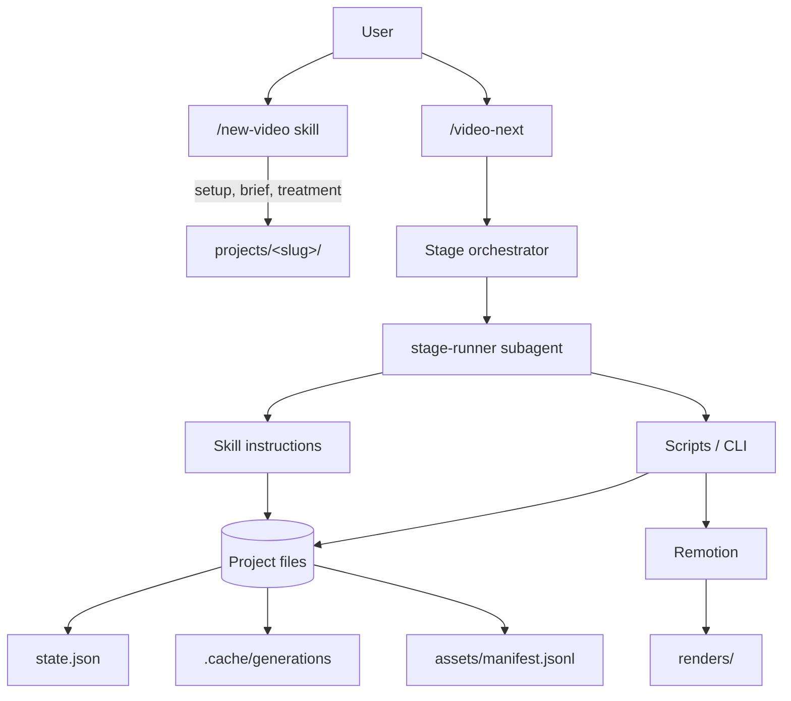

# Architecture

## Overview

coreslopper is a file-based pipeline. Every stage reads files from a project directory and writes files back. The orchestrator passes paths and short summaries, not raw assets. This keeps context windows bounded and makes every stage resumable.



## Control plane

`state.json` is the control plane:

- one entry per stage with `pending`, `running`, `done`, `failed`, or `skipped`;
- input hashes, output paths, attempts, timestamps, and the last error;
- project budget: total, spent, reserved;
- a global `stage` and `status`.

The first three stages (`setup`, `brief`, `treatment`) are interactive: the `new-video` skill runs them with the user in the main session. `/video-next` uses `npm run cli -- status` to find the next stage and `stage-start`, `stage-done`, `stage-fail`, and `stage-skip` to persist transitions. Done and skipped stages are not repeated; use `stage-reset` to re-run one after changing an input. Input hashes are recorded when the stage provides them.

## Data plane

The project directory is the only interface between stages:

```text
project.yaml        configuration and budget
brief.md
treatment.md
lyrics.txt          user-supplied lyrics with section tags
song.json           song metadata: title, artist, language, rights, duration
timing.json         generated timing
timing.overrides.json  user-owned corrections
timing.effective.json  resolved base + overrides (derived, gitignored)
style.yaml
characters.yaml
storyboard.yaml
storyboard.md
state.json
assets/manifest.jsonl
assets/references/  user-provided moodboards and reference images, gitignored
assets/footage/     normalized real footage, gitignored
assets/poses/       pose tracks from reference clips (pose-extract) and their review previews, gitignored
audio/              the user's song.wav and stems/vocals.wav, gitignored
characters/<id>/    character sheets and refs, gitignored (copies of library characters too)
renders/            gitignored
review/             report, contact sheet, small stills
```

`timing.overrides.json` is never written by a script. The TypeScript loader merges it over `timing.json` on every load and writes `timing.effective.json` for the renderer.

## Project kinds

`project.yaml` has a `kind`: `music-video` (the default when it is missing) or `episode` ([ADR 0016](adr/0016-episode-projects.md)). `state.json` records the same kind; `migrateState` copies it from `project.yaml` into older state files, and `validate` fails when the two differ. `stagesFor(kind)` in `packages/core/src/state.ts` picks the stage list, and every state function walks that list.

An episode belongs to a series. `projects/<series>/` holds its **canon**: `series.yaml` (formats, provider defaults, episode plan, optional limits), `bible.md`, `style.yaml`, `characters.yaml`, `sets.yaml`, and references under `characters/` and `sets/` (gitignored). `loadProject` reads an episode's style, characters, and sets from there; an episode has no copies. `new --kind episode` copies formats, providers, and brand from `series.yaml` once; nothing is inherited at run time.

The series budget is an umbrella over the canon and the episodes. `projects/<series>/state.json` books only canon generations (`generate --series` runs them through the same `runBatch` path as a project, with the series manifest in `projects/<series>/assets/manifest.jsonl`). Each episode keeps its own budget in its own state; `new --kind episode` refuses an episode when canon spend plus all episode budgets would exceed `budget_usd`.

An episode's data plane adds:

```text
script.yaml         scenes and script lines; replaces lyrics.txt
takes.json          take registry: source, duration, text hash, file hash
audio/lines/        one take per audible line, gitignored
audio/ambience/     one ambience per scene with atmo, gitignored
audio/episode.wav   the episode track, gitignored
audio/stems/<character>.wav  speaker stems, gitignored
renders/<slug>.en.srt  English subtitles
```

The timing is constructed, not measured. `voice-track` produces takes through the normal batch path (`runBatch`: estimate, budget, cache, manifest). `episode-track` places the lines one after another (`placeLines`), writes `timing.json` without `bpm` or beats, merges `timing.overrides.json`, and mixes `audio/episode.wav` and the speaker stems with ffmpeg **from the effective timing**, so an override moves sound and picture together. `energy` is the RMS envelope of the finished mix. Validation adds two rules: a shot's `refs.sets` must be the set of its scene, and a `ChatWindow` shot names chat lines of its scene.

## Stage isolation

Each stage runs in a fresh `stage-runner` subagent or process. The runner reads the skill and the stage inputs, writes the stage outputs, and returns a compact summary:

```text
STATUS: ok
STAGE: storyboard
OUTPUTS: storyboard.yaml,storyboard.md,review/contact-sheet.svg
WARNINGS: none
SPEND_USD: 0
NEXT: assets
```

The main orchestrator never reads raw images, audio, or full transcripts. It reads `state.json`, `project.yaml`, `review/report.md`, and the summary. Asset production is batched (default 5 shots) by the skill.

## Autonomy and hard stops

`review_mode: auto` is the default. There are no creative approval gates. A stage may stop the pipeline only when:

1. the next batch would exceed `batch_cap_usd` or the remaining project budget;
2. a real provider is configured and its credentials are missing;
3. validation or QA fails after the stage's bounded retries;
4. a script would overwrite a user-owned file (`timing.overrides.json`, `project.yaml`).

`review_mode: final` adds one optional human review before `qa-export`. It is for users who want a gate; it is not the default.

## Schemas

Zod is the source of truth in `packages/core/src/schema.ts`. `npm run schema` generates JSON Schema into `schema/` with `io: input`. Python validates `timing.json` against the generated schema. This gives one contract for TypeScript and Python without duplicating definitions.

Pose tracks follow the same contract: `PoseTrackSchema` (`packages/core/src/pose.ts`, `schema/pose-track.schema.json`) describes what `scripts/pose/extract.py` writes; `pose-extract` runs it through `uv run --extra engine` and checks the file with Zod. The sampling helpers in the same module are browser-safe, so Remotion components retarget a track at render time ([ADR 0054](adr/0054-pose-tracks-from-reference-clips.md)).

The storyboard schema is stricter than YAML: it defines shot IDs, anchors, sources, transitions, refs, prompts, layers, and chaining. Semantic validation in `packages/core/src/timing.ts` checks:

- every anchor resolves;
- shots are ordered, start at 0, end at the song duration, and have no gaps or overlaps;
- every style/character reference exists;
- source-specific fields are present (`motion.component`, AI prompts, footage asset, mixed layers);
- text highlights are part of the text;
- frame chaining points backward.

## Timing resolution

`timing.json` contains BPM, beats, downbeats, onsets, energy, sections, lines, and words. `timing.overrides.json` can replace BPM, beat arrays, section boundaries, line times, and word times. The text itself never comes from overrides.

Anchors are symbolic:

```yaml
start: { type: section, id: chorus_1, edge: start }
end:   { type: line, id: l4, edge: end }
```

Section and line anchors carry an `edge` (`start` or `end`). Word, beat, and downbeat anchors are points. `time` exists as an escape hatch and is flagged in validation.

## Providers and cache

`packages/providers` exposes only:

```ts
generateImage(input)
editImage(input)
textToVideo(input)
imageToVideo(input)
firstLastFrameToVideo(input)
lipSync(input)
```

The cloud adapters are fal.ai, Higgsfield, and Topview, the local video adapter is ComfyUI, and the mock adapter returns deterministic SVG placeholders. Model IDs, provider-specific slugs, params, and prices live in `config/models.yaml`: each role names a base provider and can add `alternatives.<provider>` for another adapter. A project selects `providers.image`, `.video`, and optional `.lipsync`. The `GenerationRunner`:

1. hashes the canonical request, including SHA-256 hashes of every reference file;
2. checks `.cache/generations/<hash>/result.json`;
3. on a hit, copies the cached files and records a zero-cost manifest entry;
4. on a miss, calls the provider, writes the cache, copies outputs to the project, and appends to `assets/manifest.jsonl`;
5. retries transient provider errors with backoff and timeouts;
6. records failures in the manifest.

fal.ai uses a queue endpoint. Image models take references as data URIs; video and lip-sync models download their inputs and reject data URIs, so the adapter uploads start/end frames and audio to fal storage (cached per file within a run) and sends the returned URLs. `reference_field` (legacy alias `image_param`) names the start-frame field. Higgsfield uses an asynchronous request API; the adapter uploads local references through the presigned-upload endpoint, sends a stable `Idempotency-Key`, polls the status URL with backoff, and downloads the result before caching. Higgsfield model schemas are strict, so adapter-only options such as `send_seed` and `reference_field` are stripped before the request is sent. Higgsfield does not implement lip-sync, so `providers.lipsync` can stay on fal.ai. Topview runs every model at `POST /models/<model>/predictions` and polls `GET /predictions/<id>`; it uploads local references as multipart to `/media/files` and sends the signed URL. Its models do not share one request shape, so `request_format: content` selects the `content[]` list (first/last frame as roles), `wan` the `input` + `parameters` shape of Wan 3.0, and the default `flat` sends named fields. A `payment_required` task is a hard stop. Topview has no lip-sync; with `providers.video: topview`, lip-sync defaults to fal.ai ([ADR 0021](adr/0021-topview-provider.md)).

ComfyUI renders clips only. A role's `alternatives.comfyui.model` names a workflow exported with Export (API) into `comfyui/workflows/`. The adapter fills the nodes tagged by title (`cs_prompt`, `cs_start_image`, `cs_frames`, …), uploads frames through `/upload/image`, queues `/prompt`, polls `/history/<id>`, and downloads the video through `/view`. The provider's `fingerprint` adds the workflow's SHA-256 to the cache key, so editing a workflow regenerates. Local runs cost $0, and lip-sync runs locally too when `providers.video` is `comfyui` and `providers.lipsync` is unset. See [ADR 0014](adr/0014-comfyui-local-video.md) and [ADR 0053](adr/0053-local-lipsync-by-default.md).

A batch is estimated before the first paid call. Unknown pricing for the selected provider is a hard error. The budget and batch cap are enforced before generation, and spend is recorded in `state.json` after each successful call.

## Remotion

`packages/remotion` renders a single `MusicVideo` composition. The CLI resolves the project, builds a serializable `VideoProps` object, stages a public directory with symlinks to only the referenced files, bundles the composition, and calls `renderMedia` or `renderStill`. Videos render in segments (default 60 s, fresh browser each, video only) under `.cache/render/`; ffmpeg joins them with the concat demuxer (`-c copy`) and muxes the song once. Shots' sound cues (`motion.props.chimes`) are mixed over the song in the same pass and go through a 4x-oversampled true-peak limiter at `render.true_peak_dbtp`; a Short's re-encode ends in the same limiter. Remotion's caches are capped (`CORESLOPPER_VIDEO_CACHE_MB`, `CORESLOPPER_MEDIA_CACHE_MB`) because its defaults take half of the free RAM each. Finished segments are reused when a render resumes. With `CORESLOPPER_MEDIA_DIR`, a project's `assets/` and `renders/` are symlinks into an external media directory.

The composition:

- maps each resolved shot to a `<Sequence>`;
- renders motion backdrops, media layers, mixed layers, and text overlays;
- uses `useCurrentFrame()` and `useVideoConfig()` for every animation;
- uses `random(seed)` for particles;
- uses `@remotion/three` for 3D;
- has no wall-clock, `Math.random`, `useFrame` clock, or time-based CSS animation.

Formats are `16x9`, `9x16`, `1x1`, and `4x5`, with safe-area-aware layouts. The master is whatever `formats.master` says; render, QA, and stage outputs derive its ID from the master's aspect (`renders/16x9.mp4` for a 16:9 music video, `renders/9x16.mp4` for a vertical episode). Derivatives are not naive crops. The composition plays `audio/song.wav` or `audio/episode.wav` by kind. For episodes it also gets the chat lines for the `ChatWindow` component and, with `render --subtitles en`, burns in the English subtitles inside the format's safe area. A meme burns in its subtitles the same way, in the project's subtitle language (`subtitles` in `project.yaml`: `de` by default, `en`, or `off`).

Thumbnails use a second composition, `Thumbnail` (one frame; 1280x720, or 1080x1920 for a Short with `--format 9x16`, set through `calculateMetadata`). `npm run cli -- thumbnail` resolves the colors from the style bible's palette roles and the hook and tag fonts from its typography, copies the still into `.cache/thumbnail/`, and renders a JPEG with `renderStill`. The composition measures the glyphs once, before the frame is captured, and passes the metrics to pure layout functions, so the same inputs give the same pixels.

Shorts are not rendered: `npm run cli -- short` re-encodes a frame-snapped range of `renders/9x16.mp4` with ffmpeg into `renders/shorts/`. Its bounds use the storyboard's anchor kinds in a compact string form, resolved against the effective timing. `qa` probes each Short (9:16, at most 60 s), checks the Short thumbnails, and parses `review/upload.md` for a title, description, and hashtags per item.

## Release calendar and board

`release` plans `review/calendar.yaml` before it lays out the texts ([ADR 0028](adr/0028-release-board-and-calendar.md)). `buildCalendar` in `packages/core/src/calendar.ts` is pure date arithmetic: it reads the workspace's `config/release-schedule.yaml` (or the defaults), the project's existing calendar, and the calendars of every other publicly released project in `projects/` (an internal project's earlier calendar is not read), then dates each step relative to the release day and places the Shorts on free slot days. `release.release_date` wins; an event the calendar already holds keeps its time unless the release day changed or `--replan` is given. Times are local with their offset, in the schedule's time zone or the computer's.

`board` (`packages/cli/src/release-board.ts`, alias `release-board`) is a dependency-free Node HTTP server on 127.0.0.1 with a static page of ES modules in `packages/cli/src/board/` ([ADR 0030](adr/0030-board-as-hub.md)). Its production view (`board-production.ts`) reads `state.json`, `assets/queue.json`, `assets/review/verdicts.jsonl`, `renders/`, and the series canons; the next step per project and series comes from `packages/core/src/production.ts`. The watchdog round `watch` (`production-watch.ts`) runs `release-run`, then compares a pulse of every project with the last round (`packages/core/src/watch.ts`) and writes `.cache/watch/snapshot.json` and `events.jsonl`; `render` writes `review/progress/<output>.json` while it runs ([ADR 0031](adr/0031-watchdog-and-board-container.md)). For the release view, `release-board-data.ts` builds each project's view from `renders/release/manifest.json`, `review/upload.yaml`, the calendar, and the channel config, reusing the text layout of `release-texts.ts`. Post ids are calendar event ids. The release view writes `review/release-status.json` (done state, live URLs, the approval, and takeovers) under the release lock, retry marks into the log `review/autopilot.json`, and the approval of a proposed day also writes `release.release_date` into `project.yaml`; an internal project is never approved. The board's other writes belong to their views: the wizard creates projects and takes uploads, lyrics, and references, the library manages characters, and the review view writes notes and rounds. Every write passes the write guard; media is served from the release folder with byte ranges and a path check. `release` reads the status back into `microsite/<slug>.json`; the board runs a quick `release --no-render` without new stills after a live URL arrives.

The release autopilot ([ADR 0029](adr/0029-release-autopilot.md)) is a pure plan plus a runner. `planAutopilot` in `packages/core/src/autopilot.ts` maps each calendar event to its API action (or none) and a state from the calendar, `review/release-status.json` (the approval, done state, takeovers), the log `review/autopilot.json`, the schedule's `autopilot:` block, the credentials, and the clock. `release-run` (`packages/cli/src/release-autopilot.ts`) takes a lock in `.cache/`, first polls private YouTube uploads for going public, then acts on every due event: YouTube and TikTok through `publishProject`, Instagram, X, and LinkedIn through the post adapters in `packages/providers/src/publish/` (Instagram media hosted in fal.ai storage), the links step through `videos.update`, the microsite by a copy and a command. Each attempt is logged as `running` first; an error the adapter marks *uncertain* (the post may be live) is never retried by itself. `release-timer` installs the round in the Windows Task Scheduler (WSL), systemd, or launchd. The board reads the same plan and writes the approval, takeovers, and retry marks. A round leaves a project with `distribution: internal` alone – it posts nothing of it, also with an approval from before it became internal – and `release-run --plan` prints one line for it and lists no event of it.

## Release folder

`release` assembles `renders/release/` after the renders exist ([ADR 0024](adr/0024-release-folder-manual-distribution.md)). It reads `review/upload.yaml`, the optional `release:` block of `project.yaml`, and the optional `config/channel.yaml`; it hardlinks (or copies) renders, thumbnails, Shorts, and the cover, converts the song to a deliverable WAV only when needed, cuts the Spotify canvas with ffmpeg (one process at a time, six threads), writes lyrics as text, LRC, and SRT from the effective timing, lays out one text file per platform with the limits from `PLATFORM_LIMITS`, and records `manifest.json`. `render` records each full render's inputs hash and file hash in `state.json` (`artifacts`), so `release` re-renders a format only when it is missing or stale. `qa` checks the folder against the manifest and the specifications with ffprobe and reports PASS, FAIL, or TODO; a TODO (a fact only the user can give) never blocks `READY`. A project with `distribution: internal` in `project.yaml` is never released publicly: `release` builds no folder and plans no calendar, says so, and exits cleanly; an earlier folder or calendar stays as it is, and the board's quick refresh skips it. An earlier calendar books no release day and no slot for another project's plan, because planning reads only publicly released projects.

## Publishing

`publish` is a user command after the pipeline, not a stage ([ADR 0023](adr/0023-publish-command.md)). It reads `review/upload.yaml` (Zod `UploadDataSchema`), builds a publish plan without network calls (files, platform limits, quota, and earlier uploads from `review/publish.json` by file hash), and then runs one publish adapter per platform: `YouTubePublisher` (Data API v3, resumable `videos.insert` as private or scheduled, `thumbnails.set`), `TikTokPublisher` (Content Posting API inbox path, chunked upload, status polling), or `MockPublisher`. The adapters live in `packages/providers/src/publish/`, next to the generation providers but behind their own interface (`PublishAdapter.publish(item)`). OAuth uses a loopback redirect with PKCE (`publish-auth`); refresh tokens are in `.env`, access tokens only in memory, and errors are masked before they are printed or logged. `upload-text` renders `review/upload.md` from the same data.

## Claude Code layer

Paths as a workspace sees them; in the upstream repository they live under `workspace/` ([ADR 0036](adr/0036-workspace-payload.md)).

- `.claude/skills/<name>/SKILL.md` — the stage skills.
- `.claude/commands/` — `/video-next`, `/video-status`, `/series-status`. `/new-video` and `/new-episode` are skills. `/video-next` reads the project kind from `status` and walks that kind's stages.
- `.claude/agents/` — `stage-runner`, `art-director`, `qa-checker`.
- `.claude/hooks/validate-artifacts.mjs` — validates project artifacts (including `review/upload.yaml`) after `Write|Edit`.
- `.claude/settings.json` — registers the hook.

The core skills and scripts are tool-agnostic. The commands, agents, and hooks are the Claude Code layer.

## Character library

`packages/cli/src/character-library.ts` keeps the workspace's characters in `library/characters/<id>/` ([ADR 0034](adr/0034-character-library.md)): a `character.yaml` (`LibraryCharacterSchema`) and the files beside it, stored once by content hash. `importCharacters` reads a project's or canon's `characters.yaml` and finds each character's entry (its `library` link, a same-id entry sharing a file, `--into`, or a new id), copies new files, appends new references and states, and records the import in `history`; `stage-done … style-character` calls it. `useCharacter` copies an entry's identity and the chosen states into a target's `characters/<id>/` and edits its `characters.yaml` through the YAML document API, so comments and the other characters stay as they were. Where a library character is used is derived from the `library` fields of every `characters.yaml`, not stored. The board serves entry files at `/library-files/<id>/<file>` and writes through `/api/library/*`.

## Distribution and onboarding

The root package is publishable as `coreslopper`. `npm run build` produces two artifacts:

- `runtime/` — a snapshot of the tracked workflow, excluding generated media and local credentials;
- `dist/cli.js` — a bundled npx entry point with `init`, `update`, `doctor`, `new`, `status`, and `validate`.

`npx coreslopper init` copies `runtime/` into a private workspace, checks the local toolchain, optionally installs uv/Python/ffmpeg/Claude Code, and writes `FAL_KEY`, `HIGGSFIELD_API_KEY`, `TOPVIEW_API_PLATFORM_KEY`, and the optional YouTube and TikTok app credentials to `.env`. The npx package deliberately does not depend on Remotion; the workspace's `npm install` provides rendering and audio-analysis dependencies. The workspace is a snapshot, not a clone, so `npx coreslopper@latest update` merges a newer runtime against the baseline recorded in `coreslopper.workspace.json` rather than `git pull` ([ADR 0012](adr/0012-workspace-update.md), [ADR 0047](adr/0047-workspace-marker-and-visible-conflicts.md)). See [onboarding.md](onboarding.md) and [ADR 0010](adr/0010-npx-onboarding.md).

## Security and licensing

- No secrets in the repository. `.env.example` documents the variables; `.env` is gitignored.
- Nothing goes public without the user: `publish` is a user command and uploads private or scheduled videos and drafts, and the release autopilot posts only a release the user approved on the board.
- Generated media and copyrighted material are gitignored. The demo audio is synthetic.
- Vendored skills are MIT, pinned, and attributed in `docs/THIRD_PARTY.md`.
- Remotion is source-available; its license is separate from this repository's MIT license.
- CI runs without API keys and uses the mock provider.
