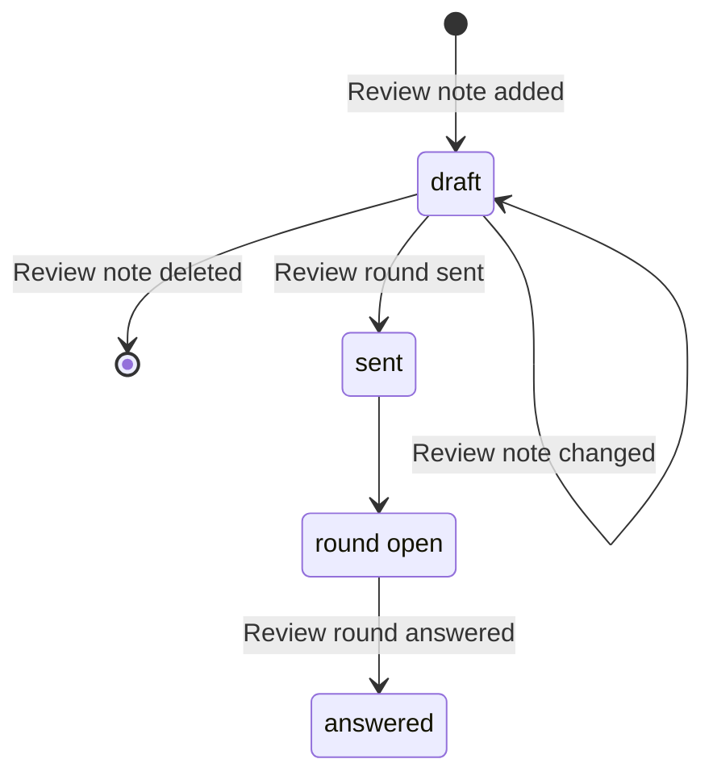
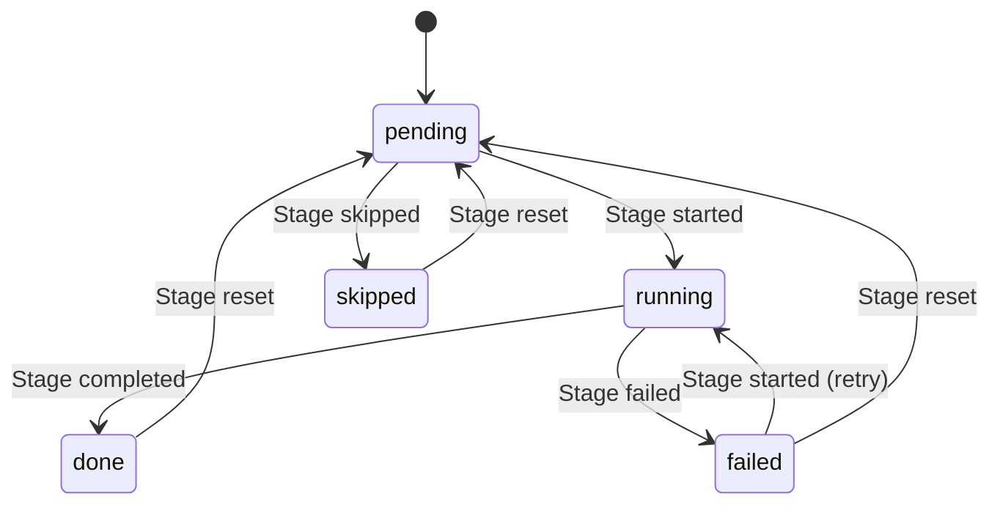
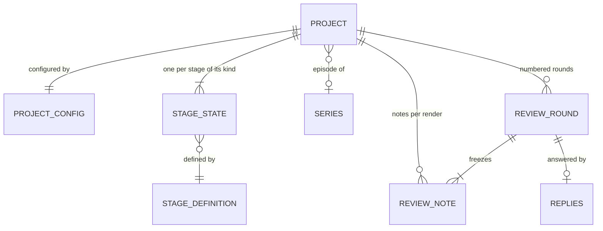

# Logical data model – coreslopper

> **As-is** for the adopted slices, recovered from `packages/core/src/schema.ts` (Zod is the source, ADR 0004).
> Slices: project and stage pipeline (2026-11-21); human review (draft, 2026-11-21). Open points are hotspots in `docs/domain/events.yaml`.

## Aggregates

### AGG-Project – Project (as-is)

Persisted as two documents in `projects/<slug>/`: the configuration `project.yaml` (user-owned, never written by
a stage runner) and the control plane `state.json`. The consistency boundary in code is `state.json`
(one load, modify, save); whether `project.yaml` is part of the same boundary is HS-5.

**Configuration (`project.yaml`)**

| Attribute | Type | Required | Source |
|---|---|---|---|
| Slug | ProjectSlug | yes | EVT-ProjectCreated |
| Title | Text | yes | EVT-ProjectCreated |
| Created | Date | yes | EVT-ProjectCreated |
| Project kind | `music-video` \| `episode` | default `music-video` | EVT-ProjectCreated |
| Review mode | `auto` \| `final` | default `auto` | EVT-ProjectCreated (HS-8) |
| Budget | Money (USD, > 0) | yes | EVT-ProjectCreated (HS-5) |
| Batch cap | Money (USD) | no – default 30 % of the remaining budget | read by CMD-RecordSpend's pre-check |
| Series | SeriesSlug | when kind is `episode` | EVT-ProjectCreated |
| Episode number | Positive integer | when kind is `episode` | EVT-ProjectCreated |
| Workflow version | Version | yes | EVT-ProjectCreated |
| Formats, brand, models, providers | – | outside this slice | – |

**Control plane (`state.json`)**

| Attribute | Type | Required | Source |
|---|---|---|---|
| Project | ProjectSlug | yes | EVT-ProjectCreated |
| Project kind | `music-video` \| `episode` | no – filled from `project.yaml` on load | EVT-ProjectCreated |
| Workflow version | Version | yes | EVT-ProjectCreated |
| Current stage | StageId | yes | EVT-StageStarted, EVT-StageCompleted, EVT-StageSkipped, EVT-StageReset |
| Overall status | StageStatus | yes | derived from all stage states |
| Stage states | map StageId → Stage state | yes | all stage events |
| Budget total / spent / reserved | Money | yes | EVT-ProjectCreated, EVT-SpendRecorded; reserved is always 0 (HS-9) |
| Errors | list of Text | default empty | EVT-StageFailed (never cleared) |
| Artifacts | map Text → Text | default empty | written by `render`, outside this slice |
| Updated at | Timestamp | yes | every event |

**Stage state (entity, one per stage of the kind's list)**

| Attribute | Type | Required | Source |
|---|---|---|---|
| Status | StageStatus | yes | all stage events |
| Outputs | list of ProjectPath | default empty | EVT-StageCompleted |
| Attempt count | Count | default 0 | EVT-StageStarted (+1), EVT-StageReset (0) – term HS-2 |
| Input hash | Hash | no | EVT-StageCompleted – never compared (HS-10) |
| Last error | Text | no | EVT-StageFailed; also holds the skip reason (EVT-StageSkipped) |
| Started at / Finished at | Timestamp | no | EVT-StageStarted / EVT-StageCompleted, EVT-StageFailed |

**Stage definition (value, fixed per project kind in code)** – ID, label, skills, outputs, interactive flag,
mechanical flag (no reader). Music video: `setup`✋ `brief`✋ `treatment`✋ `audio-analysis` `style-character`
`storyboard` `assets` `assembly` `qa-export`. Episode: `setup`✋ `script`✋ `voice-track` `episode-track`
`storyboard` `assets` `assembly` `qa-export`. Order is list order; there are no other dependencies.

### AGG-ProjectReview – Project review (as-is, draft)

Files in `projects/<slug>/review/`. The board changes notes and sends rounds under one lock per project
(`review/.notes.lock`); the desktop player writes notes without it; the agent writes replies.

**Notes file (one per render, `notes/<video-stem>.json`)** – Render (file name), Frame rate, Notes.

| Attribute of a note | Type | Required | Source |
|---|---|---|---|
| Note ID | NoteId | no – given by the board on its first write | EVT-ReviewNoteAdded |
| Frame / Seconds / Time | FrameNumber / Seconds / Timecode | yes | EVT-ReviewNoteAdded, EVT-ReviewNoteChanged |
| End frame / end seconds / end time | – | no (a range; board only) | EVT-ReviewNoteAdded, EVT-ReviewNoteChanged |
| Text | Text | yes | EVT-ReviewNoteAdded, EVT-ReviewNoteChanged |
| Round | RoundNumber | no – absent means draft | EVT-ReviewRoundSent |
| Created | Timestamp | no | EVT-ReviewNoteAdded |

**Review round (`rounds/<NNN>.json`, frozen)** – Round number, Render, Frame rate, Sent at, and per note its ID,
frames, range, Shots (list of ShotId), Section (SectionId, from the note's start), Text. Source: EVT-ReviewRoundSent.

**Replies (`rounds/<NNN>.replies.json`)** – Round number, Answered at, Render with the fixes (optional), and per
note ID a Reply status (`fixed`, `partly`, `not-fixed`, `question`) and a Reply text. Source:
EVT-ReviewRoundAnswered. Its existence makes the round answered (HS-18).

## Lifecycle

Stage state as the code allows it today. Every transition is accepted from every status (HS-11); the diagram
shows the transitions the orchestrator actually uses.

Confirmed with the user (2026-11-21), ahead of the code (gap register G-2, G-3): start only an autonomous stage
from `pending` or `failed` after every earlier stage is `done` or `skipped`; complete and fail only from
`running`; an interactive stage is completed from `pending` or `failed` by its setup skill; skip only from
`pending` or `failed`; a reset refuses `running` and returns every later `done` or `skipped` stage to `pending`.

The next stage is the first `pending` or `failed` stage in list order. The project is done when every stage is
`done` or `skipped`; any `failed` stage makes the overall status `failed`.

## Overview

