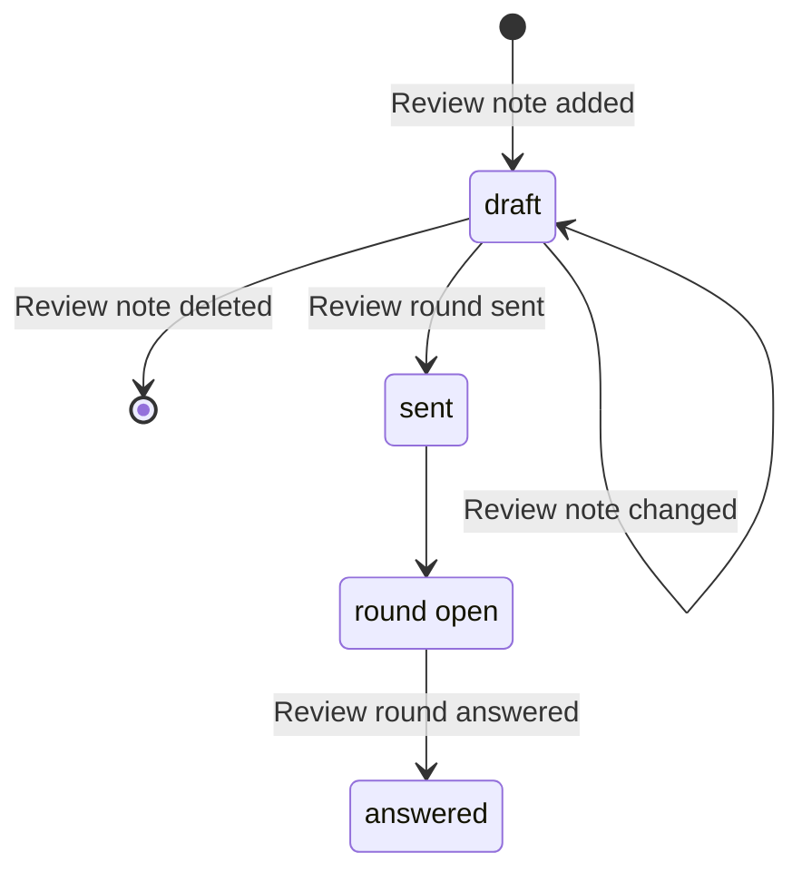
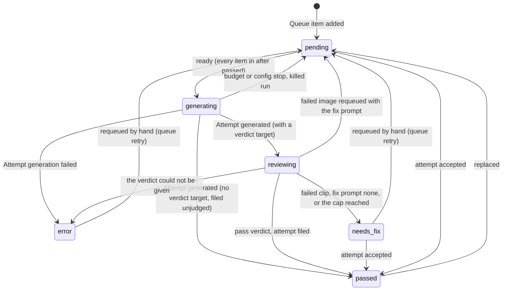
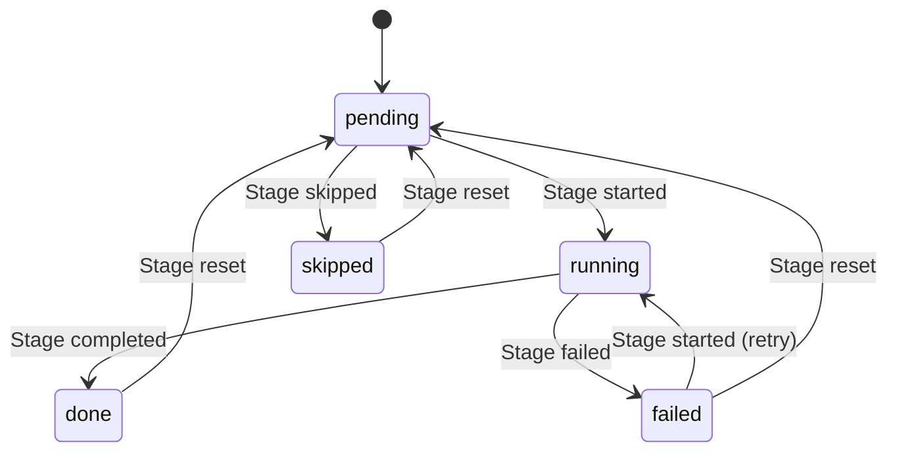
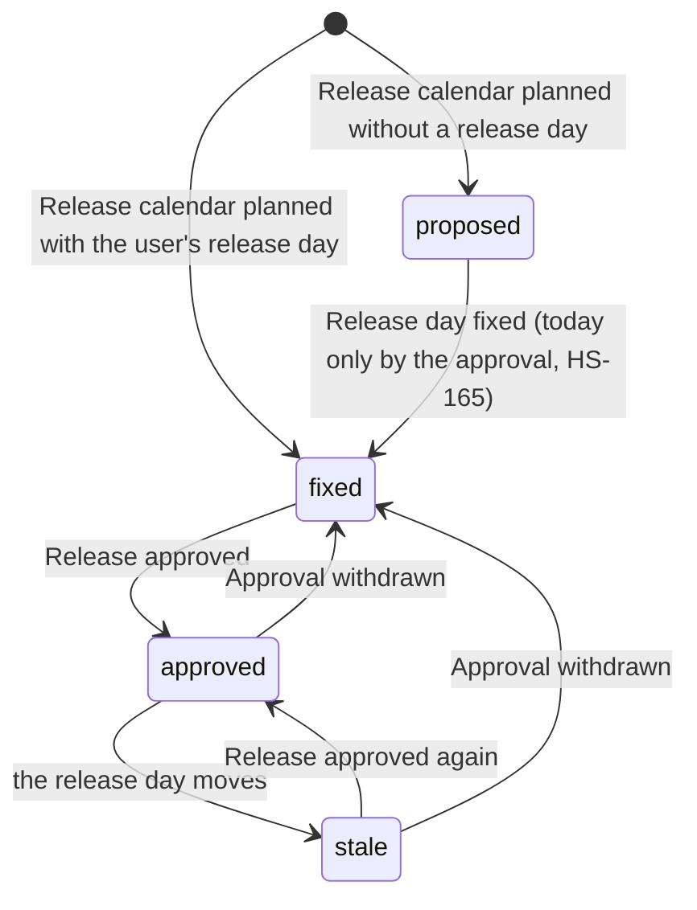
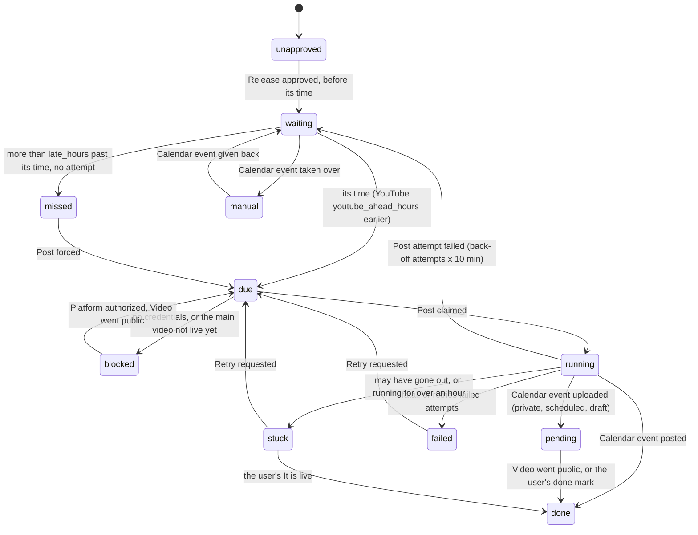
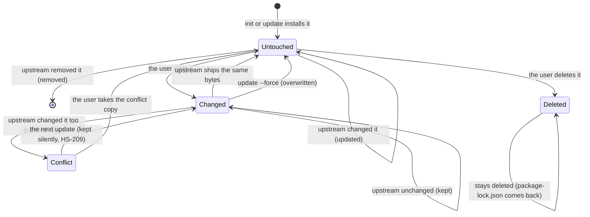
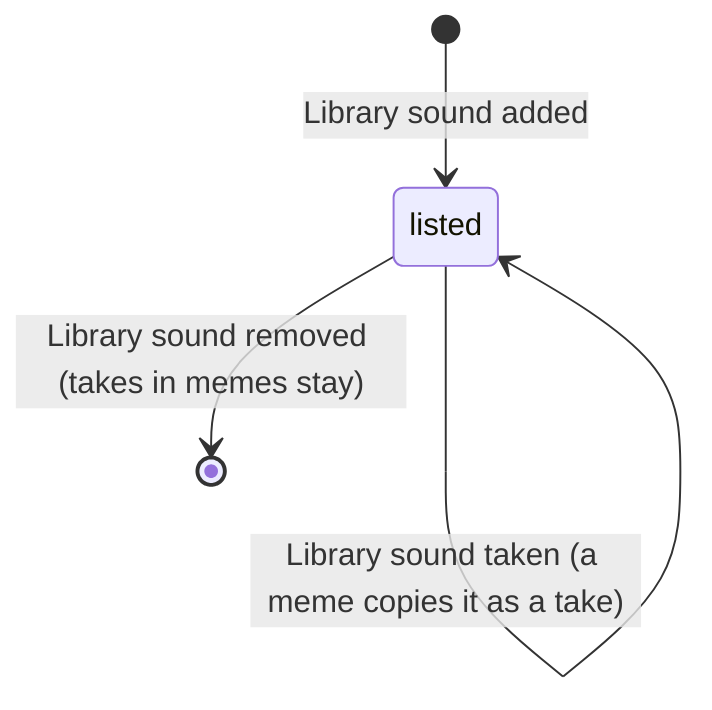
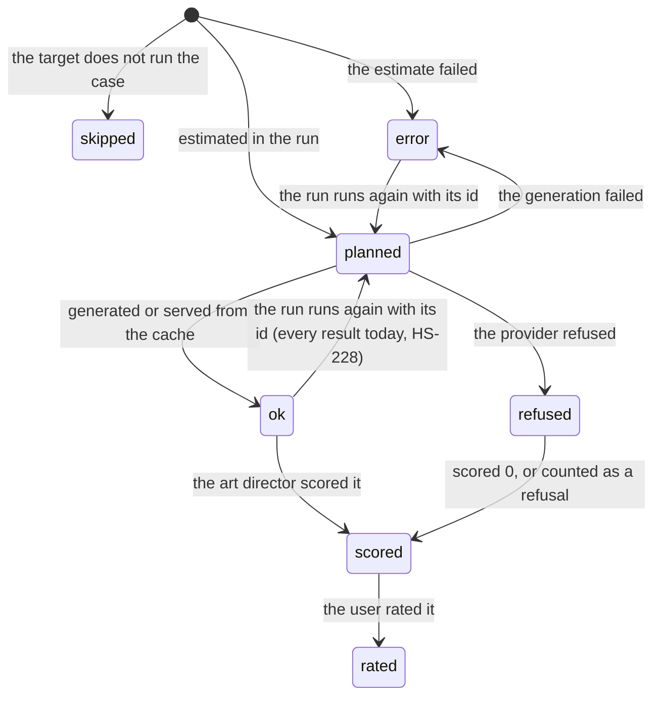

# Logical data model – coreslopper

> **As-is** for the adopted slices, recovered from `packages/core/src/schema.ts` (Zod is the source, ADR 0004).
> Slices: project and stage pipeline (2026-11-21); human review (2026-11-21); generation queue and verdicts (2026-11-21, decided by recommendation); timing, storyboard and generation (2026-11-21), series, bibles and the character library, render (2026-11-22), each decided by recommendation with four answers from the user. Open points are hotspots in `docs/domain/events.yaml`.
> **Target** additions from feature `meme` (user, 2026-11-22; ADR 0051, proposed): the project kind `meme` and its
> pitch, the script's sound line, the library take, and `AGG-LibrarySound`. No code exists for them yet.
> Script, take registry and episode track belong to BC-ScriptedAudio since HS-258; their sections stay where they are.

## Aggregates

### AGG-Project – Project (as-is)

Persisted as two documents in `projects/<slug>/`: the configuration `project.yaml` (user-owned, never written by
a stage runner) and the control plane `state.json`. The consistency boundary in code is `state.json`
(one load, modify, save); whether `project.yaml` is part of the same boundary is HS-5.

**Configuration (`project.yaml`)**

| Attribute | Type | Required | Source |
|---|---|---|---|
| Slug | ProjectSlug | yes | EVT-ProjectCreated |
| Title | Text | yes | EVT-ProjectCreated |
| Created | Date | yes | EVT-ProjectCreated |
| Project kind | `music-video` \| `episode` \| `meme` (target) | default `music-video` | EVT-ProjectCreated, EVT-MemeCreated |
| Review mode | `auto` \| `final` | default `auto` | EVT-ProjectCreated (HS-8) |
| Budget | Money (USD, > 0) | yes | EVT-ProjectCreated (HS-5) |
| Batch cap | Money (USD) | no – default 30 % of the remaining budget | read by CMD-RecordSpend's pre-check |
| Series | SeriesSlug | when kind is `episode` | EVT-ProjectCreated |
| Episode number | Positive integer | when kind is `episode` | EVT-ProjectCreated |
| Workflow version | Version | yes | EVT-ProjectCreated |
| Formats, brand, models, providers | – | outside this slice | – |

**Meme (target, kind `meme`)** – created whole by `CMD-CreateMeme`; setup is done at creation.

| Attribute | Type | Required | Source |
|---|---|---|---|
| Slug, Title, Budget, Providers | as above; budget default 10 USD, at least the configured minimum | yes | EVT-MemeCreated |
| Formats | the master format 9:16, and no other | yes | EVT-MemeCreated (CMD-CreateMeme rule) |
| Pitch | Document `pitch.md`: the idea (required) and the setting (optional) in the user's words | yes | EVT-MemeCreated |
| Library characters | list of library character ids, possibly empty; copied into the meme's character bible by character use, so the project keeps no list of its own | no | EVT-MemeCreated, EVT-LibraryCharacterUsed |

The pitch is a starting point, never checked against the script. The track's limit of 30 seconds has no attribute
yet (HS-264).

**Control plane (`state.json`)**

| Attribute | Type | Required | Source |
|---|---|---|---|
| Project | ProjectSlug | yes | EVT-ProjectCreated |
| Project kind | `music-video` \| `episode` \| `meme` (target) | no – filled from `project.yaml` on load | EVT-ProjectCreated, EVT-MemeCreated |
| Workflow version | Version | yes | EVT-ProjectCreated |
| Current stage | StageId | yes | EVT-StageStarted, EVT-StageCompleted, EVT-StageSkipped, EVT-StageReset |
| Overall status | StageStatus | yes | derived from all stage states |
| Stage states | map StageId → Stage state | yes | all stage events |
| Budget total / spent / reserved | Money | yes | EVT-ProjectCreated, EVT-SpendRecorded; reserved is always 0 (HS-9) |
| Errors | list of Text | default empty | EVT-StageFailed (never cleared) |
| Artifacts | map Text → Text | default empty | written by `render`, outside this slice |
| Updated at | Timestamp | yes | every event |

**Stage state (entity, one per stage of the kind's list)**

| Attribute | Type | Required | Source |
|---|---|---|---|
| Status | StageStatus | yes | all stage events |
| Outputs | list of ProjectPath | default empty | EVT-StageCompleted |
| Attempt count | Count | default 0 | EVT-StageStarted (+1), EVT-StageReset (0) – term HS-2 |
| Input hash | Hash | no | EVT-StageCompleted – never compared (HS-10) |
| Last error | Text | no | EVT-StageFailed; also holds the skip reason (EVT-StageSkipped) |
| Started at / Finished at | Timestamp | no | EVT-StageStarted / EVT-StageCompleted, EVT-StageFailed |

**Stage definition (value, fixed per project kind in code)** – ID, label, skills, outputs, interactive flag,
mechanical flag (no reader). Music video: `setup`✋ `brief`✋ `treatment`✋ `audio-analysis` `style-character`
`storyboard` `assets` `assembly` `qa-export`. Episode: `setup`✋ `script`✋ `voice-track` `episode-track`
`storyboard` `assets` `assembly` `qa-export`. Meme (target): `setup`✋ `script`✋ `style-character` `voice-track`
`episode-track` `storyboard` `assets` `assembly` `qa-export`. Order is list order; there are no other dependencies.

### AGG-ProjectReview – Project review (as-is)

Files in `projects/<slug>/review/`. The board changes notes and sends rounds under one lock per project
(`review/.notes.lock`); the agent writes replies.

**Notes file (one per render, `notes/<video-stem>.json`)** – Render (file name), Frame rate, Notes.

| Attribute of a note | Type | Required | Source |
|---|---|---|---|
| Note ID | NoteId | no – given by the board on its first write | EVT-ReviewNoteAdded |
| Frame / Seconds / Time | FrameNumber / Seconds / Timecode | yes | EVT-ReviewNoteAdded, EVT-ReviewNoteChanged |
| End frame / end seconds / end time | – | no (a range; board only) | EVT-ReviewNoteAdded, EVT-ReviewNoteChanged |
| Text | Text | yes | EVT-ReviewNoteAdded, EVT-ReviewNoteChanged |
| Round | RoundNumber | no – absent means draft | EVT-ReviewRoundSent |
| Created | Timestamp | no | EVT-ReviewNoteAdded |

**Review round (`rounds/<NNN>.json`, frozen)** – Round number, Render, Frame rate, Sent at, and per note its ID,
frames, range, Shots (list of ShotId), Section (SectionId, from the note's start), Text. Source: EVT-ReviewRoundSent.

**Replies (`rounds/<NNN>.replies.json`)** – Round number, Answered at, Render with the fixes (optional), and per
note ID a Reply status (`fixed`, `partly`, `not-fixed`, `question`) and a Reply text. Source:
EVT-ReviewRoundAnswered. Its existence makes the round answered (HS-18).

### AGG-GenerationQueue – Generation queue (as-is)

One file per project, `assets/queue.json` (`{version: 1, items}`), read, changed and written whole through a
temp file and a rename (`packages/cli/src/queue.ts:111-119`). The Zod schema lives in the CLI, not in
`schema.ts` (gap). The run lock is `assets/queue.lock` with the run's pid.

**Queue item**

| Attribute | Type | Required | Source |
|---|---|---|---|
| Item id | QueueItemId (`keyframe:<shot>`, `clip:<shot>`, or hand-written) | yes | EVT-QueueItemAdded |
| Kind | `image` \| `clip` \| `audio` (from the generation operation) | yes | EVT-QueueItemAdded |
| Generation item | the batch item as `generate` takes it | yes | EVT-QueueItemAdded, EVT-QueueItemReplaced, EVT-QueueItemRequeued |
| Out path | ProjectPath (an episode may file under `../<series>/`) | yes | EVT-QueueItemAdded |
| Verdict target | ShotId or reference label (`sheet:`, `state:`, `plate:`, `prop:`), one of both | no – absent: filed unjudged | EVT-QueueItemAdded |
| After | list of QueueItemId (an id not in the queue counts as done) | default empty | EVT-QueueItemAdded |
| Chain from | QueueItemId of a clip whose last frame starts this one | no | EVT-QueueItemAdded |
| Provider for the next attempt | ProviderKind (cloud fallback), cleared after one attempt | no | CMD-RetryQueueItem |
| Status | QueueItemStatus | default `pending` | every event |
| Attempt number | next or last attempt | default 1 | EVT-AttemptGenerated, EVT-QueueItemRequeued |
| Order | Integer; a requeued item gets a new, higher one | yes | EVT-QueueItemAdded, EVT-QueueItemRequeued |
| Focus | the blocking defects the next verdict checks first | no | EVT-QueueItemRequeued, EVT-QueueItemNeedsFix |
| Note, Error | Text | no | EVT-QueueItemNeedsFix, EVT-AttemptAccepted, EVT-AttemptGenerationFailed |

**Attempt (inside the item)** – Attempt number, Attempt file (`<out dir>/attempts/<name>-a<n>.<ext>`), Seed,
Provider (written, read by no code), and a copy of its verdict: Verdict, Score, Issues, Fix prompt. Source:
EVT-AttemptGenerated, EVT-VerdictGiven.

**Verdict log (`assets/review/verdicts.jsonl`; series canon `<series>/review/verdicts.jsonl`)** – append-only,
the record of every verdict (HS-36), outside the aggregate: Image, Subject (ShotId or reference label), Attempt
number, Verdict (`pass` \| `fail`), Score (0–10), Issues (blocking defects and verdict notes, `note:` prefix),
Fix prompt, Judged at (`reviewedAt`), Clip, Start frame PSNR. Source: EVT-VerdictGiven. The latest line per
subject counts; a clip counts apart from its keyframe.

**Patch log (`assets/review/patches.jsonl`)** – Image, Box, Prompt, References, Attempt file. Source:
EVT-RegionPatched.

Decided 2026-11-21 by recommendation (HS-38, HS-39, HS-41, HS-42), ahead of the code: no accept, requeue,
replace or drop while `generating` or `reviewing`; no requeue of a `passed` item (a replace redoes it, and
returns every passed item after it to `pending`); at most three local attempts and one cloud attempt since the
last replace; a user's accept is final; no lost write and one run per project.

### AGG-ProjectTiming – Project timing (as-is)

Two files per project merged into one effective timing on every load: the measured timing `timing.json`
(`TimingSchema`, written whole by the analysis) and the user's `timing.overrides.json`
(`TimingOverridesSchema`). The merge ends in one check of the whole result (`packages/core/src/timing.ts:61-165`).
Times are seconds in the song, checked with a tolerance of 0.05 s.

**Timing (root)**

| Attribute | Type | Required | Source |
|---|---|---|---|
| Audio | path, Duration (seconds), sample rate (always 48 kHz from the analysis) | yes | EVT-SongAnalyzed |
| BPM | positive number; an episode has none | no | EVT-SongAnalyzed, EVT-TimingOverridden |
| Beats, Downbeats, Onsets | lists of Seconds inside the audio | default empty | EVT-SongAnalyzed (beats and downbeats also EVT-TimingOverridden) |
| Energy | frame rate, hop, values normalized to the peak | yes | EVT-SongAnalyzed |
| Sections | at least one Section | yes | EVT-SongAnalyzed |
| Lines | list of Line | default empty | EVT-SongAnalyzed |
| Meta | untyped: device, models, speech recognition used, downbeat phase, line kinds, line directions, line confidence, cues (HS-65) | default empty | EVT-SongAnalyzed |

**Section** – Id (SectionId, from the tag text, e.g. `verse_1`, `chorus_2`, `intro`), Label (the tag text),
Start, End, Confidence (0–1, the lower of its two boundaries), Sources. Source: EVT-SongAnalyzed; Start and End
also EVT-TimingOverridden.

**Line** – Id (LineId, positional `l1…ln`), Section (SectionId), Start, End, Text (from the lyrics), Words.
**Word** – Text, Start, End; addressed by line and index. Source: EVT-SongAnalyzed; times also
EVT-TimingOverridden.

**Timing override** – BPM, Beats, Downbeats (replace the whole value); per section and per line by id: Start,
End; per word by line and index: Start, End. Source: EVT-TimingOverridden.

**Not in the aggregate** – the snapshot `timing.effective.json` (RM-EffectiveTiming), the timing report
`timing.report.md` (RM-TimingReport), the song files and `song.json` (no schema, HS-64), the lead and backing
stems.

Decided 2026-11-21 by recommendation, ahead of the code: every line inside its section and every word inside its
line (HS-53); an override that misses its target is reported by name, without blocking commands that do not read
timing (HS-54); words in parentheses are timed as backing vocals (user, HS-50); the timing's duration matches the
song (HS-59).

### AGG-Lyrics – Lyrics (as-is)

`lyrics.txt`, plain text: section tags on their own line (`[Verse 1]`, `[Chorus]`), each followed by its sung
lines; words in parentheses are backing vocals. Written whole and atomically by `writeLyrics`
(`packages/cli/src/board-wizard.ts:271-278`), which refuses lines before the first tag and lyrics without a sung
line. Source: EVT-LyricsWritten (Lyrics text, Sections). A hand edit bypasses the check; the analysis then puts
lines before the first tag into a section `unlabeled` (HS-68).

### AGG-Storyboard – Storyboard (as-is)

One file per project, `storyboard.yaml` (`StoryboardSchema`, `packages/core/src/schema.ts:277-371`), parsed whole
by `loadProject` and resolved and checked as one by `resolveStoryboard` against the effective timing, the bibles,
and in an episode the script (`packages/core/src/timing.ts:455-577`). One model for both project kinds.

**Storyboard (root)**

| Attribute | Type | Required | Source |
|---|---|---|---|
| Version | always 1 | yes | EVT-StoryboardWritten |
| Shots | at least one Shot, in start order | yes | EVT-StoryboardWritten, EVT-StoryboardRevised |
| Timing, Style, Characters | paths with defaults, read by nothing (HS-74, to be removed) | default | – |

**Shot** – the attributes all come from EVT-StoryboardWritten and EVT-StoryboardRevised.

| Attribute | Type | Required |
|---|---|---|
| Id | ShotId `shot-NNN`, unique | yes |
| Section | SectionId of the effective timing (a scene id in an episode) | yes |
| Start, End | Anchor (BC-Timing); End after Start, at least one frame | yes |
| Source | Shot Source: motion, ai-clip, footage, mixed | yes |
| Description | text | yes |
| Camera | text, default `static`; direction for the prompts, read by no code (HS-75) | default |
| Text, Highlights | on-screen text; highlights are words of it (HS-81) | no, default empty |
| Transition | type cut, fade, dissolve, wipe, glitch (default cut) and duration in seconds (default 0) | default |
| Continuity references | style tokens (paths into the style bible), characters, sets, plate (`<set>/<plate>`), props, character state per character | default empty |
| Motion | component (one of the motion components) and untyped props (HS-83) | for motion |
| Prompts | keyframe, video | for an AI clip (HS-73) |
| Asset | path of the footage or clip | for footage |
| Lip-sync | character, optional audio source (default the vocal stem, or the speaker stem in an episode) | no |
| Layers | at least two Layers | for mixed |
| Focus point | x and y in 0–1, default centre | no |
| Chaining | enabled, from (ShotId of an earlier shot) | no |

**Layer** – Layer type (motion, ai-clip, footage), Asset, Component, Blend (read by nothing, HS-75), Order
(z-index, default 0). Motion layers share the shot's motion props (HS-82).

**Not in the aggregate** – the resolved storyboard (RM-ResolvedStoryboard: seconds and frames per shot, made on
demand), the storyboard table `storyboard.md` (RM-StoryboardTable), the contact sheet `review/contact-sheet.svg`
(RM-ContactSheet), and the sets, plates, props and character states the references point to (bibles and canon).

Decided 2026-11-21, ahead of the code: lip-sync checks for both project kinds (user and recommendation, HS-72); a
lip-sync shot needs no video prompt and a chained shot no keyframe prompt (HS-73); every layer renderable
(HS-82); a highlight is one word (HS-81); the agent is the only writer (user, HS-77).

### AGG-CachedGeneration – Cached generation (as-is)

One record per cache key, `.cache/generations/<key>/result.json`, next to the provider's files. The cache is shared
by every project and series of the workspace (`packages/cli/src/generate.ts:711`). It is written once by
`GenerationRunner.run` after the provider returned files (`packages/providers/src/runner.ts:167-189`). It is
reused while all its files exist and never changed or removed by a tool.

| Attribute | Type | Required | Source |
|---|---|---|---|
| Cache key | CacheKey (SHA-256 of the canonical request) | yes | EVT-GenerationCompleted |
| Generation id | `gen_<first 12 of the key>` | yes | EVT-GenerationCompleted |
| Operation | Generation Operation (9 values) | yes | EVT-GenerationCompleted |
| Model role | ModelRoleId (`image.keyframe`, `video.lipsync`, …) | yes | EVT-GenerationCompleted |
| Provider | ProviderKind `fal` \| `higgsfield` \| `topview` \| `comfyui` \| `mock` | yes | EVT-GenerationCompleted |
| Model | cloud model slug or ComfyUI workflow name | yes | EVT-GenerationCompleted |
| Prompt, Seed | text (a Flex or FL2VA prompt rendered to text); Integer, derived from model, prompt and operation when absent | yes | EVT-GenerationCompleted |
| References | list of file paths with their content hash | default empty | EVT-GenerationCompleted |
| Audio | file path (lip-sync and audio-guided clips) | no | EVT-GenerationCompleted |
| Params | the role's params merged with the item's | default empty | EVT-GenerationCompleted |
| Planned cost | Money (USD): units × the role's price; 0 for ComfyUI and mock | yes | EVT-GenerationCompleted |
| Files | at least one file path in the cache folder | yes | EVT-GenerationCompleted |
| Created at | Timestamp | yes | EVT-GenerationCompleted |

The size, duration, negative prompt, audio start and workflow fingerprint are part of the key only and are not
stored.

**Manifest line (`assets/manifest.jsonl` of the project or series canon)**: append-only, outside the aggregate.
It holds the record above plus Reused (`cached`), Status (`ok` \| `failed`) and Error. Its paths are relative
to the project, and a reuse is recorded at cost 0. Sources are EVT-GenerationCompleted, EVT-GenerationReused,
EVT-GenerationFailed and EVT-ClipRestored. A paid call that returns no file writes no line today (HS-92).

### AGG-ModelRoles – Model roles (as-is)

One file per workspace, `config/models.yaml` (`ModelsConfigSchema`, `packages/core/src/schema.ts:714-762`), parsed
whole on every batch and estimate. A project overrides a role in `project.yaml` `models.<role>`. Only the agent
changes either, at the user's request (HS-88).

| Attribute | Type | Required | Source |
|---|---|---|---|
| Version, Last verified | 1; date of the price check | default; no | EVT-ModelRolesChanged |
| Model role | ModelRoleId → base Provider (default `fal`), Model, Params, Pricing, Max duration, Notes | yes | EVT-ModelRolesChanged |
| Provider alternative | per ProviderKind: Model, Params, Pricing, Max duration, Notes | default empty | EVT-ModelRolesChanged |
| Pricing | Unit `image` \| `second` \| `request`, USD ≥ 0; required at resolution for a paid provider | no | EVT-ModelRolesChanged |
| ComfyUI locks | per workflow family: the model files each loader input may load | default empty | EVT-ModelRolesChanged |

**Project providers (`project.yaml` `providers`, in AGG-Project's config)**: Image and Video (default `mock`),
optional Lip-sync (defaults to Video, or to fal.ai when Video is `comfyui` or `topview`) and optional Audio
(default `comfyui`).

**Budget (in `state.json`, AGG-Project)**: Total, Spent (the planned costs of new generations; equal to the
manifest's cost sum, HS-92) and Reserved, which is never written above 0 (HS-93, to be removed). The batch cap
is `batch_cap_usd` in `project.yaml`, or 30 % of the remaining budget.

### AGG-Series – Series (as-is)

One folder per series, `projects/<slug>/` with `series.yaml` (`SeriesSchema`) and `state.json`
(`SeriesStateSchema`), loaded together by `loadSeries` (`packages/core/src/project.ts:380-416`). The canon files
beside them (`bible.md`, `style.yaml`, `characters.yaml`, `sets.yaml`, references) belong to BC-Bibles (`AGG-StyleBible`, `AGG-CharacterBible`, `AGG-SetBible`, `AGG-UserReferences`).
The commitment spans the series and the `project.yaml` of every episode that names it; nothing stores the episode
list in the series (`packages/cli/src/series.ts:43-74`).

| Attribute | Type | Required | Source |
|---|---|---|---|
| Slug, Title, Description | Slug (shared namespace with projects); text | yes; yes; no | EVT-SeriesCreated |
| Formats, Providers, Brand | as in a project; copied into each new episode | yes | EVT-SeriesCreated |
| Series budget | Money (USD), `budget_usd`; optional in the schema, required by `new-series` (HS-106) | yes | EVT-SeriesCreated |
| Batch cap | Money, `batch_cap_usd`; default 30 % of the remaining series budget | no | EVT-SeriesCreated |
| Episode plan | list of Planned Episode: number (unique), title, logline | default empty | EVT-SeriesCreated |
| Creative limits | `episode_seconds` {min, max}, `lipsync_seconds_max` | no | EVT-SeriesCreated |
| YouTube playlist | title and, once it exists, URL of the series playlist; a missing URL is a release TODO of a short episode (feature platform-formats) | no | the user |
| Canon spend | Money, `state.json` `budget.spentUsd`; `totalUsd` must equal the series budget (HS-107) | yes | EVT-CanonSpendRecorded |

**Derived**: Episode budgets (sum of the episodes' `budget_usd`) and the Uncommitted Series Budget (series budget −
canon spend − episode budgets), computed by `seriesBudget` on every read.

### AGG-Script – Script (as-is)

`script.yaml` of an episode and of a meme (`ScriptSchema`, `packages/core/src/schema.ts:587-657`), parsed whole by `loadProject`
and checked whole against the canon by `validateScript` (`packages/core/src/episode.ts:59-104`). Written only by
the agent (HS-121).

| Attribute | Type | Required | Source |
|---|---|---|---|
| Title | text | yes | EVT-ScriptWritten |
| Chat | typing speed (characters per second) and hold (seconds) | when the script has chat lines | EVT-ScriptWritten |
| Scene | id (unique), set (of the canon), description, ambience prompt (`atmo`) | id, set yes | EVT-ScriptWritten |
| Script line | id (unique), kind `dialogue` \| `voiceover` \| `announcement` \| `chat` \| `sfx` \| `pause`, pause after | yes | EVT-ScriptWritten |
| Spoken line fields | speaker (a canon character), `text_de` (TTS rule), `text_en` (subtitle), `direction` (unused today, HS-112) | speaker and text yes | EVT-ScriptWritten |
| Chat line fields | speaker, `text_de` (shown on screen), `text_en` | yes | EVT-ScriptWritten |
| Sfx line fields | `sound` or `prompt`, duration, optional `text_en` (on-screen text) | see the source | EVT-ScriptWritten |
| Sfx line source | exactly one of: `sound` – a Library sound id, memes only, no duration (the length is the sound's trim); or `prompt` with a duration. An episode's sfx line keeps prompt and duration | one of the two | EVT-ScriptWritten (CMD-WriteMemeScript rule), EVT-LibrarySoundTaken |
| Pause line fields | duration, optional `text_en` (on-screen text) | duration yes | EVT-ScriptWritten |

`with` (overlap) is parsed and always refused, also for a sound line (HS-257). A sound line's sound cue is reached
through the anchor `line:<id>:cue`. A meme's script is the same model: before its bibles exist its scenes and
speakers are checked as ids only, afterwards against its own bibles (HS-262); its known lengths (pauses, pauses
after, effects and library sounds) add up to at most 30 seconds (HS-264).

### AGG-TakeRegistry – Take registry (as-is)

`takes.json` of an episode (`TakesSchema`, `schema.ts:666-684`), written whole and sorted by `saveTakes`
(`packages/cli/src/takes.ts:51-57`), with the files `audio/lines/<line-id>.wav` and
`audio/ambience/<scene-id>.wav` (48 kHz mono). No lock; one voice-track run at a time.

| Attribute | Type | Required | Source |
|---|---|---|---|
| Take (per audible line id) | source `generated` \| `imported` \| `library:<id>` (target), duration (s), text hash, file hash | yes, file hash optional | EVT-TakeGenerated, EVT-TakeImported, EVT-LibrarySoundTaken |
| Ambience (per scene id) | the same fields; the hash covers the prompt only | yes | EVT-AmbienceGenerated |

**Take status** (computed, `takes.ts:65-76`): `current`, `missing`, `stale`, `replaced`, `unregistered`. The text
hash covers kind, speaker and spoken text, or an effect's prompt and length; the reference voice and the direction
are to join it (HS-111, HS-112). A library take (target) is a copy of the trimmed library sound: its hash covers
the library sound's file hash and trim, so a changed sound makes it stale and it is copied again; a removed library
sound leaves it current with a warning (HS-260). It costs nothing.

### AGG-EpisodeTrack – Episode track (as-is)

Written together by `episode-track` (`packages/cli/src/episode-track.ts:148-253`): `timing.json` (TimingSchema with
no tempo, empty beats, downbeats and onsets, words empty), `timing.effective.json`, `audio/episode.wav` and
`audio/stems/<character>.wav` for every speaker with spoken lines. The timing overrides are the user's and only
read (BC-Timing).

| Attribute | Type | Required | Source |
|---|---|---|---|
| Duration | seconds; the mix and each speaker stem have exactly this length | yes | EVT-EpisodeTrackBuilt |
| Sections, Lines | one section per scene, one line per script line, in playing order, with `text_de` | yes | EVT-EpisodeTrackBuilt |
| Energy | RMS envelope of the finished mix | yes | EVT-EpisodeTrackBuilt |
| Mix | takes, ambience (gain 0.3), optional `audio/music.wav` (gain 0.25), raised to the project loudness target | yes | EVT-EpisodeTrackBuilt |

**Derived outside the aggregate**: subtitles `renders/<slug>.en.srt` (EVT-SubtitlesWritten) and lip-sync audio
segments `assets/audio-segments/<name>.mp3|wav` cut from a speaker stem (EVT-LipSyncAudioCut).

### AGG-StyleBible – Style bible (as-is)

`style.yaml` of a music video or series canon (`StyleBibleSchema`, `packages/core/src/schema.ts:373-419`), parsed
whole. An episode has none of its own; it reads the canon's (`packages/core/src/project.ts:89,105-107`).

| Attribute | Type | Required | Source |
|---|---|---|---|
| Name | text | yes | EVT-StyleBibleWritten |
| Palette | map of name → Colour (#rrggbb) | yes | EVT-StyleBibleWritten |
| Renderer roles | map of role (background, surface, primary, secondary, accent, text, muted, custom) → palette key or Colour | no | EVT-StyleBibleWritten |
| Typography | map of key → font family, weight 100–900, size, letter spacing, line height | yes | EVT-StyleBibleWritten |
| Look | keywords, negatives, look references (agent guidance, HS-138) | default empty | EVT-StyleBibleWritten |
| Motion | easing (default `easeOut`), grain 0–1 (default 0.08) | default | EVT-StyleBibleWritten |

### AGG-CharacterBible – Character bible (as-is)

`characters.yaml` of a music video or series canon (`CharacterBibleSchema`, `schema.ts:436-489`), with the files in
`characters/<id>/` beside it. Paths are relative to the bible's folder.

| Attribute | Type | Required | Source |
|---|---|---|---|
| Character id | text; unique and script-id shaped decided (HS-127), any non-empty text today | yes | EVT-CharacterBibleWritten |
| Name, Description | text | yes | EVT-CharacterBibleWritten |
| Character sheet | Path; required for a recurring on-screen character (HS-125), optional today | no | EVT-CharacterBibleWritten |
| Reference images | list of Path (face, turnaround, outfits) | default empty | EVT-CharacterBibleWritten |
| Prompt | text (agent guidance) | no | EVT-CharacterBibleWritten |
| Reference voice | Path to a WAV and its exact transcript | no | EVT-CharacterBibleWritten |
| Display rule | `full` | `silhouette` | `screen-only` | `voice-only` (field `face`), default `full` | default | EVT-CharacterBibleWritten |
| Character states | list: id (unique per character), description, prompt, reference image, derived from (a state of the same character; the sheet when absent) | default empty | EVT-CharacterStateAdded |
| Library character | id of the library character it is a copy of | no | EVT-LibraryCharacterUsed |

### AGG-SetBible – Set bible (as-is)

`sets.yaml` of a music video or series canon (`SetBibleSchema`, `schema.ts:496-541`); plates in
`sets/<set>/plates/<id>.png`, props in `props/<id>/`.

| Attribute | Type | Required | Source |
|---|---|---|---|
| Set | id (unique), name, description, prompt anchor, reference frames (Paths) | id, name, description, prompt yes | EVT-SetBibleWritten |
| Library set | per set: id of the library set it is a copy of | no | EVT-LibrarySetUsed |
| Plate | per set: id (unique in the set), angle, prompt, reference image (Path) | id, angle yes | EVT-PlateAdded |
| Prop reference | id (unique), name, description (shape, colour, material, size, attachments), prompt, reference images (Paths) | id, name, description yes | EVT-PropReferenceAdded |

### AGG-UserReferences – User references (as-is)

`references.yaml` of a project or series canon (`ReferencesSchema`, `schema.ts:1460-1489`); files in
`assets/references/`.

| Attribute | Type | Required | Source |
|---|---|---|---|
| Reference id | `r` + hex; unique (checked by validate-file) | yes | EVT-UserReferenceAdded |
| Kind | `look` | `character` | `location` | `storyboard` | `concept` | `footage` | `voice` | `other` | yes | EVT-UserReferenceAdded |
| File or link | a Path under `assets/references/`, or an http(s) URL – exactly one | yes | EVT-UserReferenceAdded |
| Title, Subject, Note | text: original name or link title; who or what it shows; what the user wants from it | no | EVT-UserReferenceAdded, EVT-UserReferenceUpdated |
| Added | Timestamp | yes | EVT-UserReferenceAdded |

### AGG-LibraryCharacter – Library character (as-is)

`library/characters/<id>/character.yaml` (`LibraryCharacterSchema`, `schema.ts:1422-1458`) and its files, which are
plain names inside the folder, stored once by content (`packages/cli/src/character-library.ts:141-167`).

| Attribute | Type | Required | Source |
|---|---|---|---|
| Id | script id; equals the folder name | yes | EVT-LibraryCharacterCreated |
| Identity | name, description, prompt, display rule, character sheet, reference images, reference voice with transcript | name, description yes | EVT-LibraryCharacterCreated, EVT-LibraryCharacterExtended, EVT-LibraryFileAdded |
| Character states | list as in a character bible, extra notes kept; ids unique | default empty | EVT-LibraryCharacterExtended |
| Tags | list of text | default empty | EVT-LibraryCharacterCreated, EVT-LibraryCharacterUpdated |
| Origin | `projects/<slug>` or `manual` | yes | EVT-LibraryCharacterCreated |
| Added | Timestamp | yes | EVT-LibraryCharacterCreated |
| History | list: when, from where, which files and states | default empty | EVT-LibraryCharacterExtended |

**Derived**: where a library character is used (every `characters.yaml` naming it in `library`) and its cover (the
sheet, else the first image reference), computed by `listLibrary` on every read.

### AGG-LibrarySet – Library set (target)

`library/sets/<id>/set.yaml` (schema `library-set`, ADR 0052) and its files, plain names inside the folder, stored
once by content.

| Attribute | Type | Required | Source |
|---|---|---|---|
| Id | script id; equals the folder name | yes | EVT-LibrarySetCreated |
| Name, Description, Prompt | text, as in a set bible | yes | EVT-LibrarySetCreated, EVT-LibrarySetUpdated |
| References | list of image file names | default empty | EVT-LibrarySetCreated, EVT-LibrarySetExtended, EVT-LibrarySetFileAdded |
| Plates | list: id (unique in the entry), camera angle, prompt, image file name | id, angle yes | EVT-LibrarySetCreated, EVT-LibrarySetExtended, EVT-LibrarySetFileAdded |
| Tags | list of text | default empty | EVT-LibrarySetCreated, EVT-LibrarySetUpdated |
| Origin | `projects/<slug>` or `manual` | yes | EVT-LibrarySetCreated |
| Added | Timestamp | yes | EVT-LibrarySetCreated |
| History | list: when, from where, which files and plates | default empty | EVT-LibrarySetExtended |

**Derived**: where a library set is used (every `sets.yaml` naming it in `library`) and its cover (the first plate,
else the first reference), computed on every read.

### AGG-Render – Render (as-is)

One file per format and variant in `renders/` (`packages/cli/src/render.ts:182-184`), written whole: rendered in
segments under `.cache/render/<slug>-<format>…/`, joined, the song muxed, then copied over the old file
(`render.ts:293-445`). A whole render's **render record** lives in `state.json` `artifacts` of AGG-Project.

| Attribute | Type | Required | Source |
|---|---|---|---|
| Format | `16x9` \| `9x16` \| `1x1` \| `4x5`; the master format or a configured derivative | yes | EVT-FormatRendered |
| Size, frame rate | width and height of the format in `project.yaml`; always the master's fps (HS-150) | yes | EVT-FormatRendered |
| Variant | whole render `<format>.mp4`, subtitled `<format>.en.mp4` (episode, English only), preview `preview-<format>.mp4` (half scale, crf 22) | yes | EVT-FormatRendered, EVT-PreviewRendered |
| Encoding | H.264, yuv420p, crf 18 (preview 22); the song as AAC 192 kbit/s, 48 kHz | yes | EVT-FormatRendered |
| Inputs hash | `render:<file>:inputs` – SHA-256 of the props, the song's bytes and crf 18; should cover asset bytes and the renderer's code (HS-147) | whole renders | EVT-FormatRendered |
| File hash | `render:<file>:sha256` | whole renders | EVT-FormatRendered |

**Not recorded**: previews, passages (`--frames`; today written over `<format>.mp4` without `--out`, HS-146), and
stills (`renders/still-<frame>.png`). **Derived**: the render progress `review/progress/<file>.json` while a render
runs (frames done and total, started, updated, error), removed on success.

### AGG-Short – Short (as-is)

`renders/shorts/<name>-9x16.mp4`, cut whole from `renders/9x16.mp4` by one ffmpeg re-encode
(`packages/cli/src/short.ts:200-233`). Its thumbnail `<name>-thumb.jpg` (9x16) and TikTok cover `<name>-tiktok.jpg`
(3x4) lie beside it (`packages/cli/src/release-files.ts:26-34`).

| Attribute | Type | Required | Source |
|---|---|---|---|
| Name | starts with a letter or digit; letters, digits, hyphens | yes | EVT-ShortCut |
| Window | from and to as seconds or anchors with an offset; at most 60 s, 30–50 s expected; on section boundaries (HS-149) | yes | EVT-ShortCut |
| Encoding | crf 18, fade-in 0.15 s, fade-out 0.4 s, the format's own fps | yes | EVT-ShortCut |
| Source render | the 9:16 render it was cut from – not recorded today (HS-148) | decided | EVT-ShortCut |

### AGG-ComposedImage – Composed image (as-is)

A JPEG and its recipe `<name>.recipe.json` (`ThumbnailRecipeSchema`, `packages/cli/src/thumbnail-recipe.ts:12-58`),
written by `thumbnail` (`packages/cli/src/thumbnail.ts:183-217`). Thumbnails sit in `renders/thumbnails/`, Short
thumbnails and TikTok covers beside the Short, the cover at `renders/cover-3000x3000.jpg`.

| Attribute | Type | Required | Source |
|---|---|---|---|
| Format | `16x9` 1280x720, `9x16` 1080x1920, `3x4` 1080x1440, `4x5` 1080x1350, `1x1` 3000x3000 (RGB) | yes | EVT-ImageComposed |
| File | JPEG under 2 MB (1x1: under 10 MB), quality 90 down to 64 | yes | EVT-ImageComposed |
| Source image | a generated image, relative to the project when inside it | yes | EVT-ImageComposed |
| Hook, tag | at most three lines of four words (`\|` between lines); the tag in `mono`; no tag or link text on a cover | hook yes | EVT-ImageComposed |
| Layout, focus, zoom, scrim, text offset | `left` \| `right` \| `bottom` (only 16x9 chooses); focus x,y 0–1; zoom 1–4; scrim 0–1; offset ±300 px | no | EVT-ImageComposed |
| Accent, font | a style-bible palette key or role (default `accent`); a typography key (default `display`) | no | EVT-ImageComposed |
| Recipe | version 1 and every input above | yes | EVT-ImageComposed |

### AGG-ReleasePackage – Release package (as-is)

`renders/release/` and its `manifest.json` (`ReleaseManifestSchema`, `packages/core/src/schema.ts:1268-1311`),
written by `buildRelease` (`packages/cli/src/release.ts:207-447`) from the renders, Shorts and composed images, the
song, the effective timing, the `release:` block of `project.yaml`, `config/channel.yaml` and the upload data
`review/upload.yaml` (`UploadDataSchema`, `schema.ts:796-926`), which the agent writes.

| Attribute | Type | Required | Source |
|---|---|---|---|
| File | path in the folder: `video/<slug>-<format>.mp4`, `video/<slug>.<lang>.srt`, `thumbnails/thumb-1..3.jpg`, `shorts/<name>-9x16.mp4` with `-thumb.jpg` and `-tiktok.jpg`; music only `audio/<Artist> - <Title>.wav`, `streaming/cover-3000x3000.jpg`, `canvas-9x16.mp4`, `lyrics.txt`, `lyrics.lrc`; `announce/`, `instagram/`, `calendar.ics`, `microsite/<slug>.json`, `texts/*.md`, `README.md` | yes | EVT-ReleasePackageBuilt |
| Kind, bytes, SHA-256, specification, source | per file; the source relative to the project or `generated` | yes | EVT-ReleasePackageBuilt |
| Release shape | `music-video` \| `meme` \| `episode` \| `short-episode`; derived from kind, master format and episode length, kept once the release status has a done mark or a live URL (HS-266, HS-268) | yes (a manifest without it reads as its kind) | EVT-ReleasePackageBuilt |
| TODOs | the gaps only the user can close | yes | EVT-ReleasePackageBuilt |
| Generated at | Timestamp | yes | EVT-ReleasePackageBuilt |
| Upload data | per platform the texts of the main video and every Short, the Instagram post (the main video's Reel), Spotify, the announcement, X (media `main` by default, the link reply optional), LinkedIn (post or skip with a reason), the microsite; a story's caption of at most 120 characters, only for a story with a video (HS-267) | for the texts | EVT-UploadDataWritten |
| Release metadata | artist, title, genres, language, explicit, release day, songwriters, producer, label, ISRC, AI credits (lyrics, music, vocals, instrumental: none \| partial \| full), AI tool, licence note; the channel's release defaults fill gaps | no (each missing one a TODO) | the user |

**Not part of it**: errors and warnings of a run (printed, not stored). **Derived**: `review/upload.md`
(EVT-UploadTextRendered), the release checks in `review/report.md` (EVT-ReleaseChecked), the microsite data
(RM-MicrositeSong, no schema yet – HS-178).

### AGG-ReleaseCalendar – Release calendar (as-is)

`review/calendar.yaml` (`ReleaseCalendarSchema`, `schema.ts:1033-1055`), planned by `buildCalendar`
(`packages/core/src/calendar.ts:133-225`) from `config/release-schedule.yaml` (`ReleaseScheduleSchema`,
`schema.ts:935-1028`, optional, defaults built in) and every other project's calendar.

| Attribute | Type | Required | Source |
|---|---|---|---|
| Project, title | the project's slug and title | yes | EVT-ReleaseCalendarPlanned |
| Release day | Date; `release.release_date` of `project.yaml` when set (EVT-ReleaseDayFixed) | yes | EVT-ReleaseCalendarPlanned |
| Proposed | whether the calendar picked the day (HS-165) | yes | EVT-ReleaseCalendarPlanned |
| Time zone | the schedule's `timezone`, else the computer's | yes | EVT-ReleaseCalendarPlanned |
| Event | id (`distributor`, `pitch`, `canvas`, `announce:<platform>`, `song`, `artist-pick`, `youtube`, `community`, `story`, `instagram-post`, `x`, `microsite`, `links`, `linkedin`, `short:<name>:<platform>`), time with offset, platform, step, item | yes | EVT-ReleaseCalendarPlanned |

### AGG-ReleaseStatus – Release status (as-is)

`review/release-status.json` (`ReleaseStatusSchema`, `schema.ts:1058-1085`), written under `review/.release.lock`
(`packages/cli/src/release-calendar.ts:28-31,118-142`).

| Attribute | Type | Required | Source |
|---|---|---|---|
| Item | per calendar event id, or `<event>#<index>` for a checklist line (HS-179) | – | EVT-CalendarEventMarkedDone |
| Done, at, by | done mark; Timestamp; `user` \| `autopilot` (missing from `calendar --done-until`, HS-179) | done yes | EVT-CalendarEventMarkedDone |
| Live URL | http or https | no | EVT-LiveUrlRecorded |
| Manual | the user's take-over of the event from the autopilot | no | EVT-CalendarEventTakenOver, EVT-CalendarEventGivenBack |
| Approval | at (Timestamp), release day (Date); holds while it equals the calendar's day | no | EVT-ReleaseApproved, EVT-ApprovalWithdrawn |

### AGG-PublishLog – Publish log (as-is)

`review/publish.json` (`PublishLogSchema`, `packages/core/src/schema.ts:1136-1164`), read validated and written
after every item by `publishProject` (`packages/cli/src/publish.ts:113-116,413-476`) – for the `publish` command and
for the autopilot's YouTube and TikTok uploads. Written without a lock today (HS-189).

| Attribute | Type | Required | Source |
|---|---|---|---|
| Platform | `youtube` \| `tiktok` | yes | EVT-VideoUploaded, EVT-UploadFailed |
| Item | `main` or a Short's name | yes | EVT-VideoUploaded, EVT-UploadFailed |
| File, file hash | path; SHA-256 of the file uploaded | yes | EVT-VideoUploaded |
| Remote ID, URL | the platform's video or publish id; the video's address | for a success | EVT-VideoUploaded |
| Status | `uploaded` \| `scheduled` \| `draft` \| `processing` \| `failed` | yes | EVT-VideoUploaded, EVT-UploadFailed |
| Scheduled at | Timestamp of `publishAt` | no | EVT-VideoUploaded |
| Warnings, error, mock, at | texts; the masked error; a mock entry never satisfies a real run; Timestamp | yes | EVT-VideoUploaded, EVT-UploadFailed |

### AGG-AutopilotLog – Autopilot log (as-is)

`review/autopilot.json` (`AutopilotLogSchema`, `schema.ts:1087-1132`), appended only under `review/.release.lock`
(`packages/cli/src/autopilot-state.ts:46-65`) by the runner (`packages/cli/src/release-autopilot.ts`) and the board's
Try again and Post now. The autopilot state of each calendar event is derived from it, the release status, the
settings `autopilot:` of `config/release-schedule.yaml` (`schema.ts:1003-1027`), readiness and the clock
(`packages/core/src/autopilot.ts:147-211`), and never stored.

| Attribute | Type | Required | Source |
|---|---|---|---|
| Event | a calendar event id, or `youtube:comment` for the pinned comment | yes | every autopilot event |
| Status | `running` \| `posted` \| `uploaded` \| `scheduled` \| `draft` \| `failed` \| `retry` \| `force` | yes | EVT-PostClaimed, EVT-CalendarEventPosted, EVT-CalendarEventUploaded, EVT-PostAttemptFailed, EVT-RetryRequested, EVT-PostForced |
| Fatal, uncertain | a failure that waits for the user at once; a send that may have gone out (stuck) | no | EVT-PostAttemptFailed |
| Remote ID, URL | the post's or video's id and address | for a success | EVT-CalendarEventPosted, EVT-CalendarEventUploaded, EVT-VideoWentPublic |
| Cost | USD, the X price of the post | no | EVT-CalendarEventPosted |
| Warnings, manual steps, error, mock, at | texts; what stays the user's; the masked error; Timestamp | yes | every autopilot event |

**Settings** (value object, `autopilot:` in the release schedule): platforms (all six), `youtube_ahead_hours` (24),
`youtube_audited` (false), `tiktok_direct` (false), `late_hours` (12), `retries` (3, failed attempts), `microsite`
(dir, command; optional) – pinned by `tests/publish-characterization.test.ts`.

### AGG-AutopilotRound – Autopilot round (as-is)

`.cache/release-run.lock` (a holder lock: pid, host, at; stale after two hours) and `.cache/release-run.last`
(`packages/cli/src/release-autopilot.ts:173-212`; `packages/cli/src/file-lock.ts:45-81`;
`packages/cli/src/autopilot-state.ts:28-42`).

| Attribute | Type | Required | Source |
|---|---|---|---|
| Holder | pid, host, Timestamp | while a round runs | EVT-AutopilotRoundRun |
| Last run | Timestamp; the interval in minutes (`CORESLOPPER_TIMER_EVERY` or the board's `--watch`) | after the first round | EVT-AutopilotRoundRun |

### AGG-PlatformCredentials – Platform credentials (as-is)

The workspace's `.env` (mode 0600), written by `saveEnvValue` (`packages/cli/src/publish-auth.ts:24-34`) from
`publish-auth` and from token rotation in the adapters; readiness from `autopilotReadiness`
(`autopilot-state.ts:68-91`) and `doctor` (`packages/cli/src/doctor.ts:108-178`).

| Attribute | Type | Required | Source |
|---|---|---|---|
| Client | `YOUTUBE_CLIENT_ID/SECRET`, `TIKTOK_CLIENT_KEY/SECRET`, `X_CLIENT_ID/SECRET`, `LINKEDIN_CLIENT_ID/SECRET` | per platform | the user |
| Refresh token | YouTube, TikTok (rotates), X (single-use), LinkedIn (approved partners only) | per platform | EVT-PlatformAuthorized, EVT-TokenRotated |
| Access token, expires at | LinkedIn (60 days), Instagram (refreshed with 10 days left) | per platform | EVT-PlatformAuthorized, EVT-TokenRotated |
| Account | `LINKEDIN_MEMBER_URN`, `INSTAGRAM_USER_ID` | per platform | EVT-PlatformAuthorized |
| Media host key | `FAL_KEY`, for Instagram | for Instagram | the user |
| Switches | `YOUTUBE_DAILY_QUOTA`, `TIKTOK_DIRECT_POST` (HS-188), API versions | no | the user |

### AGG-WorkspaceMarker – Workspace marker (as-is)

`coreslopper.workspace.json` at the workspace root, written whole by `init` (`packages/cli/src/init.ts:167-176`) and by
every `update` that is not a dry run (`packages/cli/src/update.ts:308-315`); schema `WorkspaceMarker`
(`packages/cli/src/workspace.ts:8-17`). Committed with the workspace.

| Attribute | Type | Required | Source |
|---|---|---|---|
| Version | `1` | yes | EVT-WorkspaceCreated |
| Runtime version | SemVer – the CLI's at init, the runtime's at update (HS-215) | yes | EVT-WorkspaceCreated, EVT-WorkspaceUpdated |
| Created | Timestamp | yes | EVT-WorkspaceCreated |
| First project | Slug | no | EVT-WorkspaceCreated |
| Updated | Timestamp | after the first update | EVT-WorkspaceUpdated |
| Baseline | map of runtime path → SHA-256, upstream's last offer (HS-208) | yes, since ADR 0012 | EVT-WorkspaceCreated, EVT-WorkspaceUpdated |

Beside it, owned by the workspace: `.env` (mode 0600; the provider keys from init, the platform credentials of the
publish slice), `GETTING_STARTED.md`, an optional `.mcp.json`, and the conflict copies `<file>.coreslopper-new`
(EVT-ConflictCopyWritten).

### AGG-RuntimeSnapshot – Runtime snapshot (as-is)

`runtime/` upstream, built whole by `scripts/build-runtime.mjs` from `git ls-files` through `planRuntime`
(`scripts/runtime-files.mjs`), and shipped in the npm package beside `dist/cli.js`.

| Attribute | Type | Required | Source |
|---|---|---|---|
| Files | map of runtime path → source path: `SHIPPED` at the same path, `workspace/*` at the root | yes | EVT-RuntimeBuilt |
| Package | the root `package.json`, private, without `bin`, `files`, `publishConfig` and the build scripts | yes | EVT-RuntimeBuilt |
| Version | SemVer, the package's | yes | EVT-RuntimeBuilt |

### AGG-BenchCase – Bench case (as-is)

`bench/cases/<id>.yaml`, one file per case, parsed whole by `BenchCaseSchema` with its cross-field rules
(`packages/core/src/bench.ts:17-129,245-258`; `schema/bench-case.schema.json`). Today tracked upstream; the user's
cases belong to their workspace (HS-226).

| Attribute | Type | Required | Source |
|---|---|---|---|
| Id | Slug, equal to the file name | yes | EVT-BenchCaseAdded |
| Title, Focus | Text – focus names the failure the case stresses | yes | EVT-BenchCaseAdded |
| Bench sets | list of Slug, default `core` | yes | EVT-BenchCaseAdded |
| Source | source project slug and shot | no | EVT-BenchCaseAdded |
| Operation | one of the eight generation operations | yes | EVT-BenchCaseAdded |
| Model role | role id, e.g. `image.edit` | yes | EVT-BenchCaseAdded |
| Prompt, Seed | Text, Integer | yes | EVT-BenchCaseAdded |
| Flex prompt | structured prompt for reference-to-video | for reference-to-video | EVT-BenchCaseAdded |
| Size, Duration, Params | Pixels, Seconds, portable params (no node ids) | no | EVT-BenchCaseAdded |
| Fixtures | map of name → source path inside the project, optionally a cut window | no | EVT-BenchCaseAdded |
| Inputs | references and audio, each a fixture name | by operation | EVT-BenchCaseAdded |
| Known good result | a fixture name, with a note | no | EVT-BenchCaseAdded |
| Expected text | Text, for the word error rate | no | EVT-BenchCaseAdded |
| Refusal accepted | Boolean, default false | yes | EVT-BenchCaseAdded |
| Frame positions | list of fractions, default 0.05, 0.35, 0.65, 0.95 | yes | EVT-BenchCaseAdded |
| Rubric | criteria with unique id, check, weight ≥ 1 | yes, at least one | EVT-BenchCaseAdded |

Beside it: the bench targets in `bench/targets.yaml` (provider, optional server and workflow folder, per operation a
model, params, pricing and the reference-to-video swap; EVT-BenchTargetAdded), `bench/bench.yaml` (budget, batch cap,
default size, set descriptions), and the fixtures in `bench/fixtures/<case>/` (EVT-BenchFixturesImported).

### AGG-BenchRun – Bench run (as-is)

`bench/runs/<id>/run.json`, written whole and atomically after every result (`packages/cli/src/bench.ts:127-136,700`);
a TypeScript interface only, read without validation (HS-236).

| Attribute | Type | Required | Source |
|---|---|---|---|
| Run id | `YYYYMMDD-HHMM[-set]` or the user's name | yes | EVT-BenchRunPlanned |
| Created, Updated | Timestamp | yes | EVT-BenchRunPlanned, EVT-BenchResultRecorded |
| Bench set, Cases, Seeds | Slug, list of case ids, Integer (the largest asked for) | yes | EVT-BenchRunPlanned |
| Targets | map of target → provider, description, server URL and status | yes | EVT-BenchRunPlanned |
| Bench results | one per result key `<case>/<target>/<seed index>` | yes | EVT-BenchResult* |
| – Status | ok, refused, error, skipped | yes | EVT-BenchResultRecorded, …Refused, …Failed, …Skipped |
| – Seed | case seed + seed index × 101 | yes | EVT-BenchRunPlanned |
| – Files, Hash, Cached, Cost | relative paths, SHA-256, Boolean, Money | ok | EVT-BenchResultRecorded |
| – Time | Seconds, fresh or recorded in `bench/timings.jsonl` | no | EVT-BenchResultRecorded |
| – Media, VRAM | size, length, fps; device, total, before, peak in GB | no | EVT-BenchResultRecorded |
| – Frame strip, Review clip | relative paths | clips; lip-sync | EVT-BenchResultRecorded |
| – Same bytes | Boolean, seed 0 with `--repeat` | no | EVT-BenchResultRecorded |
| – Transcript | text and word error rate | with `--transcribe` | EVT-BenchResultRecorded |
| – Message | Text | refused, error, skipped | EVT-BenchResultRefused, …Failed, …Skipped |

Beside it in the run folder: `scores/<case>.json` (per result key the points per criterion, a pass/weak/fail outcome
and notes, validated by `BenchScoreSchema`; EVT-BenchCaseScored), `ratings.json` (per result key stars 1-5 and a note,
not validated; EVT-RatingsExported), `out/<target>/<case>/s<n>/` and `index.html` (EVT-BenchReportBuilt).

### AGG-BenchBudget – Bench budget (as-is)

`bench/state.json`, the bench's own state; its total is overwritten from `bench/bench.yaml` `budget_usd` on every load
(`packages/cli/src/bench.ts:268-277`). Spend comes from the generation funnel; every call is a line in
`bench/manifest.jsonl`.

| Attribute | Type | Required | Source |
|---|---|---|---|
| Total | Money, from `budget_usd` | yes | configuration |
| Spent | Money, the planned cost of every paid generation | yes | EVT-BenchSpendRecorded |
| Batch cap | Money, `batch_cap_usd`; the whole remaining budget for the run, 30 % for each generation today (HS-230) | no | configuration |

### AGG-LibrarySound – Library sound (target)

`library/sounds/<id>/sound.yaml` and one WAV beside it (BC-SoundLibrary); the WAV is gitignored, `sound.yaml`
tracked. Written by `sound add|edit|remove|check` and by the user's own edit of `sound.yaml`, which the hook
validates. Update and init never overwrite it.

| Attribute | Type | Required | Source |
|---|---|---|---|
| Id | Library sound id; from the title unless given; equals the folder name, unique | yes | EVT-LibrarySoundAdded |
| Title | Text, never empty | yes | EVT-LibrarySoundAdded, EVT-LibrarySoundUpdated |
| Use when | Text, never empty – what the sound is typically used for | yes | EVT-LibrarySoundAdded, EVT-LibrarySoundUpdated |
| Tags | list of Text | default empty | EVT-LibrarySoundAdded, EVT-LibrarySoundUpdated |
| Length | Duration (seconds), measured from the file | yes | EVT-LibrarySoundAdded, EVT-LibrarySoundRemeasured |
| Loudness | Loudness (LUFS), measured, never normalised into the file | yes | EVT-LibrarySoundAdded, EVT-LibrarySoundRemeasured |
| Sound cue | Duration (seconds from the trimmed start), inside the trim | no | EVT-LibrarySoundAdded, EVT-LibrarySoundUpdated |
| Trim | Time span start–end (seconds), inside the length | no – the whole sound | EVT-LibrarySoundAdded, EVT-LibrarySoundUpdated |
| Source | Text (where the sound came from) | no | EVT-LibrarySoundAdded, EVT-LibrarySoundUpdated |
| Licence | Text; `unknown` unless the user names one | default `unknown` | EVT-LibrarySoundAdded, EVT-LibrarySoundUpdated |
| Credit | Text the platform texts carry for a licence that asks for attribution | no | EVT-LibrarySoundAdded, EVT-LibrarySoundUpdated |
| File hash | Hash of the WAV's content; unique across the library | yes | EVT-LibrarySoundAdded, EVT-LibrarySoundRemeasured |

**Derived**: used in – the memes whose takes have source `library:<id>` (RM-SoundLibrary). A licence that asks for
attribution without a credit is a release TODO (HS-265).

### The board shell – no aggregate

The board's shell (`BC-Board`) owns no stored data. It reads every project and series through the other contexts'
read models, and every write it receives goes to the owning context's aggregate: the release status and approval,
the review notes and rounds, the wizard's project, canon and references, and the character library. The only shell
state is in the process: the per-project chain of release refreshes (`release-board.ts:157-167`). On the page,
the language and the current view live in the browser only (HS-242).

## Lifecycle

Stage state as the code allows it today. Every transition is accepted from every status (HS-11); the diagram
shows the transitions the orchestrator actually uses.

Confirmed with the user (2026-11-21), ahead of the code (gap register G-2, G-3): start only an autonomous stage
from `pending` or `failed` after every earlier stage is `done` or `skipped`; complete and fail only from
`running`; an interactive stage is completed from `pending` or `failed` by its setup skill; skip only from
`pending` or `failed`; a reset refuses `running` and returns every later `done` or `skipped` stage to `pending`.

The next stage is the first `pending` or `failed` stage in list order. The project is done when every stage is
`done` or `skipped`; any `failed` stage makes the overall status `failed`.

Release approval as the code allows it (the autopilot state below acts on it):

The autopilot state of one calendar event, worked out every round (`packages/core/src/autopilot.ts:151-211`; the
first matching rule wins – a done mark, then no action or a take-over, then the approval):

### A workflow file at update (workspace)

### A library sound (sound library, target)

A refused add (id taken, same content, not audio, cue or trim outside) leaves nothing behind; a refused edit of
`sound.yaml` leaves the entry as it was.

### A bench result (model bench)

## Overview

```mermaid
erDiagram
  WORKSPACE ||--|| WORKSPACE_MARKER : "coreslopper.workspace.json"
  WORKSPACE_MARKER ||--|{ BASELINE_ENTRY : "one per runtime file"
  WORKSPACE ||--o{ CONFLICT_COPY : "file.coreslopper-new"
  RUNTIME_SNAPSHOT ||--|{ BASELINE_ENTRY : "hashed into"
  WORKSPACE ||--o{ PROJECT : "projects/"
  WORKSPACE ||--o{ BENCH_CASE : "bench/cases/"
  BENCH_CASE }o--o| PROJECT : "source project"
  BENCH_CASE ||--o{ BENCH_FIXTURE : "copied by bench import"
  WORKSPACE ||--o{ BENCH_TARGET : "bench/targets.yaml"
  WORKSPACE ||--|| BENCH_BUDGET : "bench/state.json"
  WORKSPACE ||--o{ BENCH_RUN : "bench/runs/"
  BENCH_RUN ||--o{ BENCH_RESULT : "one per case, target and seed"
  BENCH_RESULT }o--|| BENCH_CASE : "of"
  BENCH_RESULT }o--|| BENCH_TARGET : "on"
  BENCH_RESULT }o--o| CACHED_GENERATION : "records or reuses"
  BENCH_RESULT ||--o| BENCH_SCORE : "scored by the art director"
  BENCH_RESULT ||--o| RATING : "rated by the user"
  PROJECT ||--|| PROJECT_CONFIG : "configured by"
  PROJECT ||--|{ STAGE_STATE : "one per stage of its kind"
  STAGE_STATE }o--|| STAGE_DEFINITION : "defined by"
  PROJECT }o--o| SERIES : "episode of"
  PROJECT ||--o{ REVIEW_NOTE : "notes per render"
  PROJECT ||--o{ REVIEW_ROUND : "numbered rounds"
  REVIEW_ROUND ||--|{ REVIEW_NOTE : "freezes"
  REVIEW_ROUND ||--o| REPLIES : "answered by"
  PROJECT ||--o| GENERATION_QUEUE : "assets/queue.json"
  GENERATION_QUEUE ||--o{ QUEUE_ITEM : "ordered items"
  QUEUE_ITEM }o--o{ QUEUE_ITEM : "after, chain from"
  QUEUE_ITEM ||--o{ ATTEMPT : "numbered attempts"
  ATTEMPT ||--o{ VERDICT : "judged in verdicts.jsonl"
  PROJECT ||--|| LYRICS : "lyrics.txt"
  PROJECT ||--o| TIMING : "timing.json"
  PROJECT ||--o| TIMING_OVERRIDES : "timing.overrides.json"
  TIMING ||--|{ SECTION : "covers the audio"
  SECTION ||--o{ LINE : "contains"
  LINE ||--o{ WORD : "contains"
  TIMING_OVERRIDES }o--o{ SECTION : "moves by id"
  TIMING_OVERRIDES }o--o{ LINE : "moves by id"
  TIMING_OVERRIDES }o--o{ WORD : "moves by line and index"
  LYRICS ||--o{ SECTION : "section tags name"
  PROJECT ||--o| STORYBOARD : "storyboard.yaml"
  STORYBOARD ||--|{ SHOT : "covers the audio in order"
  SHOT }o--|| SECTION : "in"
  SHOT ||--o{ LAYER : "mixed shot"
  SHOT }o--o| SHOT : "chains from"
  PROJECT ||--o{ MANIFEST_LINE : "assets/manifest.jsonl"
  MANIFEST_LINE }o--|| CACHED_GENERATION : "records or reuses"
  CACHED_GENERATION }o--|| MODEL_ROLE : "run for"
  MODEL_ROLE ||--o{ PROVIDER_ALTERNATIVE : "per provider"
  QUEUE_ITEM ||--o{ MANIFEST_LINE : "one batch per attempt"
  PROJECT ||--o| STYLE_BIBLE : "style.yaml (episode: the canon's)"
  PROJECT ||--o| CHARACTER_BIBLE : "characters.yaml (episode: the canon's)"
  PROJECT ||--o| SET_BIBLE : "sets.yaml (episode: the canon's)"
  PROJECT ||--o| USER_REFERENCES : "references.yaml"
  CHARACTER_BIBLE ||--o{ CHARACTER : "unique ids"
  CHARACTER ||--o{ CHARACTER_STATE : "derives from sheet or state"
  SET_BIBLE ||--o{ SET : "unique ids"
  SET ||--o{ PLATE : "fixed angles"
  SET_BIBLE ||--o{ PROP_REFERENCE : "unique ids"
  CHARACTER }o--o| LIBRARY_CHARACTER : "copy of"
  LIBRARY_CHARACTER ||--o{ CHARACTER_STATE : "states of earlier productions"
  SHOT }o--o{ CHARACTER : "on screen"
  SHOT }o--o| PLATE : "keyframe is an edit of"
  SHOT }o--o{ PROP_REFERENCE : "shows"
  SHOT }o--o{ CHARACTER_STATE : "names"
  PROJECT ||--o{ RENDER : "one per format and variant"
  RENDER }o--|| SHOT : "renders every resolved"
  RENDER ||--o{ SHORT : "the 9:16 render is cut into"
  SHORT ||--o| COMPOSED_IMAGE : "thumbnail, TikTok cover"
  PROJECT ||--o{ COMPOSED_IMAGE : "thumbnails, cover, feed images"
  COMPOSED_IMAGE ||--|| THUMBNAIL_RECIPE : "beside it"
  COMPOSED_IMAGE }o--|| STYLE_BIBLE : "colours and fonts from"
  PROJECT ||--o| UPLOAD_DATA : "review/upload.yaml"
  PROJECT ||--o| RELEASE_PACKAGE : "renders/release/"
  RELEASE_PACKAGE ||--|{ RELEASE_FILE : "manifest.json"
  RELEASE_FILE }o--o| RENDER : "placed from"
  RELEASE_FILE }o--o| SHORT : "placed from"
  RELEASE_FILE }o--o| COMPOSED_IMAGE : "placed or composed from"
  UPLOAD_DATA ||--o{ RELEASE_FILE : "laid out as texts"
  PROJECT ||--o| RELEASE_CALENDAR : "review/calendar.yaml"
  RELEASE_CALENDAR ||--|{ CALENDAR_EVENT : "dated steps"
  RELEASE_CALENDAR }o--|| RELEASE_SCHEDULE : "planned under"
  PROJECT ||--o| RELEASE_STATUS : "review/release-status.json"
  RELEASE_STATUS ||--o{ DONE_MARK : "per event"
  DONE_MARK }o--|| CALENDAR_EVENT : "of"
  RELEASE_STATUS ||--o| RELEASE_APPROVAL : "for one release day"
  PROJECT ||--o| PUBLISH_LOG : "review/publish.json"
  PUBLISH_LOG ||--o{ PUBLISH_ENTRY : "one per upload attempt"
  PUBLISH_ENTRY }o--|| RELEASE_FILE : "uploads by hash"
  PROJECT ||--o| AUTOPILOT_LOG : "review/autopilot.json"
  AUTOPILOT_LOG ||--o{ AUTOPILOT_ENTRY : "steps"
  AUTOPILOT_ENTRY }o--o| CALENDAR_EVENT : "of"
  AUTOPILOT_ENTRY }o--o| PUBLISH_ENTRY : "YouTube and TikTok through"
  RELEASE_STATUS ||--o{ TAKE_OVER : "per event"
  RELEASE_SCHEDULE ||--|| AUTOPILOT_SETTINGS : "autopilot:"
  PROJECT ||--o| PITCH : "pitch.md (meme)"
  PROJECT ||--o| SCRIPT : "script.yaml (episode, meme)"
  SCRIPT ||--|{ SCENE : "in playing order"
  SCENE ||--|{ SCRIPT_LINE : "strictly sequential"
  PROJECT ||--o| TAKE_REGISTRY : "takes.json"
  TAKE_REGISTRY ||--o{ TAKE : "one per audible line"
  TAKE }o--|| SCRIPT_LINE : "of"
  SCRIPT_LINE }o--o| LIBRARY_SOUND : "sound line names"
  TAKE }o--o| LIBRARY_SOUND : "copied from (library take)"
  PROJECT ||--o| EPISODE_TRACK : "audio/episode.wav, timing.json"
  EPISODE_TRACK }o--|{ TAKE : "mixed from"
  WORKSPACE ||--o{ LIBRARY_SOUND : "library/sounds/"
```

