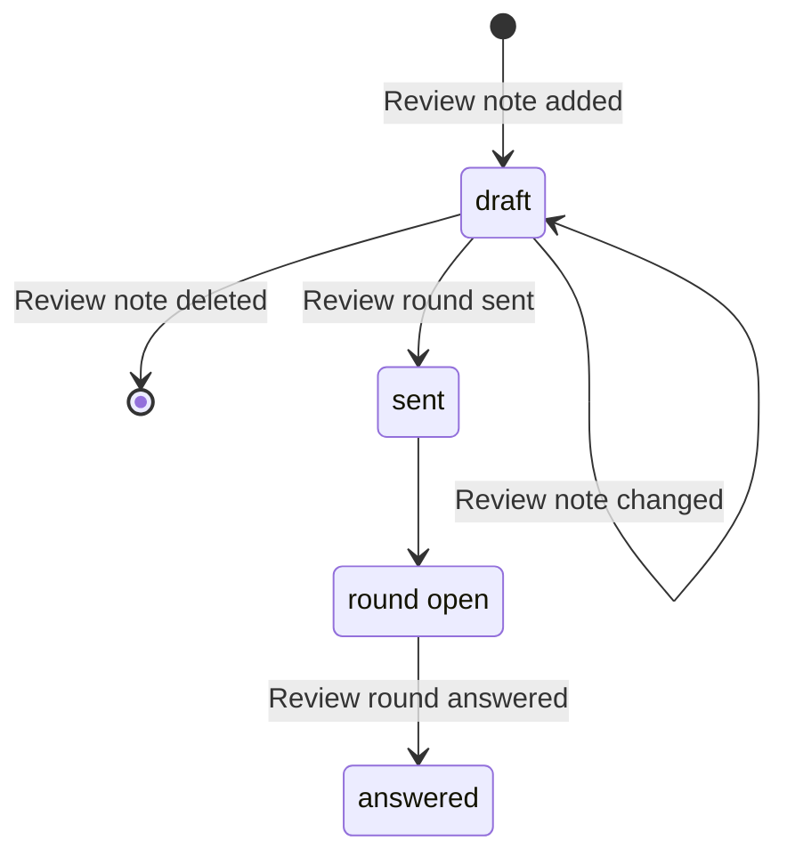
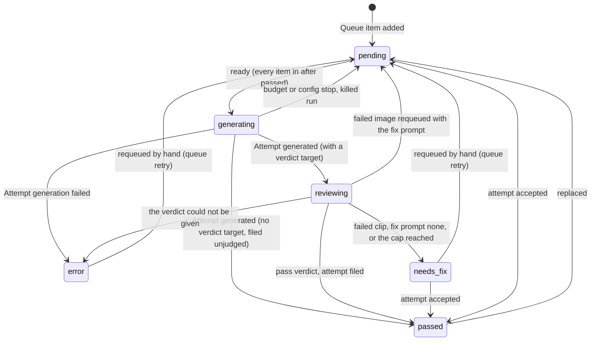
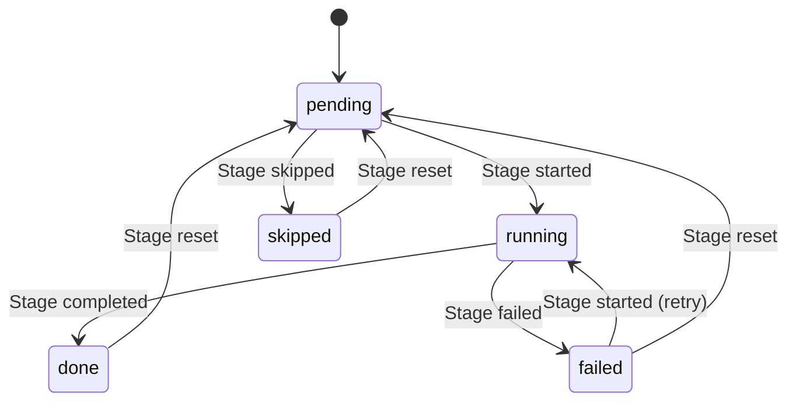
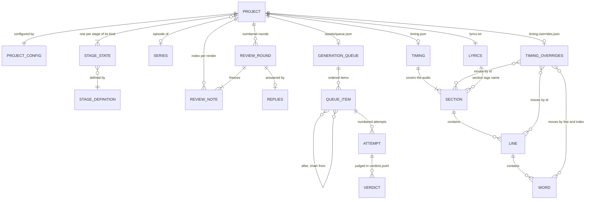

# Logical data model – coreslopper

> **As-is** for the adopted slices, recovered from `packages/core/src/schema.ts` (Zod is the source, ADR 0004).
> Slices: project and stage pipeline (2026-11-21); human review (2026-11-21); generation queue and verdicts (2026-11-21, decided by recommendation). Open points are hotspots in `docs/domain/events.yaml`.

## Aggregates

### AGG-Project – Project (as-is)

Persisted as two documents in `projects/<slug>/`: the configuration `project.yaml` (user-owned, never written by
a stage runner) and the control plane `state.json`. The consistency boundary in code is `state.json`
(one load, modify, save); whether `project.yaml` is part of the same boundary is HS-5.

**Configuration (`project.yaml`)**

| Attribute | Type | Required | Source |
|---|---|---|---|
| Slug | ProjectSlug | yes | EVT-ProjectCreated |
| Title | Text | yes | EVT-ProjectCreated |
| Created | Date | yes | EVT-ProjectCreated |
| Project kind | `music-video` \| `episode` | default `music-video` | EVT-ProjectCreated |
| Review mode | `auto` \| `final` | default `auto` | EVT-ProjectCreated (HS-8) |
| Budget | Money (USD, > 0) | yes | EVT-ProjectCreated (HS-5) |
| Batch cap | Money (USD) | no – default 30 % of the remaining budget | read by CMD-RecordSpend's pre-check |
| Series | SeriesSlug | when kind is `episode` | EVT-ProjectCreated |
| Episode number | Positive integer | when kind is `episode` | EVT-ProjectCreated |
| Workflow version | Version | yes | EVT-ProjectCreated |
| Formats, brand, models, providers | – | outside this slice | – |

**Control plane (`state.json`)**

| Attribute | Type | Required | Source |
|---|---|---|---|
| Project | ProjectSlug | yes | EVT-ProjectCreated |
| Project kind | `music-video` \| `episode` | no – filled from `project.yaml` on load | EVT-ProjectCreated |
| Workflow version | Version | yes | EVT-ProjectCreated |
| Current stage | StageId | yes | EVT-StageStarted, EVT-StageCompleted, EVT-StageSkipped, EVT-StageReset |
| Overall status | StageStatus | yes | derived from all stage states |
| Stage states | map StageId → Stage state | yes | all stage events |
| Budget total / spent / reserved | Money | yes | EVT-ProjectCreated, EVT-SpendRecorded; reserved is always 0 (HS-9) |
| Errors | list of Text | default empty | EVT-StageFailed (never cleared) |
| Artifacts | map Text → Text | default empty | written by `render`, outside this slice |
| Updated at | Timestamp | yes | every event |

**Stage state (entity, one per stage of the kind's list)**

| Attribute | Type | Required | Source |
|---|---|---|---|
| Status | StageStatus | yes | all stage events |
| Outputs | list of ProjectPath | default empty | EVT-StageCompleted |
| Attempt count | Count | default 0 | EVT-StageStarted (+1), EVT-StageReset (0) – term HS-2 |
| Input hash | Hash | no | EVT-StageCompleted – never compared (HS-10) |
| Last error | Text | no | EVT-StageFailed; also holds the skip reason (EVT-StageSkipped) |
| Started at / Finished at | Timestamp | no | EVT-StageStarted / EVT-StageCompleted, EVT-StageFailed |

**Stage definition (value, fixed per project kind in code)** – ID, label, skills, outputs, interactive flag,
mechanical flag (no reader). Music video: `setup`✋ `brief`✋ `treatment`✋ `audio-analysis` `style-character`
`storyboard` `assets` `assembly` `qa-export`. Episode: `setup`✋ `script`✋ `voice-track` `episode-track`
`storyboard` `assets` `assembly` `qa-export`. Order is list order; there are no other dependencies.

### AGG-ProjectReview – Project review (as-is)

Files in `projects/<slug>/review/`. The board changes notes and sends rounds under one lock per project
(`review/.notes.lock`); the desktop player writes notes without it; the agent writes replies.

**Notes file (one per render, `notes/<video-stem>.json`)** – Render (file name), Frame rate, Notes.

| Attribute of a note | Type | Required | Source |
|---|---|---|---|
| Note ID | NoteId | no – given by the board on its first write | EVT-ReviewNoteAdded |
| Frame / Seconds / Time | FrameNumber / Seconds / Timecode | yes | EVT-ReviewNoteAdded, EVT-ReviewNoteChanged |
| End frame / end seconds / end time | – | no (a range; board only) | EVT-ReviewNoteAdded, EVT-ReviewNoteChanged |
| Text | Text | yes | EVT-ReviewNoteAdded, EVT-ReviewNoteChanged |
| Round | RoundNumber | no – absent means draft | EVT-ReviewRoundSent |
| Created | Timestamp | no | EVT-ReviewNoteAdded |

**Review round (`rounds/<NNN>.json`, frozen)** – Round number, Render, Frame rate, Sent at, and per note its ID,
frames, range, Shots (list of ShotId), Section (SectionId, from the note's start), Text. Source: EVT-ReviewRoundSent.

**Replies (`rounds/<NNN>.replies.json`)** – Round number, Answered at, Render with the fixes (optional), and per
note ID a Reply status (`fixed`, `partly`, `not-fixed`, `question`) and a Reply text. Source:
EVT-ReviewRoundAnswered. Its existence makes the round answered (HS-18).

### AGG-GenerationQueue – Generation queue (as-is)

One file per project, `assets/queue.json` (`{version: 1, items}`), read, changed and written whole through a
temp file and a rename (`packages/cli/src/queue.ts:111-119`). The Zod schema lives in the CLI, not in
`schema.ts` (gap). The run lock is `assets/queue.lock` with the run's pid.

**Queue item**

| Attribute | Type | Required | Source |
|---|---|---|---|
| Item id | QueueItemId (`keyframe:<shot>`, `clip:<shot>`, or hand-written) | yes | EVT-QueueItemAdded |
| Kind | `image` \| `clip` \| `audio` (from the generation operation) | yes | EVT-QueueItemAdded |
| Generation item | the batch item as `generate` takes it | yes | EVT-QueueItemAdded, EVT-QueueItemReplaced, EVT-QueueItemRequeued |
| Out path | ProjectPath (an episode may file under `../<series>/`) | yes | EVT-QueueItemAdded |
| Verdict target | ShotId or reference label (`sheet:`, `state:`, `plate:`, `prop:`), one of both | no – absent: filed unjudged | EVT-QueueItemAdded |
| After | list of QueueItemId (an id not in the queue counts as done) | default empty | EVT-QueueItemAdded |
| Chain from | QueueItemId of a clip whose last frame starts this one | no | EVT-QueueItemAdded |
| Provider for the next attempt | ProviderKind (cloud fallback), cleared after one attempt | no | CMD-RetryQueueItem |
| Status | QueueItemStatus | default `pending` | every event |
| Attempt number | next or last attempt | default 1 | EVT-AttemptGenerated, EVT-QueueItemRequeued |
| Order | Integer; a requeued item gets a new, higher one | yes | EVT-QueueItemAdded, EVT-QueueItemRequeued |
| Focus | the blocking defects the next verdict checks first | no | EVT-QueueItemRequeued, EVT-QueueItemNeedsFix |
| Note, Error | Text | no | EVT-QueueItemNeedsFix, EVT-AttemptAccepted, EVT-AttemptGenerationFailed |

**Attempt (inside the item)** – Attempt number, Attempt file (`<out dir>/attempts/<name>-a<n>.<ext>`), Seed,
Provider (written, read by no code), and a copy of its verdict: Verdict, Score, Issues, Fix prompt. Source:
EVT-AttemptGenerated, EVT-VerdictGiven.

**Verdict log (`assets/review/verdicts.jsonl`; series canon `<series>/review/verdicts.jsonl`)** – append-only,
the record of every verdict (HS-36), outside the aggregate: Image, Subject (ShotId or reference label), Attempt
number, Verdict (`pass` \| `fail`), Score (0–10), Issues (blocking defects and verdict notes, `note:` prefix),
Fix prompt, Judged at (`reviewedAt`), Clip, Start frame PSNR. Source: EVT-VerdictGiven. The latest line per
subject counts; a clip counts apart from its keyframe.

**Patch log (`assets/review/patches.jsonl`)** – Image, Box, Prompt, References, Attempt file. Source:
EVT-RegionPatched.

Decided 2026-11-21 by recommendation (HS-38, HS-39, HS-41, HS-42), ahead of the code: no accept, requeue,
replace or drop while `generating` or `reviewing`; no requeue of a `passed` item (a replace redoes it, and
returns every passed item after it to `pending`); at most three local attempts and one cloud attempt since the
last replace; a user's accept is final; no lost write and one run per project.

### AGG-ProjectTiming – Project timing (as-is)

Two files per project merged into one effective timing on every load: the measured timing `timing.json`
(`TimingSchema`, written whole by the analysis) and the user's `timing.overrides.json`
(`TimingOverridesSchema`). The merge ends in one check of the whole result (`packages/core/src/timing.ts:61-165`).
Times are seconds in the song, checked with a tolerance of 0.05 s.

**Timing (root)**

| Attribute | Type | Required | Source |
|---|---|---|---|
| Audio | path, Duration (seconds), sample rate (always 48 kHz from the analysis) | yes | EVT-SongAnalyzed |
| BPM | positive number; an episode has none | no | EVT-SongAnalyzed, EVT-TimingOverridden |
| Beats, Downbeats, Onsets | lists of Seconds inside the audio | default empty | EVT-SongAnalyzed (beats and downbeats also EVT-TimingOverridden) |
| Energy | frame rate, hop, values normalized to the peak | yes | EVT-SongAnalyzed |
| Sections | at least one Section | yes | EVT-SongAnalyzed |
| Lines | list of Line | default empty | EVT-SongAnalyzed |
| Meta | untyped: device, models, speech recognition used, downbeat phase, line kinds, line directions, line confidence, cues (HS-65) | default empty | EVT-SongAnalyzed |

**Section** – Id (SectionId, from the tag text, e.g. `verse_1`, `chorus_2`, `intro`), Label (the tag text),
Start, End, Confidence (0–1, the lower of its two boundaries), Sources. Source: EVT-SongAnalyzed; Start and End
also EVT-TimingOverridden.

**Line** – Id (LineId, positional `l1…ln`), Section (SectionId), Start, End, Text (from the lyrics), Words.
**Word** – Text, Start, End; addressed by line and index. Source: EVT-SongAnalyzed; times also
EVT-TimingOverridden.

**Timing override** – BPM, Beats, Downbeats (replace the whole value); per section and per line by id: Start,
End; per word by line and index: Start, End. Source: EVT-TimingOverridden.

**Not in the aggregate** – the snapshot `timing.effective.json` (RM-EffectiveTiming), the timing report
`timing.report.md` (RM-TimingReport), the song files and `song.json` (no schema, HS-64), the lead and backing
stems.

Decided 2026-11-21 by recommendation, ahead of the code: every line inside its section and every word inside its
line (HS-53); an override that misses its target is reported by name, without blocking commands that do not read
timing (HS-54); words in parentheses are timed as backing vocals (user, HS-50); the timing's duration matches the
song (HS-59).

### AGG-Lyrics – Lyrics (as-is)

`lyrics.txt`, plain text: section tags on their own line (`[Verse 1]`, `[Chorus]`), each followed by its sung
lines; words in parentheses are backing vocals. Written whole and atomically by `writeLyrics`
(`packages/cli/src/board-wizard.ts:271-278`), which refuses lines before the first tag and lyrics without a sung
line. Source: EVT-LyricsWritten (Lyrics text, Sections). A hand edit bypasses the check; the analysis then puts
lines before the first tag into a section `unlabeled` (HS-68).

## Lifecycle

Stage state as the code allows it today. Every transition is accepted from every status (HS-11); the diagram
shows the transitions the orchestrator actually uses.

Confirmed with the user (2026-11-21), ahead of the code (gap register G-2, G-3): start only an autonomous stage
from `pending` or `failed` after every earlier stage is `done` or `skipped`; complete and fail only from
`running`; an interactive stage is completed from `pending` or `failed` by its setup skill; skip only from
`pending` or `failed`; a reset refuses `running` and returns every later `done` or `skipped` stage to `pending`.

The next stage is the first `pending` or `failed` stage in list order. The project is done when every stage is
`done` or `skipped`; any `failed` stage makes the overall status `failed`.

## Overview

