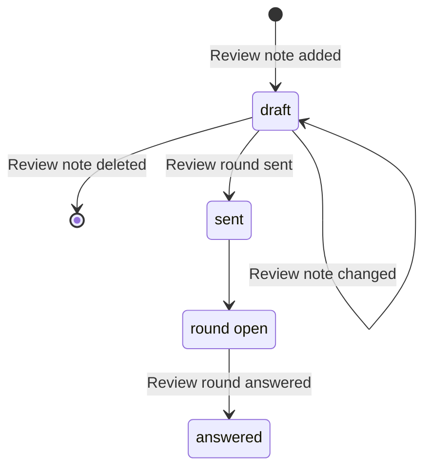
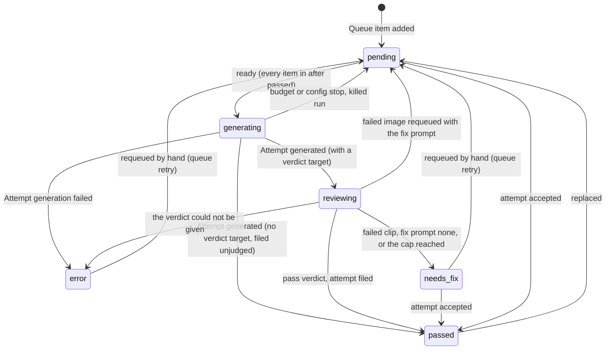
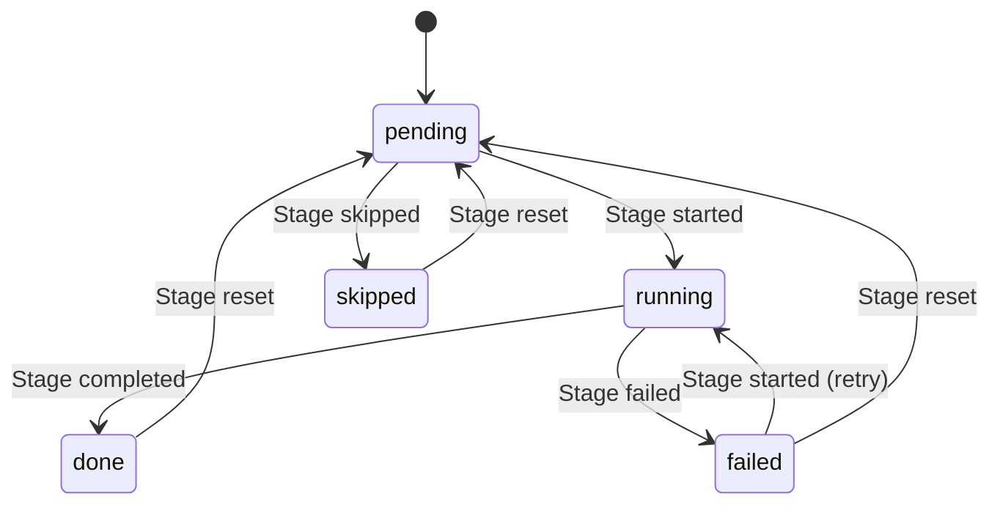
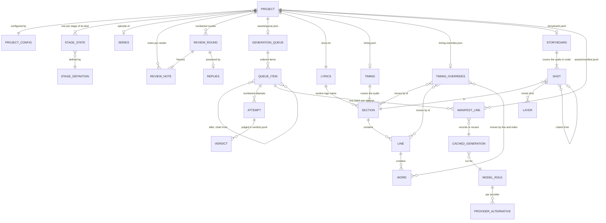

# Logical data model – coreslopper

> **As-is** for the adopted slices, recovered from `packages/core/src/schema.ts` (Zod is the source, ADR 0004).
> Slices: project and stage pipeline (2026-11-21); human review (2026-11-21); generation queue and verdicts (2026-11-21, decided by recommendation). Open points are hotspots in `docs/domain/events.yaml`.

## Aggregates

### AGG-Project – Project (as-is)

Persisted as two documents in `projects/<slug>/`: the configuration `project.yaml` (user-owned, never written by
a stage runner) and the control plane `state.json`. The consistency boundary in code is `state.json`
(one load, modify, save); whether `project.yaml` is part of the same boundary is HS-5.

**Configuration (`project.yaml`)**

| Attribute | Type | Required | Source |
|---|---|---|---|
| Slug | ProjectSlug | yes | EVT-ProjectCreated |
| Title | Text | yes | EVT-ProjectCreated |
| Created | Date | yes | EVT-ProjectCreated |
| Project kind | `music-video` \| `episode` | default `music-video` | EVT-ProjectCreated |
| Review mode | `auto` \| `final` | default `auto` | EVT-ProjectCreated (HS-8) |
| Budget | Money (USD, > 0) | yes | EVT-ProjectCreated (HS-5) |
| Batch cap | Money (USD) | no – default 30 % of the remaining budget | read by CMD-RecordSpend's pre-check |
| Series | SeriesSlug | when kind is `episode` | EVT-ProjectCreated |
| Episode number | Positive integer | when kind is `episode` | EVT-ProjectCreated |
| Workflow version | Version | yes | EVT-ProjectCreated |
| Formats, brand, models, providers | – | outside this slice | – |

**Control plane (`state.json`)**

| Attribute | Type | Required | Source |
|---|---|---|---|
| Project | ProjectSlug | yes | EVT-ProjectCreated |
| Project kind | `music-video` \| `episode` | no – filled from `project.yaml` on load | EVT-ProjectCreated |
| Workflow version | Version | yes | EVT-ProjectCreated |
| Current stage | StageId | yes | EVT-StageStarted, EVT-StageCompleted, EVT-StageSkipped, EVT-StageReset |
| Overall status | StageStatus | yes | derived from all stage states |
| Stage states | map StageId → Stage state | yes | all stage events |
| Budget total / spent / reserved | Money | yes | EVT-ProjectCreated, EVT-SpendRecorded; reserved is always 0 (HS-9) |
| Errors | list of Text | default empty | EVT-StageFailed (never cleared) |
| Artifacts | map Text → Text | default empty | written by `render`, outside this slice |
| Updated at | Timestamp | yes | every event |

**Stage state (entity, one per stage of the kind's list)**

| Attribute | Type | Required | Source |
|---|---|---|---|
| Status | StageStatus | yes | all stage events |
| Outputs | list of ProjectPath | default empty | EVT-StageCompleted |
| Attempt count | Count | default 0 | EVT-StageStarted (+1), EVT-StageReset (0) – term HS-2 |
| Input hash | Hash | no | EVT-StageCompleted – never compared (HS-10) |
| Last error | Text | no | EVT-StageFailed; also holds the skip reason (EVT-StageSkipped) |
| Started at / Finished at | Timestamp | no | EVT-StageStarted / EVT-StageCompleted, EVT-StageFailed |

**Stage definition (value, fixed per project kind in code)** – ID, label, skills, outputs, interactive flag,
mechanical flag (no reader). Music video: `setup`✋ `brief`✋ `treatment`✋ `audio-analysis` `style-character`
`storyboard` `assets` `assembly` `qa-export`. Episode: `setup`✋ `script`✋ `voice-track` `episode-track`
`storyboard` `assets` `assembly` `qa-export`. Order is list order; there are no other dependencies.

### AGG-ProjectReview – Project review (as-is)

Files in `projects/<slug>/review/`. The board changes notes and sends rounds under one lock per project
(`review/.notes.lock`); the desktop player writes notes without it; the agent writes replies.

**Notes file (one per render, `notes/<video-stem>.json`)** – Render (file name), Frame rate, Notes.

| Attribute of a note | Type | Required | Source |
|---|---|---|---|
| Note ID | NoteId | no – given by the board on its first write | EVT-ReviewNoteAdded |
| Frame / Seconds / Time | FrameNumber / Seconds / Timecode | yes | EVT-ReviewNoteAdded, EVT-ReviewNoteChanged |
| End frame / end seconds / end time | – | no (a range; board only) | EVT-ReviewNoteAdded, EVT-ReviewNoteChanged |
| Text | Text | yes | EVT-ReviewNoteAdded, EVT-ReviewNoteChanged |
| Round | RoundNumber | no – absent means draft | EVT-ReviewRoundSent |
| Created | Timestamp | no | EVT-ReviewNoteAdded |

**Review round (`rounds/<NNN>.json`, frozen)** – Round number, Render, Frame rate, Sent at, and per note its ID,
frames, range, Shots (list of ShotId), Section (SectionId, from the note's start), Text. Source: EVT-ReviewRoundSent.

**Replies (`rounds/<NNN>.replies.json`)** – Round number, Answered at, Render with the fixes (optional), and per
note ID a Reply status (`fixed`, `partly`, `not-fixed`, `question`) and a Reply text. Source:
EVT-ReviewRoundAnswered. Its existence makes the round answered (HS-18).

### AGG-GenerationQueue – Generation queue (as-is)

One file per project, `assets/queue.json` (`{version: 1, items}`), read, changed and written whole through a
temp file and a rename (`packages/cli/src/queue.ts:111-119`). The Zod schema lives in the CLI, not in
`schema.ts` (gap). The run lock is `assets/queue.lock` with the run's pid.

**Queue item**

| Attribute | Type | Required | Source |
|---|---|---|---|
| Item id | QueueItemId (`keyframe:<shot>`, `clip:<shot>`, or hand-written) | yes | EVT-QueueItemAdded |
| Kind | `image` \| `clip` \| `audio` (from the generation operation) | yes | EVT-QueueItemAdded |
| Generation item | the batch item as `generate` takes it | yes | EVT-QueueItemAdded, EVT-QueueItemReplaced, EVT-QueueItemRequeued |
| Out path | ProjectPath (an episode may file under `../<series>/`) | yes | EVT-QueueItemAdded |
| Verdict target | ShotId or reference label (`sheet:`, `state:`, `plate:`, `prop:`), one of both | no – absent: filed unjudged | EVT-QueueItemAdded |
| After | list of QueueItemId (an id not in the queue counts as done) | default empty | EVT-QueueItemAdded |
| Chain from | QueueItemId of a clip whose last frame starts this one | no | EVT-QueueItemAdded |
| Provider for the next attempt | ProviderKind (cloud fallback), cleared after one attempt | no | CMD-RetryQueueItem |
| Status | QueueItemStatus | default `pending` | every event |
| Attempt number | next or last attempt | default 1 | EVT-AttemptGenerated, EVT-QueueItemRequeued |
| Order | Integer; a requeued item gets a new, higher one | yes | EVT-QueueItemAdded, EVT-QueueItemRequeued |
| Focus | the blocking defects the next verdict checks first | no | EVT-QueueItemRequeued, EVT-QueueItemNeedsFix |
| Note, Error | Text | no | EVT-QueueItemNeedsFix, EVT-AttemptAccepted, EVT-AttemptGenerationFailed |

**Attempt (inside the item)** – Attempt number, Attempt file (`<out dir>/attempts/<name>-a<n>.<ext>`), Seed,
Provider (written, read by no code), and a copy of its verdict: Verdict, Score, Issues, Fix prompt. Source:
EVT-AttemptGenerated, EVT-VerdictGiven.

**Verdict log (`assets/review/verdicts.jsonl`; series canon `<series>/review/verdicts.jsonl`)** – append-only,
the record of every verdict (HS-36), outside the aggregate: Image, Subject (ShotId or reference label), Attempt
number, Verdict (`pass` \| `fail`), Score (0–10), Issues (blocking defects and verdict notes, `note:` prefix),
Fix prompt, Judged at (`reviewedAt`), Clip, Start frame PSNR. Source: EVT-VerdictGiven. The latest line per
subject counts; a clip counts apart from its keyframe.

**Patch log (`assets/review/patches.jsonl`)** – Image, Box, Prompt, References, Attempt file. Source:
EVT-RegionPatched.

Decided 2026-11-21 by recommendation (HS-38, HS-39, HS-41, HS-42), ahead of the code: no accept, requeue,
replace or drop while `generating` or `reviewing`; no requeue of a `passed` item (a replace redoes it, and
returns every passed item after it to `pending`); at most three local attempts and one cloud attempt since the
last replace; a user's accept is final; no lost write and one run per project.

### AGG-ProjectTiming – Project timing (as-is)

Two files per project merged into one effective timing on every load: the measured timing `timing.json`
(`TimingSchema`, written whole by the analysis) and the user's `timing.overrides.json`
(`TimingOverridesSchema`). The merge ends in one check of the whole result (`packages/core/src/timing.ts:61-165`).
Times are seconds in the song, checked with a tolerance of 0.05 s.

**Timing (root)**

| Attribute | Type | Required | Source |
|---|---|---|---|
| Audio | path, Duration (seconds), sample rate (always 48 kHz from the analysis) | yes | EVT-SongAnalyzed |
| BPM | positive number; an episode has none | no | EVT-SongAnalyzed, EVT-TimingOverridden |
| Beats, Downbeats, Onsets | lists of Seconds inside the audio | default empty | EVT-SongAnalyzed (beats and downbeats also EVT-TimingOverridden) |
| Energy | frame rate, hop, values normalized to the peak | yes | EVT-SongAnalyzed |
| Sections | at least one Section | yes | EVT-SongAnalyzed |
| Lines | list of Line | default empty | EVT-SongAnalyzed |
| Meta | untyped: device, models, speech recognition used, downbeat phase, line kinds, line directions, line confidence, cues (HS-65) | default empty | EVT-SongAnalyzed |

**Section** – Id (SectionId, from the tag text, e.g. `verse_1`, `chorus_2`, `intro`), Label (the tag text),
Start, End, Confidence (0–1, the lower of its two boundaries), Sources. Source: EVT-SongAnalyzed; Start and End
also EVT-TimingOverridden.

**Line** – Id (LineId, positional `l1…ln`), Section (SectionId), Start, End, Text (from the lyrics), Words.
**Word** – Text, Start, End; addressed by line and index. Source: EVT-SongAnalyzed; times also
EVT-TimingOverridden.

**Timing override** – BPM, Beats, Downbeats (replace the whole value); per section and per line by id: Start,
End; per word by line and index: Start, End. Source: EVT-TimingOverridden.

**Not in the aggregate** – the snapshot `timing.effective.json` (RM-EffectiveTiming), the timing report
`timing.report.md` (RM-TimingReport), the song files and `song.json` (no schema, HS-64), the lead and backing
stems.

Decided 2026-11-21 by recommendation, ahead of the code: every line inside its section and every word inside its
line (HS-53); an override that misses its target is reported by name, without blocking commands that do not read
timing (HS-54); words in parentheses are timed as backing vocals (user, HS-50); the timing's duration matches the
song (HS-59).

### AGG-Lyrics – Lyrics (as-is)

`lyrics.txt`, plain text: section tags on their own line (`[Verse 1]`, `[Chorus]`), each followed by its sung
lines; words in parentheses are backing vocals. Written whole and atomically by `writeLyrics`
(`packages/cli/src/board-wizard.ts:271-278`), which refuses lines before the first tag and lyrics without a sung
line. Source: EVT-LyricsWritten (Lyrics text, Sections). A hand edit bypasses the check; the analysis then puts
lines before the first tag into a section `unlabeled` (HS-68).

### AGG-Storyboard – Storyboard (as-is)

One file per project, `storyboard.yaml` (`StoryboardSchema`, `packages/core/src/schema.ts:277-371`), parsed whole
by `loadProject` and resolved and checked as one by `resolveStoryboard` against the effective timing, the bibles,
and in an episode the script (`packages/core/src/timing.ts:455-577`). One model for both project kinds.

**Storyboard (root)**

| Attribute | Type | Required | Source |
|---|---|---|---|
| Version | always 1 | yes | EVT-StoryboardWritten |
| Shots | at least one Shot, in start order | yes | EVT-StoryboardWritten, EVT-StoryboardRevised |
| Timing, Style, Characters | paths with defaults, read by nothing (HS-74, to be removed) | default | – |

**Shot** – the attributes all come from EVT-StoryboardWritten and EVT-StoryboardRevised.

| Attribute | Type | Required |
|---|---|---|
| Id | ShotId `shot-NNN`, unique | yes |
| Section | SectionId of the effective timing (a scene id in an episode) | yes |
| Start, End | Anchor (BC-Timing); End after Start, at least one frame | yes |
| Source | Shot Source: motion, ai-clip, footage, mixed | yes |
| Description | text | yes |
| Camera | text, default `static`; direction for the prompts, read by no code (HS-75) | default |
| Text, Highlights | on-screen text; highlights are words of it (HS-81) | no, default empty |
| Transition | type cut, fade, dissolve, wipe, glitch (default cut) and duration in seconds (default 0) | default |
| Continuity references | style tokens (paths into the style bible), characters, sets, plate (`<set>/<plate>`), props, character state per character | default empty |
| Motion | component (one of the motion components) and untyped props (HS-83) | for motion |
| Prompts | keyframe, video | for an AI clip (HS-73) |
| Asset | path of the footage or clip | for footage |
| Lip-sync | character, optional audio source (default the vocal stem, or the speaker stem in an episode) | no |
| Layers | at least two Layers | for mixed |
| Focus point | x and y in 0–1, default centre | no |
| Chaining | enabled, from (ShotId of an earlier shot) | no |

**Layer** – Layer type (motion, ai-clip, footage), Asset, Component, Blend (read by nothing, HS-75), Order
(z-index, default 0). Motion layers share the shot's motion props (HS-82).

**Not in the aggregate** – the resolved storyboard (RM-ResolvedStoryboard: seconds and frames per shot, made on
demand), the storyboard table `storyboard.md` (RM-StoryboardTable), the contact sheet `review/contact-sheet.svg`
(RM-ContactSheet), and the sets, plates, props and character states the references point to (bibles and canon).

Decided 2026-11-21, ahead of the code: lip-sync checks for both project kinds (user and recommendation, HS-72); a
lip-sync shot needs no video prompt and a chained shot no keyframe prompt (HS-73); every layer renderable
(HS-82); a highlight is one word (HS-81); the agent is the only writer (user, HS-77).

### AGG-CachedGeneration – Cached generation (as-is)

One record per cache key, `.cache/generations/<key>/result.json`, next to the provider's files. The cache is shared
by every project and series of the workspace (`packages/cli/src/generate.ts:711`). It is written once by
`GenerationRunner.run` after the provider returned files (`packages/providers/src/runner.ts:167-189`). It is
reused while all its files exist and never changed or removed by a tool.

| Attribute | Type | Required | Source |
|---|---|---|---|
| Cache key | CacheKey (SHA-256 of the canonical request) | yes | EVT-GenerationCompleted |
| Generation id | `gen_<first 12 of the key>` | yes | EVT-GenerationCompleted |
| Operation | Generation Operation (9 values) | yes | EVT-GenerationCompleted |
| Model role | ModelRoleId (`image.keyframe`, `video.lipsync`, …) | yes | EVT-GenerationCompleted |
| Provider | ProviderKind `fal` \| `higgsfield` \| `topview` \| `comfyui` \| `mock` | yes | EVT-GenerationCompleted |
| Model | cloud model slug or ComfyUI workflow name | yes | EVT-GenerationCompleted |
| Prompt, Seed | text (a Flex or FL2VA prompt rendered to text); Integer, derived from model, prompt and operation when absent | yes | EVT-GenerationCompleted |
| References | list of file paths with their content hash | default empty | EVT-GenerationCompleted |
| Audio | file path (lip-sync and audio-guided clips) | no | EVT-GenerationCompleted |
| Params | the role's params merged with the item's | default empty | EVT-GenerationCompleted |
| Planned cost | Money (USD): units × the role's price; 0 for ComfyUI and mock | yes | EVT-GenerationCompleted |
| Files | at least one file path in the cache folder | yes | EVT-GenerationCompleted |
| Created at | Timestamp | yes | EVT-GenerationCompleted |

The size, duration, negative prompt, audio start and workflow fingerprint are part of the key only and are not
stored.

**Manifest line (`assets/manifest.jsonl` of the project or series canon)**: append-only, outside the aggregate.
It holds the record above plus Reused (`cached`), Status (`ok` \| `failed`) and Error. Its paths are relative
to the project, and a reuse is recorded at cost 0. Sources are EVT-GenerationCompleted, EVT-GenerationReused,
EVT-GenerationFailed and EVT-ClipRestored. A paid call that returns no file writes no line today (HS-92).

### AGG-ModelRoles – Model roles (as-is)

One file per workspace, `config/models.yaml` (`ModelsConfigSchema`, `packages/core/src/schema.ts:714-762`), parsed
whole on every batch and estimate. A project overrides a role in `project.yaml` `models.<role>`. Only the agent
changes either, at the user's request (HS-88).

| Attribute | Type | Required | Source |
|---|---|---|---|
| Version, Last verified | 1; date of the price check | default; no | EVT-ModelRolesChanged |
| Model role | ModelRoleId → base Provider (default `fal`), Model, Params, Pricing, Max duration, Notes | yes | EVT-ModelRolesChanged |
| Provider alternative | per ProviderKind: Model, Params, Pricing, Max duration, Notes | default empty | EVT-ModelRolesChanged |
| Pricing | Unit `image` \| `second` \| `request`, USD ≥ 0; required at resolution for a paid provider | no | EVT-ModelRolesChanged |
| ComfyUI locks | per workflow family: the model files each loader input may load | default empty | EVT-ModelRolesChanged |

**Project providers (`project.yaml` `providers`, in AGG-Project's config)**: Image and Video (default `mock`),
optional Lip-sync (defaults to Video, or to fal.ai when Video is `comfyui` or `topview`) and optional Audio
(default `comfyui`).

**Budget (in `state.json`, AGG-Project)**: Total, Spent (the planned costs of new generations; equal to the
manifest's cost sum, HS-92) and Reserved, which is never written above 0 (HS-93, to be removed). The batch cap
is `batch_cap_usd` in `project.yaml`, or 30 % of the remaining budget.

### AGG-Series – Series (as-is)

One folder per series, `projects/<slug>/` with `series.yaml` (`SeriesSchema`) and `state.json`
(`SeriesStateSchema`), loaded together by `loadSeries` (`packages/core/src/project.ts:380-416`). The canon files
beside them (`bible.md`, `style.yaml`, `characters.yaml`, `sets.yaml`, references) belong to the character slice.
The commitment spans the series and the `project.yaml` of every episode that names it; nothing stores the episode
list in the series (`packages/cli/src/series.ts:43-74`).

| Attribute | Type | Required | Source |
|---|---|---|---|
| Slug, Title, Description | Slug (shared namespace with projects); text | yes; yes; no | EVT-SeriesCreated |
| Formats, Providers, Brand | as in a project; copied into each new episode | yes | EVT-SeriesCreated |
| Series budget | Money (USD), `budget_usd`; optional in the schema, required by `new-series` (HS-106) | yes | EVT-SeriesCreated |
| Batch cap | Money, `batch_cap_usd`; default 30 % of the remaining series budget | no | EVT-SeriesCreated |
| Episode plan | list of Planned Episode: number (unique), title, logline | default empty | EVT-SeriesCreated |
| Creative limits | `episode_seconds` {min, max}, `lipsync_seconds_max` | no | EVT-SeriesCreated |
| Canon spend | Money, `state.json` `budget.spentUsd`; `totalUsd` must equal the series budget (HS-107) | yes | EVT-CanonSpendRecorded |

**Derived**: Episode budgets (sum of the episodes' `budget_usd`) and the Uncommitted Series Budget (series budget −
canon spend − episode budgets), computed by `seriesBudget` on every read.

### AGG-Script – Script (as-is)

`script.yaml` of an episode (`ScriptSchema`, `packages/core/src/schema.ts:587-657`), parsed whole by `loadProject`
and checked whole against the canon by `validateScript` (`packages/core/src/episode.ts:59-104`). Written only by
the agent (HS-121).

| Attribute | Type | Required | Source |
|---|---|---|---|
| Title | text | yes | EVT-ScriptWritten |
| Chat | typing speed (characters per second) and hold (seconds) | when the script has chat lines | EVT-ScriptWritten |
| Scene | id (unique), set (of the canon), description, ambience prompt (`atmo`) | id, set yes | EVT-ScriptWritten |
| Script line | id (unique), kind `dialogue` \| `voiceover` \| `announcement` \| `chat` \| `sfx` \| `pause`, pause after | yes | EVT-ScriptWritten |
| Spoken line fields | speaker (a canon character), `text_de` (TTS rule), `text_en` (subtitle), `direction` (unused today, HS-112) | speaker and text yes | EVT-ScriptWritten |
| Chat line fields | speaker, `text_de` (shown on screen), `text_en` | yes | EVT-ScriptWritten |
| Sfx line fields | prompt, duration, optional `text_en` (on-screen text) | prompt, duration yes | EVT-ScriptWritten |
| Pause line fields | duration | yes | EVT-ScriptWritten |

`with` (overlap) is parsed and always refused.

### AGG-TakeRegistry – Take registry (as-is)

`takes.json` of an episode (`TakesSchema`, `schema.ts:666-684`), written whole and sorted by `saveTakes`
(`packages/cli/src/takes.ts:51-57`), with the files `audio/lines/<line-id>.wav` and
`audio/ambience/<scene-id>.wav` (48 kHz mono). No lock; one voice-track run at a time.

| Attribute | Type | Required | Source |
|---|---|---|---|
| Take (per audible line id) | source `generated` \| `imported`, duration (s), text hash, file hash | yes, file hash optional | EVT-TakeGenerated, EVT-TakeImported |
| Ambience (per scene id) | the same fields; the hash covers the prompt only | yes | EVT-AmbienceGenerated |

**Take status** (computed, `takes.ts:65-76`): `current`, `missing`, `stale`, `replaced`, `unregistered`. The text
hash covers kind, speaker and spoken text, or an effect's prompt and length; the reference voice and the direction
are to join it (HS-111, HS-112).

### AGG-EpisodeTrack – Episode track (as-is)

Written together by `episode-track` (`packages/cli/src/episode-track.ts:148-253`): `timing.json` (TimingSchema with
no tempo, empty beats, downbeats and onsets, words empty), `timing.effective.json`, `audio/episode.wav` and
`audio/stems/<character>.wav` for every speaker with spoken lines. The timing overrides are the user's and only
read (BC-Timing).

| Attribute | Type | Required | Source |
|---|---|---|---|
| Duration | seconds; the mix and each speaker stem have exactly this length | yes | EVT-EpisodeTrackBuilt |
| Sections, Lines | one section per scene, one line per script line, in playing order, with `text_de` | yes | EVT-EpisodeTrackBuilt |
| Energy | RMS envelope of the finished mix | yes | EVT-EpisodeTrackBuilt |
| Mix | takes, ambience (gain 0.3), optional `audio/music.wav` (gain 0.25), raised to the project loudness target | yes | EVT-EpisodeTrackBuilt |

**Derived outside the aggregate**: subtitles `renders/<slug>.en.srt` (EVT-SubtitlesWritten) and lip-sync audio
segments `assets/audio-segments/<name>.mp3|wav` cut from a speaker stem (EVT-LipSyncAudioCut).

## Lifecycle

Stage state as the code allows it today. Every transition is accepted from every status (HS-11); the diagram
shows the transitions the orchestrator actually uses.

Confirmed with the user (2026-11-21), ahead of the code (gap register G-2, G-3): start only an autonomous stage
from `pending` or `failed` after every earlier stage is `done` or `skipped`; complete and fail only from
`running`; an interactive stage is completed from `pending` or `failed` by its setup skill; skip only from
`pending` or `failed`; a reset refuses `running` and returns every later `done` or `skipped` stage to `pending`.

The next stage is the first `pending` or `failed` stage in list order. The project is done when every stage is
`done` or `skipped`; any `failed` stage makes the overall status `failed`.

## Overview

