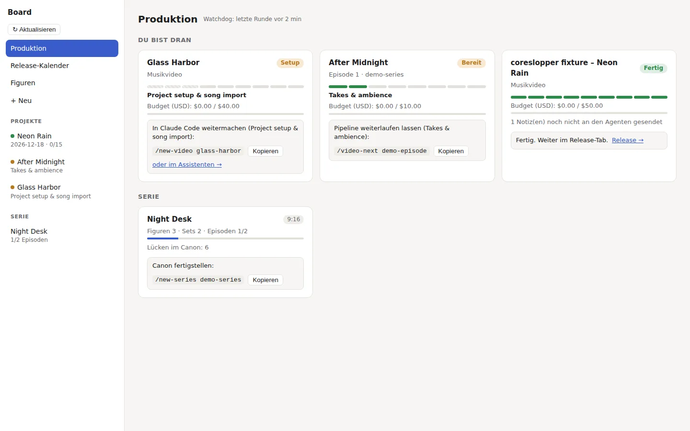
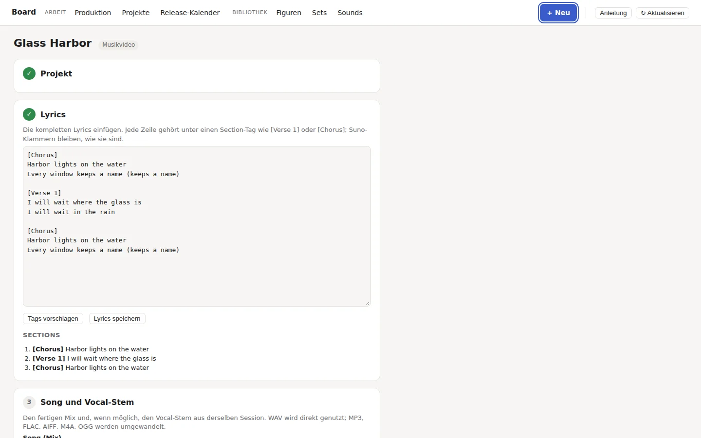
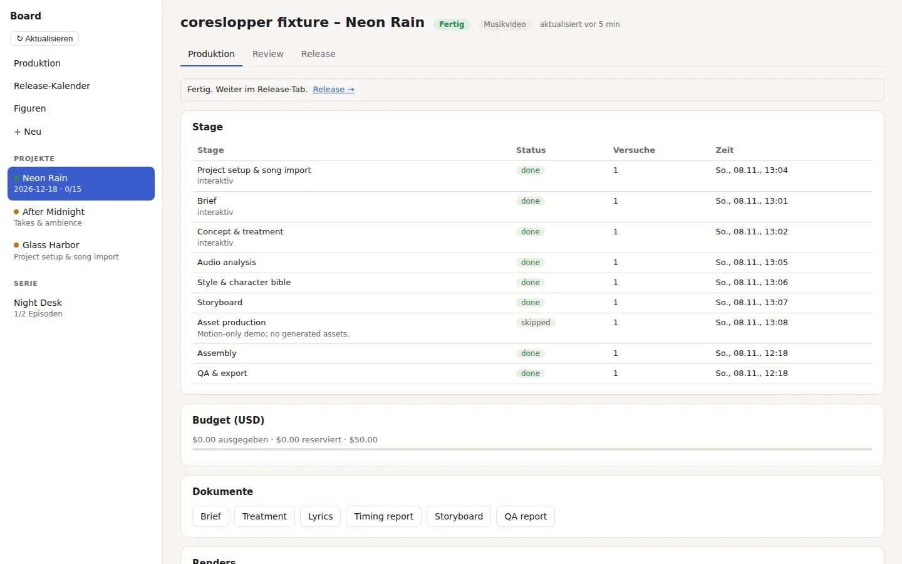
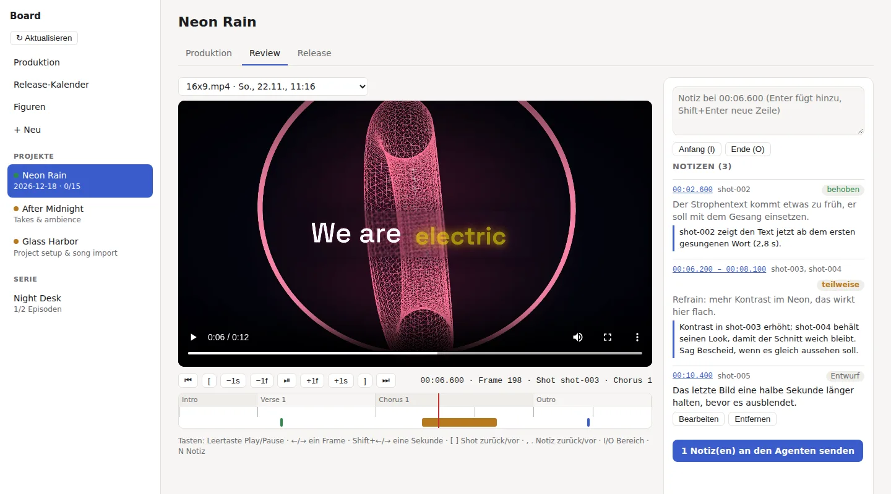
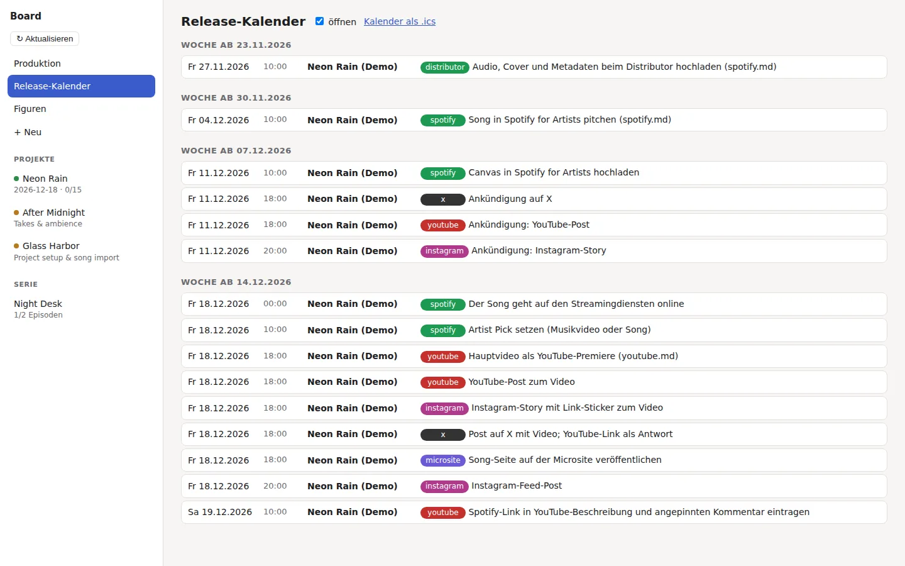
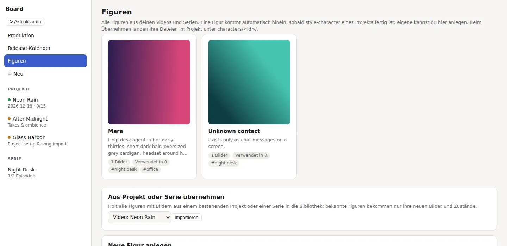

# Board-Anleitung

*[English version](board-guide.md)*

Ein kurzer Rundgang durch das Board: wo du hinschaust, was du anklickst und was in Claude Code passiert. Die Einzelheiten jeder Ansicht stehen in [board.md](board.md) (Englisch).

Die Screenshots zeigen die Demo-Projekte des Workspaces. Das Board spricht die Sprache deines Browsers. Die Release-Ansicht spricht die Sprache des Projekts.

## Board starten

Im Workspace:

```bash
npm run cli -- board          # http://127.0.0.1:4848
```

Oder im Board-Container, der auch den Watchdog ausführt: `docker compose up -d` (siehe [board.md](board.md#start-it)). Öffne http://127.0.0.1:4848 im Browser.

Die Navigation ist die Leiste oben. **Arbeit** enthält Produktion, Projekte und Release-Kalender; **Bibliothek** enthält Figuren, Sets und Sounds. **+ Neu** legt etwas Neues an, **Anleitung** und **↻ Aktualisieren** stehen abgesetzt rechts. Der Eintrag der Ansicht, auf der du bist, ist markiert; die Tabs eines Projekts und eine Serie markieren **Projekte**.

Das Board aktualisiert sich nicht von selbst. Klicke rechts in der Navigation auf **↻ Aktualisieren**, nachdem Claude Code gearbeitet hat. Ein laufendes Video oder eine Notiz, die du gerade schreibst, bleiben erhalten.

## Produktion: wo du dran bist



**Produktion** ist die Startansicht. Jede Karte ist ein Projekt oder eine Serie:

- **Du bist dran**: Etwas wartet auf dich. Die Karte nennt den Befehl, den du in Claude Code ausführst. Klicke auf **Kopieren** und füge ihn dort ein.
- **Läuft**: Claude Code oder ein Render arbeitet daran.
- Der farbige Streifen zeigt die Stages. Darunter stehen die aktuelle Stage und das Budget.

Die Navigation listet kein Projekt: **Projekte** öffnet die Liste aller Projekte und Serien, die veröffentlichten eingeschlossen.

## Projekte: ein Projekt finden

**Projekte** ist eine Tabelle aller Musikvideos, Memes, Folgen und Serien, die neueste Aktivität zuerst. Jede Zeile zeigt die Art, den Status, die aktuelle Stage, den nächsten Schritt, die Veröffentlichung mit der Zahl der erledigten Release-Termine und wann sich zuletzt etwas geändert hat. Ein Klick auf eine Zeile öffnet sie.

- Tippe ins Suchfeld, um ein Projekt über Titel oder Slug zu finden.
- Klicke auf **Art**, **Status** oder wähle eine **Serie**, um die Liste einzugrenzen. **Veröffentlicht** zeigt die Projekte, die draußen sind.
- Klicke auf einen Spaltenkopf, um nach Titel, Veröffentlichung oder letzter Aktivität zu sortieren; ein zweiter Klick dreht die Reihenfolge um.
- Schalte **Nach Serie gruppieren** ein, um jede Folge unter ihrer Serie zu sehen, mit den geplanten Folgen, die noch kein Projekt haben.
- **Filter zurücksetzen** leert alles. Die Adresse behält Suche und Filter, sodass **↻ Aktualisieren**, Zurück und ein Lesezeichen dieselbe Liste wiederherstellen.

## Ein Musikvideo anlegen

Klicke auf **+ Neu** und wähle **Musikvideo**. Die Auswahl hat zwei Gruppen: **Produktion** (Musikvideo, Serie, Episode, Meme) und **Bibliothek** (Figur).


Der Assistent fragt zuerst die Projektdaten ab: Titel, Artist, Budget und Provider. Dann kommen die Lyrics:



1. Füge die kompletten Lyrics ein.
2. Klicke auf **Tags vorschlagen**: Ein Block, der sich wiederholt, wird `[Chorus]`, jeder andere Block ein `[Verse n]`. Korrigiere die Tags, wo der Song anders aufgebaut ist.
3. Prüfe die Liste **Sections** und klicke auf **Lyrics speichern**.

Danach lädst du den Song (den Mix) hoch und, falls vorhanden, den Vocal-Stem. MP3, FLAC und die anderen gängigen Formate werden in WAV umgewandelt. Dann folgen Referenzen (Moodboards, Fotos, Links), danach Figuren und Sets aus der Bibliothek. **Setup abschließen** beendet den Schritt. Danach führst du `/new-video <slug>` in Claude Code aus: Der Agent beginnt mit dem Brief.

## Ein Projekt verfolgen

Klicke auf **Produktion** auf die Karte eines Projekts, oder öffne **Projekte** und klicke auf seine Zeile.



Der Tab **Produktion** listet jede Stage mit Status, Versuchen und Zeit. Darunter stehen das Budget, die Dokumente (Brief, Treatment, Storyboard, QA-Bericht) und die Renders. Ein Dokument öffnet sich formatiert im Board; der Dateiname oben rechts öffnet die Datei selbst. Der Kasten oben nennt immer den nächsten Schritt.

## Einen Render reviewen

Der Tab **Review** spielt die Renders des Projekts ab.



1. Wähle oben einen Render und such die Stelle: abspielen, mit ← und → bildweise springen oder auf die Zeitleiste klicken. Die Zeitleiste zeigt die Sections, die Shots und deine Notizen.
2. Schreib eine Notiz in das Feld rechts und drück Enter. Sie sitzt auf dem aktuellen Frame. Für einen Bereich klickst du vorher auf **Anfang (I)** und **Ende (O)**.
3. Notizen sind Entwürfe, bis du sie schickst. Du kannst einen Entwurf bearbeiten oder entfernen.
4. Klicke auf **An den Agenten senden**. Die Notizen werden zu einer Review-Runde.
5. Führe `/video-next <slug>` in Claude Code aus. Der Agent arbeitet zuerst die Runde ab, rendert neu und beantwortet jede Notiz: **behoben**, **teilweise**, **nicht behoben** oder eine **Rückfrage**. Die Antwort erscheint nach **↻ Aktualisieren** unter der Notiz.

Tastatur: Leertaste spielt ab und pausiert, `[` und `]` springen zwischen Shots, `,` und `.` zwischen Notizen, `N` beginnt eine Notiz.

## Release

Wenn ein Projekt fertig ist, enthält der Tab **Release** alles für die Veröffentlichung.


- Die Kopfzeile zeigt den Release-Tag und wie viele Posts erledigt sind. Einen Tag, den der Kalender gewählt hat, markiert sie als *vorgeschlagen*.
- **Offene TODOs** listet, was dem Release noch fehlt, etwa ein Thumbnail oder eine Release-Angabe.
- Die Plattform-Tabs (YouTube, Shorts, TikTok, Instagram, Spotify & Distributor, X, LinkedIn, Microsite) enthalten jeden Post mit Termin, Text und Dateien. **Kopieren** übernimmt einen Text, ein Datei-Link öffnet die Datei.
- Wenn du etwas von Hand gepostet hast, füge seine Adresse in das Feld `https://…` ein und hake **Gepostet** an. Die Texte, die darauf verlinken, werden neu gesetzt.
- **Release freigeben** legt den Release-Tag fest. Mit eingerichtetem Plattform-Zugang (siehe [publishing.md](publishing.md), Englisch) postet der Release-Autopilot dann zu den Kalenderzeiten. Ohne Zugang bleibt jeder Post bei dir.

## Release-Kalender



**Release-Kalender** zeigt Woche für Woche, was wann wo online geht, über alle Projekte hinweg. **nur offene** blendet Erledigtes aus. **Kalender als .ics** exportiert ihn für deine Kalender-App.

## Figuren



**Figuren** ist deine Figuren-Bibliothek, eine Tabelle mit einer Zeile pro Figur: Vorschaubild, Schlagworte, Bilder und Zustände, Stimme, in wie vielen Produktionen sie steckt und woher sie kommt. Suche nach Name, Beschreibung oder Schlagwort, filtere nach Schlagwort, **unbenutzt** oder **Herkunft** und sortiere per Klick auf einen Spaltenkopf; die Adresse behält alles, sodass Zurück und Aktualisieren zur selben Liste führen. Ein Klick auf eine Zeile öffnet die Figur. Die Figuren eines Projekts kommen von selbst hinein, sobald seine Character-Bible fertig ist. **+ Neu** im Kopf der Liste öffnet den Figuren-Assistenten, wie **+ Neu** → **Figur**. Er fragt zuerst: **Neu anlegen** oder **Aus Projekt oder Serie übernehmen**. Zum Anlegen füllst du Name, Darstellung, Beschreibung, Prompt-Satz und Schlagworte aus und klickst **Anlegen**; dann lädst du das Character Sheet und weitere Bilder hoch (jedes erscheint, sobald es oben ist) und, falls vorhanden, ein WAV der Stimme mit ihrem exakten Text. **Zur Figur** öffnet ihre Seite. Die Adresse des Assistenten behält die Figur, sodass ein Neuladen dort weitermacht, wo du warst. Zum Übernehmen wählst du das Projekt oder die Serie und klickst **Importieren**: Der Assistent listet die übernommenen Figuren, jede mit einem Link auf ihre Seite. Ein abgelehnter Eintrag (ein leerer oder vergebener Name, eine Datei der falschen Art) zeigt seinen Grund im Schritt und behält, was du eingegeben hast. In der Ansicht einer Figur kopiert **Übernehmen in** sie in ein Musikvideo oder den Canon einer Serie.

**Sets** ist deine Set-Bibliothek, die gleiche Art Tabelle: eine Zeile pro Set mit Vorschaubild (die erste Platte, sonst die erste Referenz), Schlagworten, der Zahl der Referenzen und Platten, in wie vielen Produktionen es steckt und woher es kommt. Suche, die Filter **unbenutzt** und **Herkunft**, die Schlagwort-Chips und die Spaltenköpfe funktionieren wie bei den Figuren, und die Adresse behält auch sie. Ein Klick auf eine Zeile öffnet das Set.

**Sounds** ist die Sound-Bibliothek deiner Memes, die gleiche Art Tabelle: eine Zeile pro Sound mit Abspielknopf, wofür er gedacht ist, seiner Länge nach dem Trim, seiner Lizenz, Schlagworten und wie viele Memes ihn übernommen haben. ▶ spielt den Sound direkt in der Zeile, ein zweiter Klick stoppt ihn, und das ▶ einer anderen Zeile stoppt den ersten. Suche nach Titel, Wofür oder Schlagwort, filtere nach Schlagwort, **unbenutzt** oder **Lizenz** (`unknown` findet, was der Release-Check anmerken wird) und sortiere per Klick auf einen Spaltenkopf; die Adresse behält alles. Ein Klick an eine andere Stelle der Zeile öffnet den Sound.

## Serien


Eine Serie zeigt ihr Budget, ihren Canon und ihre Episoden. Die roten Zeilen sind Lücken im Canon: eine sichtbare Figur oder ein Set ohne Referenz, oder eine sprechende Figur ohne Stimme. Führe `/new-series <slug>` aus, bis sie verschwunden sind. Danach legst du Episoden mit **+ Neu** → **Episode** an und führst `/new-episode <slug>` aus.
