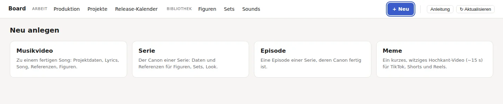
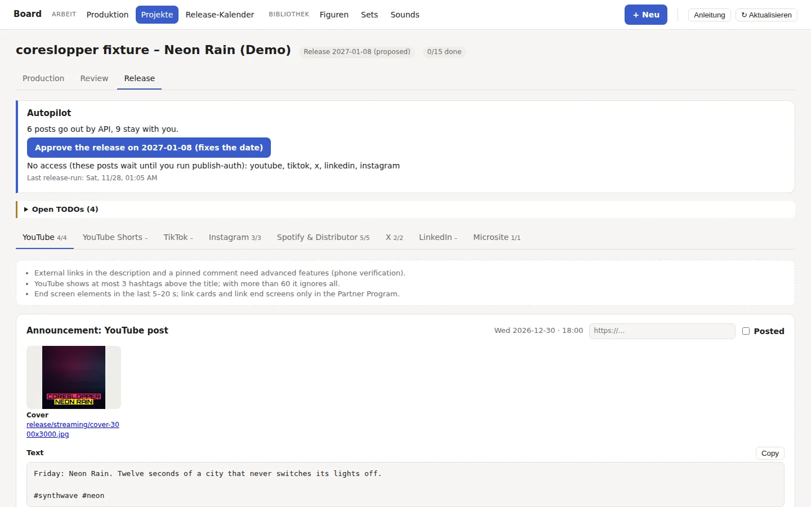
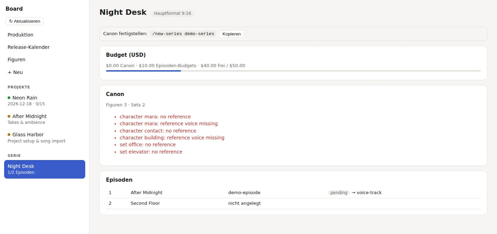

# Board-Anleitung

*[English version](board-guide.md)*

Ein kurzer Rundgang durch das Board: wo du hinschaust, was du anklickst und was in Claude Code passiert. Die Einzelheiten jeder Ansicht stehen in [board.md](board.md) (Englisch).

Die Screenshots zeigen die Demo-Projekte des Workspaces. Das Board spricht die Sprache deines Browsers. Die Release-Ansicht spricht die Sprache des Projekts.

## Board starten

Im Workspace:

```bash
npm run cli -- board          # http://127.0.0.1:4848
```

Oder im Board-Container, der auch den Watchdog ausführt: `docker compose up -d` (siehe [board.md](board.md#start-it)). Öffne http://127.0.0.1:4848 im Browser.

Das Board aktualisiert sich nicht von selbst. Klicke oben in der Navigation auf **↻ Aktualisieren**, nachdem Claude Code gearbeitet hat. Ein laufendes Video oder eine Notiz, die du gerade schreibst, bleiben erhalten.

## Produktion: wo du dran bist


**Produktion** ist die Startansicht. Jede Karte ist ein Projekt oder eine Serie:

- **Du bist dran**: Etwas wartet auf dich. Die Karte nennt den Befehl, den du in Claude Code ausführst. Klicke auf **Kopieren** und füge ihn dort ein.
- **Läuft**: Claude Code oder ein Render arbeitet daran.
- Der farbige Streifen zeigt die Stages. Darunter stehen die aktuelle Stage und das Budget.

Die Navigation links listet alle Projekte und Serien. Ein fertiges Projekt klappt am Ende in **Fertig** ein: ein veröffentlichtes, und ein internes Projekt (**Fertig – nicht öffentlich**), sobald alle Stages fertig sind.

## Ein Musikvideo anlegen

Klicke auf **+ Neu** und wähle **Musikvideo**.



Der Assistent fragt zuerst die Projektdaten ab: Titel, Artist, Budget und Provider. Dann kommen die Lyrics:


1. Füge die kompletten Lyrics ein.
2. Klicke auf **Tags vorschlagen**: Ein Block, der sich wiederholt, wird `[Chorus]`, jeder andere Block ein `[Verse n]`. Korrigiere die Tags, wo der Song anders aufgebaut ist.
3. Prüfe die Liste **Sections** und klicke auf **Lyrics speichern**.

Danach lädst du den Song (den Mix) hoch und, falls vorhanden, den Vocal-Stem. MP3, FLAC und die anderen gängigen Formate werden in WAV umgewandelt. Dann folgen Referenzen (Moodboards, Fotos, Links) und Figuren aus der Bibliothek. **Setup abschließen** beendet den Schritt. Danach führst du `/new-video <slug>` in Claude Code aus: Der Agent beginnt mit dem Brief.

## Ein Projekt verfolgen

Klicke in der Navigation auf ein Projekt.


Der Tab **Produktion** listet jede Stage mit Status, Versuchen und Zeit. Darunter stehen das Budget, die Dokumente (Brief, Treatment, Storyboard, QA-Bericht) und die Renders. Ein Dokument öffnet sich formatiert im Board; der Dateiname oben rechts öffnet die Datei selbst. Der Kasten oben nennt immer den nächsten Schritt.

## Einen Render reviewen

Der Tab **Review** spielt die Renders des Projekts ab.


1. Wähle oben einen Render und such die Stelle: abspielen, mit ← und → bildweise springen oder auf die Zeitleiste klicken. Die Zeitleiste zeigt die Sections, die Shots und deine Notizen.
2. Schreib eine Notiz in das Feld rechts und drück Enter. Sie sitzt auf dem aktuellen Frame. Für einen Bereich klickst du vorher auf **Anfang (I)** und **Ende (O)**.
3. Notizen sind Entwürfe, bis du sie schickst. Du kannst einen Entwurf bearbeiten oder entfernen.
4. Klicke auf **An den Agenten senden**. Die Notizen werden zu einer Review-Runde.
5. Führe `/video-next <slug>` in Claude Code aus. Der Agent arbeitet zuerst die Runde ab, rendert neu und beantwortet jede Notiz: **behoben**, **teilweise**, **nicht behoben** oder eine **Rückfrage**. Die Antwort erscheint nach **↻ Aktualisieren** unter der Notiz.

Tastatur: Leertaste spielt ab und pausiert, `[` und `]` springen zwischen Shots, `,` und `.` zwischen Notizen, `N` beginnt eine Notiz.

## Release

Wenn ein Projekt fertig ist, enthält der Tab **Release** alles für die Veröffentlichung.



- Die Kopfzeile zeigt den Release-Tag und wie viele Posts erledigt sind. Einen Tag, den der Kalender gewählt hat, markiert sie als *vorgeschlagen*.
- **Offene TODOs** listet, was dem Release noch fehlt, etwa ein Thumbnail oder eine Release-Angabe.
- Die Plattform-Tabs (YouTube, Shorts, TikTok, Instagram, Spotify & Distributor, X, LinkedIn, Microsite) enthalten jeden Post mit Termin, Text und Dateien. **Kopieren** übernimmt einen Text, ein Datei-Link öffnet die Datei.
- Wenn du etwas von Hand gepostet hast, füge seine Adresse in das Feld `https://…` ein und hake **Gepostet** an. Die Texte, die darauf verlinken, werden neu gesetzt.
- **Release freigeben** legt den Release-Tag fest. Mit eingerichtetem Plattform-Zugang (siehe [publishing.md](publishing.md), Englisch) postet der Release-Autopilot dann zu den Kalenderzeiten. Ohne Zugang bleibt jeder Post bei dir.

## Release-Kalender


**Release-Kalender** zeigt Woche für Woche, was wann wo online geht, über alle Projekte hinweg. **nur offene** blendet Erledigtes aus. **Kalender als .ics** exportiert ihn für deine Kalender-App.

## Figuren


**Figuren** ist deine Figuren-Bibliothek. Die Figuren eines Projekts kommen von selbst hinein, sobald seine Character-Bible fertig ist. **Aus Projekt oder Serie übernehmen** importiert vorhandene Figuren, **Neue Figur anlegen** fügt eigene hinzu. In der Ansicht einer Figur kopiert **Übernehmen in** sie in ein Musikvideo oder den Canon einer Serie.

## Serien



Eine Serie zeigt ihr Budget, ihren Canon und ihre Episoden. Die roten Zeilen sind Lücken im Canon: eine sichtbare Figur oder ein Set ohne Referenz, oder eine sprechende Figur ohne Stimme. Führe `/new-series <slug>` aus, bis sie verschwunden sind. Danach legst du Episoden mit **+ Neu** → **Episode** an und führst `/new-episode <slug>` aus.
