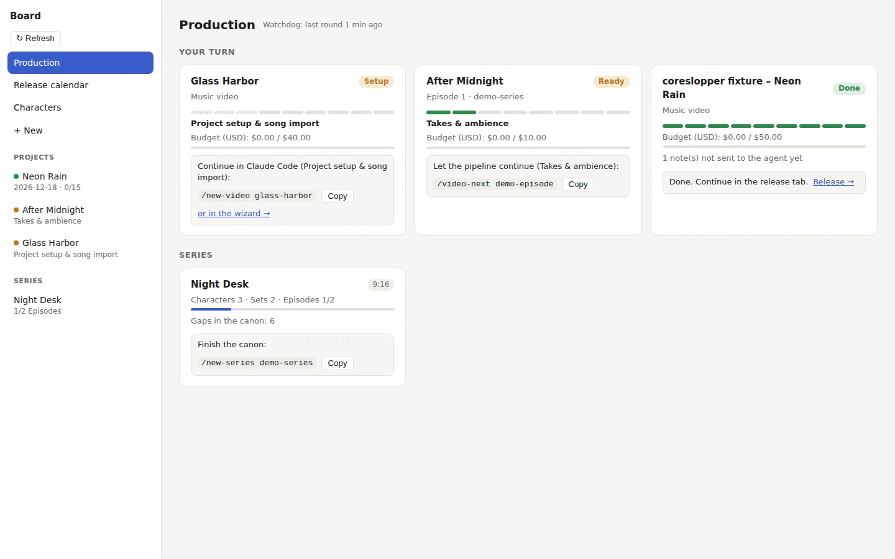
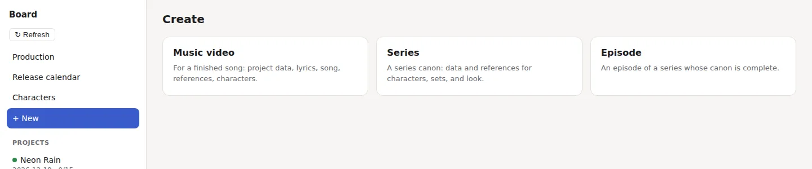
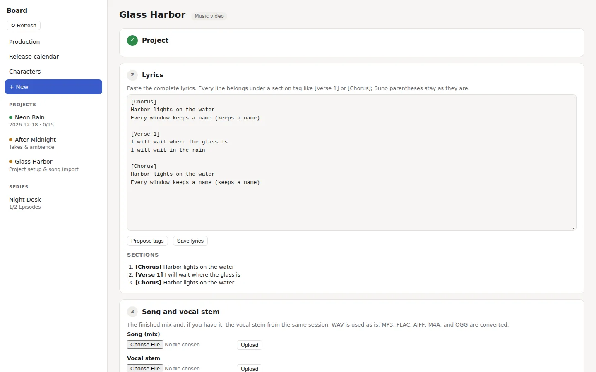
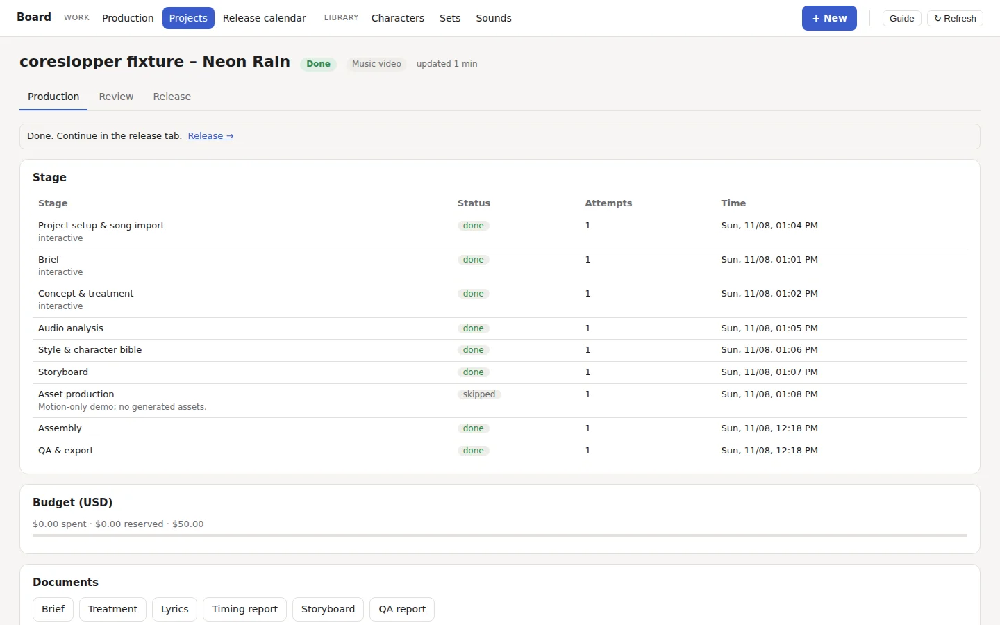
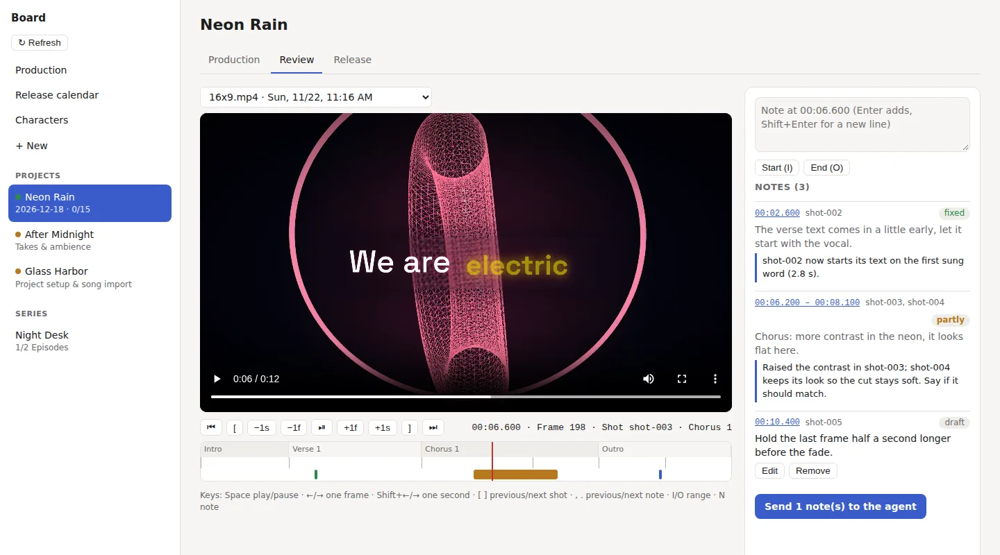
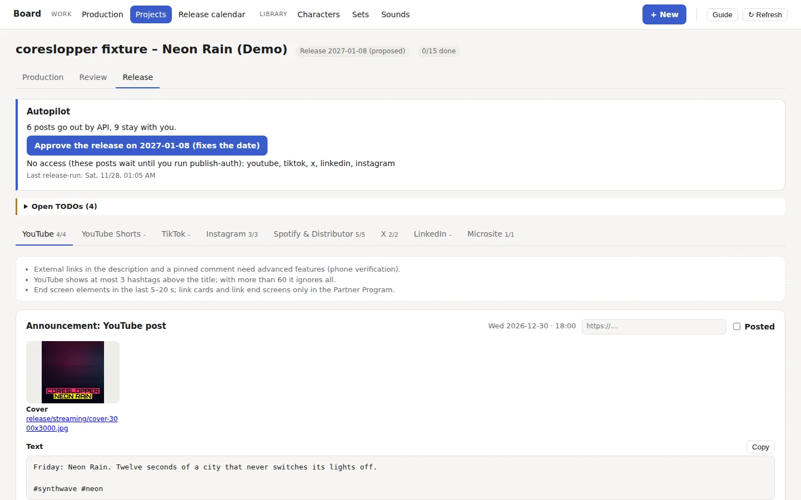
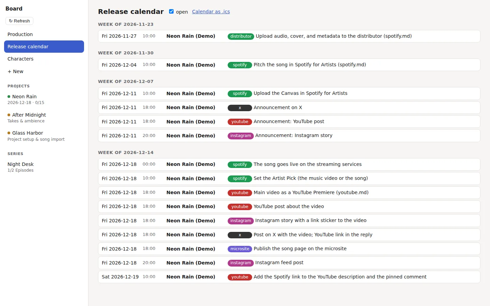
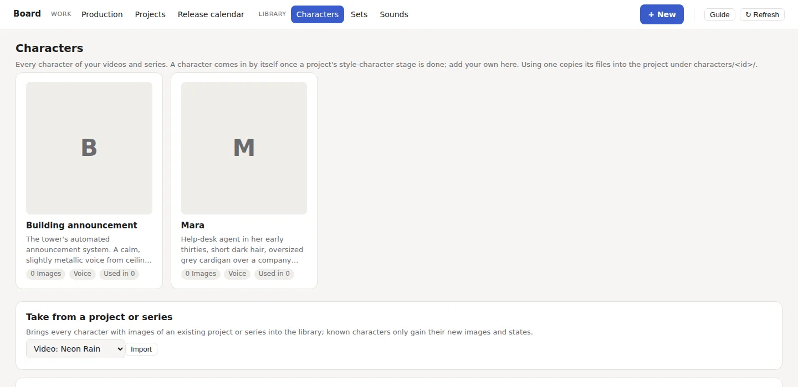
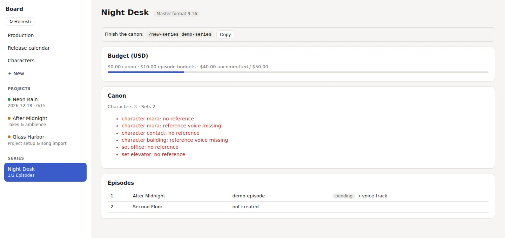

# Board guide

*[Deutsche Fassung](board-guide.de.md)*

A short tour of the board: where to look, what to click, and what happens in Claude Code. The details of every view are in [board.md](board.md).

The screenshots show the workspace's demo projects. The board speaks your browser's language. The release view speaks the project's language.

## Start the board

In the workspace:

```bash
npm run cli -- board          # http://127.0.0.1:4848
```

Or in the board container, which also runs the watchdog: `docker compose up -d` (see [board.md](board.md#start-it)). Open http://127.0.0.1:4848 in your browser.

The navigation is the bar across the top. **Work** holds Production, Projects, and Release calendar; **Library** holds Characters, Sets, and Sounds. **+ New** starts something new, and **Guide** and **↻ Refresh** sit apart at the right. The entry of the view you are on is marked; a project's tabs and a series mark **Projects**.

The board does not refresh by itself. Press **↻ Refresh** at the right of the navigation after Claude Code has worked. A playing video or a note you are typing stays as it is.

## Production: what is your turn



**Production** is the start view. Each card is a project or a series:

- **Your turn**: something waits for you. The card names the command to run in Claude Code. Click **Copy** and paste it there.
- **Running**: Claude Code or a render is working on it.
- The coloured strip shows the stages. Below it are the current stage and the budget.

The navigation lists no project: **Projects** opens the list of every project and series, released ones included.

## Projects: find a project

**Projects** is a table of every music video, meme, episode, and series, the newest activity first. Each row shows the kind, the state, the current stage, the next step, the release day with how many release events are done, and when something last changed. Click a row to open it.

- Type in the search field to find a project by its title or slug.
- Click **Kind**, **Status**, or pick a **Series** to narrow the list. **Released** shows the projects that are out.
- Click a column header to sort by title, release day, or last activity; click it again to reverse the order.
- Switch on **Group by series** to see every episode under its series, with the planned episodes that have no project yet.
- **Reset filters** clears everything. The address keeps your search and filters, so **↻ Refresh**, Back, and a bookmark bring the same list back.

## Start a music video

Click **+ New** and choose **Music video**. The chooser has two groups: **Production** (Music video, Series, Episode, Meme) and **Library** (Character, Set).



The wizard asks for the project data first: title, artist, budget, and providers. Then come the lyrics:



1. Paste the complete lyrics.
2. Click **Propose tags**: a block that repeats becomes `[Chorus]`, every other block a `[Verse n]`. Correct the tags where the song differs.
3. Check the **Sections** list, then click **Save lyrics**.

Next, upload the song (the mix) and, if you have it, the vocal stem. MP3, FLAC, and the other common formats are converted to WAV. After that, add references (mood boards, photos, links), then characters and sets from the library. **Finish setup** completes the step. Then run `/new-video <slug>` in Claude Code: the agent starts with the brief.

## Follow a project

Click a project's card on **Production**, or open **Projects** and click its row.



The **Production** tab lists every stage with its status, attempts, and time, then the budget, the documents (brief, treatment, storyboard, QA report), and the renders. A document opens formatted on the board; the file name at its top right opens the file itself. The box at the top always names the next step.

## Review a render

The **Review** tab plays the project's renders.



1. Choose a render at the top and find the moment: play it, step with ← and →, or click the timeline. The timeline shows the sections, the shots, and your notes.
2. Type a note in the box on the right and press Enter. It sits on the current frame. For a range, press **Start (I)** and **End (O)** first.
3. Notes are drafts until you send them. Edit or remove a draft as you like.
4. Click **Send to the agent**. The notes become a review round.
5. Run `/video-next <slug>` in Claude Code. It works through the round first, renders again, and answers every note: **fixed**, **partly**, **not fixed**, or a question. The answer appears under the note after **↻ Refresh**.

Keyboard: Space plays and pauses, `[` and `]` jump between shots, `,` and `.` between notes, `N` starts a note.

## Release

When a project is done, the **Release** tab holds everything for publishing it.



- The header shows the release day and how many posts are done. A day the calendar chose is marked *proposed*.
- **Open TODOs** lists what the release still misses, such as a thumbnail or a release fact.
- The platform tabs (YouTube, Shorts, TikTok, Instagram, Spotify & Distributor, X, LinkedIn, Microsite) hold every post with its date, text, and files. **Copy** takes a text, and a file link opens the file.
- After you post something by hand, paste its address into the `https://…` field and tick **Posted**. The texts that link to it are laid out again.
- **Approve the release** fixes the release day. With platform access set up (see [publishing.md](publishing.md)), the release autopilot then posts at the calendar times. Without access, every post stays with you.

## Release calendar



**Release calendar** shows what goes online when, across all projects, week by week. **open only** hides what is done. **Calendar as .ics** exports it for your calendar app.

## Characters



**Characters** is your character library, a table with one row per character: its cover, tags, images and states, voice, how many productions use it, and where it came from. Search by name, description, or tag, filter by tag, **unused**, or **Origin**, and click a column header to sort; the address keeps all of it, so Back and a refresh return to the same list. Click a row to open the character. A project's characters come in by themselves once its character bible is done. **+ New** in the head of the list opens the character wizard, as **+ New** → **Character** does. It first asks: **Create new** or **Import from a project or series**. To create one, fill in the name, display, description, prompt sentence, and tags and click **Create**; then upload the character sheet and more images (each shows as it uploads), and, if you have it, a WAV of the voice with its exact words. **To the character** opens its page. The wizard's address keeps the character, so a reload goes on where you were. To import, choose the project or series and click **Import**: the wizard lists the characters it took in, each linked to its page. A refused entry (an empty or taken name, a file of the wrong kind) shows its reason in the step and keeps what you typed. On a character's own view, **Use in** copies it into a music video or a series canon.

**Sets** is your set library, the same kind of table: one row per set with its cover (the first plate, else the first reference), tags, the number of references and plates, how many productions use it, and where it came from. Search, the filters **unused** and **Origin**, the tag chips, and the column headers work as in Characters, and the address keeps them too. Click a row to open the set. **+ New** in the head of the list opens the set wizard, as **+ New** → **Set** does. It first asks: **Create new** or **Import from a project or series**. To create one, fill in the name, description, and prompt sentence (all three required) and tags and click **Create**; then upload references and plates, each plate with its camera angle (each image shows as it uploads). **To the set** opens its page, and a reload goes on where you were. To import, choose the project or series and click **Import**: the wizard lists the sets it took in, each linked to its page. A refused entry (an empty or taken name, a plate without its angle) shows its reason in the step and keeps what you typed.

**Sounds** is the sound library of your memes, the same kind of table: one row per sound with a play button, its use when, its length after the trim, its licence, tags, and how many memes took it. ▶ plays the sound right in the row, a second click stops it, and another row's ▶ stops the first. Search by title, use when, or tag, filter by tag, **unused**, or **Licence** (`unknown` finds what the release check will flag), and sort by the column headers; the address keeps it all. A click elsewhere on the row opens the sound.

## Series



A series shows its budget, its canon, and its episodes. The red lines are canon gaps: an on-screen character or set without a reference, or a speaking character without a voice. Run `/new-series <slug>` until they are gone. Then start episodes with **+ New** → **Episode** and `/new-episode <slug>`.
