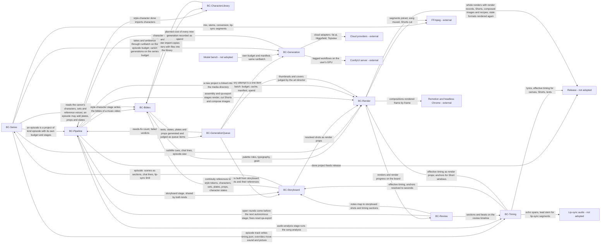

# As-is context map – coreslopper

> Recovered from code by `/adopt` on 2026-11-21 at b195086. This is **not a target**.
> Target: [context-map.md](context-map.md) · Gap register: [gap-register.md](gap-register.md).

Adopted slices: project and stage pipeline; human review; art-director verdicts and the generation queue (decided by recommendation); song timing and lyrics (decided by recommendation, four answers from the user); the storyboard (decided by recommendation, four answers from the user); generation and the provider adapters (decided by recommendation, four answers from the user); series budget, script, takes and the episode track (decided by recommendation, four answers from the user); the bibles, user references and the character library (decided by recommendation, four answers from the user); render, Shorts, composed images and the media directory (decided by recommendation, four answers from the user). Other areas – release, publishing, the workspace, model bench – appear only as neighbours until their own slice is adopted.

## Contexts

### BC-Pipeline – Pipeline
Purpose (as recovered): drives one project through the fixed stage list of its project kind (`music-video`,
`episode`), records each stage's status, outputs and attempts, and keeps the project budget.
Core terms: Project, Project Kind, Stage, Interactive Stage, Stage Reset, Review Mode, Hard Stop, Stage Runner,
budget, batch cap, next action, production phase (term unresolved, HS-1).
Evidence:
- control plane `projects/<slug>/state.json`, schema `StateSchema` (`packages/core/src/schema.ts:134-168`)
- configuration `projects/<slug>/project.yaml`, schema `ProjectConfigSchema` (`schema.ts:97-132`)
- stage lists and transitions (`packages/core/src/state.ts:18-341`), budget checks (`packages/core/src/cost.ts:13-38`)
- derived views (`packages/core/src/production.ts`), CLI writers `new`, `stage-*`, `spend`, `generate`
  (`packages/cli/src/index.ts:763-846`, `new-project.ts`, `generate.ts:757-759`)
Boundaries:
- Writers of `state.json`: the CLI (`new`, `stage-*`, `spend`, `generate`, `render` for `artifacts`) and the
  board wizard (`finishSetup`, `packages/cli/src/board-wizard.ts:344`). Agents never edit it directly; the
  workspace hook validates any edit (`workspace/.claude/hooks/validate-artifacts.mjs`).
- Readers only: `status`, the board production view, the watchdog (`packages/cli/src/production-watch.ts`).
- The orchestrating rules (interactive gate, review-mode stop, hard stops, batch size) live in agent
  instructions (`workspace/.claude/commands/video-next.md`, `workspace/.claude/agents/stage-runner.md`), not in code.

### BC-Review – Review
Purpose (as recovered): the user's frame-accurate notes on a render, sent to the agent in numbered rounds and
answered note by note; the human side of quality control, next to the automated critics.
Core terms: Review Note (draft, sent), Review Round (open, answered), reply and reply status, render.
Evidence:
- notes `review/notes/<video-stem>.json`, rounds `review/rounds/<NNN>.json`, replies `<NNN>.replies.json`
  (`packages/core/src/schema.ts:1349-1421`); pure helpers `packages/core/src/review.ts`
- writes and the lock `review/.notes.lock` (`packages/cli/src/board-review.ts:200-269`); board routes
  `/api/review/<slug>[/notes|/submit]` (`packages/cli/src/release-board.ts:373-392`)
- a second writer of notes: the desktop player (`scripts/review-player/review_notes.py`), without the lock
- replies validated by `validate-file` and the workspace hook; answered by a `review-fix` runner per
  `workspace/.claude/commands/video-next.md` and `workspace/.claude/skills/assembly-render/SKILL.md`
Boundaries:
- BC-Pipeline reads only the count of open rounds (`projectNextAction`, `status` `Review:` lines); the link
  back is the orchestrator's `stage-reset … qa-export`, an instruction, not code.
- The art director's verdicts (`assets/review/verdicts.jsonl`) share the word "review" but not this context.

### BC-GenerationQueue – Generation queue
Purpose (as recovered, draft – name HS-29): gets every generated image and clip of a project approved before
anything derives from it. One queue run generates the ready items in order, the art director gives every attempt
a verdict in the background, and the run files a passed attempt, requeues a failed image with the fix prompt, or
leaves the item waiting for a fix.
Core terms: Generation Queue, queue item, Attempt, verdict (term HS-30), blocking defect and note (HS-31), fix
prompt, focus, Art Director, Region Patch, cloud fallback, frame chaining.
Evidence:
- the queue `assets/queue.json`, Zod schema in the CLI only (`packages/cli/src/queue.ts:31-80`), written whole
  through a temp file and a rename (`queue.ts:111-119`); run lock `assets/queue.lock` (`queue.ts:562-578`)
- attempts as files `<out dir>/attempts/<name>-a<n>.<ext>` (`queue.ts:137`); filed at `out` on a pass or an accept
- the verdict log `assets/review/verdicts.jsonl` (series canon: `<series>/review/verdicts.jsonl`), append-only
  (`packages/cli/src/review-image.ts:300-302`); the art director runs as `claude -p --agent art-director` with a
  JSON schema (`review-image.ts:177-217`)
- region patches: an attempt file plus `assets/review/patches.jsonl`, not in the queue (`packages/cli/src/patch.ts`)
- instructions: `workspace/.claude/skills/ai-clips/SKILL.md` steps 3–6, `workspace/.claude/agents/art-director.md`,
  `workspace/.claude/agents/stage-runner.md` rule 10
Boundaries:
- Writers of `queue.json`: `queue add|run|retry|accept|drop`, run by the stage runner. Readers: `queue status|wait`,
  the board production view and the watchdog (loosely, `packages/cli/src/board-production.ts:140-176`,
  `production-watch.ts:36`).
- Every attempt is generated through `runBatch` (`packages/cli/src/generate.ts`), so budget, cache, manifest and
  spend stay with the generation slice and `AGG-Project`.
- BC-Pipeline sees this context only through the stage skills' completion checks and the board's counts; no
  stage state is written here.
- The model bench has its own scores (`pass/weak/fail`, `packages/core/src/bench.ts:183`), not verdicts.

### BC-Timing – Timing
Purpose (as recovered, decided by recommendation HS-47): turns the user's finished song and section-tagged
lyrics into a measured timing, merges the user's timing overrides into the effective timing, and resolves
symbolic anchors to seconds for every later stage. Measured for a music video; an episode's timing is
constructed by the episode track (series slice, not adopted) and passes the same merge and check.
Core terms: Lyrics, section tag, Song Import, Stem, Lead Stem, Echo Span, Timing, Section, Line, Word, Beat,
Downbeat, Onset, Energy, Timing Override, Effective Timing, Timing Report, Anchor.
Evidence:
- the measured timing `projects/<slug>/timing.json`, schema `TimingSchema` (`packages/core/src/schema.ts:170-215`),
  written whole by the Python analysis (`scripts/audio-analysis/analyze.py:430-432`) in the `audio-analysis`
  stage (`packages/core/src/state.ts:43-50`), run by the stage runner through
  `workspace/.claude/skills/audio-analysis/SKILL.md`; no CLI command runs it
- the overrides `timing.overrides.json`, schema `TimingOverridesSchema` (`schema.ts:218-239`), seeded empty by
  `new` (`packages/cli/src/new-project.ts:157-162`) and otherwise edited by hand
- the merge and check on every project load (`packages/core/src/project.ts:237-241`;
  `packages/core/src/timing.ts:61-165`); the snapshot `timing.effective.json` written by `validate`
  (`packages/cli/src/validate.ts:104-119`); the anchor resolver `resolveAnchor` (`timing.ts:167-217`)
- the lyrics `lyrics.txt`, checked and written by `writeLyrics` (`packages/cli/src/board-wizard.ts:271-278`),
  tag rules in `packages/core/src/lyrics.ts`; section ids derived only by the Python parser
  (`scripts/audio-analysis/timing_core.py:13-55`)
- the song files `audio/song.wav`, `audio/stems/vocals.wav` and `song.json` (no schema), written by
  `import-song` and `normalize-audio` (`packages/cli/src/media.ts:169-312`); the lead stem by
  `separate_lead.py`; the timing report `timing.report.md` and the echo scan (`echo_scan.py`)
Boundaries:
- Writers of `timing.json`: the analysis for a music video, the episode track for an episode
  (`packages/cli/src/episode-track.ts:247`). Writer of the overrides: the agent at the user's request (HS-66).
- Readers of the effective timing, all through `loadProject`: render (as Remotion props,
  `packages/cli/src/render.ts:173`), the storyboard resolver, the board review (`board-review.ts:251`), the
  queue (`queue.ts:293`), Shorts and release (`short.ts:99`, `release.ts:557`), lip-sync segments
  (`media.ts:136`). Remotion re-implements the lookups (`packages/remotion/src/lib/timing.ts`, HS-60).
- The Python analysis and TypeScript share only the generated JSON Schema `schema/timing.schema.json`
  (ADR 0004); `timing.meta` is untyped (HS-65).
- Song metadata in `song.json` (title, artist, rights) belongs to setup and release, not here (HS-47).

### BC-Storyboard – Storyboard
Purpose (as recovered, decided by recommendation HS-69): turns the treatment or script, the effective timing and
the bibles into an ordered list of shots that covers the song or episode track, checks every shot's source,
continuity references and limits, and hands resolved shots to the queue, render, QA and review. One model for
both project kinds; an episode adds checks through `EpisodeContext` (ADR 0016).
Core terms: Storyboard, Shot, Shot Source, Layer, Continuity Reference, Lip-Sync Shot, Highlight, Focus Point,
Frame Chaining, Coverage, Contact Sheet, Anchor (from BC-Timing).
Evidence:
- `projects/<slug>/storyboard.yaml`, schema `StoryboardSchema` and `ShotSchema`
  (`packages/core/src/schema.ts:277-371`), parsed only by `loadProject` (`packages/core/src/project.ts:242-243`);
  written by the agent in the `storyboard` stage (`packages/core/src/state.ts:59-66`,
  `workspace/.claude/skills/storyboard/SKILL.md`); no command or template writes it
- `resolveStoryboard` (`packages/core/src/timing.ts:455-577`) with the per-shot checks (`:226-452`); its only
  caller is `validateProject` (`packages/cli/src/validate.ts:66-121`)
- `validate`, `contact-sheet` (`packages/cli/src/index.ts:86-103,165-182`), the hook path
  (`workspace/.claude/hooks/validate-artifacts.mjs:13-15`, `packages/cli/src/validate-file.ts:124-127`)
- `review/contact-sheet.svg` (`packages/cli/src/contact-sheet.ts`), embedded by the board
  (`packages/cli/src/board-production.ts:314`); `storyboard.md` written by hand (skill step 6)
Boundaries:
- Writer of `storyboard.yaml`: the agent only, in the stage and at the user's request (HS-77).
- Readers of the resolved storyboard, through `validateProject`: render (Remotion props, `render.ts:98-140`),
  contact sheet, QA (`qa.ts:334`), subtitles (`subtitles.ts:12`), the board review's shot spans
  (`board-review.ts:122-128`). Readers of the raw storyboard: the queue's `buildShotItems` (`queue.ts:326-386`)
  and QA's continuity checks (`qa.ts:48-102`) – HS-79.
- Continuity references point into the style, character and set bibles (project or series canon); their
  definitions are not this context's (HS-69). Resolved three times today (HS-80).
- Episode checks read the script's scenes and chat lines and the series' lip-sync limit; the lip-sync maximum
  comes from `config/models.yaml` (`validate.ts:53-63`).
- Remotion keeps its own motion component switch and highlight matching (HS-80, HS-81).

### BC-Generation – Generation
Purpose (as recovered, decided by recommendation HS-87): turns the items of a generation batch into provider calls
for a model role. A batch that does not fit the budget is refused up front, a request that ran before is served
from the generation cache, every generation is recorded in the manifest, and every new one is billed at its
planned cost.
Core terms: Generation Batch, Generation, Generation Operation, Model Role, Provider, Provider Alternative,
Provider Adapter, ComfyUI Workflow, Mock Provider, Generation Cache, Cache Key, Manifest, Project Budget, Batch
Cap, Restore Pass, Video Model.
Evidence:
- `runBatch` (`packages/cli/src/generate.ts:667-772`): it resolves every item (`resolveItem`, `:287-594`) and
  checks the worst-case estimate once (`assertAffordable`, `packages/core/src/cost.ts:21-38`). Then it builds
  one `GenerationRunner` per provider, records the spend and saves the state after each new result. Its callers
  are `generate` (`index.ts:897`), the queue (`queue.ts:628`), `patch` (`patch.ts:96`), the voice track
  (`voice-track.ts:137,191`) and the bench (`bench.ts:577,634,675`).
- `GenerationRunner` (`packages/providers/src/runner.ts`): the cache key (`:53-84`), the cache under
  `<workspace>/.cache/generations/<key>/` (`:86-99,167-207`) and the manifest append (`:209-226`).
- Model roles: `config/models.yaml` (`ModelsConfigSchema`, `schema.ts:714-762`), resolved by
  `resolveModelRole` and `providerForRole` (`packages/core/src/models.ts:26-98`). The project's choice is in
  `project.yaml` `providers` (`schema.ts:37-48`).
- Adapters: `createProvider` (`packages/providers/src/index.ts:20-27`) and the `Provider` interface (`types.ts:36-69`).
  The adapters are `fal.ts`, `higgsfield.ts`, `topview.ts`, `comfyui.ts` (with the workflows in
  `comfyui/workflows/` and their tags) and `mock.ts`, sharing `http.ts` and `duration.ts`.
- The Pika prompt schemas are `flex.ts` and `fl2va.ts` in core; the local clip options are in `clip-options.ts`.
  The ComfyUI server commands `comfy status` and `comfy restart` are in `comfy.ts`.
Boundaries:
- Every media generation goes through `runBatch`; no adapter is called around it. The only exception is not a
  generation: the release autopilot uses fal's file upload to host Instagram media (`release-autopilot.ts:138`).
- The budget ledger belongs to `AGG-Project` (BC-Pipeline): `recordSpend` and `saveState` are called by
  `runBatch`, and `state.json` has no lock (G-1). A series canon batch books against the series budget.
- The queue (BC-GenerationQueue) sends one item per batch, so the batch cap guards one item and the project budget
  guards the run (HS-91).
- `packages/providers` imports only core and knows no project, state or budget. It owns the cache and the
  manifest file and reads `config/models.yaml` and the workflow folder (`comfyui.ts:165-168,729`).
- Provider-specific routing lives outside the adapters: ComfyUI, Pika, LTX, Wan and SeedVR2 rules in
  `generate.ts` and the lip-sync fallback in `models.ts`. The provider list is kept five times (HS-100).
- Readers of the manifest: the QA checker (cost sum equals recorded spend, `qa.ts:230-262`). The bench keeps its
  own manifest and budget (bench slice).

### BC-Series – Series
Purpose (as recovered, decided by recommendation HS-103): keeps a series' umbrella budget and episode plan and
creates its episodes, and turns an episode's script into takes, an episode track with speaker stems, subtitles and
lip-sync audio – the episode's replacement for the song (ADR 0016, ADR 0042 proposed).
Core terms: Series, Series Budget, Uncommitted Series Budget, Episode Plan, Planned Episode, Creative Limit, Canon
Gap, Episode, Script, Scene, Script Line, Speaker, Reference Voice, Take, Take Registry, Take Status, Ambience,
Voice Track, Episode Track, Speaker Stem, Subtitles.
Evidence:
- the series `projects/<slug>/series.yaml` and `state.json` (`SeriesSchema`, `SeriesStateSchema`,
  `packages/core/src/schema.ts:543-664`), loaded by `loadSeries` (`packages/core/src/project.ts:380-416`), created
  by `new-series` (`packages/cli/src/new-series.ts:67-104`) and the board wizard (`POST /api/new/series`)
- the series budget sum `seriesBudget` (`packages/cli/src/series.ts:43-74`), checked by `createProject` for an
  episode (`packages/cli/src/new-project.ts:205-216`); canon generations through `seriesTarget`
  (`packages/cli/src/generate.ts:260-277`); `series-status` and the board's series view (`series.ts:101-209`,
  `board-production.ts:336-370`, `packages/core/src/production.ts:109-122`)
- the script `script.yaml` (`ScriptSchema`, `schema.ts:587-657`) and its rules (`packages/core/src/episode.ts`),
  checked by the hook (`packages/cli/src/validate-file.ts:134-145`)
- the take registry `takes.json` (`TakesSchema`, `schema.ts:666-684`) with `audio/lines/` and `audio/ambience/`,
  written by `voice-track` (`packages/cli/src/voice-track.ts`) and `import-takes` (`media.ts:395-460`); take status
  in `takes.ts`
- the episode track `episode-track` (`packages/cli/src/episode-track.ts`): `timing.json`, `audio/episode.wav`,
  `audio/stems/<character>.wav`; subtitles `subtitles` (`subtitles.ts`, `renders/<slug>.en.srt`); lip-sync audio
  `audio-segment --character` (`media.ts:75-136`)
- the stages `setup`, `script`, `voice-track`, `episode-track` (`EPISODE_STAGES`, `packages/core/src/state.ts:102-151`)
  and the skills `new-series`, `new-episode`, `voice-track`, `episode-track`
Boundaries:
- An episode is a project (BC-Pipeline): its stages, state and budget ledger are `AGG-Project`'s; this context adds
  the series commitment at creation and the episode's audio.
- The canon files – `characters.yaml`, `sets.yaml`, `style.yaml`, `bible.md` and references – are read here (sets,
  speakers, reference voices, display rules) but belong to BC-Bibles (`.claude/rules/character.md`). An episode may add
  files to the canon; overwriting one is a gap (HS-117).
- Takes, ambience and canon references are generated through `runBatch` (BC-Generation): takes on the episode
  budget, canon generations on the series budget, which ignores episode budgets today (HS-105).
- `episode-track` is the writer of an episode's `timing.json`; the overrides stay the user's and the merge and
  check are BC-Timing's. Storyboard checks read the script's scenes, chat lines and the series' lip-sync limit.
- Render reads `audio/episode.wav` and the subtitle cues; `SubtitleCue` is defined twice (HS-116). The lead-only
  lip-sync audio of a music video (`lipsync-audio.ts`, ADR 0026) is not this context's.
- Writers of `script.yaml`: the agent only (HS-121). Writers of `takes.json`: `voice-track` and `import-takes`. No
  locks; one stage at a time.

### BC-Bibles – Bibles
Purpose (as recovered, decided by recommendation HS-123): holds what a production must look and sound like before
any shot is generated – the style bible, the character bible with its character states, the set bible with plates
and prop references, and the user references – per music video, or once per series canon that every episode
reads and may only add to (ADR 0025, ADR 0043 proposed).
Core terms: Style Bible, Character Bible, Set Bible, Character Sheet, Character Identity, Character State, Display
Rule, Reference Voice, Set, Plate, Prop Reference, Continuity Reference, Canon, Canon Gap, User Reference.
Evidence:
- the schemas `StyleBibleSchema`, `CharacterBibleSchema`, `SetBibleSchema` and `ReferencesSchema`
  (`packages/core/src/schema.ts:373-541,1460-1489`), loaded by `loadProject` – an episode's from its series folder
  (`packages/core/src/project.ts:85-108,226-250`)
- the files `style.yaml`, `characters.yaml` with `characters/<id>/`, `sets.yaml` with `sets/<set>/plates/` and
  `props/<id>/`, `references.yaml` with `assets/references/`, validated by the hook on every edit
  (`packages/cli/src/validate-file.ts:86-97,234-243`)
- the writers: the `style-bible` and `character-bible` skills in `style-character` (`packages/core/src/state.ts:52-58`),
  the `new-series` skill and `new-series` command (`packages/cli/src/new-series.ts:48-104`), `character use`
  (`packages/cli/src/character-library.ts:452-525`), the `reference` command and the board wizard
  (`packages/cli/src/board-wizard.ts:72-178`)
Boundaries:
- The bibles' consumers resolve continuity references three times – the storyboard check
  (`packages/core/src/timing.ts:226-366`), QA (`packages/cli/src/qa.ts:76-103,292-313`) and the queue
  (`packages/cli/src/queue.ts:242-286`) – one resolution is decided (HS-135).
- Reference images are generated and judged as queue items (BC-GenerationQueue, BC-Generation); a canon by hand
  with `review-image`. The bibles name the filed paths.
- In a canon an episode adds plates, prop references and character states and changes nothing; only prompt text
  says so today (HS-130, HS-117).
- Render, thumbnails, the voice track and the lip-sync check read the style, the reference voices and the display
  rules. No locks; one stage at a time, the board writes only user references and character use (HS-134).

### BC-CharacterLibrary – Character library
Purpose (as recovered, decided by recommendation HS-123): keeps the workspace's reusable characters across
productions – takes the characters of finished character bibles in and copies a character's identity, and the
states the user chooses, into a new music video or series canon (ADR 0034, ADR 0043 proposed).
Core terms: Character Library, Library Character, Character Identity, Character Import, Character Use, Character
State.
Evidence:
- `library/characters/<id>/character.yaml` with `LibraryCharacterSchema` (`packages/core/src/schema.ts:1422-1458`)
  and its files, checked by `validate-file` (`packages/cli/src/validate-file.ts:246-258`)
- every rule in `packages/cli/src/character-library.ts`: import and entry matching (`:206-293`), content dedupe
  (`:141-167`), manual entries (`:328-428`), use (`:452-525`), listing and targets (`:69-112,538-547`)
- the `character` command (`packages/cli/src/index.ts:655-760`), the automatic import at `stage-done … style-character`
  (`index.ts:786-794`), the board's Characters view (`packages/cli/src/board/characters.js`) and its routes
  `/api/library*` and `/library-files/<id>/<file>` (`packages/cli/src/release-board.ts:252-318`)
Boundaries:
- Only copies cross to BC-Bibles: a bible's character names its library character in `library`; changing the
  library never changes a production (ADR 0034).
- The library belongs to the user: `update` and `init` never touch `library/` (`packages/cli/src/update.ts:43-45`).
- The board serves library files but never `character.yaml` or dot files; writes follow the board's same-origin
  rules.
- A series canon comes in through a skill step, not code (HS-131); the user has not used the library yet.

### BC-Render – Render
Purpose (as recovered, decided by recommendation HS-143): turns a validated project into its videos and images – a
render per format from one composition, previews for checks, Shorts cut from the 9:16 render, and composed images
(thumbnails, covers, feed images) from a generated image and the style bible – and keeps a project's media in the
media directory (ADR 0007, ADR 0018, ADR 0044 proposed).
Core terms: Render, Master Format, Derivative Format, Render Record, Preview, Short, Composed Image, Thumbnail,
Cover, Thumbnail Recipe, Media Directory.
Evidence:
- one `MusicVideo` composition sized by props for every format, and a `Thumbnail` composition
  (`packages/remotion/src/Root.tsx:7-44`); the CLI builds the props from the loaded project – resolved shots,
  effective timing, style, characters, chat lines and subtitles, brand fonts (`packages/cli/src/render.ts:137-180`)
- `render` writes `renders/[preview-]<format>[.en].mp4` in segments that resume, joins them and muxes the song
  (`render.ts:293-445`); a whole render leaves its render record in `state.json` (`render.ts:267-291,431-433`),
  which `release` compares to decide what to render again (`packages/cli/src/release.ts:237-262`)
- `short` cuts `renders/shorts/<name>-9x16.mp4` from `renders/9x16.mp4` (`packages/cli/src/short.ts:200-233`);
  `thumbnail` composes a JPEG in one of five formats with its recipe (`packages/cli/src/thumbnail.ts:183-217`,
  `thumbnail-recipe.ts`)
- `media-link` and project creation link `assets/` and `renders/` into `CORESLOPPER_MEDIA_DIR`
  (`packages/cli/src/media-dir.ts:19-97`, `new-project.ts:182-186`)
- the progress file `review/progress/<file>.json`, read by the board and the watch
  (`packages/cli/src/render-progress.ts`, `board-production.ts:204-221`, `packages/core/src/watch.ts:104-118`);
  QA's render checks (`packages/cli/src/qa.ts:107-174,350-417`)
Boundaries:
- Reads only: the resolved storyboard (BC-Storyboard), the effective timing (BC-Timing), the style and character
  bibles (BC-Bibles), an episode's script, chat lines and subtitle cues (BC-Series). It writes nothing of theirs.
- The CLI owns all input, output and encoding; `packages/remotion` is a pure function of props and frame and takes
  runtime values only from `@coreslopper/core/browser` (HS-158).
- Release (not adopted) places the renders, Shorts and composed images in the release folder and renders a missing
  or stale format again; it composes the announcement images from the cover's recipe.
- The art director judges thumbnails and covers (BC-GenerationQueue's agent, run by hand in `video-qa`).
- The render record lives in `AGG-Project`'s `state.json` and is saved without a lock (G-1, HS-155).
- A passage render without `--out` replaces the recorded render's file (HS-146); a Short is not tied to the render it
  was cut from (HS-148); a series canon is not linked into the media directory (HS-154).

