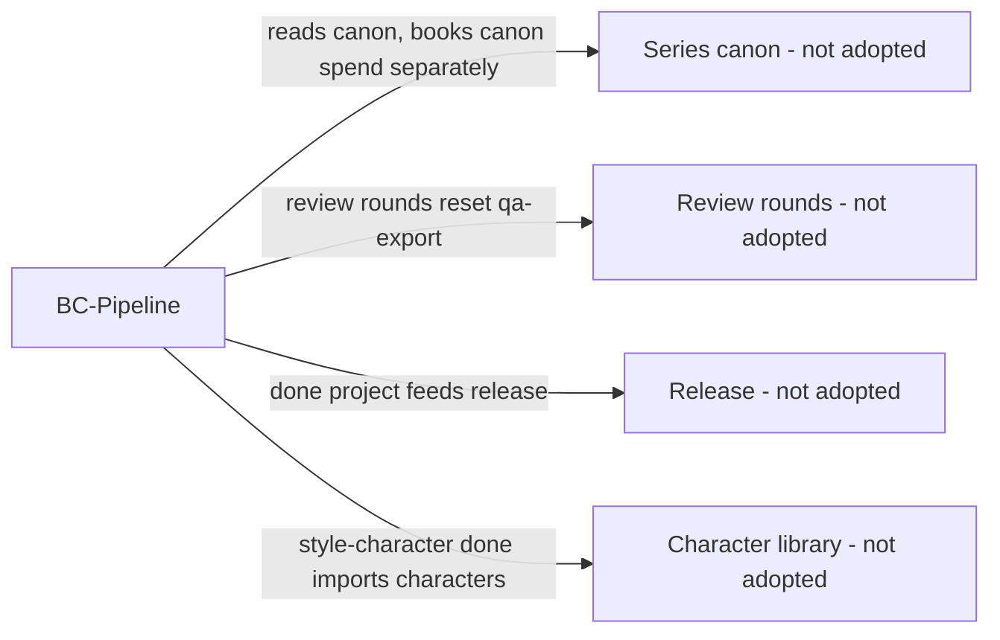

# As-is context map – coreslopper

> Recovered from code by `/adopt` on 2026-11-21 at b195086. This is **not a target**.
> Target: [context-map.md](context-map.md) · Gap register: [gap-register.md](gap-register.md).

Adopted slices: project and stage pipeline (draft). Other areas – review rounds, release, series canon,
character library, model bench, providers – appear only as neighbours until their own slice is adopted.

## Contexts

### BC-Pipeline – Pipeline
Purpose (as recovered): drives one project through the fixed stage list of its project kind (`music-video`,
`episode`), records each stage's status, outputs and attempts, and keeps the project budget.
Core terms: Project, Project Kind, Stage, Interactive Stage, Stage Reset, Review Mode, Hard Stop, Stage Runner,
budget, batch cap, next action, production phase (term unresolved, HS-1).
Evidence:
- control plane `projects/<slug>/state.json`, schema `StateSchema` (`packages/core/src/schema.ts:134-168`)
- configuration `projects/<slug>/project.yaml`, schema `ProjectConfigSchema` (`schema.ts:97-132`)
- stage lists and transitions (`packages/core/src/state.ts:18-341`), budget checks (`packages/core/src/cost.ts:13-38`)
- derived views (`packages/core/src/production.ts`), CLI writers `new`, `stage-*`, `spend`, `generate`
  (`packages/cli/src/index.ts:763-846`, `new-project.ts`, `generate.ts:757-759`)
Boundaries:
- Writers of `state.json`: the CLI (`new`, `stage-*`, `spend`, `generate`, `render` for `artifacts`) and the
  board wizard (`finishSetup`, `packages/cli/src/board-wizard.ts:344`). Agents never edit it directly; the
  workspace hook validates any edit (`workspace/.claude/hooks/validate-artifacts.mjs`).
- Readers only: `status`, the board production view, the watchdog (`packages/cli/src/production-watch.ts`).
- The orchestrating rules (interactive gate, review-mode stop, hard stops, batch size) live in agent
  instructions (`workspace/.claude/commands/video-next.md`, `workspace/.claude/agents/stage-runner.md`), not in code.
