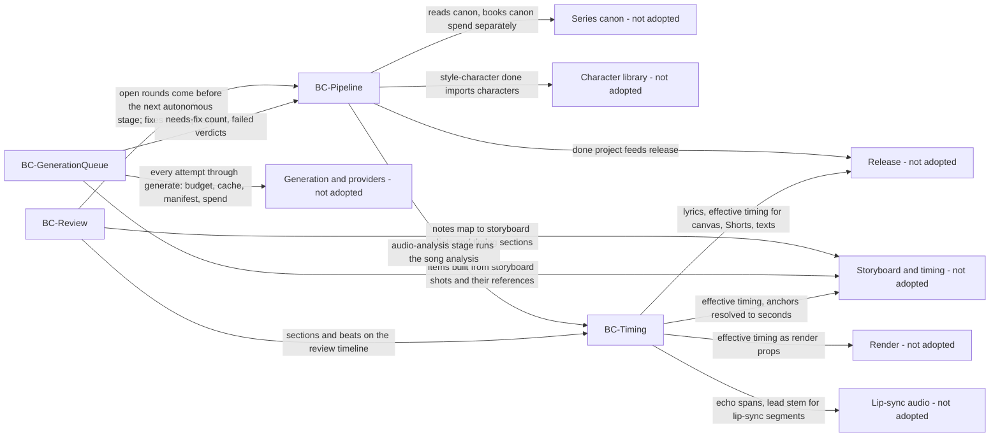

# As-is context map – coreslopper

> Recovered from code by `/adopt` on 2026-11-21 at b195086. This is **not a target**.
> Target: [context-map.md](context-map.md) · Gap register: [gap-register.md](gap-register.md).

Adopted slices: project and stage pipeline; human review; art-director verdicts and the generation queue (decided by recommendation); song timing and lyrics (decided by recommendation, four answers from the user). Other areas – release, series canon,
character library, model bench, providers – appear only as neighbours until their own slice is adopted.

## Contexts

### BC-Pipeline – Pipeline
Purpose (as recovered): drives one project through the fixed stage list of its project kind (`music-video`,
`episode`), records each stage's status, outputs and attempts, and keeps the project budget.
Core terms: Project, Project Kind, Stage, Interactive Stage, Stage Reset, Review Mode, Hard Stop, Stage Runner,
budget, batch cap, next action, production phase (term unresolved, HS-1).
Evidence:
- control plane `projects/<slug>/state.json`, schema `StateSchema` (`packages/core/src/schema.ts:134-168`)
- configuration `projects/<slug>/project.yaml`, schema `ProjectConfigSchema` (`schema.ts:97-132`)
- stage lists and transitions (`packages/core/src/state.ts:18-341`), budget checks (`packages/core/src/cost.ts:13-38`)
- derived views (`packages/core/src/production.ts`), CLI writers `new`, `stage-*`, `spend`, `generate`
  (`packages/cli/src/index.ts:763-846`, `new-project.ts`, `generate.ts:757-759`)
Boundaries:
- Writers of `state.json`: the CLI (`new`, `stage-*`, `spend`, `generate`, `render` for `artifacts`) and the
  board wizard (`finishSetup`, `packages/cli/src/board-wizard.ts:344`). Agents never edit it directly; the
  workspace hook validates any edit (`workspace/.claude/hooks/validate-artifacts.mjs`).
- Readers only: `status`, the board production view, the watchdog (`packages/cli/src/production-watch.ts`).
- The orchestrating rules (interactive gate, review-mode stop, hard stops, batch size) live in agent
  instructions (`workspace/.claude/commands/video-next.md`, `workspace/.claude/agents/stage-runner.md`), not in code.

### BC-Review – Review
Purpose (as recovered): the user's frame-accurate notes on a render, sent to the agent in numbered rounds and
answered note by note; the human side of quality control, next to the automated critics.
Core terms: Review Note (draft, sent), Review Round (open, answered), reply and reply status, render.
Evidence:
- notes `review/notes/<video-stem>.json`, rounds `review/rounds/<NNN>.json`, replies `<NNN>.replies.json`
  (`packages/core/src/schema.ts:1349-1421`); pure helpers `packages/core/src/review.ts`
- writes and the lock `review/.notes.lock` (`packages/cli/src/board-review.ts:200-269`); board routes
  `/api/review/<slug>[/notes|/submit]` (`packages/cli/src/release-board.ts:373-392`)
- a second writer of notes: the desktop player (`scripts/review-player/review_notes.py`), without the lock
- replies validated by `validate-file` and the workspace hook; answered by a `review-fix` runner per
  `workspace/.claude/commands/video-next.md` and `workspace/.claude/skills/assembly-render/SKILL.md`
Boundaries:
- BC-Pipeline reads only the count of open rounds (`projectNextAction`, `status` `Review:` lines); the link
  back is the orchestrator's `stage-reset … qa-export`, an instruction, not code.
- The art director's verdicts (`assets/review/verdicts.jsonl`) share the word "review" but not this context.

### BC-GenerationQueue – Generation queue
Purpose (as recovered, draft – name HS-29): gets every generated image and clip of a project approved before
anything derives from it. One queue run generates the ready items in order, the art director gives every attempt
a verdict in the background, and the run files a passed attempt, requeues a failed image with the fix prompt, or
leaves the item waiting for a fix.
Core terms: Generation Queue, queue item, Attempt, verdict (term HS-30), blocking defect and note (HS-31), fix
prompt, focus, Art Director, Region Patch, cloud fallback, frame chaining.
Evidence:
- the queue `assets/queue.json`, Zod schema in the CLI only (`packages/cli/src/queue.ts:31-80`), written whole
  through a temp file and a rename (`queue.ts:111-119`); run lock `assets/queue.lock` (`queue.ts:562-578`)
- attempts as files `<out dir>/attempts/<name>-a<n>.<ext>` (`queue.ts:137`); filed at `out` on a pass or an accept
- the verdict log `assets/review/verdicts.jsonl` (series canon: `<series>/review/verdicts.jsonl`), append-only
  (`packages/cli/src/review-image.ts:300-302`); the art director runs as `claude -p --agent art-director` with a
  JSON schema (`review-image.ts:177-217`)
- region patches: an attempt file plus `assets/review/patches.jsonl`, not in the queue (`packages/cli/src/patch.ts`)
- instructions: `workspace/.claude/skills/ai-clips/SKILL.md` steps 3–6, `workspace/.claude/agents/art-director.md`,
  `workspace/.claude/agents/stage-runner.md` rule 10
Boundaries:
- Writers of `queue.json`: `queue add|run|retry|accept|drop`, run by the stage runner. Readers: `queue status|wait`,
  the board production view and the watchdog (loosely, `packages/cli/src/board-production.ts:140-176`,
  `production-watch.ts:36`).
- Every attempt is generated through `runBatch` (`packages/cli/src/generate.ts`), so budget, cache, manifest and
  spend stay with the generation slice and `AGG-Project`.
- BC-Pipeline sees this context only through the stage skills' completion checks and the board's counts; no
  stage state is written here.
- The model bench has its own scores (`pass/weak/fail`, `packages/core/src/bench.ts:183`), not verdicts.

### BC-Timing – Timing
Purpose (as recovered, decided by recommendation HS-47): turns the user's finished song and section-tagged
lyrics into a measured timing, merges the user's timing overrides into the effective timing, and resolves
symbolic anchors to seconds for every later stage. Measured for a music video; an episode's timing is
constructed by the episode track (series slice, not adopted) and passes the same merge and check.
Core terms: Lyrics, section tag, Song Import, Stem, Lead Stem, Echo Span, Timing, Section, Line, Word, Beat,
Downbeat, Onset, Energy, Timing Override, Effective Timing, Timing Report, Anchor.
Evidence:
- the measured timing `projects/<slug>/timing.json`, schema `TimingSchema` (`packages/core/src/schema.ts:170-215`),
  written whole by the Python analysis (`scripts/audio-analysis/analyze.py:430-432`) in the `audio-analysis`
  stage (`packages/core/src/state.ts:43-50`), run by the stage runner through
  `workspace/.claude/skills/audio-analysis/SKILL.md`; no CLI command runs it
- the overrides `timing.overrides.json`, schema `TimingOverridesSchema` (`schema.ts:218-239`), seeded empty by
  `new` (`packages/cli/src/new-project.ts:157-162`) and otherwise edited by hand
- the merge and check on every project load (`packages/core/src/project.ts:237-241`;
  `packages/core/src/timing.ts:61-165`); the snapshot `timing.effective.json` written by `validate`
  (`packages/cli/src/validate.ts:104-119`); the anchor resolver `resolveAnchor` (`timing.ts:167-217`)
- the lyrics `lyrics.txt`, checked and written by `writeLyrics` (`packages/cli/src/board-wizard.ts:271-278`),
  tag rules in `packages/core/src/lyrics.ts`; section ids derived only by the Python parser
  (`scripts/audio-analysis/timing_core.py:13-55`)
- the song files `audio/song.wav`, `audio/stems/vocals.wav` and `song.json` (no schema), written by
  `import-song` and `normalize-audio` (`packages/cli/src/media.ts:169-312`); the lead stem by
  `separate_lead.py`; the timing report `timing.report.md` and the echo scan (`echo_scan.py`)
Boundaries:
- Writers of `timing.json`: the analysis for a music video, the episode track for an episode
  (`packages/cli/src/episode-track.ts:247`). Writer of the overrides: the agent at the user's request (HS-66).
- Readers of the effective timing, all through `loadProject`: render (as Remotion props,
  `packages/cli/src/render.ts:173`), the storyboard resolver, the board review (`board-review.ts:251`), the
  queue (`queue.ts:293`), Shorts and release (`short.ts:99`, `release.ts:557`), lip-sync segments
  (`media.ts:136`). Remotion re-implements the lookups (`packages/remotion/src/lib/timing.ts`, HS-60).
- The Python analysis and TypeScript share only the generated JSON Schema `schema/timing.schema.json`
  (ADR 0004); `timing.meta` is untyped (HS-65).
- Song metadata in `song.json` (title, artist, rights) belongs to setup and release, not here (HS-47).
