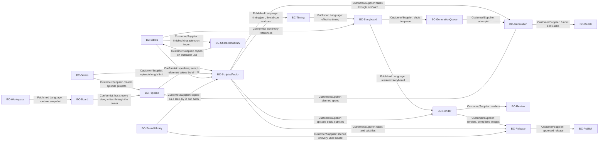

# Target context map – coreslopper

> Where the domain is going, not what the code does today. The as-is map is `context-map.as-is.md` and is
> written only by `/adopt`; the gap register links both sides. `/bootstrap`, `/shape`, `/feature`,
> `/event-storming`, `domain-architect` and `/improve-codebase-architecture` write this file.

Contexts and aggregates are those of `docs/domain/events.yaml`. The cut is a documentation cut: several contexts
share a package today (`packages/cli`), and nothing here asks the code to move. Scripted audio (HS-258) and the
sound library (feature `meme`, ADR 0051, proposed) are the newest; their edges are the ones drawn with care.

## Contexts

### BC-Pipeline – Pipeline
Purpose: drives one project – a music video, an episode or a meme – from setup to qa-export through the stages
of its project kind, and keeps its budget. Creates a meme from the wizard's pitch (`CMD-CreateMeme`).
Core terms: Project, Project Kind, Stage, Production Phase, Pitch, Meme.
Owner role: the orchestrator runs the stages; the user owns `project.yaml`; the board wizard completes setup.

### BC-Series – Series
Purpose: keeps a series' umbrella budget and episode plan and creates its episodes with the series' formats,
providers and brand. Since HS-258 it no longer owns the script or the audio built from it.
Core terms: Series, Episode, Episode Plan, Series Budget, Uncommitted Series Budget, Canon.
Owner role: the user, through the new-series and new-episode skills and the wizard.

### BC-ScriptedAudio – Scripted audio
Purpose: turns the script of an episode or a meme into takes – generated, imported, taken from clips or copied
from the sound library – and the takes into an episode track with speaker stems, subtitles and lip-sync audio:
the scripted project's replacement for the song.
Aggregates: `AGG-Script`, `AGG-TakeRegistry`, `AGG-EpisodeTrack` (as-is; moved from Series, code unchanged).
Core terms: Script, Scene, Script Line, Speaker, Take, Take Registry, Take Status, Voice Track, Ambience,
Episode Track, Speaker Stem, Subtitles.
Owner role: the agent writes the script (new-episode, new-meme) and only it; the user imports takes; the stage
runner builds takes and track.
Relationships:
- Downstream of Pipeline: its commands run inside the `script`, `voice-track` and `episode-track` stages, and
  their generations bill the project budget through Generation.
- Downstream of Series for an episode only: the episode length limit (HS-114). A meme has no series (HS-264).
- Conformist to Bibles: a speaker is a character, a scene plays in a set, a speech take uses the speaker's
  reference voice – all by id. For a meme the bibles come after the script (HS-262).
- Customer of the sound library: a sound line names a library sound; the voice track copies its trimmed audio as a
  take (source `library:<id>`) and records its hash. No live link: a changed sound makes the take stale, a removed
  one only warns (HS-260). Lines stay strictly sequential (HS-257, ADR 0016).
- Supplier to Timing in Timing's published language: it writes `timing.json` with one section per scene and one
  line per script line; the user's timing overrides stay Timing's. The anchor edge `line:<id>:cue` resolves a sound
  line's sound cue.

### BC-SoundLibrary – Sound library
Purpose: keeps the workspace's recurring meme sounds – the user adds, describes, corrects and removes library
sounds; the meme skill picks from them by what they are used for, and the voice track copies a chosen sound into
a meme as a take.
Aggregate: `AGG-LibrarySound` (target).
Core terms: Sound Library, Library Sound, Sound Cue.
Owner role: the user. Update and init never overwrite it; the agent only reads it (`RM-SoundLibrary`).
Relationships:
- Supplier to Scripted audio (above). It knows nothing of memes; where a sound is used is derived from the takes.
- Supplier to Release: the release check reads the licence of every sound a meme used; unknown or needing credit
  is a TODO, never a failure (HS-261; the credit text has no field yet, HS-265).
- Trending platform audio is outside it until HS-259 is answered.

### BC-Timing – Timing
Purpose: turns the song and lyrics – or the episode track's timing – into the effective timing with the user's
overrides, and resolves symbolic anchors to seconds.
Core terms: Lyrics, Timing, Effective Timing, Timing Override, Anchor, Section, Line, Word.
Owner role: the analysis and Scripted audio write the measured timing; only the user's request writes overrides.

### BC-Bibles – Bibles
Purpose: what a production must look and sound like before any shot – style, character and set bibles, user
references – per music video, per meme, or once per series canon that episodes only add to.
Core terms: Style Bible, Character Bible, Set Bible, Plate, Prop Reference, Character State, User Reference.
Owner role: the agent in style-character (for a meme from pitch and script, inventing characters when none were
chosen); the user owns the user references.

### BC-CharacterLibrary – Character library
Purpose: the workspace's reusable characters; takes finished characters in and copies identity and chosen states
into a music video, a meme or a series canon. The two contexts exchange copies only (ADR 0043).
Core terms: Character Library, Library Character, Character Use.
Owner role: the user.

### BC-Storyboard – Storyboard
Purpose: turns treatment or script, effective timing and bibles into an ordered, checked list of shots.
Core terms: Storyboard, Shot, Shot Source, Anchor. Owner role: the agent, only in its stage or at the
user's request.

### BC-GenerationQueue – Generation queue
Purpose: gets every generated image and clip approved before anything derives from it.
Core terms: Generation Queue, Attempt, Verdict. Owner role: the queue run and the art director; the user's
accept is final.

### BC-Generation – Generation
Purpose: turns batch items into provider calls for a model role, budget-checked, cached and billed at the planned
cost. Core terms: Model Role, Generation Cache, Manifest, Batch Cap. Owner role: the agent changes model roles at
the user's request.

### BC-Render – Render
Purpose: renders every format from one composition, cuts Shorts, composes images, keeps media in the media
directory. Core terms: Render, Preview, Short, Composed Image. Owner role: the stage runner.

### BC-Review – Review
Purpose: the user's frame-accurate notes on renders, sent in rounds and answered note by note.
Core terms: Review Note, Review Round, Fix Pass. Owner role: the user writes notes; the agent writes replies.

### BC-Release – Release
Purpose: the release folder, platform texts, release calendar and release board with the one approval. For a
meme: one 9:16 video, a 1080x1920 cover and the TikTok, Shorts and Reels texts.
Core terms: Release Package, Release Calendar, Release Status, Release Approval. Owner role: the user approves.

### BC-Publish – Publishing
Purpose: gets an approved release onto the platforms, by hand or by the autopilot, never twice.
Core terms: Publish Log, Release Autopilot, Platform Credentials, Watchdog. Owner role: the user; agents never run it.

### BC-Workspace – Workspace
Purpose: a private, self-contained workspace kept current by init, update and doctor; upstream decides what ships.
Core terms: Workspace, Runtime Snapshot, Baseline, Conflict Copy. Owner role: the user runs it.

### BC-Bench – Model bench
Purpose: replays fixed scenes on several targets before a model switch, with its own budget, never producing
project assets. Core terms: Bench Case, Bench Target, Bench Run. Owner role: the user, with the model-bench skill.

### BC-Board – Board
Purpose: the workspace's local page hosting every context's views – including the wizard that creates a meme –
behind one navigation; it owns no state and writes only through the owning context.
Core terms: Board. Owner role: the user starts it.
