# Event Storming – coreslopper

> Generated from `docs/domain/events.yaml` – **do not edit manually**.

Legend: 🟧 Event · 🟦 Command · 🟪 Policy · 🟩 Read model · 🟨 Actor · 🩷 External system · 🟥 Hotspot · ⭐ Pivotal event

## Big Picture

```mermaid
flowchart LR
    subgraph BC_Pipeline["Pipeline"]
        CMD_CreateProject["Create project"]:::cmd
        CMD_StartStage["Start stage"]:::cmd
        CMD_CompleteStage["Complete stage"]:::cmd
        CMD_CompleteInteractiveStage["Complete interactive stage"]:::cmd
        CMD_FailStage["Fail stage"]:::cmd
        CMD_SkipStage["Skip stage"]:::cmd
        CMD_ResetStage["Reset stage"]:::cmd
        CMD_RecordSpend["Record spend"]:::cmd
        EVT_ProjectCreated["⭐ Project created"]:::evt
        EVT_StageStarted["Stage started"]:::evt
        EVT_StageCompleted["Stage completed"]:::evt
        EVT_StageFailed["Stage failed"]:::evt
        EVT_StageSkipped["Stage skipped"]:::evt
        EVT_StageReset["Stage reset"]:::evt
        EVT_SpendRecorded["Spend recorded"]:::evt
        EVT_ProjectCompleted["⭐ Project completed"]:::evt
    end
    subgraph BC_Review["Review"]
        CMD_AddReviewNote["Add review note"]:::cmd
        CMD_ChangeReviewNote["Change review note"]:::cmd
        CMD_DeleteReviewNote["Delete review note"]:::cmd
        CMD_SendReviewRound["Send review round"]:::cmd
        CMD_AnswerReviewRound["Answer review round"]:::cmd
        EVT_ReviewNoteAdded["Review note added"]:::evt
        EVT_ReviewNoteChanged["Review note changed"]:::evt
        EVT_ReviewNoteDeleted["Review note deleted"]:::evt
        EVT_ReviewRoundSent["⭐ Review round sent"]:::evt
        EVT_ReviewRoundAnswered["⭐ Review round answered"]:::evt
    end
    subgraph BC_GenerationQueue["Generation queue"]
        CMD_AddQueueItem["Add queue item"]:::cmd
        CMD_RunQueue["Run the queue"]:::cmd
        CMD_ApplyVerdict["Apply a verdict"]:::cmd
        CMD_RetryQueueItem["Retry queue item"]:::cmd
        CMD_AcceptAttempt["Accept attempt"]:::cmd
        CMD_DropQueueItem["Drop queue item"]:::cmd
        CMD_PatchRegion["Patch a region"]:::cmd
        EVT_QueueItemAdded["Queue item added"]:::evt
        EVT_QueueItemReplaced["Queue item replaced"]:::evt
        EVT_AttemptGenerated["Attempt generated"]:::evt
        EVT_AttemptGenerationFailed["Attempt generation failed"]:::evt
        EVT_VerdictGiven["⭐ Verdict given"]:::evt
        EVT_AttemptFiled["⭐ Attempt filed"]:::evt
        EVT_QueueItemRequeued["Queue item requeued"]:::evt
        EVT_QueueItemNeedsFix["Queue item needs a fix"]:::evt
        EVT_AttemptAccepted["Attempt accepted"]:::evt
        EVT_QueueItemDropped["Queue item dropped"]:::evt
        EVT_RegionPatched["Region patched"]:::evt
        EVT_QueueRunStopped["Queue run stopped"]:::evt
    end
    CMD_GiveVerdict["Give a verdict"]:::cmd
    ACT_User(["User"]):::act
    ACT_Orchestrator(["Orchestrator"]):::act
    ACT_SetupSkill(["Setup skill"]):::act
    ACT_StageRunner(["Stage runner"]):::act
    ACT_BoardWizard(["Board wizard"]):::act
    ACT_ArtDirector(["Art director"]):::act
    ACT_QueueRun(["Queue run"]):::act
    EXT_Provider[["Generation provider"]]:::ext
    EXT_ComfyUI[["ComfyUI server"]]:::ext
    POL_RunNextStage{{"Run the next autonomous stage"}}:::pol
    POL_HardStop{{"A hard stop fails the stage and halts the pipeline"}}:::pol
    POL_AnswerOpenRounds{{"Open review rounds are answered before the next autonomous stage"}}:::pol
    POL_RebuildQaAfterFixes{{"Fixes that change the picture reset qa-export"}}:::pol
    POL_JudgeEveryAttempt{{"Every attempt with a verdict target is judged"}}:::pol
    POL_ApplyVerdict{{"The queue run applies every verdict"}}:::pol
    RM_Status[("Status")]:::rm
    RM_NextAction[("Next action")]:::rm
    RM_ProductionView[("Production view")]:::rm
    RM_ReviewView[("Review view")]:::rm
    RM_OpenReviewRounds[("Open review rounds")]:::rm
    RM_QueueStatus[("Queue status")]:::rm
    RM_LatestVerdicts[("Latest verdicts")]:::rm
    ACT_SetupSkill --> CMD_CreateProject
    CMD_CreateProject --> EVT_ProjectCreated
    ACT_Orchestrator --> CMD_StartStage
    CMD_StartStage --> EVT_StageStarted
    ACT_Orchestrator --> CMD_CompleteStage
    CMD_CompleteStage --> EVT_StageCompleted
    CMD_CompleteStage --> EVT_ProjectCompleted
    ACT_SetupSkill --> CMD_CompleteInteractiveStage
    CMD_CompleteInteractiveStage --> EVT_StageCompleted
    ACT_Orchestrator --> CMD_FailStage
    CMD_FailStage --> EVT_StageFailed
    ACT_User --> CMD_SkipStage
    CMD_SkipStage --> EVT_StageSkipped
    CMD_SkipStage --> EVT_ProjectCompleted
    ACT_User --> CMD_ResetStage
    CMD_ResetStage --> EVT_StageReset
    ACT_StageRunner --> CMD_RecordSpend
    CMD_RecordSpend --> EVT_SpendRecorded
    ACT_User --> CMD_AddReviewNote
    CMD_AddReviewNote --> EVT_ReviewNoteAdded
    ACT_User --> CMD_ChangeReviewNote
    CMD_ChangeReviewNote --> EVT_ReviewNoteChanged
    ACT_User --> CMD_DeleteReviewNote
    CMD_DeleteReviewNote --> EVT_ReviewNoteDeleted
    ACT_User --> CMD_SendReviewRound
    CMD_SendReviewRound --> EVT_ReviewRoundSent
    ACT_StageRunner --> CMD_AnswerReviewRound
    CMD_AnswerReviewRound --> EVT_ReviewRoundAnswered
    ACT_StageRunner --> CMD_AddQueueItem
    CMD_AddQueueItem --> EVT_QueueItemAdded
    CMD_AddQueueItem --> EVT_QueueItemReplaced
    ACT_StageRunner --> CMD_RunQueue
    CMD_RunQueue --> EVT_AttemptGenerated
    CMD_RunQueue --> EVT_AttemptGenerationFailed
    CMD_RunQueue --> EVT_QueueRunStopped
    ACT_ArtDirector --> CMD_GiveVerdict
    CMD_GiveVerdict --> EVT_VerdictGiven
    ACT_QueueRun --> CMD_ApplyVerdict
    CMD_ApplyVerdict --> EVT_AttemptFiled
    CMD_ApplyVerdict --> EVT_QueueItemRequeued
    CMD_ApplyVerdict --> EVT_QueueItemNeedsFix
    ACT_StageRunner --> CMD_RetryQueueItem
    CMD_RetryQueueItem --> EVT_QueueItemRequeued
    ACT_User --> CMD_AcceptAttempt
    CMD_AcceptAttempt --> EVT_AttemptAccepted
    CMD_AcceptAttempt --> EVT_AttemptFiled
    ACT_StageRunner --> CMD_DropQueueItem
    CMD_DropQueueItem --> EVT_QueueItemDropped
    ACT_StageRunner --> CMD_PatchRegion
    CMD_PatchRegion --> EVT_RegionPatched
    EVT_StageCompleted --> POL_RunNextStage
    EVT_StageSkipped --> POL_RunNextStage
    POL_RunNextStage --> CMD_StartStage
    EVT_StageStarted --> POL_HardStop
    POL_HardStop --> CMD_FailStage
    EVT_ReviewRoundSent --> POL_AnswerOpenRounds
    POL_AnswerOpenRounds --> CMD_AnswerReviewRound
    EVT_ReviewRoundAnswered --> POL_RebuildQaAfterFixes
    POL_RebuildQaAfterFixes --> CMD_ResetStage
    EVT_AttemptGenerated --> POL_JudgeEveryAttempt
    POL_JudgeEveryAttempt --> CMD_GiveVerdict
    EVT_VerdictGiven --> POL_ApplyVerdict
    POL_ApplyVerdict --> CMD_ApplyVerdict
    EVT_StageStarted -.-> RM_Status
    EVT_StageCompleted -.-> RM_Status
    EVT_StageFailed -.-> RM_Status
    EVT_StageSkipped -.-> RM_Status
    EVT_StageReset -.-> RM_Status
    EVT_SpendRecorded -.-> RM_Status
    RM_Status -.-> ACT_Orchestrator
    RM_Status -.-> ACT_User
    EVT_StageStarted -.-> RM_NextAction
    EVT_StageCompleted -.-> RM_NextAction
    EVT_StageFailed -.-> RM_NextAction
    EVT_StageSkipped -.-> RM_NextAction
    EVT_StageReset -.-> RM_NextAction
    RM_NextAction -.-> ACT_User
    EVT_ProjectCreated -.-> RM_ProductionView
    EVT_StageStarted -.-> RM_ProductionView
    EVT_StageCompleted -.-> RM_ProductionView
    EVT_StageFailed -.-> RM_ProductionView
    EVT_StageSkipped -.-> RM_ProductionView
    EVT_StageReset -.-> RM_ProductionView
    EVT_SpendRecorded -.-> RM_ProductionView
    RM_ProductionView -.-> ACT_User
    EVT_ReviewNoteAdded -.-> RM_ReviewView
    EVT_ReviewNoteChanged -.-> RM_ReviewView
    EVT_ReviewNoteDeleted -.-> RM_ReviewView
    EVT_ReviewRoundSent -.-> RM_ReviewView
    EVT_ReviewRoundAnswered -.-> RM_ReviewView
    RM_ReviewView -.-> ACT_User
    EVT_ReviewRoundSent -.-> RM_OpenReviewRounds
    EVT_ReviewRoundAnswered -.-> RM_OpenReviewRounds
    RM_OpenReviewRounds -.-> ACT_Orchestrator
    RM_OpenReviewRounds -.-> ACT_User
    EVT_QueueItemAdded -.-> RM_QueueStatus
    EVT_QueueItemReplaced -.-> RM_QueueStatus
    EVT_AttemptGenerated -.-> RM_QueueStatus
    EVT_AttemptGenerationFailed -.-> RM_QueueStatus
    EVT_AttemptFiled -.-> RM_QueueStatus
    EVT_QueueItemRequeued -.-> RM_QueueStatus
    EVT_QueueItemNeedsFix -.-> RM_QueueStatus
    EVT_AttemptAccepted -.-> RM_QueueStatus
    EVT_QueueItemDropped -.-> RM_QueueStatus
    RM_QueueStatus -.-> ACT_StageRunner
    RM_QueueStatus -.-> ACT_User
    EVT_VerdictGiven -.-> RM_LatestVerdicts
    EVT_AttemptAccepted -.-> RM_LatestVerdicts
    RM_LatestVerdicts -.-> ACT_Orchestrator
    RM_LatestVerdicts -.-> ACT_StageRunner
    RM_LatestVerdicts -.-> ACT_User
    classDef evt fill:#a3391f,stroke:#e65100,color:#fff
    classDef cmd fill:#64b5f6,stroke:#0d47a1,color:#000
    classDef pol fill:#ce93d8,stroke:#4a148c,color:#000
    classDef rm fill:#81c784,stroke:#1b5e20,color:#000
    classDef act fill:#a3751f,stroke:#f57f17,color:#000
    classDef ext fill:#f48fb1,stroke:#880e4f,color:#000
    classDef agg fill:#ffe082,stroke:#ff6f00,color:#000
    classDef hs fill:#e57373,stroke:#b71c1c,color:#fff
```

## Flows

### One autonomous stage

### From a note to its reply

```mermaid
flowchart LR
    ACT_User(["User"]):::act
    CMD_AddReviewNote["Add review note"]:::cmd
    EVT_ReviewNoteAdded["Review note added"]:::evt
    CMD_SendReviewRound["Send review round"]:::cmd
    EVT_ReviewRoundSent["⭐ Review round sent"]:::evt
    POL_AnswerOpenRounds{{"Open review rounds are answered before the next autonomous stage"}}:::pol
    CMD_AnswerReviewRound["Answer review round"]:::cmd
    EVT_ReviewRoundAnswered["⭐ Review round answered"]:::evt
    POL_RebuildQaAfterFixes{{"Fixes that change the picture reset qa-export"}}:::pol
    ACT_User --> CMD_AddReviewNote
    CMD_AddReviewNote --> EVT_ReviewNoteAdded
    EVT_ReviewNoteAdded --> CMD_SendReviewRound
    CMD_SendReviewRound --> EVT_ReviewRoundSent
    EVT_ReviewRoundSent --> POL_AnswerOpenRounds
    POL_AnswerOpenRounds --> CMD_AnswerReviewRound
    CMD_AnswerReviewRound --> EVT_ReviewRoundAnswered
    EVT_ReviewRoundAnswered --> POL_RebuildQaAfterFixes
    classDef evt fill:#a3391f,stroke:#e65100,color:#fff
    classDef cmd fill:#64b5f6,stroke:#0d47a1,color:#000
    classDef pol fill:#ce93d8,stroke:#4a148c,color:#000
    classDef rm fill:#81c784,stroke:#1b5e20,color:#000
    classDef act fill:#a3751f,stroke:#f57f17,color:#000
    classDef ext fill:#f48fb1,stroke:#880e4f,color:#000
    classDef agg fill:#ffe082,stroke:#ff6f00,color:#000
    classDef hs fill:#e57373,stroke:#b71c1c,color:#fff
```

### From a queue item to a filed attempt

## Bounded Contexts & Aggregates

| Context | Purpose | Aggregates | Events |
|---|---|---|---|
| Pipeline (`BC-Pipeline`) | Drives one project from setup to qa-export through the stages of its project kind and keeps its budget | Project | Project created, Stage started, Stage completed, Stage failed, Stage skipped, Stage reset, Spend recorded, Project completed |
| Review (`BC-Review`) | The user's frame-accurate notes on renders, sent to the agent in rounds and answered note by note | Project review | Review note added, Review note changed, Review note deleted, Review round sent, Review round answered |
| Generation queue (`BC-GenerationQueue`) | Gets every generated image and clip of a project approved before anything derives from it – generate an attempt, give it a verdict, requeue it with the fix prompt, or file it | Generation queue | Queue item added, Queue item replaced, Attempt generated, Attempt generation failed, Verdict given, Attempt filed, Queue item requeued, Queue item needs a fix, Attempt accepted, Queue item dropped, Region patched, Queue run stopped |

## Aggregates

| Aggregate | Context | Status | Evidence |
|---|---|---|---|
| Project (`AGG-Project`) | Pipeline | as-is | state.json per project, loaded and saved as one document (packages/core/src/project.ts:171-184,233-236) stage transitions mutate one State (packages/core/src/state.ts:250-324) budget ledger inside the same State (packages/core/src/state.ts:326-341) |
| Project review (`AGG-ProjectReview`) | Review | as-is | one lock per project review folder, review/.notes.lock, around every note change and every send (packages/cli/src/board-review.ts:38,202,238) round numbers from all rounds of the project (packages/core/src/review.ts:37; board-review.ts:242) notes per render in review/notes/<video-stem>.json, rounds in review/rounds/<NNN>.json (board-review.ts:50,62-78) |
| Generation queue (`AGG-GenerationQueue`) | Generation queue | as-is | assets/queue.json per project, read, changed and written whole on every change (packages/cli/src/queue.ts:101-119) an item waits for the items in its after list across the whole queue (queue.ts:524-529); order numbers are taken from the whole queue (queue.ts:127) one queue run per project, pid lock assets/queue.lock (queue.ts:562-578,671-674) |
