# Event Storming – coreslopper

> Generated from `docs/domain/events.yaml` – **do not edit manually**.

Legend: 🟧 Event · 🟦 Command · 🟪 Policy · 🟩 Read model · 🟨 Actor · 🩷 External system · 🟥 Hotspot · ⭐ Pivotal event

## Big Picture

```mermaid
flowchart LR
    subgraph BC_Pipeline["Pipeline"]
        CMD_CreateProject["Create project"]:::cmd
        CMD_StartStage["Start stage"]:::cmd
        CMD_CompleteStage["Complete stage"]:::cmd
        CMD_CompleteInteractiveStage["Complete interactive stage"]:::cmd
        CMD_FailStage["Fail stage"]:::cmd
        CMD_SkipStage["Skip stage"]:::cmd
        CMD_ResetStage["Reset stage"]:::cmd
        CMD_RecordSpend["Record spend"]:::cmd
        CMD_CreateMeme["Create a meme"]:::cmd
        EVT_ProjectCreated["⭐ Project created"]:::evt
        EVT_StageStarted["Stage started"]:::evt
        EVT_StageCompleted["Stage completed"]:::evt
        EVT_StageFailed["Stage failed"]:::evt
        EVT_StageSkipped["Stage skipped"]:::evt
        EVT_StageReset["Stage reset"]:::evt
        EVT_SpendRecorded["Spend recorded"]:::evt
        EVT_ProjectCompleted["⭐ Project completed"]:::evt
        EVT_MemeCreated["⭐ Meme created"]:::evt
        EVT_MemeRefused["Meme refused"]:::evt
    end
    subgraph BC_Review["Review"]
        CMD_AddReviewNote["Add review note"]:::cmd
        CMD_ChangeReviewNote["Change review note"]:::cmd
        CMD_DeleteReviewNote["Delete review note"]:::cmd
        CMD_SendReviewRound["Send review round"]:::cmd
        CMD_AnswerReviewRound["Answer review round"]:::cmd
        EVT_ReviewNoteAdded["Review note added"]:::evt
        EVT_ReviewNoteChanged["Review note changed"]:::evt
        EVT_ReviewNoteDeleted["Review note deleted"]:::evt
        EVT_ReviewRoundSent["⭐ Review round sent"]:::evt
        EVT_ReviewRoundAnswered["⭐ Review round answered"]:::evt
    end
    subgraph BC_GenerationQueue["Generation queue"]
        CMD_AddQueueItem["Add queue item"]:::cmd
        CMD_RunQueue["Run the queue"]:::cmd
        CMD_ApplyVerdict["Apply a verdict"]:::cmd
        CMD_RetryQueueItem["Retry queue item"]:::cmd
        CMD_AcceptAttempt["Accept attempt"]:::cmd
        CMD_DropQueueItem["Drop queue item"]:::cmd
        CMD_PatchRegion["Patch a region"]:::cmd
        EVT_QueueItemAdded["Queue item added"]:::evt
        EVT_QueueItemReplaced["Queue item replaced"]:::evt
        EVT_AttemptGenerated["Attempt generated"]:::evt
        EVT_AttemptGenerationFailed["Attempt generation failed"]:::evt
        EVT_VerdictGiven["⭐ Verdict given"]:::evt
        EVT_AttemptFiled["⭐ Attempt filed"]:::evt
        EVT_QueueItemRequeued["Queue item requeued"]:::evt
        EVT_QueueItemNeedsFix["Queue item needs a fix"]:::evt
        EVT_AttemptAccepted["Attempt accepted"]:::evt
        EVT_QueueItemDropped["Queue item dropped"]:::evt
        EVT_RegionPatched["Region patched"]:::evt
        EVT_QueueRunStopped["Queue run stopped"]:::evt
    end
    CMD_GiveVerdict["Give a verdict"]:::cmd
    CMD_ImportSong["Import song"]:::cmd
    CMD_NormalizeSongLoudness["Normalize song loudness"]:::cmd
    CMD_SeparateLeadStem["Separate lead stem"]:::cmd
    CMD_RestartComfyUI["Restart ComfyUI"]:::cmd
    CMD_RenderStill["Render a still"]:::cmd
    CMD_LinkProjectMedia["Link a project's media"]:::cmd
    CMD_CheckDeterminism["Check determinism"]:::cmd
    CMD_RenderUploadText["Render the upload text"]:::cmd
    CMD_CheckRelease["Check the release package"]:::cmd
    CMD_InstallTimer["Install the timer"]:::cmd
    CMD_MigrateLayout["Migrate the layout"]:::cmd
    CMD_CreateSandbox["Create the sandbox workspace"]:::cmd
    CMD_StartBoardContainer["Start the board container"]:::cmd
    CMD_InstallDependencies["Install the dependencies"]:::cmd
    CMD_AddBenchTarget["Add a bench target"]:::cmd
    CMD_ImportBenchFixtures["Import the bench fixtures"]:::cmd
    CMD_ScoreBenchCase["Score a bench case"]:::cmd
    CMD_BuildBenchReport["Build the bench report"]:::cmd
    CMD_RateBenchResult["Rate a bench result"]:::cmd
    CMD_ExportRatings["Export the ratings"]:::cmd
    CMD_StartBoard["Start the board"]:::cmd
    CMD_OpenBoardView["Open a board view"]:::cmd
    CMD_RefreshBoard["Refresh the board"]:::cmd
    CMD_OpenBoardFile["Open a file on the board"]:::cmd
    CMD_CheckSoundLibrary["Check the sound library"]:::cmd
    subgraph BC_Timing["Timing"]
        CMD_WriteLyrics["Write lyrics"]:::cmd
        CMD_AnalyzeSong["Analyze song"]:::cmd
        CMD_OverrideTiming["Override timing"]:::cmd
        EVT_SongImported["Song imported"]:::evt
        EVT_SongLoudnessNormalized["Song loudness normalized"]:::evt
        EVT_LyricsWritten["Lyrics written"]:::evt
        EVT_SongAnalyzed["⭐ Song analyzed"]:::evt
        EVT_LeadStemSeparated["Lead stem separated"]:::evt
        EVT_TimingOverridden["Timing overridden"]:::evt
    end
    subgraph BC_Storyboard["Storyboard"]
        CMD_WriteStoryboard["Write storyboard"]:::cmd
        CMD_ReviseStoryboard["Revise storyboard"]:::cmd
        CMD_ValidateStoryboard["Validate storyboard"]:::cmd
        CMD_WriteContactSheet["Write contact sheet"]:::cmd
        EVT_StoryboardWritten["⭐ Storyboard written"]:::evt
        EVT_StoryboardRevised["Storyboard revised"]:::evt
        EVT_StoryboardValidated["Storyboard validated"]:::evt
        EVT_ContactSheetWritten["Contact sheet written"]:::evt
    end
    subgraph BC_Generation["Generation"]
        CMD_RunGenerationBatch["Run a generation batch"]:::cmd
        CMD_EstimateGeneration["Estimate a generation"]:::cmd
        CMD_ChangeModelRoles["Change model roles"]:::cmd
        EVT_GenerationBatchRefused["Generation batch refused"]:::evt
        EVT_GenerationCompleted["⭐ Generation completed"]:::evt
        EVT_GenerationReused["Generation reused from the cache"]:::evt
        EVT_GenerationFailed["Generation failed"]:::evt
        EVT_ClipRestored["Clip restored"]:::evt
        EVT_GenerationFiled["Generation filed"]:::evt
        EVT_ModelRolesChanged["Model roles changed"]:::evt
        EVT_ComfyUIRestarted["ComfyUI restarted"]:::evt
    end
    subgraph BC_Series["Series"]
        CMD_RecordCanonSpend["Record canon spend"]:::cmd
        CMD_CreateSeries["Create a series"]:::cmd
        CMD_CreateEpisode["Create an episode"]:::cmd
        EVT_SeriesCreated["Series created"]:::evt
        EVT_EpisodeCreated["⭐ Episode created"]:::evt
        EVT_EpisodeRefused["Episode refused"]:::evt
        EVT_CanonSpendRecorded["Canon spend recorded"]:::evt
    end
    subgraph BC_ScriptedAudio["Scripted audio"]
        CMD_WriteScript["Write the script"]:::cmd
        CMD_ReviseScript["Revise the script"]:::cmd
        CMD_ValidateScript["Validate the script"]:::cmd
        CMD_GenerateTakes["Generate the takes"]:::cmd
        CMD_ImportTakes["Import takes"]:::cmd
        CMD_TakeSoundFromClips["Take an effect's sound from its clips"]:::cmd
        CMD_BuildEpisodeTrack["Build the episode track"]:::cmd
        CMD_WriteSubtitles["Write subtitles"]:::cmd
        CMD_CutLipSyncAudio["Cut lip-sync audio"]:::cmd
        CMD_WriteMemeScript["Write a meme's script"]:::cmd
        EVT_ScriptWritten["Script written"]:::evt
        EVT_ScriptRevised["Script revised"]:::evt
        EVT_ScriptValidated["Script validated"]:::evt
        EVT_TakeGenerated["Take generated"]:::evt
        EVT_AmbienceGenerated["Ambience generated"]:::evt
        EVT_TakeImported["Take imported"]:::evt
        EVT_VoiceTrackStopped["Voice track stopped"]:::evt
        EVT_EpisodeTrackBuilt["⭐ Episode track built"]:::evt
        EVT_SubtitlesWritten["Subtitles written"]:::evt
        EVT_LipSyncAudioCut["Lip-sync audio cut"]:::evt
        EVT_LibrarySoundTaken["Library sound taken"]:::evt
    end
    subgraph BC_Bibles["Bibles"]
        CMD_WriteStyleBible["Write the style bible"]:::cmd
        CMD_WriteCharacterBible["Write the character bible"]:::cmd
        CMD_AddCharacterState["Add a character state"]:::cmd
        CMD_WriteSetBible["Write the set bible"]:::cmd
        CMD_AddSetReference["Add a plate or prop reference"]:::cmd
        CMD_AddUserReference["Add a user reference"]:::cmd
        CMD_UpdateUserReference["Update a user reference"]:::cmd
        CMD_RemoveUserReference["Remove a user reference"]:::cmd
        CMD_UseLibraryCharacter["Use a library character"]:::cmd
        CMD_UseLibrarySet["Use a library set"]:::cmd
        EVT_StyleBibleWritten["Style bible written"]:::evt
        EVT_CharacterBibleWritten["⭐ Character bible written"]:::evt
        EVT_CharacterStateAdded["Character state added"]:::evt
        EVT_SetBibleWritten["Set bible written"]:::evt
        EVT_PlateAdded["Plate added"]:::evt
        EVT_PropReferenceAdded["Prop reference added"]:::evt
        EVT_UserReferenceAdded["User reference added"]:::evt
        EVT_UserReferenceUpdated["User reference updated"]:::evt
        EVT_UserReferenceRemoved["User reference removed"]:::evt
        EVT_LibraryCharacterUsed["⭐ Library character used"]:::evt
        EVT_LibrarySetUsed["⭐ Library set used"]:::evt
    end
    subgraph BC_Library["Library"]
        CMD_ImportCharacters["Take characters into the library"]:::cmd
        CMD_AddLibraryCharacter["Add a library character by hand"]:::cmd
        CMD_AddLibraryFile["Add a file to a library character"]:::cmd
        CMD_UpdateLibraryCharacter["Update a library character"]:::cmd
        CMD_RemoveLibraryFile["Remove a file from a library character"]:::cmd
        CMD_DeleteLibraryCharacter["Delete a library character"]:::cmd
        CMD_ImportSets["Take sets into the library"]:::cmd
        CMD_AddLibrarySet["Add a library set by hand"]:::cmd
        CMD_AddLibrarySetFile["Add a file to a library set"]:::cmd
        CMD_UpdateLibrarySet["Update a library set"]:::cmd
        CMD_RemoveLibrarySetFile["Remove a file from a library set"]:::cmd
        CMD_DeleteLibrarySet["Delete a library set"]:::cmd
        EVT_LibraryCharacterCreated["⭐ Library character created"]:::evt
        EVT_LibraryCharacterExtended["Library character extended"]:::evt
        EVT_LibraryCharacterUpdated["Library character updated"]:::evt
        EVT_LibraryFileAdded["Library file added"]:::evt
        EVT_LibraryFileRemoved["Library file removed"]:::evt
        EVT_LibraryCharacterDeleted["Library character deleted"]:::evt
        EVT_LibraryCharacterUseRefused["Library character use refused"]:::evt
        EVT_LibrarySetCreated["⭐ Library set created"]:::evt
        EVT_LibrarySetExtended["Library set extended"]:::evt
        EVT_LibrarySetUpdated["Library set updated"]:::evt
        EVT_LibrarySetFileAdded["Library set file added"]:::evt
        EVT_LibrarySetFileRemoved["Library set file removed"]:::evt
        EVT_LibrarySetDeleted["Library set deleted"]:::evt
        EVT_LibrarySetUseRefused["Library set use refused"]:::evt
    end
    subgraph BC_Render["Render"]
        CMD_RenderPreview["Render a preview"]:::cmd
        CMD_RenderPassage["Render a passage"]:::cmd
        CMD_RenderFormat["Render a format"]:::cmd
        CMD_CutShort["Cut a Short"]:::cmd
        CMD_ComposeImage["Compose an image"]:::cmd
        EVT_PreviewRendered["Preview rendered"]:::evt
        EVT_PassageRendered["Passage rendered"]:::evt
        EVT_FormatRendered["⭐ Format rendered"]:::evt
        EVT_StillRendered["Still rendered"]:::evt
        EVT_RenderFailed["Render failed"]:::evt
        EVT_ShortCut["⭐ Short cut"]:::evt
        EVT_ShortRefused["Short refused"]:::evt
        EVT_ImageComposed["⭐ Image composed"]:::evt
        EVT_ImageCompositionRefused["Image composition refused"]:::evt
        EVT_ProjectMediaLinked["Project media linked"]:::evt
        EVT_DeterminismChecked["Determinism checked"]:::evt
    end
    subgraph BC_Release["Release"]
        CMD_WriteUploadData["Write the upload data"]:::cmd
        CMD_BuildReleasePackage["Build the release package"]:::cmd
        CMD_PlanReleaseCalendar["Plan the release calendar"]:::cmd
        CMD_MarkCalendarEventDone["Mark a calendar event done"]:::cmd
        CMD_RecordLiveUrl["Record a live URL"]:::cmd
        CMD_ApproveRelease["Approve a release"]:::cmd
        CMD_WithdrawApproval["Withdraw the approval"]:::cmd
        CMD_TakeOverCalendarEvent["Take over a calendar event"]:::cmd
        CMD_GiveBackCalendarEvent["Give a calendar event back"]:::cmd
        EVT_UploadDataWritten["Upload data written"]:::evt
        EVT_ReleasePackageBuilt["⭐ Release package built"]:::evt
        EVT_ReleaseRulesBroken["Release rules broken"]:::evt
        EVT_UploadTextRendered["Upload text rendered"]:::evt
        EVT_ReleaseCalendarPlanned["⭐ Release calendar planned"]:::evt
        EVT_ReleaseDayFixed["Release day fixed"]:::evt
        EVT_CalendarEventMarkedDone["Calendar event marked done"]:::evt
        EVT_LiveUrlRecorded["Live URL recorded"]:::evt
        EVT_ReleaseApproved["⭐ Release approved"]:::evt
        EVT_ApprovalWithdrawn["Approval withdrawn"]:::evt
        EVT_ApprovalRefused["Approval refused"]:::evt
        EVT_ReleaseChecked["Release checked"]:::evt
        EVT_CalendarEventTakenOver["Calendar event taken over"]:::evt
        EVT_CalendarEventGivenBack["Calendar event given back"]:::evt
    end
    subgraph BC_Publish["Publishing"]
        CMD_AuthorizePlatform["Authorize a platform"]:::cmd
        CMD_PublishUploads["Publish the uploads"]:::cmd
        CMD_RunAutopilotRound["Run an autopilot round"]:::cmd
        CMD_PostCalendarEvent["Post a calendar event"]:::cmd
        CMD_CheckUploadStatus["Check an upload's status"]:::cmd
        CMD_PostPinnedComment["Post the pinned comment"]:::cmd
        CMD_RetryCalendarEvent["Try a calendar event again"]:::cmd
        CMD_ForceCalendarEvent["Post a missed calendar event now"]:::cmd
        EVT_PlatformAuthorized["Platform authorized"]:::evt
        EVT_TokenRotated["Token rotated"]:::evt
        EVT_PublishPlanned["Publish planned"]:::evt
        EVT_VideoUploaded["⭐ Video uploaded"]:::evt
        EVT_UploadFailed["Upload failed"]:::evt
        EVT_AutopilotRoundRun["Autopilot round run"]:::evt
        EVT_PostClaimed["Post claimed"]:::evt
        EVT_CalendarEventPosted["⭐ Calendar event posted"]:::evt
        EVT_CalendarEventUploaded["Calendar event uploaded"]:::evt
        EVT_VideoWentPublic["Video went public"]:::evt
        EVT_PostAttemptFailed["Post attempt failed"]:::evt
        EVT_PinnedCommentPosted["Pinned comment posted"]:::evt
        EVT_SpotifyLinkAppended["Spotify link appended"]:::evt
        EVT_MicrositePageDeployed["Microsite page deployed"]:::evt
        EVT_RetryRequested["Retry requested"]:::evt
        EVT_PostForced["Post forced"]:::evt
        EVT_TimerInstalled["Timer installed"]:::evt
    end
    subgraph BC_Workspace["Workspace"]
        CMD_CreateWorkspace["Create a workspace"]:::cmd
        CMD_UpdateWorkspace["Update the workspace"]:::cmd
        CMD_BuildRuntime["Build the runtime"]:::cmd
        EVT_WorkspaceCreated["Workspace created"]:::evt
        EVT_ProviderKeyStored["Provider key stored"]:::evt
        EVT_ToolInstalled["Tool installed"]:::evt
        EVT_DependenciesInstalled["Dependencies installed"]:::evt
        EVT_WorkspaceUpdated["Workspace updated"]:::evt
        EVT_ConflictCopyWritten["Conflict copy written"]:::evt
        EVT_LayoutMigrated["Layout migrated"]:::evt
        EVT_RuntimeBuilt["Runtime built"]:::evt
        EVT_BoardContainerStarted["Board container started"]:::evt
    end
    subgraph BC_Bench["Model bench"]
        CMD_AddBenchCase["Add a bench case"]:::cmd
        CMD_RunBench["Run the bench"]:::cmd
        EVT_BenchCaseAdded["Bench case added"]:::evt
        EVT_BenchTargetAdded["Bench target added"]:::evt
        EVT_BenchFixturesImported["Bench fixtures imported"]:::evt
        EVT_BenchRunPlanned["Bench run planned"]:::evt
        EVT_BenchRunRefusedOverBudget["Bench run refused over budget"]:::evt
        EVT_BenchResultRecorded["Bench result recorded"]:::evt
        EVT_BenchResultRefused["Bench result refused"]:::evt
        EVT_BenchResultFailed["Bench result failed"]:::evt
        EVT_BenchResultSkipped["Bench result skipped"]:::evt
        EVT_BenchSpendRecorded["Bench spend recorded"]:::evt
        EVT_BenchCaseScored["Bench case scored"]:::evt
        EVT_BenchReportBuilt["Bench report built"]:::evt
        EVT_BenchResultRated["Bench result rated"]:::evt
        EVT_RatingsExported["Ratings exported"]:::evt
    end
    subgraph BC_SoundLibrary["Sound library"]
        CMD_AddLibrarySound["Add a library sound"]:::cmd
        CMD_UpdateLibrarySound["Update a library sound"]:::cmd
        CMD_RemoveLibrarySound["Remove a library sound"]:::cmd
        CMD_ValidateLibrarySound["Validate a library sound"]:::cmd
        EVT_LibrarySoundAdded["⭐ Library sound added"]:::evt
        EVT_LibrarySoundRefused["Library sound refused"]:::evt
        EVT_LibrarySoundUpdated["Library sound updated"]:::evt
        EVT_LibrarySoundRemeasured["Library sound remeasured"]:::evt
        EVT_LibrarySoundRemoved["Library sound removed"]:::evt
        EVT_SoundLibraryChecked["Sound library checked"]:::evt
    end
    subgraph BC_Board["Board"]
        EVT_BoardStarted["Board started"]:::evt
        EVT_BoardViewOpened["Board view opened"]:::evt
        EVT_BoardRefreshed["Board refreshed"]:::evt
        EVT_BoardFileServed["Board file served"]:::evt
        EVT_BoardFileRefused["Board file refused"]:::evt
        EVT_BoardWriteRefused["Board write refused"]:::evt
    end
    ACT_User(["User"]):::act
    ACT_Orchestrator(["Orchestrator"]):::act
    ACT_SetupSkill(["Setup skill"]):::act
    ACT_StageRunner(["Stage runner"]):::act
    ACT_BoardWizard(["Board wizard"]):::act
    ACT_ArtDirector(["Art director"]):::act
    ACT_QueueRun(["Queue run"]):::act
    ACT_Watchdog(["Watchdog round"]):::act
    ACT_BenchSkill(["Model bench skill"]):::act
    EXT_Provider[["Generation provider"]]:::ext
    EXT_ComfyUI[["ComfyUI server"]]:::ext
    EXT_AudioModels[["Local audio models"]]:::ext
    EXT_FFmpeg[["FFmpeg"]]:::ext
    EXT_Remotion[["Remotion and headless Chrome"]]:::ext
    EXT_Microsite[["Artist microsite"]]:::ext
    EXT_Distributor[["Distributor"]]:::ext
    EXT_YouTube[["YouTube Data API"]]:::ext
    EXT_TikTok[["TikTok Content Posting API"]]:::ext
    EXT_Instagram[["Instagram Graph API"]]:::ext
    EXT_X[["X API v2"]]:::ext
    EXT_LinkedIn[["LinkedIn Posts API"]]:::ext
    EXT_FalStorage[["fal.ai storage"]]:::ext
    EXT_OsScheduler[["Operating system scheduler"]]:::ext
    EXT_NpmRegistry[["npm registry"]]:::ext
    EXT_ToolInstallers[["Tool installers"]]:::ext
    EXT_Docker[["Docker"]]:::ext
    POL_RunNextStage{{"Run the next autonomous stage"}}:::pol
    POL_HardStop{{"A hard stop fails the stage and halts the pipeline"}}:::pol
    POL_AnswerOpenRounds{{"Open review rounds are answered before the next autonomous stage"}}:::pol
    POL_RebuildQaAfterFixes{{"Fixes that change the picture reset qa-export"}}:::pol
    POL_JudgeEveryAttempt{{"Every attempt with a verdict target is judged"}}:::pol
    POL_ApplyVerdict{{"The queue run applies every verdict"}}:::pol
    POL_ValidateEveryStoryboardEdit{{"Every storyboard edit is validated"}}:::pol
    POL_RecordPlannedSpend{{"Every new generation is billed at its planned cost"}}:::pol
    POL_RestartComfyUIOnFailure{{"A failed local generation restarts ComfyUI before the next try"}}:::pol
    POL_ValidateEveryScriptEdit{{"Every script edit is validated"}}:::pol
    POL_ImportFinishedCharacters{{"The characters of a finished character bible go into the library"}}:::pol
    POL_ImportFinishedSets{{"The sets of a finished set bible go into the library"}}:::pol
    POL_LinkNewProjectMedia{{"A new project's media go to the media directory"}}:::pol
    POL_RefreshAfterStatusChange{{"The release folder follows a live URL and an approval"}}:::pol
    POL_MarkPostedEventDone{{"A posted calendar event is marked done"}}:::pol
    POL_PostsWaitForMainVideo{{"Posts that link to the main video follow it"}}:::pol
    POL_CommentWhenPublic{{"The main video gets its comment when it is public"}}:::pol
    POL_InstallAfterUpdate{{"An update that changed something installs the dependencies"}}:::pol
    POL_ScoreEveryBenchCase{{"Every bench case of a run gets scored"}}:::pol
    POL_ReportAfterBenchRun{{"A bench run ends with its report"}}:::pol
    POL_ValidateEverySoundEntryEdit{{"Every sound entry edit is validated"}}:::pol
    POL_TakeChosenLibrarySounds{{"A sound line with a library sound gets its take from the library"}}:::pol
    RM_Status[("Status")]:::rm
    RM_NextAction[("Next action")]:::rm
    RM_ProductionView[("Production view")]:::rm
    RM_ReviewView[("Review view")]:::rm
    RM_OpenReviewRounds[("Open review rounds")]:::rm
    RM_QueueStatus[("Queue status")]:::rm
    RM_LatestVerdicts[("Latest verdicts")]:::rm
    RM_EffectiveTiming[("Effective timing")]:::rm
    RM_TimingReport[("Timing report")]:::rm
    RM_EchoSpans[("Echo spans")]:::rm
    RM_ResolvedStoryboard[("Resolved storyboard")]:::rm
    RM_StoryboardTable[("Storyboard table")]:::rm
    RM_ContactSheet[("Contact sheet")]:::rm
    RM_Manifest[("Manifest")]:::rm
    RM_GenerationEstimate[("Generation estimate")]:::rm
    RM_ComfyUIStatus[("ComfyUI status")]:::rm
    RM_SeriesStatus[("Series status")]:::rm
    RM_TakeStatus[("Take status")]:::rm
    RM_Subtitles[("Subtitles")]:::rm
    RM_CharacterLibrary[("Character library")]:::rm
    RM_SetLibrary[("Set library")]:::rm
    RM_UserReferences[("User references")]:::rm
    RM_RenderProgress[("Render progress")]:::rm
    RM_Renders[("Renders")]:::rm
    RM_RenderChecks[("Render checks")]:::rm
    RM_ReleaseBoard[("Release board")]:::rm
    RM_WorkspaceReleaseCalendar[("Workspace release calendar")]:::rm
    RM_ReleaseChecks[("Release checks")]:::rm
    RM_UploadText[("Upload text")]:::rm
    RM_MicrositeSong[("Microsite song")]:::rm
    RM_AutopilotBoard[("Autopilot on the release board")]:::rm
    RM_AutopilotPlan[("Autopilot plan")]:::rm
    RM_PublishPlan[("Publish plan")]:::rm
    RM_PlatformReadiness[("Platform readiness")]:::rm
    RM_DoctorReport[("Doctor report")]:::rm
    RM_UpdateReport[("Update report")]:::rm
    RM_BenchList[("Bench list")]:::rm
    RM_ComparisonPage[("Comparison page")]:::rm
    RM_ModelRecommendation[("Model recommendation")]:::rm
    RM_BoardNavigation[("Board navigation")]:::rm
    RM_BoardActivity[("Board activity")]:::rm
    RM_SoundLibrary[("Sound library")]:::rm
    ACT_SetupSkill --> CMD_CreateProject
    CMD_CreateProject --> EVT_ProjectCreated
    ACT_Orchestrator --> CMD_StartStage
    CMD_StartStage --> EVT_StageStarted
    ACT_Orchestrator --> CMD_CompleteStage
    CMD_CompleteStage --> EVT_StageCompleted
    CMD_CompleteStage --> EVT_ProjectCompleted
    ACT_SetupSkill --> CMD_CompleteInteractiveStage
    CMD_CompleteInteractiveStage --> EVT_StageCompleted
    ACT_Orchestrator --> CMD_FailStage
    CMD_FailStage --> EVT_StageFailed
    ACT_User --> CMD_SkipStage
    CMD_SkipStage --> EVT_StageSkipped
    CMD_SkipStage --> EVT_ProjectCompleted
    ACT_User --> CMD_ResetStage
    CMD_ResetStage --> EVT_StageReset
    ACT_StageRunner --> CMD_RecordSpend
    CMD_RecordSpend --> EVT_SpendRecorded
    ACT_User --> CMD_AddReviewNote
    CMD_AddReviewNote --> EVT_ReviewNoteAdded
    ACT_User --> CMD_ChangeReviewNote
    CMD_ChangeReviewNote --> EVT_ReviewNoteChanged
    ACT_User --> CMD_DeleteReviewNote
    CMD_DeleteReviewNote --> EVT_ReviewNoteDeleted
    ACT_User --> CMD_SendReviewRound
    CMD_SendReviewRound --> EVT_ReviewRoundSent
    ACT_StageRunner --> CMD_AnswerReviewRound
    CMD_AnswerReviewRound --> EVT_ReviewRoundAnswered
    ACT_StageRunner --> CMD_AddQueueItem
    CMD_AddQueueItem --> EVT_QueueItemAdded
    CMD_AddQueueItem --> EVT_QueueItemReplaced
    ACT_StageRunner --> CMD_RunQueue
    CMD_RunQueue --> EVT_AttemptGenerated
    CMD_RunQueue --> EVT_AttemptGenerationFailed
    CMD_RunQueue --> EVT_QueueRunStopped
    ACT_ArtDirector --> CMD_GiveVerdict
    CMD_GiveVerdict --> EVT_VerdictGiven
    ACT_QueueRun --> CMD_ApplyVerdict
    CMD_ApplyVerdict --> EVT_AttemptFiled
    CMD_ApplyVerdict --> EVT_QueueItemRequeued
    CMD_ApplyVerdict --> EVT_QueueItemNeedsFix
    ACT_StageRunner --> CMD_RetryQueueItem
    CMD_RetryQueueItem --> EVT_QueueItemRequeued
    ACT_User --> CMD_AcceptAttempt
    CMD_AcceptAttempt --> EVT_AttemptAccepted
    CMD_AcceptAttempt --> EVT_AttemptFiled
    ACT_StageRunner --> CMD_DropQueueItem
    CMD_DropQueueItem --> EVT_QueueItemDropped
    ACT_StageRunner --> CMD_PatchRegion
    CMD_PatchRegion --> EVT_RegionPatched
    ACT_SetupSkill --> CMD_ImportSong
    CMD_ImportSong --> EVT_SongImported
    ACT_SetupSkill --> CMD_NormalizeSongLoudness
    CMD_NormalizeSongLoudness --> EVT_SongLoudnessNormalized
    ACT_User --> CMD_WriteLyrics
    CMD_WriteLyrics --> EVT_LyricsWritten
    ACT_StageRunner --> CMD_AnalyzeSong
    CMD_AnalyzeSong --> EVT_SongAnalyzed
    ACT_StageRunner --> CMD_SeparateLeadStem
    CMD_SeparateLeadStem --> EVT_LeadStemSeparated
    ACT_User --> CMD_OverrideTiming
    CMD_OverrideTiming --> EVT_TimingOverridden
    ACT_StageRunner --> CMD_WriteStoryboard
    CMD_WriteStoryboard --> EVT_StoryboardWritten
    ACT_Orchestrator --> CMD_ReviseStoryboard
    CMD_ReviseStoryboard --> EVT_StoryboardRevised
    ACT_StageRunner --> CMD_ValidateStoryboard
    CMD_ValidateStoryboard --> EVT_StoryboardValidated
    ACT_StageRunner --> CMD_WriteContactSheet
    CMD_WriteContactSheet --> EVT_ContactSheetWritten
    ACT_QueueRun --> CMD_RunGenerationBatch
    CMD_RunGenerationBatch --> EVT_GenerationBatchRefused
    CMD_RunGenerationBatch --> EVT_GenerationCompleted
    CMD_RunGenerationBatch --> EVT_GenerationReused
    CMD_RunGenerationBatch --> EVT_GenerationFailed
    CMD_RunGenerationBatch --> EVT_ClipRestored
    CMD_RunGenerationBatch --> EVT_GenerationFiled
    ACT_StageRunner --> CMD_EstimateGeneration
    CMD_EstimateGeneration --> EVT_GenerationBatchRefused
    ACT_Orchestrator --> CMD_ChangeModelRoles
    CMD_ChangeModelRoles --> EVT_ModelRolesChanged
    ACT_QueueRun --> CMD_RestartComfyUI
    CMD_RestartComfyUI --> EVT_ComfyUIRestarted
    ACT_SetupSkill --> CMD_RecordCanonSpend
    CMD_RecordCanonSpend --> EVT_CanonSpendRecorded
    ACT_SetupSkill --> CMD_CreateSeries
    CMD_CreateSeries --> EVT_SeriesCreated
    ACT_SetupSkill --> CMD_CreateEpisode
    CMD_CreateEpisode --> EVT_EpisodeCreated
    CMD_CreateEpisode --> EVT_EpisodeRefused
    ACT_SetupSkill --> CMD_WriteScript
    CMD_WriteScript --> EVT_ScriptWritten
    ACT_Orchestrator --> CMD_ReviseScript
    CMD_ReviseScript --> EVT_ScriptRevised
    ACT_StageRunner --> CMD_ValidateScript
    CMD_ValidateScript --> EVT_ScriptValidated
    ACT_StageRunner --> CMD_GenerateTakes
    CMD_GenerateTakes --> EVT_TakeGenerated
    CMD_GenerateTakes --> EVT_AmbienceGenerated
    CMD_GenerateTakes --> EVT_VoiceTrackStopped
    CMD_GenerateTakes --> EVT_LibrarySoundTaken
    ACT_User --> CMD_ImportTakes
    CMD_ImportTakes --> EVT_TakeImported
    ACT_StageRunner --> CMD_TakeSoundFromClips
    CMD_TakeSoundFromClips --> EVT_TakeImported
    ACT_StageRunner --> CMD_BuildEpisodeTrack
    CMD_BuildEpisodeTrack --> EVT_EpisodeTrackBuilt
    ACT_StageRunner --> CMD_WriteSubtitles
    CMD_WriteSubtitles --> EVT_SubtitlesWritten
    ACT_StageRunner --> CMD_CutLipSyncAudio
    CMD_CutLipSyncAudio --> EVT_LipSyncAudioCut
    ACT_StageRunner --> CMD_WriteStyleBible
    CMD_WriteStyleBible --> EVT_StyleBibleWritten
    ACT_StageRunner --> CMD_WriteCharacterBible
    CMD_WriteCharacterBible --> EVT_CharacterBibleWritten
    ACT_StageRunner --> CMD_AddCharacterState
    CMD_AddCharacterState --> EVT_CharacterStateAdded
    ACT_StageRunner --> CMD_WriteSetBible
    CMD_WriteSetBible --> EVT_SetBibleWritten
    ACT_StageRunner --> CMD_AddSetReference
    CMD_AddSetReference --> EVT_PlateAdded
    CMD_AddSetReference --> EVT_PropReferenceAdded
    ACT_User --> CMD_AddUserReference
    CMD_AddUserReference --> EVT_UserReferenceAdded
    ACT_User --> CMD_UpdateUserReference
    CMD_UpdateUserReference --> EVT_UserReferenceUpdated
    ACT_User --> CMD_RemoveUserReference
    CMD_RemoveUserReference --> EVT_UserReferenceRemoved
    ACT_User --> CMD_ImportCharacters
    CMD_ImportCharacters --> EVT_LibraryCharacterCreated
    CMD_ImportCharacters --> EVT_LibraryCharacterExtended
    ACT_User --> CMD_UseLibraryCharacter
    CMD_UseLibraryCharacter --> EVT_LibraryCharacterUsed
    CMD_UseLibraryCharacter --> EVT_LibraryCharacterUseRefused
    ACT_User --> CMD_AddLibraryCharacter
    CMD_AddLibraryCharacter --> EVT_LibraryCharacterCreated
    ACT_User --> CMD_AddLibraryFile
    CMD_AddLibraryFile --> EVT_LibraryFileAdded
    ACT_User --> CMD_UpdateLibraryCharacter
    CMD_UpdateLibraryCharacter --> EVT_LibraryCharacterUpdated
    ACT_User --> CMD_RemoveLibraryFile
    CMD_RemoveLibraryFile --> EVT_LibraryFileRemoved
    ACT_User --> CMD_DeleteLibraryCharacter
    CMD_DeleteLibraryCharacter --> EVT_LibraryCharacterDeleted
    ACT_User --> CMD_ImportSets
    CMD_ImportSets --> EVT_LibrarySetCreated
    CMD_ImportSets --> EVT_LibrarySetExtended
    ACT_User --> CMD_UseLibrarySet
    CMD_UseLibrarySet --> EVT_LibrarySetUsed
    CMD_UseLibrarySet --> EVT_LibrarySetUseRefused
    ACT_User --> CMD_AddLibrarySet
    CMD_AddLibrarySet --> EVT_LibrarySetCreated
    ACT_User --> CMD_AddLibrarySetFile
    CMD_AddLibrarySetFile --> EVT_LibrarySetFileAdded
    ACT_User --> CMD_UpdateLibrarySet
    CMD_UpdateLibrarySet --> EVT_LibrarySetUpdated
    ACT_User --> CMD_RemoveLibrarySetFile
    CMD_RemoveLibrarySetFile --> EVT_LibrarySetFileRemoved
    ACT_User --> CMD_DeleteLibrarySet
    CMD_DeleteLibrarySet --> EVT_LibrarySetDeleted
    ACT_StageRunner --> CMD_RenderPreview
    CMD_RenderPreview --> EVT_PreviewRendered
    CMD_RenderPreview --> EVT_RenderFailed
    ACT_StageRunner --> CMD_RenderPassage
    CMD_RenderPassage --> EVT_PassageRendered
    CMD_RenderPassage --> EVT_RenderFailed
    ACT_StageRunner --> CMD_RenderFormat
    CMD_RenderFormat --> EVT_FormatRendered
    CMD_RenderFormat --> EVT_RenderFailed
    ACT_StageRunner --> CMD_RenderStill
    CMD_RenderStill --> EVT_StillRendered
    ACT_StageRunner --> CMD_CutShort
    CMD_CutShort --> EVT_ShortCut
    CMD_CutShort --> EVT_ShortRefused
    ACT_StageRunner --> CMD_ComposeImage
    CMD_ComposeImage --> EVT_ImageComposed
    CMD_ComposeImage --> EVT_ImageCompositionRefused
    ACT_User --> CMD_LinkProjectMedia
    CMD_LinkProjectMedia --> EVT_ProjectMediaLinked
    ACT_StageRunner --> CMD_CheckDeterminism
    CMD_CheckDeterminism --> EVT_DeterminismChecked
    ACT_StageRunner --> CMD_WriteUploadData
    CMD_WriteUploadData --> EVT_UploadDataWritten
    ACT_StageRunner --> CMD_BuildReleasePackage
    CMD_BuildReleasePackage --> EVT_ReleasePackageBuilt
    CMD_BuildReleasePackage --> EVT_ReleaseRulesBroken
    CMD_BuildReleasePackage --> EVT_ReleaseCalendarPlanned
    ACT_StageRunner --> CMD_RenderUploadText
    CMD_RenderUploadText --> EVT_UploadTextRendered
    ACT_User --> CMD_PlanReleaseCalendar
    CMD_PlanReleaseCalendar --> EVT_ReleaseCalendarPlanned
    ACT_User --> CMD_MarkCalendarEventDone
    CMD_MarkCalendarEventDone --> EVT_CalendarEventMarkedDone
    ACT_User --> CMD_RecordLiveUrl
    CMD_RecordLiveUrl --> EVT_LiveUrlRecorded
    ACT_User --> CMD_ApproveRelease
    CMD_ApproveRelease --> EVT_ReleaseDayFixed
    CMD_ApproveRelease --> EVT_ReleaseCalendarPlanned
    CMD_ApproveRelease --> EVT_ReleaseApproved
    CMD_ApproveRelease --> EVT_ApprovalRefused
    ACT_User --> CMD_WithdrawApproval
    CMD_WithdrawApproval --> EVT_ApprovalWithdrawn
    ACT_StageRunner --> CMD_CheckRelease
    CMD_CheckRelease --> EVT_ReleaseChecked
    ACT_User --> CMD_AuthorizePlatform
    CMD_AuthorizePlatform --> EVT_PlatformAuthorized
    ACT_User --> CMD_PublishUploads
    CMD_PublishUploads --> EVT_PublishPlanned
    CMD_PublishUploads --> EVT_VideoUploaded
    CMD_PublishUploads --> EVT_UploadFailed
    ACT_Watchdog --> CMD_RunAutopilotRound
    CMD_RunAutopilotRound --> EVT_AutopilotRoundRun
    ACT_Watchdog --> CMD_PostCalendarEvent
    CMD_PostCalendarEvent --> EVT_PostClaimed
    CMD_PostCalendarEvent --> EVT_CalendarEventPosted
    CMD_PostCalendarEvent --> EVT_CalendarEventUploaded
    CMD_PostCalendarEvent --> EVT_PostAttemptFailed
    CMD_PostCalendarEvent --> EVT_SpotifyLinkAppended
    CMD_PostCalendarEvent --> EVT_MicrositePageDeployed
    ACT_Watchdog --> CMD_CheckUploadStatus
    CMD_CheckUploadStatus --> EVT_VideoWentPublic
    ACT_Watchdog --> CMD_PostPinnedComment
    CMD_PostPinnedComment --> EVT_PinnedCommentPosted
    ACT_User --> CMD_TakeOverCalendarEvent
    CMD_TakeOverCalendarEvent --> EVT_CalendarEventTakenOver
    ACT_User --> CMD_GiveBackCalendarEvent
    CMD_GiveBackCalendarEvent --> EVT_CalendarEventGivenBack
    ACT_User --> CMD_RetryCalendarEvent
    CMD_RetryCalendarEvent --> EVT_RetryRequested
    ACT_User --> CMD_ForceCalendarEvent
    CMD_ForceCalendarEvent --> EVT_PostForced
    ACT_User --> CMD_InstallTimer
    CMD_InstallTimer --> EVT_TimerInstalled
    ACT_User --> CMD_CreateWorkspace
    CMD_CreateWorkspace --> EVT_WorkspaceCreated
    CMD_CreateWorkspace --> EVT_ProviderKeyStored
    CMD_CreateWorkspace --> EVT_ToolInstalled
    CMD_CreateWorkspace --> EVT_DependenciesInstalled
    ACT_User --> CMD_UpdateWorkspace
    CMD_UpdateWorkspace --> EVT_WorkspaceUpdated
    CMD_UpdateWorkspace --> EVT_ConflictCopyWritten
    ACT_User --> CMD_MigrateLayout
    CMD_MigrateLayout --> EVT_LayoutMigrated
    ACT_User --> CMD_BuildRuntime
    CMD_BuildRuntime --> EVT_RuntimeBuilt
    ACT_User --> CMD_CreateSandbox
    CMD_CreateSandbox --> EVT_RuntimeBuilt
    CMD_CreateSandbox --> EVT_WorkspaceCreated
    CMD_CreateSandbox --> EVT_WorkspaceUpdated
    ACT_User --> CMD_StartBoardContainer
    CMD_StartBoardContainer --> EVT_BoardContainerStarted
    ACT_User --> CMD_InstallDependencies
    CMD_InstallDependencies --> EVT_DependenciesInstalled
    ACT_BenchSkill --> CMD_AddBenchCase
    CMD_AddBenchCase --> EVT_BenchCaseAdded
    ACT_BenchSkill --> CMD_AddBenchTarget
    CMD_AddBenchTarget --> EVT_BenchTargetAdded
    ACT_BenchSkill --> CMD_ImportBenchFixtures
    CMD_ImportBenchFixtures --> EVT_BenchFixturesImported
    ACT_BenchSkill --> CMD_RunBench
    CMD_RunBench --> EVT_BenchRunPlanned
    CMD_RunBench --> EVT_BenchRunRefusedOverBudget
    CMD_RunBench --> EVT_BenchResultRecorded
    CMD_RunBench --> EVT_BenchResultRefused
    CMD_RunBench --> EVT_BenchResultFailed
    CMD_RunBench --> EVT_BenchResultSkipped
    CMD_RunBench --> EVT_BenchSpendRecorded
    ACT_ArtDirector --> CMD_ScoreBenchCase
    CMD_ScoreBenchCase --> EVT_BenchCaseScored
    ACT_BenchSkill --> CMD_BuildBenchReport
    CMD_BuildBenchReport --> EVT_BenchReportBuilt
    ACT_User --> CMD_RateBenchResult
    CMD_RateBenchResult --> EVT_BenchResultRated
    ACT_User --> CMD_ExportRatings
    CMD_ExportRatings --> EVT_RatingsExported
    ACT_User --> CMD_StartBoard
    CMD_StartBoard --> EVT_BoardStarted
    ACT_User --> CMD_OpenBoardView
    CMD_OpenBoardView --> EVT_BoardViewOpened
    ACT_User --> CMD_RefreshBoard
    CMD_RefreshBoard --> EVT_BoardRefreshed
    ACT_User --> CMD_OpenBoardFile
    CMD_OpenBoardFile --> EVT_BoardFileServed
    CMD_OpenBoardFile --> EVT_BoardFileRefused
    ACT_BoardWizard --> CMD_CreateMeme
    CMD_CreateMeme --> EVT_MemeCreated
    CMD_CreateMeme --> EVT_MemeRefused
    ACT_User --> CMD_AddLibrarySound
    CMD_AddLibrarySound --> EVT_LibrarySoundAdded
    CMD_AddLibrarySound --> EVT_LibrarySoundRefused
    ACT_User --> CMD_UpdateLibrarySound
    CMD_UpdateLibrarySound --> EVT_LibrarySoundUpdated
    ACT_User --> CMD_RemoveLibrarySound
    CMD_RemoveLibrarySound --> EVT_LibrarySoundRemoved
    ACT_User --> CMD_CheckSoundLibrary
    CMD_CheckSoundLibrary --> EVT_SoundLibraryChecked
    CMD_CheckSoundLibrary --> EVT_LibrarySoundRemeasured
    ACT_StageRunner --> CMD_ValidateLibrarySound
    CMD_ValidateLibrarySound --> EVT_LibrarySoundUpdated
    CMD_ValidateLibrarySound --> EVT_LibrarySoundRefused
    ACT_SetupSkill --> CMD_WriteMemeScript
    CMD_WriteMemeScript --> EVT_ScriptWritten
    EVT_StageCompleted --> POL_RunNextStage
    EVT_StageSkipped --> POL_RunNextStage
    POL_RunNextStage --> CMD_StartStage
    EVT_StageStarted --> POL_HardStop
    POL_HardStop --> CMD_FailStage
    EVT_ReviewRoundSent --> POL_AnswerOpenRounds
    POL_AnswerOpenRounds --> CMD_AnswerReviewRound
    EVT_ReviewRoundAnswered --> POL_RebuildQaAfterFixes
    POL_RebuildQaAfterFixes --> CMD_ResetStage
    EVT_AttemptGenerated --> POL_JudgeEveryAttempt
    POL_JudgeEveryAttempt --> CMD_GiveVerdict
    EVT_VerdictGiven --> POL_ApplyVerdict
    POL_ApplyVerdict --> CMD_ApplyVerdict
    EVT_StoryboardWritten --> POL_ValidateEveryStoryboardEdit
    EVT_StoryboardRevised --> POL_ValidateEveryStoryboardEdit
    POL_ValidateEveryStoryboardEdit --> CMD_ValidateStoryboard
    EVT_GenerationCompleted --> POL_RecordPlannedSpend
    POL_RecordPlannedSpend --> CMD_RecordSpend
    POL_RecordPlannedSpend --> CMD_RecordCanonSpend
    EVT_GenerationFailed --> POL_RestartComfyUIOnFailure
    POL_RestartComfyUIOnFailure --> CMD_RestartComfyUI
    EVT_ScriptWritten --> POL_ValidateEveryScriptEdit
    EVT_ScriptRevised --> POL_ValidateEveryScriptEdit
    POL_ValidateEveryScriptEdit --> CMD_ValidateScript
    EVT_StageCompleted --> POL_ImportFinishedCharacters
    EVT_CharacterBibleWritten --> POL_ImportFinishedCharacters
    POL_ImportFinishedCharacters --> CMD_ImportCharacters
    EVT_StageCompleted --> POL_ImportFinishedSets
    EVT_SetBibleWritten --> POL_ImportFinishedSets
    POL_ImportFinishedSets --> CMD_ImportSets
    EVT_ProjectCreated --> POL_LinkNewProjectMedia
    POL_LinkNewProjectMedia --> CMD_LinkProjectMedia
    EVT_LiveUrlRecorded --> POL_RefreshAfterStatusChange
    EVT_ReleaseApproved --> POL_RefreshAfterStatusChange
    POL_RefreshAfterStatusChange --> CMD_BuildReleasePackage
    EVT_CalendarEventPosted --> POL_MarkPostedEventDone
    EVT_VideoWentPublic --> POL_MarkPostedEventDone
    POL_MarkPostedEventDone --> CMD_MarkCalendarEventDone
    EVT_VideoWentPublic --> POL_PostsWaitForMainVideo
    POL_PostsWaitForMainVideo --> CMD_PostCalendarEvent
    EVT_VideoWentPublic --> POL_CommentWhenPublic
    EVT_CalendarEventMarkedDone --> POL_CommentWhenPublic
    POL_CommentWhenPublic --> CMD_PostPinnedComment
    EVT_WorkspaceUpdated --> POL_InstallAfterUpdate
    POL_InstallAfterUpdate --> CMD_InstallDependencies
    EVT_BenchResultRecorded --> POL_ScoreEveryBenchCase
    EVT_BenchResultRefused --> POL_ScoreEveryBenchCase
    POL_ScoreEveryBenchCase --> CMD_ScoreBenchCase
    EVT_BenchResultRecorded --> POL_ReportAfterBenchRun
    EVT_BenchResultRefused --> POL_ReportAfterBenchRun
    EVT_BenchResultFailed --> POL_ReportAfterBenchRun
    EVT_BenchResultSkipped --> POL_ReportAfterBenchRun
    POL_ReportAfterBenchRun --> CMD_BuildBenchReport
    EVT_LibrarySoundUpdated --> POL_ValidateEverySoundEntryEdit
    POL_ValidateEverySoundEntryEdit --> CMD_ValidateLibrarySound
    EVT_ScriptWritten --> POL_TakeChosenLibrarySounds
    EVT_LibrarySoundUpdated --> POL_TakeChosenLibrarySounds
    EVT_LibrarySoundRemeasured --> POL_TakeChosenLibrarySounds
    POL_TakeChosenLibrarySounds --> CMD_GenerateTakes
    EVT_StageStarted -.-> RM_Status
    EVT_StageCompleted -.-> RM_Status
    EVT_StageFailed -.-> RM_Status
    EVT_StageSkipped -.-> RM_Status
    EVT_StageReset -.-> RM_Status
    EVT_SpendRecorded -.-> RM_Status
    RM_Status -.-> ACT_Orchestrator
    RM_Status -.-> ACT_User
    EVT_StageStarted -.-> RM_NextAction
    EVT_StageCompleted -.-> RM_NextAction
    EVT_StageFailed -.-> RM_NextAction
    EVT_StageSkipped -.-> RM_NextAction
    EVT_StageReset -.-> RM_NextAction
    RM_NextAction -.-> ACT_User
    EVT_ProjectCreated -.-> RM_ProductionView
    EVT_StageStarted -.-> RM_ProductionView
    EVT_StageCompleted -.-> RM_ProductionView
    EVT_StageFailed -.-> RM_ProductionView
    EVT_StageSkipped -.-> RM_ProductionView
    EVT_StageReset -.-> RM_ProductionView
    EVT_SpendRecorded -.-> RM_ProductionView
    RM_ProductionView -.-> ACT_User
    EVT_ReviewNoteAdded -.-> RM_ReviewView
    EVT_ReviewNoteChanged -.-> RM_ReviewView
    EVT_ReviewNoteDeleted -.-> RM_ReviewView
    EVT_ReviewRoundSent -.-> RM_ReviewView
    EVT_ReviewRoundAnswered -.-> RM_ReviewView
    RM_ReviewView -.-> ACT_User
    EVT_ReviewRoundSent -.-> RM_OpenReviewRounds
    EVT_ReviewRoundAnswered -.-> RM_OpenReviewRounds
    RM_OpenReviewRounds -.-> ACT_Orchestrator
    RM_OpenReviewRounds -.-> ACT_User
    EVT_QueueItemAdded -.-> RM_QueueStatus
    EVT_QueueItemReplaced -.-> RM_QueueStatus
    EVT_AttemptGenerated -.-> RM_QueueStatus
    EVT_AttemptGenerationFailed -.-> RM_QueueStatus
    EVT_AttemptFiled -.-> RM_QueueStatus
    EVT_QueueItemRequeued -.-> RM_QueueStatus
    EVT_QueueItemNeedsFix -.-> RM_QueueStatus
    EVT_AttemptAccepted -.-> RM_QueueStatus
    EVT_QueueItemDropped -.-> RM_QueueStatus
    RM_QueueStatus -.-> ACT_StageRunner
    RM_QueueStatus -.-> ACT_User
    EVT_VerdictGiven -.-> RM_LatestVerdicts
    EVT_AttemptAccepted -.-> RM_LatestVerdicts
    RM_LatestVerdicts -.-> ACT_Orchestrator
    RM_LatestVerdicts -.-> ACT_StageRunner
    RM_LatestVerdicts -.-> ACT_User
    EVT_SongAnalyzed -.-> RM_EffectiveTiming
    EVT_TimingOverridden -.-> RM_EffectiveTiming
    RM_EffectiveTiming -.-> ACT_StageRunner
    RM_EffectiveTiming -.-> ACT_Orchestrator
    RM_EffectiveTiming -.-> ACT_User
    EVT_SongAnalyzed -.-> RM_TimingReport
    RM_TimingReport -.-> ACT_StageRunner
    RM_TimingReport -.-> ACT_User
    EVT_SongAnalyzed -.-> RM_EchoSpans
    EVT_LeadStemSeparated -.-> RM_EchoSpans
    RM_EchoSpans -.-> ACT_StageRunner
    EVT_StoryboardValidated -.-> RM_ResolvedStoryboard
    EVT_StoryboardWritten -.-> RM_ResolvedStoryboard
    EVT_StoryboardRevised -.-> RM_ResolvedStoryboard
    EVT_TimingOverridden -.-> RM_ResolvedStoryboard
    RM_ResolvedStoryboard -.-> ACT_StageRunner
    RM_ResolvedStoryboard -.-> ACT_Orchestrator
    RM_ResolvedStoryboard -.-> ACT_QueueRun
    RM_ResolvedStoryboard -.-> ACT_User
    EVT_StoryboardWritten -.-> RM_StoryboardTable
    EVT_StoryboardRevised -.-> RM_StoryboardTable
    RM_StoryboardTable -.-> ACT_User
    RM_StoryboardTable -.-> ACT_StageRunner
    EVT_ContactSheetWritten -.-> RM_ContactSheet
    RM_ContactSheet -.-> ACT_User
    EVT_GenerationCompleted -.-> RM_Manifest
    EVT_GenerationReused -.-> RM_Manifest
    EVT_GenerationFailed -.-> RM_Manifest
    EVT_ClipRestored -.-> RM_Manifest
    RM_Manifest -.-> ACT_StageRunner
    RM_Manifest -.-> ACT_User
    EVT_ModelRolesChanged -.-> RM_GenerationEstimate
    EVT_SpendRecorded -.-> RM_GenerationEstimate
    RM_GenerationEstimate -.-> ACT_StageRunner
    EVT_ComfyUIRestarted -.-> RM_ComfyUIStatus
    RM_ComfyUIStatus -.-> ACT_StageRunner
    RM_ComfyUIStatus -.-> ACT_User
    EVT_SeriesCreated -.-> RM_SeriesStatus
    EVT_EpisodeCreated -.-> RM_SeriesStatus
    EVT_CanonSpendRecorded -.-> RM_SeriesStatus
    RM_SeriesStatus -.-> ACT_User
    RM_SeriesStatus -.-> ACT_SetupSkill
    EVT_TakeGenerated -.-> RM_TakeStatus
    EVT_AmbienceGenerated -.-> RM_TakeStatus
    EVT_TakeImported -.-> RM_TakeStatus
    EVT_ScriptRevised -.-> RM_TakeStatus
    RM_TakeStatus -.-> ACT_StageRunner
    RM_TakeStatus -.-> ACT_User
    EVT_SubtitlesWritten -.-> RM_Subtitles
    RM_Subtitles -.-> ACT_User
    EVT_LibraryCharacterCreated -.-> RM_CharacterLibrary
    EVT_LibraryCharacterExtended -.-> RM_CharacterLibrary
    EVT_LibraryCharacterUpdated -.-> RM_CharacterLibrary
    EVT_LibraryFileAdded -.-> RM_CharacterLibrary
    EVT_LibraryFileRemoved -.-> RM_CharacterLibrary
    EVT_LibraryCharacterDeleted -.-> RM_CharacterLibrary
    EVT_LibraryCharacterUsed -.-> RM_CharacterLibrary
    RM_CharacterLibrary -.-> ACT_User
    RM_CharacterLibrary -.-> ACT_SetupSkill
    RM_CharacterLibrary -.-> ACT_StageRunner
    EVT_LibrarySetCreated -.-> RM_SetLibrary
    EVT_LibrarySetExtended -.-> RM_SetLibrary
    EVT_LibrarySetUpdated -.-> RM_SetLibrary
    EVT_LibrarySetFileAdded -.-> RM_SetLibrary
    EVT_LibrarySetFileRemoved -.-> RM_SetLibrary
    EVT_LibrarySetDeleted -.-> RM_SetLibrary
    EVT_LibrarySetUsed -.-> RM_SetLibrary
    RM_SetLibrary -.-> ACT_User
    RM_SetLibrary -.-> ACT_SetupSkill
    RM_SetLibrary -.-> ACT_StageRunner
    EVT_UserReferenceAdded -.-> RM_UserReferences
    EVT_UserReferenceUpdated -.-> RM_UserReferences
    EVT_UserReferenceRemoved -.-> RM_UserReferences
    RM_UserReferences -.-> ACT_User
    RM_UserReferences -.-> ACT_SetupSkill
    RM_UserReferences -.-> ACT_StageRunner
    EVT_PreviewRendered -.-> RM_RenderProgress
    EVT_PassageRendered -.-> RM_RenderProgress
    EVT_FormatRendered -.-> RM_RenderProgress
    EVT_RenderFailed -.-> RM_RenderProgress
    RM_RenderProgress -.-> ACT_User
    EVT_PreviewRendered -.-> RM_Renders
    EVT_PassageRendered -.-> RM_Renders
    EVT_FormatRendered -.-> RM_Renders
    RM_Renders -.-> ACT_User
    EVT_FormatRendered -.-> RM_RenderChecks
    EVT_ShortCut -.-> RM_RenderChecks
    EVT_ImageComposed -.-> RM_RenderChecks
    EVT_DeterminismChecked -.-> RM_RenderChecks
    RM_RenderChecks -.-> ACT_StageRunner
    RM_RenderChecks -.-> ACT_User
    EVT_ReleasePackageBuilt -.-> RM_ReleaseBoard
    EVT_ReleaseCalendarPlanned -.-> RM_ReleaseBoard
    EVT_UploadDataWritten -.-> RM_ReleaseBoard
    EVT_CalendarEventMarkedDone -.-> RM_ReleaseBoard
    EVT_LiveUrlRecorded -.-> RM_ReleaseBoard
    EVT_ReleaseApproved -.-> RM_ReleaseBoard
    EVT_ApprovalWithdrawn -.-> RM_ReleaseBoard
    RM_ReleaseBoard -.-> ACT_User
    EVT_ReleaseCalendarPlanned -.-> RM_WorkspaceReleaseCalendar
    EVT_CalendarEventMarkedDone -.-> RM_WorkspaceReleaseCalendar
    RM_WorkspaceReleaseCalendar -.-> ACT_User
    EVT_ReleasePackageBuilt -.-> RM_ReleaseChecks
    EVT_ReleaseChecked -.-> RM_ReleaseChecks
    RM_ReleaseChecks -.-> ACT_StageRunner
    RM_ReleaseChecks -.-> ACT_User
    EVT_UploadTextRendered -.-> RM_UploadText
    RM_UploadText -.-> ACT_User
    EVT_ReleasePackageBuilt -.-> RM_MicrositeSong
    EVT_LiveUrlRecorded -.-> RM_MicrositeSong
    RM_MicrositeSong -.-> EXT_Microsite
    EVT_ReleaseApproved -.-> RM_AutopilotBoard
    EVT_PostClaimed -.-> RM_AutopilotBoard
    EVT_CalendarEventPosted -.-> RM_AutopilotBoard
    EVT_CalendarEventUploaded -.-> RM_AutopilotBoard
    EVT_PostAttemptFailed -.-> RM_AutopilotBoard
    EVT_CalendarEventTakenOver -.-> RM_AutopilotBoard
    EVT_AutopilotRoundRun -.-> RM_AutopilotBoard
    EVT_PlatformAuthorized -.-> RM_AutopilotBoard
    RM_AutopilotBoard -.-> ACT_User
    EVT_ReleaseCalendarPlanned -.-> RM_AutopilotPlan
    EVT_ReleaseApproved -.-> RM_AutopilotPlan
    EVT_PostClaimed -.-> RM_AutopilotPlan
    EVT_CalendarEventPosted -.-> RM_AutopilotPlan
    EVT_PostAttemptFailed -.-> RM_AutopilotPlan
    RM_AutopilotPlan -.-> ACT_User
    EVT_PublishPlanned -.-> RM_PublishPlan
    EVT_VideoUploaded -.-> RM_PublishPlan
    RM_PublishPlan -.-> ACT_User
    EVT_PlatformAuthorized -.-> RM_PlatformReadiness
    EVT_TokenRotated -.-> RM_PlatformReadiness
    RM_PlatformReadiness -.-> ACT_User
    EVT_WorkspaceCreated -.-> RM_DoctorReport
    EVT_WorkspaceUpdated -.-> RM_DoctorReport
    EVT_ProviderKeyStored -.-> RM_DoctorReport
    EVT_ToolInstalled -.-> RM_DoctorReport
    EVT_LayoutMigrated -.-> RM_DoctorReport
    RM_DoctorReport -.-> ACT_User
    EVT_WorkspaceUpdated -.-> RM_UpdateReport
    EVT_ConflictCopyWritten -.-> RM_UpdateReport
    RM_UpdateReport -.-> ACT_User
    EVT_BenchCaseAdded -.-> RM_BenchList
    EVT_BenchTargetAdded -.-> RM_BenchList
    EVT_BenchFixturesImported -.-> RM_BenchList
    RM_BenchList -.-> ACT_BenchSkill
    RM_BenchList -.-> ACT_User
    EVT_BenchReportBuilt -.-> RM_ComparisonPage
    EVT_BenchCaseScored -.-> RM_ComparisonPage
    EVT_RatingsExported -.-> RM_ComparisonPage
    RM_ComparisonPage -.-> ACT_User
    RM_ComparisonPage -.-> ACT_BenchSkill
    EVT_BenchReportBuilt -.-> RM_ModelRecommendation
    EVT_BenchCaseScored -.-> RM_ModelRecommendation
    EVT_RatingsExported -.-> RM_ModelRecommendation
    RM_ModelRecommendation -.-> ACT_User
    EVT_ProjectCreated -.-> RM_BoardNavigation
    EVT_StageStarted -.-> RM_BoardNavigation
    EVT_StageCompleted -.-> RM_BoardNavigation
    EVT_StageFailed -.-> RM_BoardNavigation
    EVT_ReleaseCalendarPlanned -.-> RM_BoardNavigation
    EVT_CalendarEventMarkedDone -.-> RM_BoardNavigation
    EVT_BoardRefreshed -.-> RM_BoardNavigation
    RM_BoardNavigation -.-> ACT_User
    EVT_StageStarted -.-> RM_BoardActivity
    EVT_StageCompleted -.-> RM_BoardActivity
    EVT_StageFailed -.-> RM_BoardActivity
    RM_BoardActivity -.-> ACT_User
    EVT_LibrarySoundAdded -.-> RM_SoundLibrary
    EVT_LibrarySoundUpdated -.-> RM_SoundLibrary
    EVT_LibrarySoundRemeasured -.-> RM_SoundLibrary
    EVT_LibrarySoundRemoved -.-> RM_SoundLibrary
    RM_SoundLibrary -.-> ACT_User
    RM_SoundLibrary -.-> ACT_SetupSkill
    classDef evt fill:#a3391f,stroke:#e65100,color:#fff
    classDef cmd fill:#64b5f6,stroke:#0d47a1,color:#000
    classDef pol fill:#ce93d8,stroke:#4a148c,color:#000
    classDef rm fill:#81c784,stroke:#1b5e20,color:#000
    classDef act fill:#a3751f,stroke:#f57f17,color:#000
    classDef ext fill:#f48fb1,stroke:#880e4f,color:#000
    classDef agg fill:#ffe082,stroke:#ff6f00,color:#000
    classDef hs fill:#e57373,stroke:#b71c1c,color:#fff
```

## Flows

### One autonomous stage


### From a note to its reply


### From a queue item to a filed attempt


### From the song to the effective timing

```mermaid
flowchart LR
    ACT_User(["User"]):::act
    CMD_WriteLyrics["Write lyrics"]:::cmd
    EVT_LyricsWritten["Lyrics written"]:::evt
    ACT_SetupSkill(["Setup skill"]):::act
    CMD_ImportSong["Import song"]:::cmd
    EVT_SongImported["Song imported"]:::evt
    ACT_StageRunner(["Stage runner"]):::act
    CMD_AnalyzeSong["Analyze song"]:::cmd
    EVT_SongAnalyzed["⭐ Song analyzed"]:::evt
    RM_TimingReport[("Timing report")]:::rm
    CMD_OverrideTiming["Override timing"]:::cmd
    EVT_TimingOverridden["Timing overridden"]:::evt
    RM_EffectiveTiming[("Effective timing")]:::rm
    ACT_User --> CMD_WriteLyrics
    CMD_WriteLyrics --> EVT_LyricsWritten
    EVT_LyricsWritten --> ACT_SetupSkill
    ACT_SetupSkill --> CMD_ImportSong
    CMD_ImportSong --> EVT_SongImported
    EVT_SongImported --> ACT_StageRunner
    ACT_StageRunner --> CMD_AnalyzeSong
    CMD_AnalyzeSong --> EVT_SongAnalyzed
    EVT_SongAnalyzed --> RM_TimingReport
    RM_TimingReport --> CMD_OverrideTiming
    CMD_OverrideTiming --> EVT_TimingOverridden
    EVT_TimingOverridden --> RM_EffectiveTiming
    classDef evt fill:#a3391f,stroke:#e65100,color:#fff
    classDef cmd fill:#64b5f6,stroke:#0d47a1,color:#000
    classDef pol fill:#ce93d8,stroke:#4a148c,color:#000
    classDef rm fill:#81c784,stroke:#1b5e20,color:#000
    classDef act fill:#a3751f,stroke:#f57f17,color:#000
    classDef ext fill:#f48fb1,stroke:#880e4f,color:#000
    classDef agg fill:#ffe082,stroke:#ff6f00,color:#000
    classDef hs fill:#e57373,stroke:#b71c1c,color:#fff
```



### From the treatment to the resolved storyboard

```mermaid
flowchart LR
    ACT_StageRunner(["Stage runner"]):::act
    CMD_WriteStoryboard["Write storyboard"]:::cmd
    EVT_StoryboardWritten["⭐ Storyboard written"]:::evt
    POL_ValidateEveryStoryboardEdit{{"Every storyboard edit is validated"}}:::pol
    CMD_ValidateStoryboard["Validate storyboard"]:::cmd
    EVT_StoryboardValidated["Storyboard validated"]:::evt
    RM_ResolvedStoryboard[("Resolved storyboard")]:::rm
    CMD_WriteContactSheet["Write contact sheet"]:::cmd
    EVT_ContactSheetWritten["Contact sheet written"]:::evt
    RM_ContactSheet[("Contact sheet")]:::rm
    ACT_StageRunner --> CMD_WriteStoryboard
    CMD_WriteStoryboard --> EVT_StoryboardWritten
    EVT_StoryboardWritten --> POL_ValidateEveryStoryboardEdit
    POL_ValidateEveryStoryboardEdit --> CMD_ValidateStoryboard
    CMD_ValidateStoryboard --> EVT_StoryboardValidated
    EVT_StoryboardValidated --> RM_ResolvedStoryboard
    RM_ResolvedStoryboard --> CMD_WriteContactSheet
    CMD_WriteContactSheet --> EVT_ContactSheetWritten
    EVT_ContactSheetWritten --> RM_ContactSheet
    classDef evt fill:#a3391f,stroke:#e65100,color:#fff
    classDef cmd fill:#64b5f6,stroke:#0d47a1,color:#000
    classDef pol fill:#ce93d8,stroke:#4a148c,color:#000
    classDef rm fill:#81c784,stroke:#1b5e20,color:#000
    classDef act fill:#a3751f,stroke:#f57f17,color:#000
    classDef ext fill:#f48fb1,stroke:#880e4f,color:#000
    classDef agg fill:#ffe082,stroke:#ff6f00,color:#000
    classDef hs fill:#e57373,stroke:#b71c1c,color:#fff
```



### From a batch item to a billed generation

```mermaid
flowchart LR
    ACT_QueueRun(["Queue run"]):::act
    CMD_RunGenerationBatch["Run a generation batch"]:::cmd
    EVT_GenerationCompleted["⭐ Generation completed"]:::evt
    POL_RecordPlannedSpend{{"Every new generation is billed at its planned cost"}}:::pol
    CMD_RecordSpend["Record spend"]:::cmd
    EVT_SpendRecorded["Spend recorded"]:::evt
    RM_Manifest[("Manifest")]:::rm
    ACT_QueueRun --> CMD_RunGenerationBatch
    CMD_RunGenerationBatch --> EVT_GenerationCompleted
    EVT_GenerationCompleted --> POL_RecordPlannedSpend
    POL_RecordPlannedSpend --> CMD_RecordSpend
    CMD_RecordSpend --> EVT_SpendRecorded
    EVT_SpendRecorded --> RM_Manifest
    classDef evt fill:#a3391f,stroke:#e65100,color:#fff
    classDef cmd fill:#64b5f6,stroke:#0d47a1,color:#000
    classDef pol fill:#ce93d8,stroke:#4a148c,color:#000
    classDef rm fill:#81c784,stroke:#1b5e20,color:#000
    classDef act fill:#a3751f,stroke:#f57f17,color:#000
    classDef ext fill:#f48fb1,stroke:#880e4f,color:#000
    classDef agg fill:#ffe082,stroke:#ff6f00,color:#000
    classDef hs fill:#e57373,stroke:#b71c1c,color:#fff
```



### From a series to a created episode

```mermaid
flowchart LR
    ACT_SetupSkill(["Setup skill"]):::act
    CMD_CreateSeries["Create a series"]:::cmd
    EVT_SeriesCreated["Series created"]:::evt
    CMD_CreateEpisode["Create an episode"]:::cmd
    EVT_EpisodeCreated["⭐ Episode created"]:::evt
    RM_SeriesStatus[("Series status")]:::rm
    ACT_SetupSkill --> CMD_CreateSeries
    CMD_CreateSeries --> EVT_SeriesCreated
    EVT_SeriesCreated --> CMD_CreateEpisode
    CMD_CreateEpisode --> EVT_EpisodeCreated
    EVT_EpisodeCreated --> RM_SeriesStatus
    classDef evt fill:#a3391f,stroke:#e65100,color:#fff
    classDef cmd fill:#64b5f6,stroke:#0d47a1,color:#000
    classDef pol fill:#ce93d8,stroke:#4a148c,color:#000
    classDef rm fill:#81c784,stroke:#1b5e20,color:#000
    classDef act fill:#a3751f,stroke:#f57f17,color:#000
    classDef ext fill:#f48fb1,stroke:#880e4f,color:#000
    classDef agg fill:#ffe082,stroke:#ff6f00,color:#000
    classDef hs fill:#e57373,stroke:#b71c1c,color:#fff
```



### From the script to the episode track


### From a finished character bible to a character used again


### From a finished set bible to a set used again


### From the treatment to approved continuity references


### From the resolved storyboard to the videos and images of a release


### From the upload data to a release ticked off on the board


### From the approval to a calendar event posted by the autopilot

```mermaid
flowchart LR
    ACT_User(["User"]):::act
    CMD_AuthorizePlatform["Authorize a platform"]:::cmd
    EVT_PlatformAuthorized["Platform authorized"]:::evt
    CMD_ApproveRelease["Approve a release"]:::cmd
    EVT_ReleaseApproved["⭐ Release approved"]:::evt
    ACT_Watchdog(["Watchdog round"]):::act
    CMD_RunAutopilotRound["Run an autopilot round"]:::cmd
    EVT_AutopilotRoundRun["Autopilot round run"]:::evt
    CMD_PostCalendarEvent["Post a calendar event"]:::cmd
    EVT_PostClaimed["Post claimed"]:::evt
    EVT_CalendarEventPosted["⭐ Calendar event posted"]:::evt
    POL_MarkPostedEventDone{{"A posted calendar event is marked done"}}:::pol
    CMD_MarkCalendarEventDone["Mark a calendar event done"]:::cmd
    EVT_CalendarEventMarkedDone["Calendar event marked done"]:::evt
    RM_AutopilotBoard[("Autopilot on the release board")]:::rm
    ACT_User --> CMD_AuthorizePlatform
    CMD_AuthorizePlatform --> EVT_PlatformAuthorized
    EVT_PlatformAuthorized --> CMD_ApproveRelease
    CMD_ApproveRelease --> EVT_ReleaseApproved
    EVT_ReleaseApproved --> ACT_Watchdog
    ACT_Watchdog --> CMD_RunAutopilotRound
    CMD_RunAutopilotRound --> EVT_AutopilotRoundRun
    EVT_AutopilotRoundRun --> CMD_PostCalendarEvent
    CMD_PostCalendarEvent --> EVT_PostClaimed
    EVT_PostClaimed --> EVT_CalendarEventPosted
    EVT_CalendarEventPosted --> POL_MarkPostedEventDone
    POL_MarkPostedEventDone --> CMD_MarkCalendarEventDone
    CMD_MarkCalendarEventDone --> EVT_CalendarEventMarkedDone
    EVT_CalendarEventMarkedDone --> RM_AutopilotBoard
    classDef evt fill:#a3391f,stroke:#e65100,color:#fff
    classDef cmd fill:#64b5f6,stroke:#0d47a1,color:#000
    classDef pol fill:#ce93d8,stroke:#4a148c,color:#000
    classDef rm fill:#81c784,stroke:#1b5e20,color:#000
    classDef act fill:#a3751f,stroke:#f57f17,color:#000
    classDef ext fill:#f48fb1,stroke:#880e4f,color:#000
    classDef agg fill:#ffe082,stroke:#ff6f00,color:#000
    classDef hs fill:#e57373,stroke:#b71c1c,color:#fff
```



### From the main video's upload to the posts that link to it


### From the consent to a private upload by hand

```mermaid
flowchart LR
    ACT_User(["User"]):::act
    CMD_AuthorizePlatform["Authorize a platform"]:::cmd
    EVT_PlatformAuthorized["Platform authorized"]:::evt
    CMD_PublishUploads["Publish the uploads"]:::cmd
    EVT_PublishPlanned["Publish planned"]:::evt
    RM_PublishPlan[("Publish plan")]:::rm
    EVT_VideoUploaded["⭐ Video uploaded"]:::evt
    ACT_User --> CMD_AuthorizePlatform
    CMD_AuthorizePlatform --> EVT_PlatformAuthorized
    EVT_PlatformAuthorized --> CMD_PublishUploads
    CMD_PublishUploads --> EVT_PublishPlanned
    EVT_PublishPlanned --> RM_PublishPlan
    RM_PublishPlan --> EVT_VideoUploaded
    classDef evt fill:#a3391f,stroke:#e65100,color:#fff
    classDef cmd fill:#64b5f6,stroke:#0d47a1,color:#000
    classDef pol fill:#ce93d8,stroke:#4a148c,color:#000
    classDef rm fill:#81c784,stroke:#1b5e20,color:#000
    classDef act fill:#a3751f,stroke:#f57f17,color:#000
    classDef ext fill:#f48fb1,stroke:#880e4f,color:#000
    classDef agg fill:#ffe082,stroke:#ff6f00,color:#000
    classDef hs fill:#e57373,stroke:#b71c1c,color:#fff
```



### From npx to the first project

```mermaid
flowchart LR
    ACT_User(["User"]):::act
    CMD_CreateWorkspace["Create a workspace"]:::cmd
    EVT_ProviderKeyStored["Provider key stored"]:::evt
    EVT_ToolInstalled["Tool installed"]:::evt
    EVT_WorkspaceCreated["Workspace created"]:::evt
    EVT_DependenciesInstalled["Dependencies installed"]:::evt
    RM_DoctorReport[("Doctor report")]:::rm
    ACT_User --> CMD_CreateWorkspace
    CMD_CreateWorkspace --> EVT_ProviderKeyStored
    EVT_ProviderKeyStored --> EVT_ToolInstalled
    EVT_ToolInstalled --> EVT_WorkspaceCreated
    EVT_WorkspaceCreated --> EVT_DependenciesInstalled
    EVT_DependenciesInstalled --> RM_DoctorReport
    classDef evt fill:#a3391f,stroke:#e65100,color:#fff
    classDef cmd fill:#64b5f6,stroke:#0d47a1,color:#000
    classDef pol fill:#ce93d8,stroke:#4a148c,color:#000
    classDef rm fill:#81c784,stroke:#1b5e20,color:#000
    classDef act fill:#a3751f,stroke:#f57f17,color:#000
    classDef ext fill:#f48fb1,stroke:#880e4f,color:#000
    classDef agg fill:#ffe082,stroke:#ff6f00,color:#000
    classDef hs fill:#e57373,stroke:#b71c1c,color:#fff
```



### From a new release to a current workspace


### From a comparison question to a model recommendation


### From starting the board to a view, a refresh and a file


### From the pitch in the wizard to a meme's track

```mermaid
flowchart LR
    ACT_BoardWizard(["Board wizard"]):::act
    CMD_CreateMeme["Create a meme"]:::cmd
    EVT_MemeCreated["⭐ Meme created"]:::evt
    ACT_SetupSkill(["Setup skill"]):::act
    RM_SoundLibrary[("Sound library")]:::rm
    CMD_WriteMemeScript["Write a meme's script"]:::cmd
    EVT_ScriptWritten["Script written"]:::evt
    POL_TakeChosenLibrarySounds{{"A sound line with a library sound gets its take from the library"}}:::pol
    ACT_StageRunner(["Stage runner"]):::act
    CMD_GenerateTakes["Generate the takes"]:::cmd
    EVT_LibrarySoundTaken["Library sound taken"]:::evt
    CMD_BuildEpisodeTrack["Build the episode track"]:::cmd
    EVT_EpisodeTrackBuilt["⭐ Episode track built"]:::evt
    ACT_BoardWizard --> CMD_CreateMeme
    CMD_CreateMeme --> EVT_MemeCreated
    EVT_MemeCreated --> ACT_SetupSkill
    ACT_SetupSkill --> RM_SoundLibrary
    RM_SoundLibrary --> CMD_WriteMemeScript
    CMD_WriteMemeScript --> EVT_ScriptWritten
    EVT_ScriptWritten --> POL_TakeChosenLibrarySounds
    POL_TakeChosenLibrarySounds --> ACT_StageRunner
    ACT_StageRunner --> CMD_GenerateTakes
    CMD_GenerateTakes --> EVT_LibrarySoundTaken
    EVT_LibrarySoundTaken --> CMD_BuildEpisodeTrack
    CMD_BuildEpisodeTrack --> EVT_EpisodeTrackBuilt
    classDef evt fill:#a3391f,stroke:#e65100,color:#fff
    classDef cmd fill:#64b5f6,stroke:#0d47a1,color:#000
    classDef pol fill:#ce93d8,stroke:#4a148c,color:#000
    classDef rm fill:#81c784,stroke:#1b5e20,color:#000
    classDef act fill:#a3751f,stroke:#f57f17,color:#000
    classDef ext fill:#f48fb1,stroke:#880e4f,color:#000
    classDef agg fill:#ffe082,stroke:#ff6f00,color:#000
    classDef hs fill:#e57373,stroke:#b71c1c,color:#fff
```

### From a sound file to a library sound the meme skill can pick

```mermaid
flowchart LR
    ACT_User(["User"]):::act
    CMD_AddLibrarySound["Add a library sound"]:::cmd
    EVT_LibrarySoundAdded["⭐ Library sound added"]:::evt
    CMD_UpdateLibrarySound["Update a library sound"]:::cmd
    EVT_LibrarySoundUpdated["Library sound updated"]:::evt
    POL_ValidateEverySoundEntryEdit{{"Every sound entry edit is validated"}}:::pol
    CMD_ValidateLibrarySound["Validate a library sound"]:::cmd
    CMD_CheckSoundLibrary["Check the sound library"]:::cmd
    EVT_SoundLibraryChecked["Sound library checked"]:::evt
    RM_SoundLibrary[("Sound library")]:::rm
    ACT_User --> CMD_AddLibrarySound
    CMD_AddLibrarySound --> EVT_LibrarySoundAdded
    EVT_LibrarySoundAdded --> CMD_UpdateLibrarySound
    CMD_UpdateLibrarySound --> EVT_LibrarySoundUpdated
    EVT_LibrarySoundUpdated --> POL_ValidateEverySoundEntryEdit
    POL_ValidateEverySoundEntryEdit --> CMD_ValidateLibrarySound
    CMD_ValidateLibrarySound --> CMD_CheckSoundLibrary
    CMD_CheckSoundLibrary --> EVT_SoundLibraryChecked
    EVT_SoundLibraryChecked --> RM_SoundLibrary
    classDef evt fill:#a3391f,stroke:#e65100,color:#fff
    classDef cmd fill:#64b5f6,stroke:#0d47a1,color:#000
    classDef pol fill:#ce93d8,stroke:#4a148c,color:#000
    classDef rm fill:#81c784,stroke:#1b5e20,color:#000
    classDef act fill:#a3751f,stroke:#f57f17,color:#000
    classDef ext fill:#f48fb1,stroke:#880e4f,color:#000
    classDef agg fill:#ffe082,stroke:#ff6f00,color:#000
    classDef hs fill:#e57373,stroke:#b71c1c,color:#fff
```

## Bounded Contexts & Aggregates

| Context | Purpose | Aggregates | Events |
|---|---|---|---|
| Pipeline (`BC-Pipeline`) | Drives one project from setup to qa-export through the stages of its project kind and keeps its budget | Project | Project created, Stage started, Stage completed, Stage failed, Stage skipped, Stage reset, Spend recorded, Project completed, Meme created, Meme refused |
| Review (`BC-Review`) | The user's frame-accurate notes on renders, sent to the agent in rounds and answered note by note | Project review | Review note added, Review note changed, Review note deleted, Review round sent, Review round answered |
| Generation queue (`BC-GenerationQueue`) | Gets every generated image and clip of a project approved before anything derives from it – generate an attempt, give it a verdict, requeue it with the fix prompt, or file it | Generation queue | Queue item added, Queue item replaced, Attempt generated, Attempt generation failed, Verdict given, Attempt filed, Queue item requeued, Queue item needs a fix, Attempt accepted, Queue item dropped, Region patched, Queue run stopped |
| Timing (`BC-Timing`) | Turns the user's song and lyrics into a measured timing, merges the user's timing overrides into the effective timing, and resolves symbolic anchors to seconds for every later stage | Project timing, Lyrics | Song imported, Song loudness normalized, Lyrics written, Song analyzed, Lead stem separated, Timing overridden |
| Storyboard (`BC-Storyboard`) | Turns the treatment or script, the effective timing and the bibles into an ordered list of shots that covers the song or episode track, checks every shot's source, continuity references and limits, and hands resolved shots to the queue, render, QA and review | Storyboard | Storyboard written, Storyboard revised, Storyboard validated, Contact sheet written |
| Generation (`BC-Generation`) | Turns the items of a generation batch into provider calls for a model role – each refused up front when the batch does not fit the budget, served from the generation cache when the same request ran before, recorded in the manifest, and billed to the project budget at its planned cost | Cached generation, Model roles | Generation batch refused, Generation completed, Generation reused from the cache, Generation failed, Clip restored, Generation filed, Model roles changed, ComfyUI restarted |
| Series (`BC-Series`) | Keeps a series' umbrella budget and episode plan and creates its episodes with the series' formats, providers and brand | Series | Series created, Episode created, Episode refused, Canon spend recorded |
| Scripted audio (`BC-ScriptedAudio`) | Turns the script of an episode or a meme into takes – generated, imported, taken from clips or copied from the sound library – and the takes into an episode track with speaker stems, subtitles and lip-sync audio, the scripted project's replacement for the song (HS-258; documentation only, the code stays where it is) | Script, Take registry, Episode track | Script written, Script revised, Script validated, Take generated, Ambience generated, Take imported, Voice track stopped, Episode track built, Subtitles written, Lip-sync audio cut, Library sound taken |
| Bibles (`BC-Bibles`) | Holds what a production must look and sound like before any shot is generated – the style bible, the character bible with its character states, the set bible with plates and prop references, and the user references – per music video, or once per series canon that every episode reads and may only add to | Style bible, Character bible, Set bible, User references | Style bible written, Character bible written, Character state added, Set bible written, Plate added, Prop reference added, User reference added, User reference updated, User reference removed, Library character used, Library set used |
| Library (`BC-Library`) | Keeps the workspace's reusable characters and sets across productions – takes the characters and sets of finished bibles in and copies a character's identity with the states the user chooses, or a set with its plates, into a new music video or series canon | Library character, Library set | Library character created, Library character extended, Library character updated, Library file added, Library file removed, Library character deleted, Library character use refused, Library set created, Library set extended, Library set updated, Library set file added, Library set file removed, Library set deleted, Library set use refused |
| Render (`BC-Render`) | Turns a validated project into its videos and images – a render per format from one composition, previews for checks, Shorts cut from the 9:16 render, and composed images (thumbnails, covers, feed images) from a generated image and the style bible – and keeps a project's media in the media directory | Render, Short, Composed image | Preview rendered, Passage rendered, Format rendered, Still rendered, Render failed, Short cut, Short refused, Image composed, Image composition refused, Project media linked, Determinism checked |
| Release (`BC-Release`) | Turns a finished project into everything its release needs – the release folder with its manifest, the platform texts laid out and checked against the limits, the release calendar planned across the workspace, and the release board where the user ticks off what went live and gives the one release approval | Release package, Release calendar, Release status | Upload data written, Release package built, Release rules broken, Upload text rendered, Release calendar planned, Release day fixed, Calendar event marked done, Live URL recorded, Release approved, Approval withdrawn, Approval refused, Release checked, Calendar event taken over, Calendar event given back |
| Publishing (`BC-Publish`) | Gets an approved release onto the platforms – the publish command uploads by hand, privately or as drafts; the release autopilot posts every calendar event a platform API can post at its time once the user approved the release, without ever posting twice; the platform credentials and the watchdog round that runs it every few minutes | Publish log, Autopilot log, Autopilot round, Platform credentials | Platform authorized, Token rotated, Publish planned, Video uploaded, Upload failed, Autopilot round run, Post claimed, Calendar event posted, Calendar event uploaded, Video went public, Post attempt failed, Pinned comment posted, Spotify link appended, Microsite page deployed, Retry requested, Post forced, Timer installed |
| Workspace (`BC-Workspace`) | Gives the user a private, self-contained workspace and keeps it current – init and its onboarding copy the runtime snapshot, store the provider keys and record the baseline; update merges a newer runtime against the baseline without losing the user's own edits; doctor checks the workspace, tools and keys; migrate-layout moves an old layout; the board container runs the board and its watchdog. Upstream, the runtime build decides what ships | Workspace marker, Runtime snapshot | Workspace created, Provider key stored, Tool installed, Dependencies installed, Workspace updated, Conflict copy written, Layout migrated, Runtime built, Board container started |
| Model bench (`BC-Bench`) | Replays fixed scenes from past projects – the bench cases – on several bench targets before a model, workflow, server or provider switch, measures every result mechanically, has the art director score it against the case's rubric and the user rate it, and ends with a recommendation per operation; it has its own budget and never produces project assets | Bench case, Bench run, Bench budget | Bench case added, Bench target added, Bench fixtures imported, Bench run planned, Bench run refused over budget, Bench result recorded, Bench result refused, Bench result failed, Bench result skipped, Bench spend recorded, Bench case scored, Bench report built, Bench result rated, Ratings exported |
| Board (`BC-Board`) | The workspace's local page that hosts the views of the other contexts – production, review, release, the release calendar, the character library and the wizard – behind one navigation; it starts the server, routes, serves the page and the whitelisted files, guards every write and chooses the language, and owns no state of its own – every write goes to the module of the context that owns it | – | Board started, Board view opened, Board refreshed, Board file served, Board file refused, Board write refused |
| Sound library (`BC-SoundLibrary`) | Keeps the workspace's recurring meme sounds – the user adds, describes, corrects and removes library sounds; the meme skill picks from them by what they are used for, and the voice track copies a chosen sound into a meme as a take | Library sound | Library sound added, Library sound refused, Library sound updated, Library sound remeasured, Library sound removed, Sound library checked |

## Aggregates

| Aggregate | Context | Status | Evidence |
|---|---|---|---|
| Project (`AGG-Project`) | Pipeline | as-is | state.json per project, loaded and saved as one document (packages/core/src/project.ts:171-184,233-236)<br>stage transitions mutate one State (packages/core/src/state.ts:250-324)<br>budget ledger inside the same State (packages/core/src/state.ts:326-341) |
| Project review (`AGG-ProjectReview`) | Review | as-is | one lock per project review folder, review/.notes.lock, around every note change and every send (packages/cli/src/board-review.ts:38,202,238)<br>round numbers from all rounds of the project (packages/core/src/review.ts:37; board-review.ts:242)<br>notes per render in review/notes/<video-stem>.json, rounds in review/rounds/<NNN>.json (board-review.ts:50,62-78) |
| Generation queue (`AGG-GenerationQueue`) | Generation queue | as-is | assets/queue.json per project, read, changed and written whole on every change (packages/cli/src/queue.ts:101-119)<br>an item waits for the items in its after list across the whole queue (queue.ts:524-529); order numbers are taken from the whole queue (queue.ts:127)<br>one queue run per project, pid lock assets/queue.lock (queue.ts:562-578,671-674) |
| Project timing (`AGG-ProjectTiming`) | Timing | as-is | timing.json and timing.overrides.json per project are parsed and merged into one effective timing on every project load, and the merge ends in one check of the whole timing (packages/core/src/project.ts:237-241; packages/core/src/timing.ts:61-94)<br>assertTiming checks sections, lines, words, beats and energy of the merged timing together, so one bad override fails the whole timing (timing.ts:96-165)<br>the analysis writes timing.json whole and never writes the overrides (scripts/audio-analysis/analyze.py:430-432, README.md:10) |
| Lyrics (`AGG-Lyrics`) | Timing | as-is | writeLyrics checks the whole text for section tags and writes lyrics.txt atomically (packages/cli/src/board-wizard.ts:271-278), used by the lyrics command and the board wizard (packages/cli/src/index.ts:588-608; packages/cli/src/release-board.ts:206) |
| Storyboard (`AGG-Storyboard`) | Storyboard | as-is | storyboard.yaml per project is parsed whole with StoryboardSchema, only by loadProject (packages/core/src/project.ts:242-243)<br>resolveStoryboard checks all shots together – unique ids, order, coverage, chaining – against the effective timing and the bibles, in one call whose only caller is validateProject (packages/core/src/timing.ts:455-577; packages/cli/src/validate.ts:106)<br>the hook validates the whole project on every edit of storyboard.yaml and blocks a failing edit (workspace/.claude/hooks/validate-artifacts.mjs:13-15; packages/cli/src/validate-file.ts:124-127) |
| Cached generation (`AGG-CachedGeneration`) | Generation | as-is | one record per cache key, .cache/generations/<key>/result.json with the provider's files, shared by every project and series of the workspace (packages/providers/src/runner.ts:86-87,167-195; packages/cli/src/generate.ts:711)<br>the key is the SHA-256 of the canonical request – operation, provider, model, prompt, negative prompt, seed, size, duration, params, each reference's path and content hash, the audio hash and start, the workflow fingerprint (runner.ts:53-84; packages/core/src/hash.ts:25-45)<br>runBatch is the one path every generation takes – generate, the queue, region patches, the voice track and the bench (generate.ts:667-672; queue.ts:628; patch.ts:96; voice-track.ts:137,191; bench.ts:577,634,675) |
| Model roles (`AGG-ModelRoles`) | Generation | as-is | config/models.yaml is parsed whole with ModelsConfigSchema on every batch and estimate (packages/core/src/schema.ts:714-762; packages/cli/src/generate.ts:678)<br>resolveModelRole and providerForRole pick a role's model, params and price for the project's provider in one place (packages/core/src/models.ts:26-98) |
| Series (`AGG-Series`) | Series | as-is | series.yaml and state.json of projects/<slug>/, loaded together by loadSeries (packages/core/src/project.ts:380-416), created together by new-series (packages/cli/src/new-series.ts:67-104)<br>the uncommitted series budget is computed in one place from the series state and the project.yaml of every episode that names the series (packages/cli/src/series.ts:43-74) and checked by createProject for the CLI and the board wizard (packages/cli/src/new-project.ts:205-216; board-wizard.ts:394)<br>canon generations are booked in the series' own state.json and manifest (packages/cli/src/generate.ts:260-277) |
| Script (`AGG-Script`) | Scripted audio | as-is | script.yaml of an episode, parsed whole with ScriptSchema by loadProject (packages/core/src/project.ts:262; schema.ts:587-657)<br>validateScript checks the whole script against the series canon and throws one error listing every issue (packages/core/src/episode.ts:59-104); the workspace hook runs it on every edit (packages/cli/src/validate-file.ts:134-145) |
| Take registry (`AGG-TakeRegistry`) | Scripted audio | as-is | takes.json of an episode, written whole and sorted by saveTakes (packages/cli/src/takes.ts:51-57); its writers are voice-track, import-takes and clip-audio (packages/cli/src/voice-track.ts:99-200; media.ts:395-460; clip-audio.ts)<br>every take's status follows from its file, the registered file hash and the text hash of its script line (takes.ts:65-87; packages/core/src/episode.ts:139-153) |
| Episode track (`AGG-EpisodeTrack`) | Scripted audio | as-is | episodeTrack places the lines from the take durations and writes timing.json, timing.effective.json, audio/episode.wav and audio/stems/<character>.wav together in one run from the effective timing (packages/cli/src/episode-track.ts:148-253) |
| Style bible (`AGG-StyleBible`) | Bibles | as-is | style.yaml of a music video or series canon, parsed whole with StyleBibleSchema (packages/core/src/schema.ts:373-419) by loadProject (packages/core/src/project.ts:227-250) and by validate-file on every edit (packages/cli/src/validate-file.ts:86-97)<br>an episode's style bible is the canon's (project.ts:89,105-107); new-series writes a starter from the brand kit (packages/cli/src/new-series.ts:48-58) |
| Character bible (`AGG-CharacterBible`) | Bibles | as-is | characters.yaml of a music video or series canon, parsed whole with CharacterBibleSchema (packages/core/src/schema.ts:436-489); the files lie in characters/<id>/ beside it<br>written by the character-bible and new-series skills, and by character use through the YAML document with a whole-file schema check before an atomic write (packages/cli/src/character-library.ts:452-525) |
| Set bible (`AGG-SetBible`) | Bibles | as-is | sets.yaml of a music video or series canon, parsed whole with SetBibleSchema (packages/core/src/schema.ts:496-541); plates in sets/<set>/plates/, props in props/<id>/ beside it<br>written by the style-bible skill in style-character (music video) and by new-series (canon); validated by the hook on every edit (packages/cli/src/validate-file.ts:86-97) |
| User references (`AGG-UserReferences`) | Bibles | as-is | references.yaml of a project or series canon with ReferencesSchema (packages/core/src/schema.ts:1460-1489), files in assets/references/<br>every change is a read, a change and an atomic save in board-wizard.ts (packages/cli/src/board-wizard.ts:72-178), used by the reference command and the board wizard; validate-file checks unique ids and that every file exists (packages/cli/src/validate-file.ts:234-243) |
| Library character (`AGG-LibraryCharacter`) | Library | as-is | library/characters/<id>/character.yaml with LibraryCharacterSchema (packages/core/src/schema.ts:1422-1458) and the character's files beside it; validate-file checks that the id is the folder and that every named file exists (packages/cli/src/validate-file.ts:246-258)<br>every write – import, new, add-file, update, remove – reads the entry, changes it and saves it atomically in character-library.ts (packages/cli/src/character-library.ts:63-66,206-428) |
| Library set (`AGG-LibrarySet`) | Library | target | – |
| Render (`AGG-Render`) | Render | as-is | one file per format and variant, renders/[preview-]<format>[.en].mp4, written whole – rendered in segments under .cache/render/, joined, the song muxed once, and only then copied over the old file (packages/cli/src/render.ts:193-195,305-456)<br>a whole render of a format – not a preview, not --frames, not --out – is recorded in state.json artifacts as render:<file>:inputs (the hash of the props, the song's bytes and crf 18) and render:<file>:sha256 (render.ts:279-303,443-445); release renders a format again when it is missing or its recorded inputs hash differs from the current one (packages/cli/src/release.ts:237-262) |
| Short (`AGG-Short`) | Render | as-is | renders/shorts/<name>-9x16.mp4, cut whole by short from renders/9x16.mp4 with one ffmpeg re-encode – crf 18, a 0.15 s fade-in and a 0.4 s fade-out (packages/cli/src/short.ts:22-24,132-175,200-233); its thumbnail and TikTok cover lie beside it as <name>-thumb.jpg and <name>-tiktok.jpg (packages/cli/src/release-files.ts:26-34) |
| Composed image (`AGG-ComposedImage`) | Render | as-is | one JPEG and its recipe <name>.recipe.json beside it, written by thumbnail in one run – a Remotion still of the Thumbnail composition, encoded at falling JPEG quality until it fits the limit, then the recipe (packages/cli/src/thumbnail.ts:183-217; packages/cli/src/thumbnail-recipe.ts:35-58)<br>five formats with fixed sizes and limits – 16x9 1280x720, 9x16 1080x1920, 3x4 1080x1440, 4x5 1080x1350, 1x1 3000x3000; under 2 MB, under 10 MB for 1x1 (packages/remotion/src/lib/thumbnail.ts:12-18,60-66) |
| Release package (`AGG-ReleasePackage`) | Release | as-is | renders/release/ with manifest.json, written last by buildRelease – every file placed (hardlink or copy), generated or composed by a ReleaseWriter that records size, SHA-256, specification and source (packages/cli/src/release.ts:132-175,207-447; packages/core/src/schema.ts:1268-1311)<br>review/upload.yaml, the upload data the agent writes and every layout, check and publish reads (schema.ts:796-926; workspace/.claude/skills/video-qa/release.md §7) |
| Release calendar (`AGG-ReleaseCalendar`) | Release | as-is | review/calendar.yaml, one per project, written whole by planCalendar from buildCalendar, which reads the workspace's release schedule and the calendars of every other publicly released project (packages/cli/src/release-calendar.ts:49-65,94-110; packages/core/src/calendar.ts:133-225; schema.ts:1033-1055) |
| Release status (`AGG-ReleaseStatus`) | Release | as-is | review/release-status.json, written by updateStatus and writeStatus under the project's release lock review/.release.lock (packages/cli/src/release-calendar.ts:28-31,118-142; packages/cli/src/release-autopilot.ts:52-58,70-99; schema.ts:1058-1085) |
| Publish log (`AGG-PublishLog`) | Publishing | as-is | review/publish.json, read validated and written after every item by publishProject – the publish command's and the autopilot's YouTube and TikTok uploads alike (packages/cli/src/publish.ts:113-116,217-227,413-476; packages/core/src/schema.ts:1136-1164) |
| Autopilot log (`AGG-AutopilotLog`) | Publishing | as-is | review/autopilot.json, appended only under the project's release lock review/.release.lock; the claim plans again from the fresh release status and log and appends the running entry in the same lock (packages/cli/src/autopilot-state.ts:46-65; packages/cli/src/release-autopilot.ts:258-273; packages/core/src/schema.ts:1087-1132)<br>the autopilot state of every calendar event, a pure function of the release status, the log, the settings, the readiness and the clock (packages/core/src/autopilot.ts:147-211) |
| Autopilot round (`AGG-AutopilotRound`) | Publishing | as-is | .cache/release-run.lock, a holder lock with pid, host and time, stale after two hours, and .cache/release-run.last with the time and interval of the last round (packages/cli/src/release-autopilot.ts:173-212; packages/cli/src/file-lock.ts:45-81; packages/cli/src/autopilot-state.ts:28-42) |
| Platform credentials (`AGG-PlatformCredentials`) | Publishing | as-is | the workspace's .env (mode 0600), written by saveEnvValue from publish-auth and from the adapters when a token rotates (packages/cli/src/publish-auth.ts:24-34; packages/cli/src/social-auth.ts:51-127; packages/providers/src/publish/x.ts:227-232; tiktok.ts:253-257); readiness from autopilotReadiness (packages/cli/src/autopilot-state.ts:68-91) |
| Workspace marker (`AGG-WorkspaceMarker`) | Workspace | as-is | coreslopper.workspace.json at the workspace root – version, runtime version, created, the first project, the last update and the baseline (SHA-256 per runtime file) – written whole by init and by every update that is not a dry run (packages/cli/src/workspace.ts:6-17; packages/cli/src/init.ts:167-176,324; packages/cli/src/update.ts:96-99,308-315)<br>updateWorkspace classifies every runtime file against the baseline and the workspace in one pass, then writes the new baseline (update.ts:192-353) |
| Runtime snapshot (`AGG-RuntimeSnapshot`) | Workspace | as-is | runtime/, built whole from the tracked files by build-runtime.mjs through planRuntime, which classifies every tracked path as shipped, shipped from workspace/ or not shipped (scripts/runtime-files.mjs:20-149; scripts/build-runtime.mjs:19-80)<br>the npm package carries dist/cli.js and runtime/ (package.json bin and files; tsup.config.ts) |
| Bench case (`AGG-BenchCase`) | Model bench | as-is | bench/cases/<id>.yaml, one file per case, parsed whole by BenchCaseSchema with its cross-field rules; a case is valid or not loaded (packages/core/src/bench.ts:17-129,245-258) |
| Bench run (`AGG-BenchRun`) | Model bench | as-is | bench/runs/<id>/run.json, the run's cases, targets, seeds and results keyed by <case>/<target>/<seed index>, loaded once and written whole and atomically after every result (packages/cli/src/bench.ts:127-136,523-539,698-700) |
| Bench budget (`AGG-BenchBudget`) | Model bench | as-is | bench/state.json, the bench's spend, its total overwritten from bench/bench.yaml budget_usd on every load and saved atomically by the generation funnel's recordSpend (packages/cli/src/bench.ts:268-277,354-360; packages/cli/src/generate.ts:756-759) |
| Library sound (`AGG-LibrarySound`) | Sound library | target | – |

## Open Hotspots

- **HS-259** – Can a meme use TikTok's trending audio – is there an API, what do TikTok's and the music labels' terms allow, and can such a sound leave TikTok at all? _(refs: BC-SoundLibrary)_
