# Event Storming – coreslopper

> Generated from `docs/domain/events.yaml` – **do not edit manually**.

Legend: 🟧 Event · 🟦 Command · 🟪 Policy · 🟩 Read model · 🟨 Actor · 🩷 External system · 🟥 Hotspot · ⭐ Pivotal event

## Big Picture

```mermaid
flowchart LR
    subgraph BC_Pipeline["Pipeline"]
        CMD_CreateProject["Create project"]:::cmd
        CMD_StartStage["Start stage"]:::cmd
        CMD_CompleteStage["Complete stage"]:::cmd
        CMD_FailStage["Fail stage"]:::cmd
        CMD_SkipStage["Skip stage"]:::cmd
        CMD_ResetStage["Reset stage"]:::cmd
        CMD_RecordSpend["Record spend"]:::cmd
        EVT_ProjectCreated["⭐ Project created"]:::evt
        EVT_StageStarted["Stage started"]:::evt
        EVT_StageCompleted["Stage completed"]:::evt
        EVT_StageFailed["Stage failed"]:::evt
        EVT_StageSkipped["Stage skipped"]:::evt
        EVT_StageReset["Stage reset"]:::evt
        EVT_SpendRecorded["Spend recorded"]:::evt
        EVT_ProjectCompleted["⭐ Project completed"]:::evt
    end
    ACT_User(["User"]):::act
    ACT_Orchestrator(["Orchestrator"]):::act
    ACT_SetupSkill(["Setup skill"]):::act
    ACT_StageRunner(["Stage runner"]):::act
    EXT_Provider[["Generation provider"]]:::ext
    POL_RunNextStage{{"Run the next autonomous stage"}}:::pol
    POL_HardStop{{"A hard stop fails the stage and halts the pipeline"}}:::pol
    RM_Status[("Status")]:::rm
    RM_NextAction[("Next action")]:::rm
    RM_ProductionView[("Production view")]:::rm
    ACT_SetupSkill --> CMD_CreateProject
    CMD_CreateProject --> EVT_ProjectCreated
    ACT_Orchestrator --> CMD_StartStage
    CMD_StartStage --> EVT_StageStarted
    ACT_Orchestrator --> CMD_CompleteStage
    CMD_CompleteStage --> EVT_StageCompleted
    CMD_CompleteStage --> EVT_ProjectCompleted
    ACT_Orchestrator --> CMD_FailStage
    CMD_FailStage --> EVT_StageFailed
    CMD_SkipStage --> EVT_StageSkipped
    CMD_SkipStage --> EVT_ProjectCompleted
    ACT_User --> CMD_ResetStage
    CMD_ResetStage --> EVT_StageReset
    ACT_StageRunner --> CMD_RecordSpend
    CMD_RecordSpend --> EVT_SpendRecorded
    EVT_StageCompleted --> POL_RunNextStage
    EVT_StageSkipped --> POL_RunNextStage
    POL_RunNextStage --> CMD_StartStage
    EVT_StageStarted --> POL_HardStop
    POL_HardStop --> CMD_FailStage
    EVT_StageStarted -.-> RM_Status
    EVT_StageCompleted -.-> RM_Status
    EVT_StageFailed -.-> RM_Status
    EVT_StageSkipped -.-> RM_Status
    EVT_StageReset -.-> RM_Status
    EVT_SpendRecorded -.-> RM_Status
    RM_Status -.-> ACT_Orchestrator
    RM_Status -.-> ACT_User
    EVT_StageStarted -.-> RM_NextAction
    EVT_StageCompleted -.-> RM_NextAction
    EVT_StageFailed -.-> RM_NextAction
    EVT_StageSkipped -.-> RM_NextAction
    EVT_StageReset -.-> RM_NextAction
    RM_NextAction -.-> ACT_User
    EVT_ProjectCreated -.-> RM_ProductionView
    EVT_StageStarted -.-> RM_ProductionView
    EVT_StageCompleted -.-> RM_ProductionView
    EVT_StageFailed -.-> RM_ProductionView
    EVT_StageSkipped -.-> RM_ProductionView
    EVT_StageReset -.-> RM_ProductionView
    EVT_SpendRecorded -.-> RM_ProductionView
    RM_ProductionView -.-> ACT_User
    classDef evt fill:#a3391f,stroke:#e65100,color:#fff
    classDef cmd fill:#64b5f6,stroke:#0d47a1,color:#000
    classDef pol fill:#ce93d8,stroke:#4a148c,color:#000
    classDef rm fill:#81c784,stroke:#1b5e20,color:#000
    classDef act fill:#a3751f,stroke:#f57f17,color:#000
    classDef ext fill:#f48fb1,stroke:#880e4f,color:#000
    classDef agg fill:#ffe082,stroke:#ff6f00,color:#000
    classDef hs fill:#e57373,stroke:#b71c1c,color:#fff
```

## Flows

### One autonomous stage

```mermaid
flowchart LR
    ACT_Orchestrator(["Orchestrator"]):::act
    CMD_StartStage["Start stage"]:::cmd
    EVT_StageStarted["Stage started"]:::evt
    ACT_StageRunner(["Stage runner"]):::act
    CMD_CompleteStage["Complete stage"]:::cmd
    EVT_StageCompleted["Stage completed"]:::evt
    POL_RunNextStage{{"Run the next autonomous stage"}}:::pol
    ACT_Orchestrator --> CMD_StartStage
    CMD_StartStage --> EVT_StageStarted
    EVT_StageStarted --> ACT_StageRunner
    ACT_StageRunner --> CMD_CompleteStage
    CMD_CompleteStage --> EVT_StageCompleted
    EVT_StageCompleted --> POL_RunNextStage
    classDef evt fill:#a3391f,stroke:#e65100,color:#fff
    classDef cmd fill:#64b5f6,stroke:#0d47a1,color:#000
    classDef pol fill:#ce93d8,stroke:#4a148c,color:#000
    classDef rm fill:#81c784,stroke:#1b5e20,color:#000
    classDef act fill:#a3751f,stroke:#f57f17,color:#000
    classDef ext fill:#f48fb1,stroke:#880e4f,color:#000
    classDef agg fill:#ffe082,stroke:#ff6f00,color:#000
    classDef hs fill:#e57373,stroke:#b71c1c,color:#fff
```

## Bounded Contexts & Aggregates

| Context | Purpose | Aggregates | Events |
|---|---|---|---|
| Pipeline (`BC-Pipeline`) | Drives one project from setup to qa-export through the stages of its project kind and keeps its budget | Project | Project created, Stage started, Stage completed, Stage failed, Stage skipped, Stage reset, Spend recorded, Project completed |

## Aggregates

| Aggregate | Context | Status | Evidence |
|---|---|---|---|
| Project (`AGG-Project`) | Pipeline | as-is | state.json per project, loaded and saved as one document (packages/core/src/project.ts:171-184,233-236) stage transitions mutate one State (packages/core/src/state.ts:250-324) budget ledger inside the same State (packages/core/src/state.ts:326-341) |

## Open Hotspots

- **HS-1** – 'Production phase' (setup/ready/running/failed/done) is a derived project status, but the glossary lists 'phase' under Avoid for Stage, and 'setup' is both a stage ID and a phase. Which word is the domain term? _(refs: RM-ProductionView, RM-NextAction)_
- **HS-2** – The stage's attempt counter clashes with the glossary's Attempt (a version of a queue item), and the next action reason 'retry' uses a word the glossary avoids. Which words apply to a stage? _(refs: EVT-StageStarted, RM-NextAction)_
- **HS-3** – Skipping a stage has a command but no actor and no documented reason. Who skips a stage, and when? _(refs: CMD-SkipStage, EVT-StageSkipped)_
- **HS-4** – Hard stop has three conditions in the glossary, four in docs/pipeline.md and docs/architecture.md, and six in /video-next. What is the one definition? _(refs: POL-HardStop)_
- **HS-5** – The budget lives in project.yaml (budget_usd) and in state.json (budget.totalUsd), kept equal by validate-file. Which one is the source of truth? _(refs: AGG-Project)_
- **HS-6** – The board wizard completes the setup stage (finishSetup, board-wizard.ts:344), while ADR 0030 calls the production view read-only. Is the board a sanctioned writer of project state? _(refs: CMD-CompleteStage, AGG-Project)_
- **HS-7** – Both /video-next and seven stage skills call stage-done for the same stage. Who completes a stage: the orchestrator or the stage runner? _(refs: CMD-CompleteStage)_
- **HS-8** – review_mode: final is in the schema and the glossary, but only /video-next's instructions act on it, and new always writes auto. A supported setting, an instruction-only convention, or legacy? _(refs: EVT-ProjectCreated)_
- **HS-9** – budget.reservedUsd is subtracted and shown as 'reserved', but nothing ever reserves money. Planned or dead? _(refs: AGG-Project, RM-ProductionView)_
- **HS-10** – workspace/AGENTS.md says state.json tracks input hashes for resumability; inputHash can be stored but nothing passes or compares it. Is stale-stage detection part of the model? _(refs: EVT-StageCompleted)_
- **HS-11** – No transition is guarded: done → running, pending → done and starting an interactive stage are all accepted. Which transitions are legal? _(refs: AGG-Project, CMD-StartStage, CMD-CompleteStage)_
- **HS-12** – Stage reset accepts any status (also running) and does not touch later stages, while the glossary limits it to done, failed or skipped stages. What does a reset do? _(refs: CMD-ResetStage, EVT-StageReset)_
- **HS-13** – When every stage is done but no release exists, the board tells the user to run /video-next for qa-export, while status says done and /video-next stops. What is the next action? _(refs: RM-NextAction)_
- **HS-14** – The next action puts an open interactive stage before open review rounds; /video-next answers review rounds before it checks for an interactive stage. Which comes first? _(refs: RM-NextAction)_
- **HS-15** – state.json has no write lock; a long generation batch saves after each item from the state it loaded at the start and can overwrite a parallel stage-* or spend write. Must project state be safe against concurrent writers? _(refs: AGG-Project, CMD-RecordSpend)_
